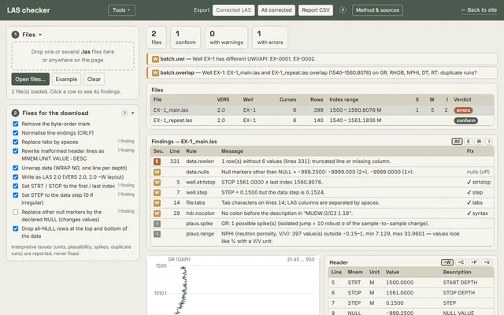
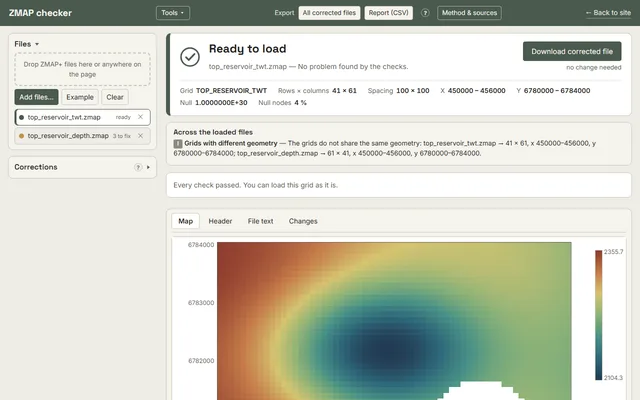
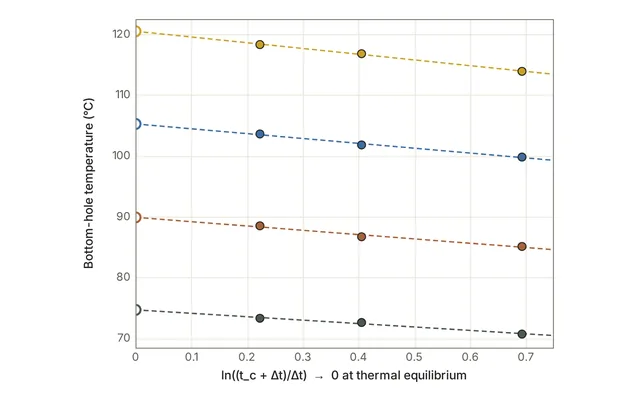
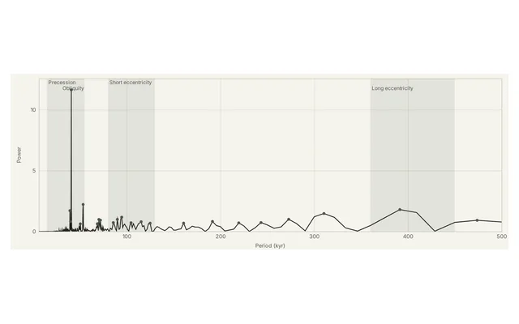

<svg class="hero-contours" viewBox="0 0 1000 420" preserveAspectRatio="xMaxYMin slice" aria-hidden="true">
<g class="contacts">
<path class="oil" d="M1001,120 L996,137 L982,152 L965,165 L946,176 L928,187 L911,197 L894,207 L874,215 L851,221 L827,224 L803,225 L780,225 L756,225 L731,227 L704,228 L675,227 L646,223 L622,213 L606,199 L599,182 L600,164 L606,147 L611,133 L613,120 L611,107 L608,93 L607,78 L610,62 L621,48 L637,36 L658,26 L680,18 L703,10 L727,4 L753,-1 L780,-3 L807,-1 L832,6 L852,17 L868,30 L882,42 L896,52 L913,60 L934,68 L958,77 L980,88 L995,103Z"/>
<path class="gas" d="M886,120 L890,129 L889,137 L883,145 L873,151 L861,156 L848,160 L837,164 L827,167 L816,171 L804,174 L792,175 L780,175 L768,174 L756,172 L744,171 L732,169 L718,167 L704,165 L691,160 L682,153 L677,145 L677,136 L682,128 L689,120 L695,113 L699,107 L701,101 L702,93 L704,86 L709,78 L717,72 L728,67 L740,64 L753,62 L767,60 L780,59 L794,59 L807,60 L820,63 L831,69 L838,75 L844,82 L848,89 L853,95 L859,101 L868,106 L878,112Z"/>
<path class="owc" pathLength="1" d="M1001,120 L996,137 L982,152 L965,165 L946,176 L928,187 L911,197 L894,207 L874,215 L851,221 L827,224 L803,225 L780,225 L756,225 L731,227 L704,228 L675,227 L646,223 L622,213 L606,199 L599,182 L600,164 L606,147 L611,133 L613,120 L611,107 L608,93 L607,78 L610,62 L621,48 L637,36 L658,26 L680,18 L703,10 L727,4 L753,-1 L780,-3 L807,-1 L832,6 L852,17 L868,30 L882,42 L896,52 L913,60 L934,68 L958,77 L980,88 L995,103Z"/>
<path class="goc" pathLength="1" d="M886,120 L890,129 L889,137 L883,145 L873,151 L861,156 L848,160 L837,164 L827,167 L816,171 L804,174 L792,175 L780,175 L768,174 L756,172 L744,171 L732,169 L718,167 L704,165 L691,160 L682,153 L677,145 L677,136 L682,128 L689,120 L695,113 L699,107 L701,101 L702,93 L704,86 L709,78 L717,72 L728,67 L740,64 L753,62 L767,60 L780,59 L794,59 L807,60 L820,63 L831,69 L838,75 L844,82 L848,89 L853,95 L859,101 L868,106 L878,112Z"/>
<text class="lbl-goc" x="806" y="192">GOC</text>
<text class="lbl-owc" x="690" y="246">OWC</text>
</g>
<g class="iso">
<path pathLength="1" style="--i:0" d="M831,120 L834,124 L836,129 L834,133 L830,137 L824,140 L817,142 L810,143 L804,145 L798,146 L792,147 L786,148 L780,149 L774,148 L768,147 L762,146 L756,145 L750,143 L743,142 L736,140 L730,137 L726,133 L724,129 L726,124 L729,120 L733,116 L737,113 L740,110 L742,107 L743,103 L745,99 L748,96 L753,93 L759,91 L766,89 L773,89 L780,89 L787,89 L794,89 L801,91 L807,93 L812,96 L815,99 L817,103 L818,107 L820,110 L823,113 L827,116Z"/>
<path pathLength="1" style="--i:1" d="M886,120 L890,129 L889,137 L883,145 L873,151 L861,156 L848,160 L837,164 L827,167 L816,171 L804,174 L792,175 L780,175 L768,174 L756,172 L744,171 L732,169 L718,167 L704,165 L691,160 L682,153 L677,145 L677,136 L682,128 L689,120 L695,113 L699,107 L701,101 L702,93 L704,86 L709,78 L717,72 L728,67 L740,64 L753,62 L767,60 L780,59 L794,59 L807,60 L820,63 L831,69 L838,75 L844,82 L848,89 L853,95 L859,101 L868,106 L878,112Z"/>
<path pathLength="1" style="--i:2" d="M944,120 L946,133 L939,145 L926,156 L910,164 L894,172 L879,178 L865,185 L850,191 L834,196 L816,200 L798,201 L780,200 L762,199 L745,198 L726,197 L705,196 L683,194 L663,189 L646,180 L637,169 L634,155 L638,142 L645,130 L652,120 L656,110 L656,101 L656,90 L657,78 L662,67 L672,57 L687,48 L704,42 L722,38 L741,34 L760,30 L780,28 L800,28 L820,32 L838,38 L851,47 L861,58 L870,67 L878,76 L890,83 L905,90 L921,98 L935,108Z"/>
<path pathLength="1" style="--i:3" d="M1001,120 L996,137 L982,152 L965,165 L946,176 L928,187 L911,197 L894,207 L874,215 L851,221 L827,224 L803,225 L780,225 L756,225 L731,227 L704,228 L675,227 L646,223 L622,213 L606,199 L599,182 L600,164 L606,147 L611,133 L613,120 L611,107 L608,93 L607,78 L610,62 L621,48 L637,36 L658,26 L680,18 L703,10 L727,4 L753,-1 L780,-3 L807,-1 L832,6 L852,17 L868,30 L882,42 L896,52 L913,60 L934,68 L958,77 L980,88 L995,103Z"/>
<path pathLength="1" style="--i:4" d="M1050,120 L1038,140 L1021,158 L1002,174 L983,189 L965,203 L945,217 L922,229 L896,238 L867,244 L838,247 L809,249 L780,252 L750,256 L716,260 L680,263 L643,260 L610,250 L586,234 L573,213 L570,191 L572,171 L574,152 L573,136 L567,120 L560,103 L554,84 L556,65 L565,47 L582,31 L604,16 L628,4 L655,-8 L682,-19 L713,-28 L746,-33 L780,-32 L813,-26 L841,-14 L864,0 L884,14 L904,25 L928,33 L956,41 L988,49 L1018,62 L1041,79 L1052,99Z"/>
<path pathLength="1" style="--i:5" d="M1091,120 L1076,143 L1058,164 L1041,184 L1023,203 L1003,221 L979,237 L949,250 L916,258 L882,264 L848,269 L815,275 L780,283 L741,292 L699,299 L654,299 L613,290 L580,273 L559,250 L549,224 L546,200 L543,178 L537,158 L526,140 L513,120 L503,99 L500,76 L507,53 L523,33 L545,14 L570,-4 L597,-20 L627,-36 L660,-50 L698,-59 L739,-62 L780,-57 L817,-45 L848,-30 L875,-15 L902,-4 L932,4 L968,10 L1008,17 L1046,30 L1077,48 L1096,70 L1100,95Z"/>
<path pathLength="1" style="--i:6" d="M1128,120 L1114,146 L1100,170 L1085,194 L1066,217 L1041,238 L1009,255 L972,267 L934,277 L896,285 L860,295 L822,308 L780,322 L732,334 L681,338 L631,332 L588,315 L558,290 L540,261 L529,233 L521,208 L508,186 L491,166 L471,144 L455,120 L447,94 L449,68 L463,43 L483,19 L507,-3 L533,-25 L562,-47 L597,-66 L639,-81 L686,-87 L734,-84 L780,-74 L820,-59 L855,-45 L888,-34 L925,-28 L968,-24 L1016,-19 L1063,-8 L1104,10 L1130,35 L1141,63 L1139,92Z"/>
<path pathLength="1" style="--i:7" d="M1166,120 L1157,149 L1146,178 L1130,205 L1106,231 L1073,252 L1034,269 L992,283 L952,296 L914,310 L875,329 L831,348 L780,366 L723,376 L665,373 L613,358 L572,332 L544,301 L524,270 L508,243 L488,219 L463,197 L436,174 L412,148 L398,120 L395,90 L404,61 L420,32 L440,5 L463,-23 L490,-50 L525,-76 L568,-96 L620,-107 L676,-108 L731,-100 L780,-86 L823,-73 L864,-64 L907,-60 L956,-59 L1011,-57 L1068,-49 L1117,-32 L1153,-7 L1173,24 L1178,57 L1174,89Z"/>
<path pathLength="1" style="--i:8" d="M1210,120 L1205,153 L1194,185 L1172,216 L1140,242 L1099,264 L1056,282 L1014,300 L976,320 L937,343 L894,370 L841,394 L780,410 L715,412 L653,399 L601,374 L561,343 L532,310 L506,281 L478,256 L445,234 L410,210 L378,183 L356,153 L346,120 L349,87 L360,54 L374,21 L392,-12 L414,-45 L445,-77 L489,-103 L544,-120 L607,-126 L670,-121 L729,-110 L780,-98 L827,-92 L876,-91 L931,-95 L993,-97 L1058,-93 L1117,-78 L1163,-53 L1193,-20 L1207,16 L1212,52 L1212,87Z"/>
<path pathLength="1" style="--i:9" d="M220,300 L219,304 L217,307 L214,310 L210,312 L207,315 L204,317 L200,319 L197,321 L193,322 L189,323 L184,323 L180,323 L176,323 L171,323 L166,323 L161,323 L156,322 L151,320 L148,317 L147,314 L147,310 L148,306 L149,303 L150,300 L150,297 L149,294 L149,291 L150,287 L151,284 L154,282 L158,279 L162,278 L166,276 L170,275 L175,274 L180,273 L185,273 L189,275 L193,277 L196,280 L199,283 L201,285 L204,287 L208,289 L212,291 L216,293 L219,296Z"/>
<path pathLength="1" style="--i:10" d="M266,300 L262,308 L257,315 L251,321 L245,327 L239,332 L233,338 L225,342 L217,346 L208,348 L198,349 L189,350 L180,351 L170,353 L160,354 L148,355 L136,354 L126,350 L118,344 L114,336 L113,328 L114,320 L114,313 L114,306 L112,300 L110,293 L108,286 L108,279 L111,272 L117,265 L124,260 L132,255 L140,250 L149,246 L159,243 L169,241 L180,241 L190,244 L199,248 L207,254 L213,259 L220,263 L227,266 L236,269 L246,273 L256,278 L263,284 L267,292Z"/>
<path pathLength="1" style="--i:11" d="M307,300 L301,311 L294,322 L287,332 L280,341 L272,350 L262,358 L249,365 L236,369 L222,372 L208,375 L194,378 L180,382 L164,387 L146,390 L128,390 L111,385 L98,376 L90,364 L86,352 L84,339 L83,329 L80,319 L75,310 L69,300 L65,289 L64,278 L67,267 L74,256 L83,247 L93,238 L105,230 L117,222 L131,215 L146,210 L163,209 L180,212 L195,218 L208,226 L219,233 L230,238 L243,241 L258,244 L275,248 L291,254 L303,264 L310,275 L311,288Z"/>
<path pathLength="1" style="--i:12" d="M345,300 L339,315 L333,329 L326,343 L317,356 L304,368 L289,378 L271,385 L253,390 L236,396 L219,403 L200,411 L180,420 L157,426 L132,428 L109,423 L89,412 L76,397 L67,380 L62,365 L57,351 L50,339 L40,327 L30,314 L23,300 L20,285 L22,270 L28,255 L38,241 L49,228 L61,215 L75,202 L92,191 L112,183 L135,181 L158,183 L180,190 L199,198 L215,205 L232,210 L250,213 L272,215 L295,218 L318,225 L336,236 L347,251 L351,267 L350,284Z"/>
<path pathLength="1" style="--i:13" d="M383,300 L379,319 L374,337 L365,355 L351,371 L333,384 L312,394 L291,403 L271,413 L252,424 L232,437 L208,451 L180,462 L149,466 L119,462 L93,450 L73,432 L59,413 L48,394 L38,378 L25,364 L10,350 L-5,335 L-17,319 L-23,300 L-23,281 L-18,262 L-10,244 L-0,226 L11,207 L25,189 L44,173 L68,162 L97,156 L126,157 L155,163 L180,172 L202,178 L224,182 L248,182 L276,181 L306,183 L335,189 L360,202 L376,219 L385,239 L387,260 L386,281Z"/>
</g>
<g class="wells">
<g transform="translate(780,118)"><g class="well" style="--d:3.4s"><circle r="5" class="full"/><line x1="7.0" y1="0.0" x2="11.0" y2="0.0"/><line x1="4.9" y1="4.9" x2="7.8" y2="7.8"/><line x1="0.0" y1="7.0" x2="0.0" y2="11.0"/><line x1="-4.9" y1="4.9" x2="-7.8" y2="7.8"/><line x1="-7.0" y1="0.0" x2="-11.0" y2="0.0"/><line x1="-4.9" y1="-4.9" x2="-7.8" y2="-7.8"/><line x1="-0.0" y1="-7.0" x2="-0.0" y2="-11.0"/><line x1="4.9" y1="-4.9" x2="7.8" y2="-7.8"/><text x="10" y="-9">W-1</text></g></g>
<g transform="translate(910,100)"><g class="well" style="--d:4.4s"><circle r="5" class="full"/><text x="10" y="-9">A-1</text></g></g>
<g transform="translate(862,236)"><g class="well" style="--d:5.0s"><circle r="5"/><line x1="-8" y1="-8" x2="8" y2="8"/><line x1="-8" y1="8" x2="8" y2="-8"/><text x="10" y="-9">A-2</text></g></g>
</g>
</svg>

Petroleum systems · Basin modeling · Applied AI

# Romain Giboreau

Lead Geoscientist at Beicip-Franlab. 15 years of petroleum systems assessment and basin modeling across 20+ basins on five continents, with a growing focus on applied AI/ML for geoscience workflows.

[CV](cv.md){ .md-button .md-button--primary } [Talks & publications](talks.md){ .md-button } [Notes](notes/index.md){ .md-button } [LinkedIn](https://www.linkedin.com/in/romain-giboreau){ .md-button }

!!! info "Last talks — November 2026"
    **APGCE 2026, Kuala Lumpur — 17 November.**
    *Closing the Exploration Gap: Probabilistic Petroleum Systems Analysis from Basin to Prospect* — Oral Session 9 (Basin Modelling and Reservoir Characterisation). Thanks to everyone who came by.

    **First EAGE Conference on Basin and Petroleum Systems Modeling, Houston — 18 November.**
    *From Basin Modeling to Storage Fairway Mapping: AI-Assisted Smart Maps for Offshore Norway CCUS Screening* — Session VII (Basin modeling applications to the energy transition, Part I). Presented by a colleague.

    [All talks & publications](talks.md)

## Expertise

01 / 08<button type="button" class="xp-prev" aria-label="Previous">&#8249;</button><button type="button" class="xp-next" aria-label="Next">&#8250;</button>

<ol class="xp-track" tabindex="0">
<li class="xp-card" aria-roledescription="slide" aria-label="01 of 08">
<svg viewBox="0 0 320 200" role="img" aria-label="Cross-section of a petroleum system: gas from the deeper kitchen and oil from the shallower one migrate along the carrier bed into a two-phase trap, gas cap over oil leg" font-family="Inter,sans-serif"><defs><marker id="m1g" viewBox="0 0 8 8" refX="6" refY="4" markerWidth="5" markerHeight="5" orient="auto"><path d="M0,0 L8,4 L0,8z" fill="#c8402f"/></marker></defs><defs><marker id="m1o" viewBox="0 0 8 8" refX="6" refY="4" markerWidth="5" markerHeight="5" orient="auto"><path d="M0,0 L8,4 L0,8z" fill="#3f7a3a"/></marker></defs><clipPath id="xc1"><rect x="30" y="14" width="290" height="172"/></clipPath><g clip-path="url(#xc1)"><path d="M30,14 34,14 38,14 42,14 46,14 50,14 54,14 58,14 62,14 66,14 70,14 74,14 78,14 82,14 86,14 90,14 94,14 98,14 102,14 106,14 110,14 114,14 118,14 122,14 126,14 130,14 134,14 138,14 142,14 146,14 150,14 154,14 158,14 162,14 166,14 170,14 174,14 178,14 182,14 186,14 190,14 194,14 198,14 202,14 206,14 210,14 214,14 218,14 222,14 226,14 230,14 234,14 238,14 242,14 246,14 250,14 254,14 258,14 262,14 266,14 270,14 274,14 278,14 282,14 286,14 290,14 294,14 298,14 302,14 306,14 310,14 314,14 318,14 318,45.7 314,45.9 310,46.1 306,46.1 302,46.1 298,45.9 294,45.6 290,45.1 286,44.5 282,43.7 278,42.7 274,41.6 270,40.3 266,38.9 262,37.4 258,35.8 254,34.2 250,32.7 246,31.3 242,30 238,29 234,28.2 230,27.8 226,27.7 222,28 218,28.7 214,29.7 210,31.1 206,32.8 202,34.8 198,37.1 194,39.4 190,41.9 186,44.5 182,47 178,49.5 174,51.8 170,54.1 166,56.2 162,58.1 158,59.9 154,61.4 150,62.9 146,64.1 142,65.3 138,66.3 134,67.2 130,68 126,68.8 122,69.5 118,70.1 114,70.7 110,71.2 106,71.8 102,72.3 98,72.8 94,73.3 90,73.8 86,74.3 82,74.8 78,75.3 74,75.8 70,76.2 66,76.7 62,77.2 58,77.7 54,78.2 50,78.6 46,79.1 42,79.6 38,80.1 34,80.6 30,81Z" fill="#a9a291"/><path d="M30,81 34,80.6 38,80.1 42,79.6 46,79.1 50,78.6 54,78.2 58,77.7 62,77.2 66,76.7 70,76.2 74,75.8 78,75.3 82,74.8 86,74.3 90,73.8 94,73.3 98,72.8 102,72.3 106,71.8 110,71.2 114,70.7 118,70.1 122,69.5 126,68.8 130,68 134,67.2 138,66.3 142,65.3 146,64.1 150,62.9 154,61.4 158,59.9 162,58.1 166,56.2 170,54.1 174,51.8 178,49.5 182,47 186,44.5 190,41.9 194,39.4 198,37.1 202,34.8 206,32.8 210,31.1 214,29.7 218,28.7 222,28 226,27.7 230,27.8 234,28.2 238,29 242,30 246,31.3 250,32.7 254,34.2 258,35.8 262,37.4 266,38.9 270,40.3 274,41.6 278,42.7 282,43.7 286,44.5 290,45.1 294,45.6 298,45.9 302,46.1 306,46.1 310,46.1 314,45.9 318,45.7 318,67.7 314,67.9 310,68.1 306,68.1 302,68.1 298,67.9 294,67.6 290,67.1 286,66.5 282,65.7 278,64.7 274,63.6 270,62.3 266,60.9 262,59.4 258,57.8 254,56.2 250,54.7 246,53.3 242,52 238,51 234,50.2 230,49.8 226,49.7 222,50 218,50.7 214,51.7 210,53.1 206,54.8 202,56.8 198,59.1 194,61.4 190,63.9 186,66.5 182,69 178,71.5 174,73.8 170,76.1 166,78.2 162,80.1 158,81.9 154,83.4 150,84.9 146,86.1 142,87.3 138,88.3 134,89.2 130,90 126,90.8 122,91.5 118,92.1 114,92.7 110,93.2 106,93.8 102,94.3 98,94.8 94,95.3 90,95.8 86,96.3 82,96.8 78,97.3 74,97.8 70,98.2 66,98.7 62,99.2 58,99.7 54,100.2 50,100.6 46,101.1 42,101.6 38,102.1 34,102.6 30,103Z" fill="#cfd3c8"/><path d="M30,103 34,102.6 38,102.1 42,101.6 46,101.1 50,100.6 54,100.2 58,99.7 62,99.2 66,98.7 70,98.2 74,97.8 78,97.3 82,96.8 86,96.3 90,95.8 94,95.3 98,94.8 102,94.3 106,93.8 110,93.2 114,92.7 118,92.1 122,91.5 126,90.8 130,90 134,89.2 138,88.3 142,87.3 146,86.1 150,84.9 154,83.4 158,81.9 162,80.1 166,78.2 170,76.1 174,73.8 178,71.5 182,69 186,66.5 190,63.9 194,61.4 198,59.1 202,56.8 206,54.8 210,53.1 214,51.7 218,50.7 222,50 226,49.7 230,49.8 234,50.2 238,51 242,52 246,53.3 250,54.7 254,56.2 258,57.8 262,59.4 266,60.9 270,62.3 274,63.6 278,64.7 282,65.7 286,66.5 290,67.1 294,67.6 298,67.9 302,68.1 306,68.1 310,68.1 314,67.9 318,67.7 318,83.7 314,83.9 310,84.1 306,84.1 302,84.1 298,83.9 294,83.6 290,83.1 286,82.5 282,81.7 278,80.7 274,79.6 270,78.3 266,76.9 262,75.4 258,73.8 254,72.2 250,70.7 246,69.3 242,68 238,67 234,66.2 230,65.8 226,65.7 222,66 218,66.7 214,67.7 210,69.1 206,70.8 202,72.8 198,75.1 194,77.4 190,79.9 186,82.5 182,85 178,87.5 174,89.8 170,92.1 166,94.2 162,96.1 158,97.9 154,99.4 150,100.9 146,102.1 142,103.3 138,104.3 134,105.2 130,106 126,106.8 122,107.5 118,108.1 114,108.7 110,109.2 106,109.8 102,110.3 98,110.8 94,111.3 90,111.8 86,112.3 82,112.8 78,113.3 74,113.8 70,114.2 66,114.7 62,115.2 58,115.7 54,116.2 50,116.6 46,117.1 42,117.6 38,118.1 34,118.6 30,119Z" fill="#e6d6b0"/><path d="M30,119 34,118.6 38,118.1 42,117.6 46,117.1 50,116.6 54,116.2 58,115.7 62,115.2 66,114.7 70,114.2 74,113.8 78,113.3 82,112.8 86,112.3 90,111.8 94,111.3 98,110.8 102,110.3 106,109.8 110,109.2 114,108.7 118,108.1 122,107.5 126,106.8 130,106 134,105.2 138,104.3 142,103.3 146,102.1 150,100.9 154,99.4 158,97.9 162,96.1 166,94.2 170,92.1 174,89.8 178,87.5 182,85 186,82.5 190,79.9 194,77.4 198,75.1 202,72.8 206,70.8 210,69.1 214,67.7 218,66.7 222,66 226,65.7 230,65.8 234,66.2 238,67 242,68 246,69.3 250,70.7 254,72.2 258,73.8 262,75.4 266,76.9 270,78.3 274,79.6 278,80.7 282,81.7 286,82.5 290,83.1 294,83.6 298,83.9 302,84.1 306,84.1 310,84.1 314,83.9 318,83.7 318,111.7 314,111.9 310,112.1 306,112.1 302,112.1 298,111.9 294,111.6 290,111.1 286,110.5 282,109.7 278,108.7 274,107.6 270,106.3 266,104.9 262,103.4 258,101.8 254,100.2 250,98.7 246,97.3 242,96 238,95 234,94.2 230,93.8 226,93.7 222,94 218,94.7 214,95.7 210,97.1 206,98.8 202,100.8 198,103.1 194,105.4 190,107.9 186,110.5 182,113 178,115.5 174,117.8 170,120.1 166,122.2 162,124.1 158,125.9 154,127.4 150,128.9 146,130.1 142,131.3 138,132.3 134,133.2 130,134 126,134.8 122,135.5 118,136.1 114,136.7 110,137.2 106,137.8 102,138.3 98,138.8 94,139.3 90,139.8 86,140.3 82,140.8 78,141.3 74,141.8 70,142.2 66,142.7 62,143.2 58,143.7 54,144.2 50,144.6 46,145.1 42,145.6 38,146.1 34,146.6 30,147Z" fill="#d9d5c8"/><path d="M30,147 34,146.6 38,146.1 42,145.6 46,145.1 50,144.6 54,144.2 58,143.7 62,143.2 66,142.7 70,142.2 74,141.8 78,141.3 82,140.8 86,140.3 90,139.8 94,139.3 98,138.8 102,138.3 106,137.8 110,137.2 114,136.7 118,136.1 122,135.5 126,134.8 130,134 134,133.2 138,132.3 142,131.3 146,130.1 150,128.9 154,127.4 158,125.9 162,124.1 166,122.2 170,120.1 174,117.8 178,115.5 182,113 186,110.5 190,107.9 194,105.4 198,103.1 202,100.8 206,98.8 210,97.1 214,95.7 218,94.7 222,94 226,93.7 230,93.8 234,94.2 238,95 242,96 246,97.3 250,98.7 254,100.2 258,101.8 262,103.4 266,104.9 270,106.3 274,107.6 278,108.7 282,109.7 286,110.5 290,111.1 294,111.6 298,111.9 302,112.1 306,112.1 310,112.1 314,111.9 318,111.7 318,127.7 314,127.9 310,128.1 306,128.1 302,128.1 298,127.9 294,127.6 290,127.1 286,126.5 282,125.7 278,124.7 274,123.6 270,122.3 266,120.9 262,119.4 258,117.8 254,116.2 250,114.7 246,113.3 242,112 238,111 234,110.2 230,109.8 226,109.7 222,110 218,110.7 214,111.7 210,113.1 206,114.8 202,116.8 198,119.1 194,121.4 190,123.9 186,126.5 182,129 178,131.5 174,133.8 170,136.1 166,138.2 162,140.1 158,141.9 154,143.4 150,144.9 146,146.1 142,147.3 138,148.3 134,149.2 130,150 126,150.8 122,151.5 118,152.1 114,152.7 110,153.2 106,153.8 102,154.3 98,154.8 94,155.3 90,155.8 86,156.3 82,156.8 78,157.3 74,157.8 70,158.2 66,158.7 62,159.2 58,159.7 54,160.2 50,160.6 46,161.1 42,161.6 38,162.1 34,162.6 30,163Z" fill="#4f4d47"/><path d="M30,163 34,162.6 38,162.1 42,161.6 46,161.1 50,160.6 54,160.2 58,159.7 62,159.2 66,158.7 70,158.2 74,157.8 78,157.3 82,156.8 86,156.3 90,155.8 94,155.3 98,154.8 102,154.3 106,153.8 110,153.2 114,152.7 118,152.1 122,151.5 126,150.8 130,150 134,149.2 138,148.3 142,147.3 146,146.1 150,144.9 154,143.4 158,141.9 162,140.1 166,138.2 170,136.1 174,133.8 178,131.5 182,129 186,126.5 190,123.9 194,121.4 198,119.1 202,116.8 206,114.8 210,113.1 214,111.7 218,110.7 222,110 226,109.7 230,109.8 234,110.2 238,111 242,112 246,113.3 250,114.7 254,116.2 258,117.8 262,119.4 266,120.9 270,122.3 274,123.6 278,124.7 282,125.7 286,126.5 290,127.1 294,127.6 298,127.9 302,128.1 306,128.1 310,128.1 314,127.9 318,127.7 318,186 314,186 310,186 306,186 302,186 298,186 294,186 290,186 286,186 282,186 278,186 274,186 270,186 266,186 262,186 258,186 254,186 250,186 246,186 242,186 238,186 234,186 230,186 226,186 222,186 218,186 214,186 210,186 206,186 202,186 198,186 194,186 190,186 186,186 182,186 178,186 174,186 170,186 166,186 162,186 158,186 154,186 150,186 146,186 142,186 138,186 134,186 130,186 126,186 122,186 118,186 114,186 110,186 106,186 102,186 98,186 94,186 90,186 86,186 82,186 78,186 74,186 70,186 66,186 62,186 58,186 54,186 50,186 46,186 42,186 38,186 34,186 30,186Z" fill="#c9c4b6"/><path d="M30,81 34,80.6 38,80.1 42,79.6 46,79.1 50,78.6 54,78.2 58,77.7 62,77.2 66,76.7 70,76.2 74,75.8 78,75.3 82,74.8 86,74.3 90,73.8 94,73.3 98,72.8 102,72.3 106,71.8 110,71.2 114,70.7 118,70.1 122,69.5 126,68.8 130,68 134,67.2 138,66.3 142,65.3 146,64.1 150,62.9 154,61.4 158,59.9 162,58.1 166,56.2 170,54.1 174,51.8 178,49.5 182,47 186,44.5 190,41.9 194,39.4 198,37.1 202,34.8 206,32.8 210,31.1 214,29.7 218,28.7 222,28 226,27.7 230,27.8 234,28.2 238,29 242,30 246,31.3 250,32.7 254,34.2 258,35.8 262,37.4 266,38.9 270,40.3 274,41.6 278,42.7 282,43.7 286,44.5 290,45.1 294,45.6 298,45.9 302,46.1 306,46.1 310,46.1 314,45.9 318,45.7" fill="none" stroke="#5c5a52" stroke-width=".6"/><path d="M30,103 34,102.6 38,102.1 42,101.6 46,101.1 50,100.6 54,100.2 58,99.7 62,99.2 66,98.7 70,98.2 74,97.8 78,97.3 82,96.8 86,96.3 90,95.8 94,95.3 98,94.8 102,94.3 106,93.8 110,93.2 114,92.7 118,92.1 122,91.5 126,90.8 130,90 134,89.2 138,88.3 142,87.3 146,86.1 150,84.9 154,83.4 158,81.9 162,80.1 166,78.2 170,76.1 174,73.8 178,71.5 182,69 186,66.5 190,63.9 194,61.4 198,59.1 202,56.8 206,54.8 210,53.1 214,51.7 218,50.7 222,50 226,49.7 230,49.8 234,50.2 238,51 242,52 246,53.3 250,54.7 254,56.2 258,57.8 262,59.4 266,60.9 270,62.3 274,63.6 278,64.7 282,65.7 286,66.5 290,67.1 294,67.6 298,67.9 302,68.1 306,68.1 310,68.1 314,67.9 318,67.7" fill="none" stroke="#5c5a52" stroke-width=".6"/><path d="M30,119 34,118.6 38,118.1 42,117.6 46,117.1 50,116.6 54,116.2 58,115.7 62,115.2 66,114.7 70,114.2 74,113.8 78,113.3 82,112.8 86,112.3 90,111.8 94,111.3 98,110.8 102,110.3 106,109.8 110,109.2 114,108.7 118,108.1 122,107.5 126,106.8 130,106 134,105.2 138,104.3 142,103.3 146,102.1 150,100.9 154,99.4 158,97.9 162,96.1 166,94.2 170,92.1 174,89.8 178,87.5 182,85 186,82.5 190,79.9 194,77.4 198,75.1 202,72.8 206,70.8 210,69.1 214,67.7 218,66.7 222,66 226,65.7 230,65.8 234,66.2 238,67 242,68 246,69.3 250,70.7 254,72.2 258,73.8 262,75.4 266,76.9 270,78.3 274,79.6 278,80.7 282,81.7 286,82.5 290,83.1 294,83.6 298,83.9 302,84.1 306,84.1 310,84.1 314,83.9 318,83.7" fill="none" stroke="#5c5a52" stroke-width=".6"/><path d="M30,147 34,146.6 38,146.1 42,145.6 46,145.1 50,144.6 54,144.2 58,143.7 62,143.2 66,142.7 70,142.2 74,141.8 78,141.3 82,140.8 86,140.3 90,139.8 94,139.3 98,138.8 102,138.3 106,137.8 110,137.2 114,136.7 118,136.1 122,135.5 126,134.8 130,134 134,133.2 138,132.3 142,131.3 146,130.1 150,128.9 154,127.4 158,125.9 162,124.1 166,122.2 170,120.1 174,117.8 178,115.5 182,113 186,110.5 190,107.9 194,105.4 198,103.1 202,100.8 206,98.8 210,97.1 214,95.7 218,94.7 222,94 226,93.7 230,93.8 234,94.2 238,95 242,96 246,97.3 250,98.7 254,100.2 258,101.8 262,103.4 266,104.9 270,106.3 274,107.6 278,108.7 282,109.7 286,110.5 290,111.1 294,111.6 298,111.9 302,112.1 306,112.1 310,112.1 314,111.9 318,111.7" fill="none" stroke="#5c5a52" stroke-width=".6"/><path d="M30,163 34,162.6 38,162.1 42,161.6 46,161.1 50,160.6 54,160.2 58,159.7 62,159.2 66,158.7 70,158.2 74,157.8 78,157.3 82,156.8 86,156.3 90,155.8 94,155.3 98,154.8 102,154.3 106,153.8 110,153.2 114,152.7 118,152.1 122,151.5 126,150.8 130,150 134,149.2 138,148.3 142,147.3 146,146.1 150,144.9 154,143.4 158,141.9 162,140.1 166,138.2 170,136.1 174,133.8 178,131.5 182,129 186,126.5 190,123.9 194,121.4 198,119.1 202,116.8 206,114.8 210,113.1 214,111.7 218,110.7 222,110 226,109.7 230,109.8 234,110.2 238,111 242,112 246,113.3 250,114.7 254,116.2 258,117.8 262,119.4 266,120.9 270,122.3 274,123.6 278,124.7 282,125.7 286,126.5 290,127.1 294,127.6 298,127.9 302,128.1 306,128.1 310,128.1 314,127.9 318,127.7" fill="none" stroke="#5c5a52" stroke-width=".6"/><clipPath id="xc1b"><path d="M30,103 34,102.6 38,102.1 42,101.6 46,101.1 50,100.6 54,100.2 58,99.7 62,99.2 66,98.7 70,98.2 74,97.8 78,97.3 82,96.8 86,96.3 90,95.8 94,95.3 98,94.8 102,94.3 106,93.8 110,93.2 114,92.7 118,92.1 122,91.5 126,90.8 130,90 134,89.2 138,88.3 142,87.3 146,86.1 150,84.9 154,83.4 158,81.9 162,80.1 166,78.2 170,76.1 174,73.8 178,71.5 182,69 186,66.5 190,63.9 194,61.4 198,59.1 202,56.8 206,54.8 210,53.1 214,51.7 218,50.7 222,50 226,49.7 230,49.8 234,50.2 238,51 242,52 246,53.3 250,54.7 254,56.2 258,57.8 262,59.4 266,60.9 270,62.3 274,63.6 278,64.7 282,65.7 286,66.5 290,67.1 294,67.6 298,67.9 302,68.1 306,68.1 310,68.1 314,67.9 318,67.7 318,83.7 314,83.9 310,84.1 306,84.1 302,84.1 298,83.9 294,83.6 290,83.1 286,82.5 282,81.7 278,80.7 274,79.6 270,78.3 266,76.9 262,75.4 258,73.8 254,72.2 250,70.7 246,69.3 242,68 238,67 234,66.2 230,65.8 226,65.7 222,66 218,66.7 214,67.7 210,69.1 206,70.8 202,72.8 198,75.1 194,77.4 190,79.9 186,82.5 182,85 178,87.5 174,89.8 170,92.1 166,94.2 162,96.1 158,97.9 154,99.4 150,100.9 146,102.1 142,103.3 138,104.3 134,105.2 130,106 126,106.8 122,107.5 118,108.1 114,108.7 110,109.2 106,109.8 102,110.3 98,110.8 94,111.3 90,111.8 86,112.3 82,112.8 78,113.3 74,113.8 70,114.2 66,114.7 62,115.2 58,115.7 54,116.2 50,116.6 46,117.1 42,117.6 38,118.1 34,118.6 30,119Z"/></clipPath><g clip-path="url(#xc1b)"><rect x="30" y="55.7" width="290" height="6.0" fill="#3f7a3a" class="a-down" style="--d:1.5s"/><rect x="30" y="47.7" width="290" height="8.0" fill="#c8402f" class="a-down" style="--d:2.3s"/></g><path d="M92,138.6 L92,106.6" stroke="#c8402f" stroke-width="1.8" fill="none" class="a-flow" style="--d:0.3s"/><path d="M140,130.8 L140,98.8" stroke="#3f7a3a" stroke-width="1.8" fill="none" class="a-flow" style="--d:0.3s"/><path d="M92,101 96,100.5 100,100 104,99.4 108,98.9 112,98.4 116,97.8 120,97.2 124,96.5 128,95.8 132,95 136,94.2 140,93.2 144,92.1 148,90.9 152,89.6 156,88.1 160,86.4 164,84.5 168,82.5 172,80.4 176,78.1 180,75.6 184,73.1 188,70.6 192,68.1 196,65.6 200,63.3 204,61.2 208,59.3 212,57.8" stroke="#c8402f" stroke-width="1.8" fill="none" marker-end="url(#m1g)" class="a-flow" style="--d:0.6s"/><path d="M140,98.4 144,97.3 148,96.1 152,94.8 156,93.3 160,91.6 164,89.7 168,87.7 172,85.6 176,83.3 180,80.8 184,78.3 188,75.8 192,73.3 196,70.8 200,68.5 204,66.4 208,64.5 212,63" stroke="#3f7a3a" stroke-width="1.8" fill="none" marker-end="url(#m1o)" class="a-flow" style="--d:0.6s"/></g><line x1="30" y1="14" x2="30" y2="186" stroke="#232220" stroke-width=".9"/><line x1="27" y1="14" x2="30" y2="14" stroke="#232220" stroke-width=".9"/><text x="25.0" y="17.3" font-size="9.5" fill="#5c5a52" text-anchor="end" font-weight="400">0</text><line x1="27" y1="54" x2="30" y2="54" stroke="#232220" stroke-width=".9"/><text x="25.0" y="57.3" font-size="9.5" fill="#5c5a52" text-anchor="end" font-weight="400">1</text><line x1="27" y1="94" x2="30" y2="94" stroke="#232220" stroke-width=".9"/><text x="25.0" y="97.3" font-size="9.5" fill="#5c5a52" text-anchor="end" font-weight="400">2</text><line x1="27" y1="134" x2="30" y2="134" stroke="#232220" stroke-width=".9"/><text x="25.0" y="137.3" font-size="9.5" fill="#5c5a52" text-anchor="end" font-weight="400">3</text><line x1="27" y1="174" x2="30" y2="174" stroke="#232220" stroke-width=".9"/><text x="25.0" y="177.3" font-size="9.5" fill="#5c5a52" text-anchor="end" font-weight="400">4</text><text x="9" y="100" font-size="9.5" fill="#8a8778" text-anchor="middle" transform="rotate(-90 9 100)">depth (km)</text><rect x="242" y="170" width="70" height="13" rx="2" fill="#f5f3ed" opacity=".9"/><line x1="248" y1="178" x2="288" y2="178" stroke="#232220" stroke-width="2"/><text x="292.0" y="181.5" font-size="9" fill="#232220" text-anchor="start" font-weight="400">10 km</text><text x="36.0" y="52.0" font-size="10" fill="#232220" text-anchor="start" font-weight="400">overburden</text><text x="36.0" y="94.3" font-size="10" fill="#232220" text-anchor="start" font-weight="400">seal</text><text x="36.0" y="114.8" font-size="10" fill="#232220" text-anchor="start" font-weight="400">reservoir</text><text x="36.0" y="134.3" font-size="10" fill="#232220" text-anchor="start" font-weight="400">shale</text><text x="36.0" y="158.3" font-size="10" fill="#f5f3ed" text-anchor="start" font-weight="400">source rock</text><text x="222.0" y="41.7" font-size="10.5" fill="#232220" text-anchor="middle" font-weight="700" class="a-fade" style="--d:2.6s">two-phase trap</text><g class="a-fade" style="--d:0.1s"><rect x="36" y="20" width="96" height="16" rx="3" fill="#f5f3ed" opacity=".9"/><rect x="42" y="24" width="9" height="8" fill="#c8402f"/><text x="55.0" y="31.5" font-size="9.5" fill="#232220" text-anchor="start" font-weight="400">gas</text><rect x="80" y="24" width="9" height="8" fill="#3f7a3a"/><text x="93.0" y="31.5" font-size="9.5" fill="#232220" text-anchor="start" font-weight="400">oil</text></g></svg>
01 / 08<h3>Petroleum systems analysis</h3>
Source, migration, reservoir, seal and trap assessed together; play fairway analysis in 20+ basins on five continents.
</li>
<li class="xp-card" aria-roledescription="slide" aria-label="02 of 08">
<svg viewBox="0 0 320 200" role="img" aria-label="Burial history with late uplift and a temperature scale: sediment layers subsiding through the heavy oil, light oil, condensate and gas windows over 150 million years" font-family="Inter,sans-serif"><line x1="40" y1="30" x2="296" y2="30" stroke="#232220" stroke-width=".9"/><line x1="40" y1="30" x2="40" y2="190" stroke="#232220" stroke-width=".9"/><line x1="40.0" y1="30" x2="40.0" y2="27" stroke="#232220" stroke-width=".9"/><text x="40.0" y="24.0" font-size="9.5" fill="#5c5a52" text-anchor="middle" font-weight="400">150</text><line x1="125.3" y1="30" x2="125.3" y2="27" stroke="#232220" stroke-width=".9"/><text x="125.3" y="24.0" font-size="9.5" fill="#5c5a52" text-anchor="middle" font-weight="400">100</text><line x1="210.7" y1="30" x2="210.7" y2="27" stroke="#232220" stroke-width=".9"/><text x="210.7" y="24.0" font-size="9.5" fill="#5c5a52" text-anchor="middle" font-weight="400">50</text><line x1="296.0" y1="30" x2="296.0" y2="27" stroke="#232220" stroke-width=".9"/><text x="296.0" y="24.0" font-size="9.5" fill="#5c5a52" text-anchor="middle" font-weight="400">0</text><line x1="37" y1="30.0" x2="40" y2="30.0" stroke="#232220" stroke-width=".9"/><text x="35.0" y="33.3" font-size="9.5" fill="#5c5a52" text-anchor="end" font-weight="400">0</text><line x1="37" y1="62.0" x2="40" y2="62.0" stroke="#232220" stroke-width=".9"/><text x="35.0" y="65.3" font-size="9.5" fill="#5c5a52" text-anchor="end" font-weight="400">1</text><line x1="37" y1="94.0" x2="40" y2="94.0" stroke="#232220" stroke-width=".9"/><text x="35.0" y="97.3" font-size="9.5" fill="#5c5a52" text-anchor="end" font-weight="400">2</text><line x1="37" y1="126.0" x2="40" y2="126.0" stroke="#232220" stroke-width=".9"/><text x="35.0" y="129.3" font-size="9.5" fill="#5c5a52" text-anchor="end" font-weight="400">3</text><line x1="37" y1="158.0" x2="40" y2="158.0" stroke="#232220" stroke-width=".9"/><text x="35.0" y="161.3" font-size="9.5" fill="#5c5a52" text-anchor="end" font-weight="400">4</text><line x1="37" y1="190.0" x2="40" y2="190.0" stroke="#232220" stroke-width=".9"/><text x="35.0" y="193.3" font-size="9.5" fill="#5c5a52" text-anchor="end" font-weight="400">5</text><text x="168.0" y="13.0" font-size="9.5" fill="#8a8778" text-anchor="middle" font-weight="400">age (Ma)</text><text x="10" y="110.0" font-size="9.5" fill="#8a8778" text-anchor="middle" transform="rotate(-90 10 110.0)">depth (km)</text><line x1="296" y1="30.0" x2="299" y2="30.0" stroke="#232220" stroke-width=".9"/><text x="301.0" y="33.3" font-size="8" fill="#5c5a52" text-anchor="start" font-weight="400">10</text><line x1="296" y1="62.0" x2="299" y2="62.0" stroke="#232220" stroke-width=".9"/><text x="301.0" y="65.3" font-size="8" fill="#5c5a52" text-anchor="start" font-weight="400">40</text><line x1="296" y1="94.0" x2="299" y2="94.0" stroke="#232220" stroke-width=".9"/><text x="301.0" y="97.3" font-size="8" fill="#5c5a52" text-anchor="start" font-weight="400">70</text><line x1="296" y1="126.0" x2="299" y2="126.0" stroke="#232220" stroke-width=".9"/><text x="301.0" y="129.3" font-size="8" fill="#5c5a52" text-anchor="start" font-weight="400">100</text><line x1="296" y1="158.0" x2="299" y2="158.0" stroke="#232220" stroke-width=".9"/><text x="301.0" y="161.3" font-size="8" fill="#5c5a52" text-anchor="start" font-weight="400">130</text><line x1="296" y1="190.0" x2="299" y2="190.0" stroke="#232220" stroke-width=".9"/><text x="301.0" y="193.3" font-size="8" fill="#5c5a52" text-anchor="start" font-weight="400">160</text><line x1="296" y1="30" x2="296" y2="190" stroke="#232220" stroke-width=".9"/><text x="306.0" y="24.0" font-size="8.5" fill="#8a8778" text-anchor="start" font-weight="400">°C</text><path d="M40,30 46,41.5 51.9,48.9 57.9,55.3 63.9,61.1 69.9,66.5 75.8,71.6 81.8,76.5 87.8,81.2 93.8,85.8 99.7,90.2 105.7,94.4 111.7,98.6 117.7,102.7 123.6,106.6 129.6,110.5 135.6,114.4 141.5,118.1 147.5,121.8 153.5,125.5 159.5,129.1 165.4,132.6 171.4,136.1 177.4,139.6 183.4,143 189.3,146.3 195.3,149.7 201.3,153 207.3,156.2 213.2,159.5 219.2,162.7 225.2,165.8 231.1,169 237.1,172.1 243.1,175.2 249.1,178.2 255,181.3 261,184.3 267,187.3 273,190.3 278.9,193.2 287.5,186.8 296,180.4 296,151.6 287.5,158 278.9,164.4 274.3,162 269.7,159.5 265.1,157.1 260.5,154.6 255.9,152.1 251.3,149.6 246.7,147 242.1,144.5 237.5,141.9 232.9,139.3 228.2,136.6 223.6,134 219,131.3 214.4,128.6 209.8,125.8 205.2,123 200.6,120.2 196,117.4 191.4,114.5 186.8,111.6 182.2,108.6 177.6,105.6 172.9,102.6 168.3,99.5 163.7,96.3 159.1,93.1 154.5,89.8 149.9,86.5 145.3,83.1 140.7,79.5 136.1,75.9 131.5,72.2 126.9,68.3 122.3,64.3 117.7,60.1 113,55.6 108.4,50.8 103.8,45.5 99.2,39.4 94.6,30Z" fill="#d9d5c8" class="a-fade" style="--d:0.4s"/><path d="M94.6,30 99.2,39.4 103.8,45.5 108.4,50.8 113,55.6 117.7,60.1 122.3,64.3 126.9,68.3 131.5,72.2 136.1,75.9 140.7,79.5 145.3,83.1 149.9,86.5 154.5,89.8 159.1,93.1 163.7,96.3 168.3,99.5 172.9,102.6 177.6,105.6 182.2,108.6 186.8,111.6 191.4,114.5 196,117.4 200.6,120.2 205.2,123 209.8,125.8 214.4,128.6 219,131.3 223.6,134 228.2,136.6 232.9,139.3 237.5,141.9 242.1,144.5 246.7,147 251.3,149.6 255.9,152.1 260.5,154.6 265.1,157.1 269.7,159.5 274.3,162 278.9,164.4 287.5,158 296,151.6 296,126 287.5,132.4 278.9,138.8 275.4,136.8 271.9,134.9 268.4,132.9 264.9,130.9 261.4,128.8 257.9,126.8 254.4,124.7 250.9,122.7 247.4,120.6 243.9,118.4 240.4,116.3 236.9,114.2 233.5,112 230,109.8 226.5,107.6 223,105.3 219.5,103 216,100.7 212.5,98.4 209,96.1 205.5,93.7 202,91.2 198.5,88.8 195,86.2 191.5,83.7 188,81.1 184.5,78.4 181,75.7 177.5,72.9 174,70.1 170.5,67.2 167,64.1 163.5,61 160,57.8 156.5,54.3 153,50.7 149.5,46.9 146,42.6 142.5,37.6 139,30Z" fill="#4f4d47" class="a-fade" style="--d:0.62s"/><path d="M139,30 142.5,37.6 146,42.6 149.5,46.9 153,50.7 156.5,54.3 160,57.8 163.5,61 167,64.1 170.5,67.2 174,70.1 177.5,72.9 181,75.7 184.5,78.4 188,81.1 191.5,83.7 195,86.2 198.5,88.8 202,91.2 205.5,93.7 209,96.1 212.5,98.4 216,100.7 219.5,103 223,105.3 226.5,107.6 230,109.8 233.5,112 236.9,114.2 240.4,116.3 243.9,118.4 247.4,120.6 250.9,122.7 254.4,124.7 257.9,126.8 261.4,128.8 264.9,130.9 268.4,132.9 271.9,134.9 275.4,136.8 278.9,138.8 287.5,132.4 296,126 296,98.8 287.5,105.2 278.9,111.6 276.5,110.1 274.2,108.6 271.8,107.1 269.4,105.6 267,104.1 264.6,102.6 262.2,101 259.8,99.5 257.4,97.9 255,96.3 252.7,94.7 250.3,93.1 247.9,91.5 245.5,89.8 243.1,88.2 240.7,86.5 238.3,84.8 235.9,83.1 233.5,81.3 231.1,79.5 228.8,77.7 226.4,75.9 224,74.1 221.6,72.2 219.2,70.3 216.8,68.3 214.4,66.3 212,64.3 209.6,62.2 207.3,60.1 204.9,57.9 202.5,55.6 200.1,53.3 197.7,50.8 195.3,48.3 192.9,45.5 190.5,42.6 188.1,39.4 185.7,35.7 183.4,30Z" fill="#cfd3c8" class="a-fade" style="--d:0.8400000000000001s"/><path d="M183.4,30 185.7,35.7 188.1,39.4 190.5,42.6 192.9,45.5 195.3,48.3 197.7,50.8 200.1,53.3 202.5,55.6 204.9,57.9 207.3,60.1 209.6,62.2 212,64.3 214.4,66.3 216.8,68.3 219.2,70.3 221.6,72.2 224,74.1 226.4,75.9 228.8,77.7 231.1,79.5 233.5,81.3 235.9,83.1 238.3,84.8 240.7,86.5 243.1,88.2 245.5,89.8 247.9,91.5 250.3,93.1 252.7,94.7 255,96.3 257.4,97.9 259.8,99.5 262.2,101 264.6,102.6 267,104.1 269.4,105.6 271.8,107.1 274.2,108.6 276.5,110.1 278.9,111.6 287.5,105.2 296,98.8 296,71.6 287.5,78 278.9,84.4 277.7,83.4 276.4,82.4 275.1,81.4 273.8,80.4 272.5,79.4 271.3,78.4 270,77.4 268.7,76.3 267.4,75.3 266.1,74.2 264.9,73.2 263.6,72.1 262.3,71 261,69.9 259.7,68.8 258.5,67.7 257.2,66.5 255.9,65.4 254.6,64.2 253.3,63 252.1,61.8 250.8,60.6 249.5,59.4 248.2,58.1 246.9,56.8 245.7,55.5 244.4,54.2 243.1,52.9 241.8,51.5 240.5,50.1 239.3,48.6 238,47.1 236.7,45.5 235.4,43.9 234.1,42.2 232.9,40.4 231.6,38.4 230.3,36.3 229,33.8 227.7,30Z" fill="#e6d6b0" class="a-fade" style="--d:1.06s"/><path d="M227.7,30 229,33.8 230.3,36.3 231.6,38.4 232.9,40.4 234.1,42.2 235.4,43.9 236.7,45.5 238,47.1 239.3,48.6 240.5,50.1 241.8,51.5 243.1,52.9 244.4,54.2 245.7,55.5 246.9,56.8 248.2,58.1 249.5,59.4 250.8,60.6 252.1,61.8 253.3,63 254.6,64.2 255.9,65.4 257.2,66.5 258.5,67.7 259.7,68.8 261,69.9 262.3,71 263.6,72.1 264.9,73.2 266.1,74.2 267.4,75.3 268.7,76.3 270,77.4 271.3,78.4 272.5,79.4 273.8,80.4 275.1,81.4 276.4,82.4 277.7,83.4 278.9,84.4 287.5,78 296,71.6 296,47.6 287.5,54 278.9,60.4 278.7,59.9 278.4,59.3 278.2,58.7 277.9,58.2 277.7,57.6 277.4,57 277.1,56.5 276.9,55.9 276.6,55.3 276.4,54.7 276.1,54.1 275.9,53.5 275.6,52.9 275.3,52.3 275.1,51.7 274.8,51 274.6,50.4 274.3,49.8 274.1,49.1 273.8,48.5 273.6,47.8 273.3,47.1 273,46.4 272.8,45.7 272.5,45 272.3,44.3 272,43.5 271.8,42.8 271.5,42 271.3,41.2 271,40.4 270.7,39.5 270.5,38.7 270.2,37.8 270,36.8 269.7,35.8 269.5,34.7 269.2,33.5 268.9,32.1 268.7,30Z" fill="#d9d5c8" class="a-fade" style="--d:1.28s"/><path d="M268.7,30 268.9,32.1 269.2,33.5 269.5,34.7 269.7,35.8 270,36.8 270.2,37.8 270.5,38.7 270.7,39.5 271,40.4 271.3,41.2 271.5,42 271.8,42.8 272,43.5 272.3,44.3 272.5,45 272.8,45.7 273,46.4 273.3,47.1 273.6,47.8 273.8,48.5 274.1,49.1 274.3,49.8 274.6,50.4 274.8,51 275.1,51.7 275.3,52.3 275.6,52.9 275.9,53.5 276.1,54.1 276.4,54.7 276.6,55.3 276.9,55.9 277.1,56.5 277.4,57 277.7,57.6 277.9,58.2 278.2,58.7 278.4,59.3 278.7,59.9 278.9,60.4 287.5,54 296,47.6 296,30Z" fill="#e6d6b0" class="a-fade" style="--d:1.5s"/><defs><linearGradient id="g2fl" gradientUnits="userSpaceOnUse" x1="0" y1="110.0" x2="0" y2="190"><stop offset="0.000" stop-color="#2f5d34"/><stop offset="0.320" stop-color="#a9cf8c"/><stop offset="0.480" stop-color="#efc04f"/><stop offset="0.600" stop-color="#e8913a"/><stop offset="0.720" stop-color="#c8402f"/><stop offset="1.000" stop-color="#c8402f"/></linearGradient></defs><clipPath id="xc2"><path d="M40,30 46,41.5 51.9,48.9 57.9,55.3 63.9,61.1 69.9,66.5 75.8,71.6 81.8,76.5 87.8,81.2 93.8,85.8 99.7,90.2 105.7,94.4 111.7,98.6 117.7,102.7 123.6,106.6 129.6,110.5 135.6,114.4 141.5,118.1 147.5,121.8 153.5,125.5 159.5,129.1 165.4,132.6 171.4,136.1 177.4,139.6 183.4,143 189.3,146.3 195.3,149.7 201.3,153 207.3,156.2 213.2,159.5 219.2,162.7 225.2,165.8 231.1,169 237.1,172.1 243.1,175.2 249.1,178.2 255,181.3 261,184.3 267,187.3 273,190.3 278.9,193.2 287.5,186.8 296,180.4 296,30Z"/></clipPath><rect x="40" y="110.0" width="256" height="80.0" fill="url(#g2fl)" fill-opacity=".55" clip-path="url(#xc2)" class="a-fade" style="--d:1.8s"/><path d="M40,30 46,41.5 51.9,48.9 57.9,55.3 63.9,61.1 69.9,66.5 75.8,71.6 81.8,76.5 87.8,81.2 93.8,85.8 99.7,90.2 105.7,94.4 111.7,98.6 117.7,102.7 123.6,106.6 129.6,110.5 135.6,114.4 141.5,118.1 147.5,121.8 153.5,125.5 159.5,129.1 165.4,132.6 171.4,136.1 177.4,139.6 183.4,143 189.3,146.3 195.3,149.7 201.3,153 207.3,156.2 213.2,159.5 219.2,162.7 225.2,165.8 231.1,169 237.1,172.1 243.1,175.2 249.1,178.2 255,181.3 261,184.3 267,187.3 273,190.3 278.9,193.2 287.5,186.8 296,180.4" fill="none" stroke="#5c5a52" stroke-width=".9" pathLength="1" class="a-draw" style="--d:0.0s"/><path d="M94.6,30 99.2,39.4 103.8,45.5 108.4,50.8 113,55.6 117.7,60.1 122.3,64.3 126.9,68.3 131.5,72.2 136.1,75.9 140.7,79.5 145.3,83.1 149.9,86.5 154.5,89.8 159.1,93.1 163.7,96.3 168.3,99.5 172.9,102.6 177.6,105.6 182.2,108.6 186.8,111.6 191.4,114.5 196,117.4 200.6,120.2 205.2,123 209.8,125.8 214.4,128.6 219,131.3 223.6,134 228.2,136.6 232.9,139.3 237.5,141.9 242.1,144.5 246.7,147 251.3,149.6 255.9,152.1 260.5,154.6 265.1,157.1 269.7,159.5 274.3,162 278.9,164.4 287.5,158 296,151.6" fill="none" stroke="#5c5a52" stroke-width=".9" pathLength="1" class="a-draw" style="--d:0.22s"/><path d="M139,30 142.5,37.6 146,42.6 149.5,46.9 153,50.7 156.5,54.3 160,57.8 163.5,61 167,64.1 170.5,67.2 174,70.1 177.5,72.9 181,75.7 184.5,78.4 188,81.1 191.5,83.7 195,86.2 198.5,88.8 202,91.2 205.5,93.7 209,96.1 212.5,98.4 216,100.7 219.5,103 223,105.3 226.5,107.6 230,109.8 233.5,112 236.9,114.2 240.4,116.3 243.9,118.4 247.4,120.6 250.9,122.7 254.4,124.7 257.9,126.8 261.4,128.8 264.9,130.9 268.4,132.9 271.9,134.9 275.4,136.8 278.9,138.8 287.5,132.4 296,126" fill="none" stroke="#5c5a52" stroke-width=".9" pathLength="1" class="a-draw" style="--d:0.44s"/><path d="M183.4,30 185.7,35.7 188.1,39.4 190.5,42.6 192.9,45.5 195.3,48.3 197.7,50.8 200.1,53.3 202.5,55.6 204.9,57.9 207.3,60.1 209.6,62.2 212,64.3 214.4,66.3 216.8,68.3 219.2,70.3 221.6,72.2 224,74.1 226.4,75.9 228.8,77.7 231.1,79.5 233.5,81.3 235.9,83.1 238.3,84.8 240.7,86.5 243.1,88.2 245.5,89.8 247.9,91.5 250.3,93.1 252.7,94.7 255,96.3 257.4,97.9 259.8,99.5 262.2,101 264.6,102.6 267,104.1 269.4,105.6 271.8,107.1 274.2,108.6 276.5,110.1 278.9,111.6 287.5,105.2 296,98.8" fill="none" stroke="#5c5a52" stroke-width=".9" pathLength="1" class="a-draw" style="--d:0.66s"/><path d="M227.7,30 229,33.8 230.3,36.3 231.6,38.4 232.9,40.4 234.1,42.2 235.4,43.9 236.7,45.5 238,47.1 239.3,48.6 240.5,50.1 241.8,51.5 243.1,52.9 244.4,54.2 245.7,55.5 246.9,56.8 248.2,58.1 249.5,59.4 250.8,60.6 252.1,61.8 253.3,63 254.6,64.2 255.9,65.4 257.2,66.5 258.5,67.7 259.7,68.8 261,69.9 262.3,71 263.6,72.1 264.9,73.2 266.1,74.2 267.4,75.3 268.7,76.3 270,77.4 271.3,78.4 272.5,79.4 273.8,80.4 275.1,81.4 276.4,82.4 277.7,83.4 278.9,84.4 287.5,78 296,71.6" fill="none" stroke="#5c5a52" stroke-width=".9" pathLength="1" class="a-draw" style="--d:0.88s"/><path d="M268.7,30 268.9,32.1 269.2,33.5 269.5,34.7 269.7,35.8 270,36.8 270.2,37.8 270.5,38.7 270.7,39.5 271,40.4 271.3,41.2 271.5,42 271.8,42.8 272,43.5 272.3,44.3 272.5,45 272.8,45.7 273,46.4 273.3,47.1 273.6,47.8 273.8,48.5 274.1,49.1 274.3,49.8 274.6,50.4 274.8,51 275.1,51.7 275.3,52.3 275.6,52.9 275.9,53.5 276.1,54.1 276.4,54.7 276.6,55.3 276.9,55.9 277.1,56.5 277.4,57 277.7,57.6 277.9,58.2 278.2,58.7 278.4,59.3 278.7,59.9 278.9,60.4 287.5,54 296,47.6" fill="none" stroke="#5c5a52" stroke-width=".9" pathLength="1" class="a-draw" style="--d:1.1s"/><line x1="40" y1="30" x2="296" y2="30" stroke="#232220" stroke-width=".9"/><text x="168.0" y="85.1" font-size="9" fill="#f5f3ed" text-anchor="middle" font-weight="700" class="a-fade" style="--d:1.0s">source rock</text><g class="a-fade" style="--d:2.4s"><line x1="184.3" y1="30" x2="184.3" y2="110.0" stroke="#232220" stroke-width=".9" stroke-dasharray="3 2"/><circle cx="184.3" cy="110.0" r="3.5" fill="#2f5d34" stroke="#f5f3ed" stroke-width="1.2"/></g><text x="188.3" y="42.0" font-size="9" fill="#232220" text-anchor="start" font-weight="700" class="a-fade" style="--d:2.4s" paint-order="stroke" stroke="#f5f3ed" stroke-width="3" stroke-linejoin="round">onset ~65 Ma</text><text x="292.0" y="49.8" font-size="8.5" fill="#232220" text-anchor="end" font-weight="700" class="a-fade" style="--d:1.6s" paint-order="stroke" stroke="#f5f3ed" stroke-width="3" stroke-linejoin="round">uplift</text><text x="292.0" y="124.7" font-size="9.5" fill="#232220" text-anchor="end" font-weight="700" class="a-fade" style="--d:2.1s" paint-order="stroke" stroke="#f5f3ed" stroke-width="3" stroke-linejoin="round">heavy oil</text><text x="292.0" y="143.9" font-size="9.5" fill="#232220" text-anchor="end" font-weight="700" class="a-fade" style="--d:2.2s" paint-order="stroke" stroke="#f5f3ed" stroke-width="3" stroke-linejoin="round">light oil</text><text x="292.0" y="158.3" font-size="9.5" fill="#232220" text-anchor="end" font-weight="700" class="a-fade" style="--d:2.3000000000000003s" paint-order="stroke" stroke="#f5f3ed" stroke-width="3" stroke-linejoin="round">condensate</text><text x="292.0" y="177.5" font-size="9.5" fill="#232220" text-anchor="end" font-weight="700" class="a-fade" style="--d:2.4000000000000004s" paint-order="stroke" stroke="#f5f3ed" stroke-width="3" stroke-linejoin="round">gas</text></svg>
02 / 08<h3>Basin modelling</h3>
Burial, thermal and pressure histories reconstructed to time hydrocarbon generation and expulsion.
</li>
<li class="xp-card" aria-roledescription="slide" aria-label="03 of 08">
<svg viewBox="0 0 320 200" role="img" aria-label="Hydrogen index against Tmax with kerogen type curves over the hydrocarbon-generation zones, heavy oil to light oil, condensate and gas, with a vitrinite reflectance scale" font-family="Inter,sans-serif"><defs><linearGradient id="g3fl" gradientUnits="userSpaceOnUse" x1="42" y1="0" x2="306" y2="0"><stop offset="0.000" stop-color="#e4e1d6"/><stop offset="0.311" stop-color="#e4e1d6"/><stop offset="0.311" stop-color="#2f5d34"/><stop offset="0.506" stop-color="#a9cf8c"/><stop offset="0.589" stop-color="#efc04f"/><stop offset="0.672" stop-color="#e8913a"/><stop offset="0.756" stop-color="#c8402f"/><stop offset="1.000" stop-color="#c8402f"/></linearGradient></defs><rect x="42" y="34" width="264" height="132" fill="url(#g3fl)" fill-opacity=".6" class="a-fade" style="--d:0s"/><line x1="42.0" y1="34" x2="42.0" y2="166" stroke="#c9c4b6" stroke-width=".5" opacity=".7"/><line x1="108.0" y1="34" x2="108.0" y2="166" stroke="#c9c4b6" stroke-width=".5" opacity=".7"/><line x1="174.0" y1="34" x2="174.0" y2="166" stroke="#c9c4b6" stroke-width=".5" opacity=".7"/><line x1="240.0" y1="34" x2="240.0" y2="166" stroke="#c9c4b6" stroke-width=".5" opacity=".7"/><line x1="306.0" y1="34" x2="306.0" y2="166" stroke="#c9c4b6" stroke-width=".5" opacity=".7"/><line x1="42" y1="166.0" x2="306" y2="166.0" stroke="#c9c4b6" stroke-width=".5" opacity=".7"/><line x1="42" y1="133.0" x2="306" y2="133.0" stroke="#c9c4b6" stroke-width=".5" opacity=".7"/><line x1="42" y1="100.0" x2="306" y2="100.0" stroke="#c9c4b6" stroke-width=".5" opacity=".7"/><line x1="42" y1="67.0" x2="306" y2="67.0" stroke="#c9c4b6" stroke-width=".5" opacity=".7"/><line x1="42" y1="34.0" x2="306" y2="34.0" stroke="#c9c4b6" stroke-width=".5" opacity=".7"/><line x1="42" y1="166" x2="306" y2="166" stroke="#232220" stroke-width=".9"/><line x1="42" y1="34" x2="42" y2="166" stroke="#232220" stroke-width=".9"/><line x1="42.0" y1="166" x2="42.0" y2="169" stroke="#232220" stroke-width=".9"/><text x="42.0" y="179.0" font-size="9.5" fill="#5c5a52" text-anchor="middle" font-weight="400">400</text><line x1="108.0" y1="166" x2="108.0" y2="169" stroke="#232220" stroke-width=".9"/><text x="108.0" y="179.0" font-size="9.5" fill="#5c5a52" text-anchor="middle" font-weight="400">425</text><line x1="174.0" y1="166" x2="174.0" y2="169" stroke="#232220" stroke-width=".9"/><text x="174.0" y="179.0" font-size="9.5" fill="#5c5a52" text-anchor="middle" font-weight="400">450</text><line x1="240.0" y1="166" x2="240.0" y2="169" stroke="#232220" stroke-width=".9"/><text x="240.0" y="179.0" font-size="9.5" fill="#5c5a52" text-anchor="middle" font-weight="400">475</text><line x1="306.0" y1="166" x2="306.0" y2="169" stroke="#232220" stroke-width=".9"/><text x="306.0" y="179.0" font-size="9.5" fill="#5c5a52" text-anchor="middle" font-weight="400">500</text><line x1="39" y1="166.0" x2="42" y2="166.0" stroke="#232220" stroke-width=".9"/><text x="37.0" y="169.3" font-size="9.5" fill="#5c5a52" text-anchor="end" font-weight="400">0</text><line x1="39" y1="133.0" x2="42" y2="133.0" stroke="#232220" stroke-width=".9"/><text x="37.0" y="136.3" font-size="9.5" fill="#5c5a52" text-anchor="end" font-weight="400">250</text><line x1="39" y1="100.0" x2="42" y2="100.0" stroke="#232220" stroke-width=".9"/><text x="37.0" y="103.3" font-size="9.5" fill="#5c5a52" text-anchor="end" font-weight="400">500</text><line x1="39" y1="67.0" x2="42" y2="67.0" stroke="#232220" stroke-width=".9"/><text x="37.0" y="70.3" font-size="9.5" fill="#5c5a52" text-anchor="end" font-weight="400">750</text><line x1="39" y1="34.0" x2="42" y2="34.0" stroke="#232220" stroke-width=".9"/><text x="37.0" y="37.3" font-size="9.5" fill="#5c5a52" text-anchor="end" font-weight="400">1000</text><text x="174.0" y="191.0" font-size="9.5" fill="#8a8778" text-anchor="middle" font-weight="400">Tmax (°C)</text><text x="10" y="100.0" font-size="9.5" fill="#8a8778" text-anchor="middle" transform="rotate(-90 10 100.0)">HI (mg HC/g TOC)</text><line x1="124.1" y1="34" x2="124.1" y2="31" stroke="#232220" stroke-width=".9"/><text x="124.1" y="29.0" font-size="9" fill="#5c5a52" text-anchor="middle" font-weight="400">0.6</text><line x1="153.5" y1="34" x2="153.5" y2="31" stroke="#232220" stroke-width=".9"/><text x="153.5" y="29.0" font-size="9" fill="#5c5a52" text-anchor="middle" font-weight="400">0.8</text><line x1="182.8" y1="34" x2="182.8" y2="31" stroke="#232220" stroke-width=".9"/><text x="182.8" y="29.0" font-size="9" fill="#5c5a52" text-anchor="middle" font-weight="400">1.0</text><line x1="226.8" y1="34" x2="226.8" y2="31" stroke="#232220" stroke-width=".9"/><text x="226.8" y="29.0" font-size="9" fill="#5c5a52" text-anchor="middle" font-weight="400">1.3</text><line x1="270.8" y1="34" x2="270.8" y2="31" stroke="#232220" stroke-width=".9"/><text x="270.8" y="29.0" font-size="9" fill="#5c5a52" text-anchor="middle" font-weight="400">1.6</text><line x1="42" y1="34" x2="306" y2="34" stroke="#232220" stroke-width=".9"/><text x="42.0" y="29.0" font-size="9" fill="#8a8778" text-anchor="start" font-weight="400">%Ro</text><path d="M52.6,47.2 54.7,47.2 56.8,47.2 58.9,47.2 61,47.2 63.1,47.2 65.2,47.2 67.3,47.2 69.5,47.2 71.6,47.2 73.7,47.2 75.8,47.2 77.9,47.2 80,47.2 82.1,47.2 84.2,47.2 86.4,47.2 88.5,47.2 90.6,47.2 92.7,47.2 94.8,47.2 96.9,47.2 99,47.2 101.1,47.3 103.2,47.3 105.4,47.3 107.5,47.3 109.6,47.3 111.7,47.4 113.8,47.4 115.9,47.5 118,47.6 120.1,47.7 122.3,47.9 124.4,48 126.5,48.3 128.6,48.6 130.7,49 132.8,49.5 134.9,50.1 137,50.9 139.2,51.9 141.3,53.2 143.4,54.8 145.5,56.7 147.6,59.2 149.7,62.2 151.8,65.7 153.9,70 156,75 158.2,80.6 160.3,86.9 162.4,93.8 164.5,101 166.6,108.5 168.7,115.8 170.8,122.9 172.9,129.5 175.1,135.5 177.2,140.8 179.3,145.4 181.4,149.3 183.5,152.6 185.6,155.3 187.7,157.5 189.8,159.3 192,160.7 194.1,161.8 196.2,162.7 198.3,163.4 200.4,164 202.5,164.4 204.6,164.8 206.7,165 208.8,165.3 211,165.4 213.1,165.5 215.2,165.6 217.3,165.7 219.4,165.8 221.5,165.8 223.6,165.9 225.7,165.9 227.9,165.9 230,165.9 232.1,166 234.2,166 236.3,166 238.4,166 240.5,166 242.6,166 244.8,166 246.9,166 249,166 251.1,166 253.2,166 255.3,166 257.4,166 259.5,166 261.6,166 263.8,166 265.9,166 268,166 270.1,166 272.2,166 274.3,166 276.4,166 278.5,166 280.7,166 282.8,166 284.9,166 287,166 289.1,166 291.2,166 293.3,166 295.4,166 297.6,166 299.7,166 301.8,166 303.9,166" fill="none" stroke="#f5f3ed" stroke-width="4" stroke-linecap="round" pathLength="1" class="a-draw" style="--d:0.6s"/><path d="M52.6,47.2 54.7,47.2 56.8,47.2 58.9,47.2 61,47.2 63.1,47.2 65.2,47.2 67.3,47.2 69.5,47.2 71.6,47.2 73.7,47.2 75.8,47.2 77.9,47.2 80,47.2 82.1,47.2 84.2,47.2 86.4,47.2 88.5,47.2 90.6,47.2 92.7,47.2 94.8,47.2 96.9,47.2 99,47.2 101.1,47.3 103.2,47.3 105.4,47.3 107.5,47.3 109.6,47.3 111.7,47.4 113.8,47.4 115.9,47.5 118,47.6 120.1,47.7 122.3,47.9 124.4,48 126.5,48.3 128.6,48.6 130.7,49 132.8,49.5 134.9,50.1 137,50.9 139.2,51.9 141.3,53.2 143.4,54.8 145.5,56.7 147.6,59.2 149.7,62.2 151.8,65.7 153.9,70 156,75 158.2,80.6 160.3,86.9 162.4,93.8 164.5,101 166.6,108.5 168.7,115.8 170.8,122.9 172.9,129.5 175.1,135.5 177.2,140.8 179.3,145.4 181.4,149.3 183.5,152.6 185.6,155.3 187.7,157.5 189.8,159.3 192,160.7 194.1,161.8 196.2,162.7 198.3,163.4 200.4,164 202.5,164.4 204.6,164.8 206.7,165 208.8,165.3 211,165.4 213.1,165.5 215.2,165.6 217.3,165.7 219.4,165.8 221.5,165.8 223.6,165.9 225.7,165.9 227.9,165.9 230,165.9 232.1,166 234.2,166 236.3,166 238.4,166 240.5,166 242.6,166 244.8,166 246.9,166 249,166 251.1,166 253.2,166 255.3,166 257.4,166 259.5,166 261.6,166 263.8,166 265.9,166 268,166 270.1,166 272.2,166 274.3,166 276.4,166 278.5,166 280.7,166 282.8,166 284.9,166 287,166 289.1,166 291.2,166 293.3,166 295.4,166 297.6,166 299.7,166 301.8,166 303.9,166" fill="none" stroke="#232220" stroke-width="1.7" pathLength="1" class="a-draw" style="--d:0.6s"/><text x="68.4" y="60.2" font-size="10" fill="#232220" text-anchor="start" font-weight="700" class="a-fade" style="--d:1.5s">Type I</text><path d="M52.6,81.6 54.7,81.6 56.8,81.6 58.9,81.6 61,81.6 63.1,81.6 65.2,81.6 67.3,81.6 69.5,81.7 71.6,81.7 73.7,81.7 75.8,81.7 77.9,81.7 80,81.8 82.1,81.8 84.2,81.9 86.4,81.9 88.5,81.9 90.6,82 92.7,82.1 94.8,82.1 96.9,82.2 99,82.3 101.1,82.4 103.2,82.5 105.4,82.6 107.5,82.8 109.6,83 111.7,83.1 113.8,83.3 115.9,83.6 118,83.8 120.1,84.1 122.3,84.5 124.4,84.8 126.5,85.2 128.6,85.7 130.7,86.2 132.8,86.8 134.9,87.4 137,88.2 139.2,89 141.3,89.8 143.4,90.8 145.5,91.9 147.6,93 149.7,94.3 151.8,95.7 153.9,97.2 156,98.9 158.2,100.6 160.3,102.5 162.4,104.5 164.5,106.6 166.6,108.8 168.7,111.2 170.8,113.6 172.9,116 175.1,118.6 177.2,121.2 179.3,123.8 181.4,126.4 183.5,128.9 185.6,131.5 187.7,134 189.8,136.4 192,138.7 194.1,140.9 196.2,143 198.3,145 200.4,146.9 202.5,148.7 204.6,150.3 206.7,151.8 208.8,153.2 211,154.5 213.1,155.7 215.2,156.7 217.3,157.7 219.4,158.6 221.5,159.4 223.6,160.1 225.7,160.7 227.9,161.3 230,161.8 232.1,162.3 234.2,162.7 236.3,163.1 238.4,163.4 240.5,163.7 242.6,163.9 244.8,164.2 246.9,164.4 249,164.6 251.1,164.7 253.2,164.9 255.3,165 257.4,165.1 259.5,165.2 261.6,165.3 263.8,165.4 265.9,165.5 268,165.5 270.1,165.6 272.2,165.6 274.3,165.7 276.4,165.7 278.5,165.7 280.7,165.8 282.8,165.8 284.9,165.8 287,165.8 289.1,165.9 291.2,165.9 293.3,165.9 295.4,165.9 297.6,165.9 299.7,165.9 301.8,165.9 303.9,165.9" fill="none" stroke="#f5f3ed" stroke-width="4" stroke-linecap="round" pathLength="1" class="a-draw" style="--d:0.6s"/><path d="M52.6,81.6 54.7,81.6 56.8,81.6 58.9,81.6 61,81.6 63.1,81.6 65.2,81.6 67.3,81.6 69.5,81.7 71.6,81.7 73.7,81.7 75.8,81.7 77.9,81.7 80,81.8 82.1,81.8 84.2,81.9 86.4,81.9 88.5,81.9 90.6,82 92.7,82.1 94.8,82.1 96.9,82.2 99,82.3 101.1,82.4 103.2,82.5 105.4,82.6 107.5,82.8 109.6,83 111.7,83.1 113.8,83.3 115.9,83.6 118,83.8 120.1,84.1 122.3,84.5 124.4,84.8 126.5,85.2 128.6,85.7 130.7,86.2 132.8,86.8 134.9,87.4 137,88.2 139.2,89 141.3,89.8 143.4,90.8 145.5,91.9 147.6,93 149.7,94.3 151.8,95.7 153.9,97.2 156,98.9 158.2,100.6 160.3,102.5 162.4,104.5 164.5,106.6 166.6,108.8 168.7,111.2 170.8,113.6 172.9,116 175.1,118.6 177.2,121.2 179.3,123.8 181.4,126.4 183.5,128.9 185.6,131.5 187.7,134 189.8,136.4 192,138.7 194.1,140.9 196.2,143 198.3,145 200.4,146.9 202.5,148.7 204.6,150.3 206.7,151.8 208.8,153.2 211,154.5 213.1,155.7 215.2,156.7 217.3,157.7 219.4,158.6 221.5,159.4 223.6,160.1 225.7,160.7 227.9,161.3 230,161.8 232.1,162.3 234.2,162.7 236.3,163.1 238.4,163.4 240.5,163.7 242.6,163.9 244.8,164.2 246.9,164.4 249,164.6 251.1,164.7 253.2,164.9 255.3,165 257.4,165.1 259.5,165.2 261.6,165.3 263.8,165.4 265.9,165.5 268,165.5 270.1,165.6 272.2,165.6 274.3,165.7 276.4,165.7 278.5,165.7 280.7,165.8 282.8,165.8 284.9,165.8 287,165.8 289.1,165.9 291.2,165.9 293.3,165.9 295.4,165.9 297.6,165.9 299.7,165.9 301.8,165.9 303.9,165.9" fill="none" stroke="#232220" stroke-width="1.7" pathLength="1" class="a-draw" style="--d:0.6s"/><text x="68.4" y="94.5" font-size="10" fill="#232220" text-anchor="start" font-weight="700" class="a-fade" style="--d:1.5s">Type II</text><path d="M52.6,130.5 54.7,130.6 56.8,130.6 58.9,130.6 61,130.6 63.1,130.6 65.2,130.6 67.3,130.7 69.5,130.7 71.6,130.7 73.7,130.7 75.8,130.8 77.9,130.8 80,130.8 82.1,130.9 84.2,130.9 86.4,130.9 88.5,131 90.6,131 92.7,131.1 94.8,131.1 96.9,131.2 99,131.2 101.1,131.3 103.2,131.4 105.4,131.5 107.5,131.5 109.6,131.6 111.7,131.7 113.8,131.8 115.9,131.9 118,132 120.1,132.1 122.3,132.3 124.4,132.4 126.5,132.5 128.6,132.7 130.7,132.9 132.8,133 134.9,133.2 137,133.4 139.2,133.6 141.3,133.9 143.4,134.1 145.5,134.3 147.6,134.6 149.7,134.9 151.8,135.2 153.9,135.5 156,135.8 158.2,136.2 160.3,136.5 162.4,136.9 164.5,137.3 166.6,137.7 168.7,138.2 170.8,138.6 172.9,139.1 175.1,139.6 177.2,140.1 179.3,140.6 181.4,141.1 183.5,141.7 185.6,142.3 187.7,142.8 189.8,143.4 192,144 194.1,144.7 196.2,145.3 198.3,145.9 200.4,146.6 202.5,147.2 204.6,147.9 206.7,148.5 208.8,149.2 211,149.8 213.1,150.4 215.2,151.1 217.3,151.7 219.4,152.3 221.5,152.9 223.6,153.5 225.7,154.1 227.9,154.7 230,155.2 232.1,155.8 234.2,156.3 236.3,156.8 238.4,157.3 240.5,157.8 242.6,158.2 244.8,158.6 246.9,159.1 249,159.4 251.1,159.8 253.2,160.2 255.3,160.5 257.4,160.9 259.5,161.2 261.6,161.5 263.8,161.8 265.9,162 268,162.3 270.1,162.5 272.2,162.7 274.3,162.9 276.4,163.1 278.5,163.3 280.7,163.5 282.8,163.7 284.9,163.8 287,164 289.1,164.1 291.2,164.2 293.3,164.3 295.4,164.5 297.6,164.6 299.7,164.7 301.8,164.7 303.9,164.8" fill="none" stroke="#f5f3ed" stroke-width="4" stroke-linecap="round" pathLength="1" class="a-draw" style="--d:0.6s"/><path d="M52.6,130.5 54.7,130.6 56.8,130.6 58.9,130.6 61,130.6 63.1,130.6 65.2,130.6 67.3,130.7 69.5,130.7 71.6,130.7 73.7,130.7 75.8,130.8 77.9,130.8 80,130.8 82.1,130.9 84.2,130.9 86.4,130.9 88.5,131 90.6,131 92.7,131.1 94.8,131.1 96.9,131.2 99,131.2 101.1,131.3 103.2,131.4 105.4,131.5 107.5,131.5 109.6,131.6 111.7,131.7 113.8,131.8 115.9,131.9 118,132 120.1,132.1 122.3,132.3 124.4,132.4 126.5,132.5 128.6,132.7 130.7,132.9 132.8,133 134.9,133.2 137,133.4 139.2,133.6 141.3,133.9 143.4,134.1 145.5,134.3 147.6,134.6 149.7,134.9 151.8,135.2 153.9,135.5 156,135.8 158.2,136.2 160.3,136.5 162.4,136.9 164.5,137.3 166.6,137.7 168.7,138.2 170.8,138.6 172.9,139.1 175.1,139.6 177.2,140.1 179.3,140.6 181.4,141.1 183.5,141.7 185.6,142.3 187.7,142.8 189.8,143.4 192,144 194.1,144.7 196.2,145.3 198.3,145.9 200.4,146.6 202.5,147.2 204.6,147.9 206.7,148.5 208.8,149.2 211,149.8 213.1,150.4 215.2,151.1 217.3,151.7 219.4,152.3 221.5,152.9 223.6,153.5 225.7,154.1 227.9,154.7 230,155.2 232.1,155.8 234.2,156.3 236.3,156.8 238.4,157.3 240.5,157.8 242.6,158.2 244.8,158.6 246.9,159.1 249,159.4 251.1,159.8 253.2,160.2 255.3,160.5 257.4,160.9 259.5,161.2 261.6,161.5 263.8,161.8 265.9,162 268,162.3 270.1,162.5 272.2,162.7 274.3,162.9 276.4,163.1 278.5,163.3 280.7,163.5 282.8,163.7 284.9,163.8 287,164 289.1,164.1 291.2,164.2 293.3,164.3 295.4,164.5 297.6,164.6 299.7,164.7 301.8,164.7 303.9,164.8" fill="none" stroke="#232220" stroke-width="1.7" pathLength="1" class="a-draw" style="--d:0.6s"/><text x="68.4" y="143.4" font-size="10" fill="#232220" text-anchor="start" font-weight="700" class="a-fade" style="--d:1.5s">Type III</text><circle cx="122.5" cy="79.7" r="3" fill="#f5f3ed" stroke="#232220" stroke-width=".9" class="a-pop" style="--d:1.9s"/><circle cx="133.7" cy="60.8" r="3" fill="#f5f3ed" stroke="#232220" stroke-width=".9" class="a-pop" style="--d:1.96s"/><circle cx="145.1" cy="92.7" r="3" fill="#f5f3ed" stroke="#232220" stroke-width=".9" class="a-pop" style="--d:2.02s"/><circle cx="147.2" cy="99.5" r="3" fill="#f5f3ed" stroke="#232220" stroke-width=".9" class="a-pop" style="--d:2.08s"/><circle cx="151.4" cy="105.5" r="3" fill="#f5f3ed" stroke="#232220" stroke-width=".9" class="a-pop" style="--d:2.1399999999999997s"/><circle cx="153.3" cy="73.8" r="3" fill="#f5f3ed" stroke="#232220" stroke-width=".9" class="a-pop" style="--d:2.1999999999999997s"/><circle cx="158.3" cy="100.7" r="3" fill="#f5f3ed" stroke="#232220" stroke-width=".9" class="a-pop" style="--d:2.26s"/><circle cx="159.6" cy="90.8" r="3" fill="#f5f3ed" stroke="#232220" stroke-width=".9" class="a-pop" style="--d:2.32s"/><circle cx="160.8" cy="99.8" r="3" fill="#f5f3ed" stroke="#232220" stroke-width=".9" class="a-pop" style="--d:2.38s"/><circle cx="162.2" cy="137.0" r="3" fill="#f5f3ed" stroke="#232220" stroke-width=".9" class="a-pop" style="--d:2.44s"/><circle cx="165.8" cy="103.1" r="3" fill="#f5f3ed" stroke="#232220" stroke-width=".9" class="a-pop" style="--d:2.5s"/><circle cx="172.9" cy="133.9" r="3" fill="#f5f3ed" stroke="#232220" stroke-width=".9" class="a-pop" style="--d:2.5599999999999996s"/><circle cx="173.7" cy="115.2" r="3" fill="#f5f3ed" stroke="#232220" stroke-width=".9" class="a-pop" style="--d:2.62s"/><circle cx="177.5" cy="142.5" r="3" fill="#f5f3ed" stroke="#232220" stroke-width=".9" class="a-pop" style="--d:2.6799999999999997s"/><circle cx="184.0" cy="134.4" r="3" fill="#f5f3ed" stroke="#232220" stroke-width=".9" class="a-pop" style="--d:2.7399999999999998s"/><circle cx="184.9" cy="128.2" r="3" fill="#f5f3ed" stroke="#232220" stroke-width=".9" class="a-pop" style="--d:2.8s"/><circle cx="185.3" cy="135.0" r="3" fill="#f5f3ed" stroke="#232220" stroke-width=".9" class="a-pop" style="--d:2.86s"/><circle cx="188.6" cy="139.1" r="3" fill="#f5f3ed" stroke="#232220" stroke-width=".9" class="a-pop" style="--d:2.92s"/><circle cx="192.8" cy="137.5" r="3" fill="#f5f3ed" stroke="#232220" stroke-width=".9" class="a-pop" style="--d:2.98s"/><circle cx="193.0" cy="142.7" r="3" fill="#f5f3ed" stroke="#232220" stroke-width=".9" class="a-pop" style="--d:3.04s"/><circle cx="193.3" cy="138.3" r="3" fill="#f5f3ed" stroke="#232220" stroke-width=".9" class="a-pop" style="--d:3.0999999999999996s"/><circle cx="197.3" cy="144.1" r="3" fill="#f5f3ed" stroke="#232220" stroke-width=".9" class="a-pop" style="--d:3.16s"/><circle cx="204.5" cy="149.8" r="3" fill="#f5f3ed" stroke="#232220" stroke-width=".9" class="a-pop" style="--d:3.2199999999999998s"/><circle cx="205.1" cy="151.1" r="3" fill="#f5f3ed" stroke="#232220" stroke-width=".9" class="a-pop" style="--d:3.28s"/><circle cx="205.9" cy="146.8" r="3" fill="#f5f3ed" stroke="#232220" stroke-width=".9" class="a-pop" style="--d:3.34s"/><circle cx="208.0" cy="153.1" r="3" fill="#f5f3ed" stroke="#232220" stroke-width=".9" class="a-pop" style="--d:3.4s"/><circle cx="221.1" cy="159.4" r="3" fill="#f5f3ed" stroke="#232220" stroke-width=".9" class="a-pop" style="--d:3.46s"/><circle cx="229.0" cy="153.9" r="3" fill="#f5f3ed" stroke="#232220" stroke-width=".9" class="a-pop" style="--d:3.5199999999999996s"/><circle cx="229.5" cy="154.1" r="3" fill="#f5f3ed" stroke="#232220" stroke-width=".9" class="a-pop" style="--d:3.58s"/><circle cx="235.3" cy="156.6" r="3" fill="#f5f3ed" stroke="#232220" stroke-width=".9" class="a-pop" style="--d:3.6399999999999997s"/><g class="a-fade" style="--d:0.4s"><rect x="236" y="40" width="66" height="82" rx="3" fill="#f5f3ed" fill-opacity=".92" stroke="#c9c4b6"/><rect x="242" y="58.0" width="9" height="9" fill="#e4e1d6" stroke="#c9c4b6" stroke-width=".5"/><text x="255.0" y="66.0" font-size="9" fill="#232220" text-anchor="start" font-weight="400">immature</text><rect x="242" y="70.4" width="9" height="9" fill="#2f5d34" stroke="#c9c4b6" stroke-width=".5"/><text x="255.0" y="78.4" font-size="9" fill="#232220" text-anchor="start" font-weight="400">heavy oil</text><rect x="242" y="82.8" width="9" height="9" fill="#a9cf8c" stroke="#c9c4b6" stroke-width=".5"/><text x="255.0" y="90.8" font-size="9" fill="#232220" text-anchor="start" font-weight="400">light oil</text><rect x="242" y="95.2" width="9" height="9" fill="#efc04f" stroke="#c9c4b6" stroke-width=".5"/><text x="255.0" y="103.2" font-size="9" fill="#232220" text-anchor="start" font-weight="400">condensate</text><rect x="242" y="107.6" width="9" height="9" fill="#c8402f" stroke="#c9c4b6" stroke-width=".5"/><text x="255.0" y="115.6" font-size="9" fill="#232220" text-anchor="start" font-weight="400">gas</text><text x="242.0" y="51.0" font-size="8.5" fill="#5c5a52" text-anchor="start" font-weight="400">zones: type II</text></g></svg>
03 / 08<h3>Source rocks &amp; kinetics</h3>
Rock-Eval, biomarkers and kerogen kinetics to type source rocks and place them in the oil, condensate or gas window.
</li>
<li class="xp-card" aria-roledescription="slide" aria-label="04 of 08">
<svg viewBox="0 0 320 200" role="img" aria-label="Pressure against depth through a two-phase trap below a seal: gas and oil gradients built up from the free-water level, overpressured water and fracture pressure" font-family="Inter,sans-serif"><line x1="40.0" y1="30" x2="40.0" y2="190" stroke="#c9c4b6" stroke-width=".5" opacity=".7"/><line x1="94.0" y1="30" x2="94.0" y2="190" stroke="#c9c4b6" stroke-width=".5" opacity=".7"/><line x1="148.0" y1="30" x2="148.0" y2="190" stroke="#c9c4b6" stroke-width=".5" opacity=".7"/><line x1="202.0" y1="30" x2="202.0" y2="190" stroke="#c9c4b6" stroke-width=".5" opacity=".7"/><line x1="256.0" y1="30" x2="256.0" y2="190" stroke="#c9c4b6" stroke-width=".5" opacity=".7"/><line x1="310.0" y1="30" x2="310.0" y2="190" stroke="#c9c4b6" stroke-width=".5" opacity=".7"/><line x1="40" y1="30.0" x2="310" y2="30.0" stroke="#c9c4b6" stroke-width=".5" opacity=".7"/><line x1="40" y1="62.0" x2="310" y2="62.0" stroke="#c9c4b6" stroke-width=".5" opacity=".7"/><line x1="40" y1="94.0" x2="310" y2="94.0" stroke="#c9c4b6" stroke-width=".5" opacity=".7"/><line x1="40" y1="126.0" x2="310" y2="126.0" stroke="#c9c4b6" stroke-width=".5" opacity=".7"/><line x1="40" y1="158.0" x2="310" y2="158.0" stroke="#c9c4b6" stroke-width=".5" opacity=".7"/><line x1="40" y1="190.0" x2="310" y2="190.0" stroke="#c9c4b6" stroke-width=".5" opacity=".7"/><line x1="40" y1="30" x2="310" y2="30" stroke="#232220" stroke-width=".9"/><line x1="40" y1="30" x2="40" y2="190" stroke="#232220" stroke-width=".9"/><line x1="40.0" y1="30" x2="40.0" y2="27" stroke="#232220" stroke-width=".9"/><text x="40.0" y="24.0" font-size="9.5" fill="#5c5a52" text-anchor="middle" font-weight="400">10</text><line x1="94.0" y1="30" x2="94.0" y2="27" stroke="#232220" stroke-width=".9"/><text x="94.0" y="24.0" font-size="9.5" fill="#5c5a52" text-anchor="middle" font-weight="400">20</text><line x1="148.0" y1="30" x2="148.0" y2="27" stroke="#232220" stroke-width=".9"/><text x="148.0" y="24.0" font-size="9.5" fill="#5c5a52" text-anchor="middle" font-weight="400">30</text><line x1="202.0" y1="30" x2="202.0" y2="27" stroke="#232220" stroke-width=".9"/><text x="202.0" y="24.0" font-size="9.5" fill="#5c5a52" text-anchor="middle" font-weight="400">40</text><line x1="256.0" y1="30" x2="256.0" y2="27" stroke="#232220" stroke-width=".9"/><text x="256.0" y="24.0" font-size="9.5" fill="#5c5a52" text-anchor="middle" font-weight="400">50</text><line x1="310.0" y1="30" x2="310.0" y2="27" stroke="#232220" stroke-width=".9"/><text x="310.0" y="24.0" font-size="9.5" fill="#5c5a52" text-anchor="middle" font-weight="400">60</text><line x1="37" y1="30.0" x2="40" y2="30.0" stroke="#232220" stroke-width=".9"/><text x="35.0" y="33.3" font-size="9.5" fill="#5c5a52" text-anchor="end" font-weight="400">1.0</text><line x1="37" y1="62.0" x2="40" y2="62.0" stroke="#232220" stroke-width=".9"/><text x="35.0" y="65.3" font-size="9.5" fill="#5c5a52" text-anchor="end" font-weight="400">1.5</text><line x1="37" y1="94.0" x2="40" y2="94.0" stroke="#232220" stroke-width=".9"/><text x="35.0" y="97.3" font-size="9.5" fill="#5c5a52" text-anchor="end" font-weight="400">2.0</text><line x1="37" y1="126.0" x2="40" y2="126.0" stroke="#232220" stroke-width=".9"/><text x="35.0" y="129.3" font-size="9.5" fill="#5c5a52" text-anchor="end" font-weight="400">2.5</text><line x1="37" y1="158.0" x2="40" y2="158.0" stroke="#232220" stroke-width=".9"/><text x="35.0" y="161.3" font-size="9.5" fill="#5c5a52" text-anchor="end" font-weight="400">3.0</text><line x1="37" y1="190.0" x2="40" y2="190.0" stroke="#232220" stroke-width=".9"/><text x="35.0" y="193.3" font-size="9.5" fill="#5c5a52" text-anchor="end" font-weight="400">3.5</text><text x="175.0" y="13.0" font-size="9.5" fill="#8a8778" text-anchor="middle" font-weight="400">pressure (MPa)</text><text x="10" y="110.0" font-size="9.5" fill="#8a8778" text-anchor="middle" transform="rotate(-90 10 110.0)">depth (km)</text><rect x="40" y="100.4" width="270" height="22.4" fill="#c8402f" fill-opacity=".16" class="a-fade" style="--d:0.3s"/><rect x="40" y="122.8" width="270" height="22.4" fill="#3f7a3a" fill-opacity=".16" class="a-fade" style="--d:0.3s"/><rect x="40" y="87.6" width="270" height="12.8" fill="#5c5a52" fill-opacity=".4" class="a-fade" style="--d:0.2s"/><text x="44.0" y="97.3" font-size="9.5" fill="#232220" text-anchor="start" font-weight="600" class="a-fade" style="--d:0.2s">seal</text><line x1="40" y1="122.8" x2="310" y2="122.8" stroke="#5c5a52" stroke-width=".6" stroke-dasharray="2 2" class="a-fade" style="--d:0.3s"/><text x="44.0" y="120.3" font-size="9" fill="#232220" text-anchor="start" font-weight="600" class="a-fade" style="--d:0.3s">GOC</text><line x1="40" y1="145.2" x2="310" y2="145.2" stroke="#5c5a52" stroke-width=".6" stroke-dasharray="2 2" class="a-fade" style="--d:0.3s"/><text x="44.0" y="142.7" font-size="9" fill="#232220" text-anchor="start" font-weight="600" class="a-fade" style="--d:0.3s">FWL</text><path d="M40.0,30.0 L175.0,190.0" stroke="#4a6f8f" stroke-width="1.4" pathLength="1" class="a-draw" style="--d:0.1s"/><path d="M76.7,30.0 L303.5,190.0" stroke="#5c5a52" stroke-width="1.4" pathLength="1" class="a-draw" style="--d:0.1s"/><path d="M40,30 88.6,87.6 162.4,100.4" fill="none" stroke="#232220" stroke-width="2" pathLength="1" class="a-draw" style="--d:0.5s"/><path d="M142.6,100.4 L180.4,145.2" stroke="#232220" stroke-width="1" stroke-dasharray="3 2" class="a-fade" style="--d:1.2s"/><path d="M180.4,145.2 L218.2,190.0" stroke="#232220" stroke-width="2" pathLength="1" class="a-draw" style="--d:1.0s"/><path d="M180.4,145.2 L166.2,122.8" stroke="#3f7a3a" stroke-width="3" stroke-linecap="round" pathLength="1" class="a-draw" style="--d:1.4s"/><path d="M166.2,122.8 L162.4,100.4" stroke="#c8402f" stroke-width="3" stroke-linecap="round" pathLength="1" class="a-draw" style="--d:2.1s"/><text x="204.7" y="116.2" font-size="9" fill="#c8402f" text-anchor="start" font-weight="700" class="a-fade" style="--d:2.6s" paint-order="stroke" stroke="#f5f3ed" stroke-width="3" stroke-linejoin="round">gas 2 MPa/km</text><text x="236.4" y="138.6" font-size="9" fill="#2f6b2f" text-anchor="start" font-weight="700" class="a-fade" style="--d:2.0s" paint-order="stroke" stroke="#f5f3ed" stroke-width="3" stroke-linejoin="round">oil 7.5 MPa/km</text><text x="211.7" y="177.0" font-size="9" fill="#232220" text-anchor="start" font-weight="700" class="a-fade" style="--d:2.0s" paint-order="stroke" stroke="#f5f3ed" stroke-width="3" stroke-linejoin="round">water 10 MPa/km</text><g class="a-fade" style="--d:0.3s"><rect x="200" y="38" width="106" height="46" rx="3" fill="#f5f3ed" stroke="#c9c4b6"/><line x1="206" y1="49" x2="220" y2="49" stroke="#4a6f8f" stroke-width="2"/><text x="225.0" y="52.5" font-size="9.5" fill="#232220" text-anchor="start" font-weight="400">hydrostatic</text><line x1="206" y1="62" x2="220" y2="62" stroke="#5c5a52" stroke-width="2"/><text x="225.0" y="65.5" font-size="9.5" fill="#232220" text-anchor="start" font-weight="400">fracture (Shmin)</text><line x1="206" y1="75" x2="220" y2="75" stroke="#232220" stroke-width="2"/><text x="225.0" y="78.5" font-size="9.5" fill="#232220" text-anchor="start" font-weight="400">pore pressure</text></g></svg>
04 / 08<h3>Pressure &amp; trap integrity</h3>
Pore-pressure prediction, overpressure, fluid gradients and seal capacity for prospect studies.
</li>
<li class="xp-card" aria-roledescription="slide" aria-label="05 of 08">
<svg viewBox="0 0 320 200" role="img" aria-label="Unrisked and risked volume exceedance curves with P90, P50 and P10, the volume frequency distribution and the probability of success as the product of charge, reservoir, trap and seal chances" font-family="Inter,sans-serif"><line x1="42.0" y1="16" x2="42.0" y2="166" stroke="#c9c4b6" stroke-width=".5" opacity=".7"/><line x1="128.0" y1="16" x2="128.0" y2="166" stroke="#c9c4b6" stroke-width=".5" opacity=".7"/><line x1="214.0" y1="16" x2="214.0" y2="166" stroke="#c9c4b6" stroke-width=".5" opacity=".7"/><line x1="300.0" y1="16" x2="300.0" y2="166" stroke="#c9c4b6" stroke-width=".5" opacity=".7"/><line x1="42" y1="166.0" x2="300" y2="166.0" stroke="#c9c4b6" stroke-width=".5" opacity=".7"/><line x1="42" y1="128.5" x2="300" y2="128.5" stroke="#c9c4b6" stroke-width=".5" opacity=".7"/><line x1="42" y1="91.0" x2="300" y2="91.0" stroke="#c9c4b6" stroke-width=".5" opacity=".7"/><line x1="42" y1="53.5" x2="300" y2="53.5" stroke="#c9c4b6" stroke-width=".5" opacity=".7"/><line x1="42" y1="16.0" x2="300" y2="16.0" stroke="#c9c4b6" stroke-width=".5" opacity=".7"/><line x1="42" y1="166" x2="300" y2="166" stroke="#232220" stroke-width=".9"/><line x1="42" y1="16" x2="42" y2="166" stroke="#232220" stroke-width=".9"/><line x1="42.0" y1="166" x2="42.0" y2="169" stroke="#232220" stroke-width=".9"/><text x="42.0" y="179.0" font-size="9.5" fill="#5c5a52" text-anchor="middle" font-weight="400">1</text><line x1="128.0" y1="166" x2="128.0" y2="169" stroke="#232220" stroke-width=".9"/><text x="128.0" y="179.0" font-size="9.5" fill="#5c5a52" text-anchor="middle" font-weight="400">10</text><line x1="214.0" y1="166" x2="214.0" y2="169" stroke="#232220" stroke-width=".9"/><text x="214.0" y="179.0" font-size="9.5" fill="#5c5a52" text-anchor="middle" font-weight="400">100</text><line x1="300.0" y1="166" x2="300.0" y2="169" stroke="#232220" stroke-width=".9"/><text x="300.0" y="179.0" font-size="9.5" fill="#5c5a52" text-anchor="middle" font-weight="400">1000</text><line x1="39" y1="166.0" x2="42" y2="166.0" stroke="#232220" stroke-width=".9"/><text x="37.0" y="169.3" font-size="9.5" fill="#5c5a52" text-anchor="end" font-weight="400">0</text><line x1="39" y1="128.5" x2="42" y2="128.5" stroke="#232220" stroke-width=".9"/><text x="37.0" y="131.8" font-size="9.5" fill="#5c5a52" text-anchor="end" font-weight="400">25</text><line x1="39" y1="91.0" x2="42" y2="91.0" stroke="#232220" stroke-width=".9"/><text x="37.0" y="94.3" font-size="9.5" fill="#5c5a52" text-anchor="end" font-weight="400">50</text><line x1="39" y1="53.5" x2="42" y2="53.5" stroke="#232220" stroke-width=".9"/><text x="37.0" y="56.8" font-size="9.5" fill="#5c5a52" text-anchor="end" font-weight="400">75</text><line x1="39" y1="16.0" x2="42" y2="16.0" stroke="#232220" stroke-width=".9"/><text x="37.0" y="19.3" font-size="9.5" fill="#5c5a52" text-anchor="end" font-weight="400">100</text><text x="171.0" y="191.0" font-size="9.5" fill="#8a8778" text-anchor="middle" font-weight="400">recoverable volume (MMbbl, log)</text><text x="10" y="91.0" font-size="9.5" fill="#8a8778" text-anchor="middle" transform="rotate(-90 10 91.0)">exceedance (%)</text><rect x="85.7" y="164.2" width="7.2" height="1.8" fill="#c9c4b6" fill-opacity=".8" class="a-rise" style="--d:0.15s"/><rect x="94.3" y="162.9" width="7.2" height="3.1" fill="#c9c4b6" fill-opacity=".8" class="a-rise" style="--d:0.18s"/><rect x="102.9" y="160.7" width="7.2" height="5.3" fill="#c9c4b6" fill-opacity=".8" class="a-rise" style="--d:0.21s"/><rect x="111.5" y="157.4" width="7.2" height="8.6" fill="#c9c4b6" fill-opacity=".8" class="a-rise" style="--d:0.24s"/><rect x="120.1" y="152.9" width="7.2" height="13.1" fill="#c9c4b6" fill-opacity=".8" class="a-rise" style="--d:0.27s"/><rect x="128.7" y="147.0" width="7.2" height="19.0" fill="#c9c4b6" fill-opacity=".8" class="a-rise" style="--d:0.3s"/><rect x="137.3" y="139.9" width="7.2" height="26.1" fill="#c9c4b6" fill-opacity=".8" class="a-rise" style="--d:0.32999999999999996s"/><rect x="145.9" y="132.0" width="7.2" height="34.0" fill="#c9c4b6" fill-opacity=".8" class="a-rise" style="--d:0.36s"/><rect x="154.5" y="124.0" width="7.2" height="42.0" fill="#c9c4b6" fill-opacity=".8" class="a-rise" style="--d:0.39s"/><rect x="163.1" y="116.8" width="7.2" height="49.2" fill="#c9c4b6" fill-opacity=".8" class="a-rise" style="--d:0.42s"/><rect x="171.7" y="111.3" width="7.2" height="54.7" fill="#c9c4b6" fill-opacity=".8" class="a-rise" style="--d:0.44999999999999996s"/><rect x="180.3" y="108.4" width="7.2" height="57.6" fill="#c9c4b6" fill-opacity=".8" class="a-rise" style="--d:0.48s"/><rect x="188.9" y="108.4" width="7.2" height="57.6" fill="#c9c4b6" fill-opacity=".8" class="a-rise" style="--d:0.51s"/><rect x="197.5" y="111.4" width="7.2" height="54.6" fill="#c9c4b6" fill-opacity=".8" class="a-rise" style="--d:0.54s"/><rect x="206.1" y="116.9" width="7.2" height="49.1" fill="#c9c4b6" fill-opacity=".8" class="a-rise" style="--d:0.57s"/><rect x="214.7" y="124.2" width="7.2" height="41.8" fill="#c9c4b6" fill-opacity=".8" class="a-rise" style="--d:0.6s"/><rect x="223.3" y="132.2" width="7.2" height="33.8" fill="#c9c4b6" fill-opacity=".8" class="a-rise" style="--d:0.63s"/><rect x="231.9" y="140.1" width="7.2" height="25.9" fill="#c9c4b6" fill-opacity=".8" class="a-rise" style="--d:0.6599999999999999s"/><rect x="240.5" y="147.1" width="7.2" height="18.9" fill="#c9c4b6" fill-opacity=".8" class="a-rise" style="--d:0.69s"/><rect x="249.1" y="153.0" width="7.2" height="13.0" fill="#c9c4b6" fill-opacity=".8" class="a-rise" style="--d:0.72s"/><rect x="257.7" y="157.5" width="7.2" height="8.5" fill="#c9c4b6" fill-opacity=".8" class="a-rise" style="--d:0.75s"/><rect x="266.3" y="160.7" width="7.2" height="5.3" fill="#c9c4b6" fill-opacity=".8" class="a-rise" style="--d:0.78s"/><rect x="274.9" y="162.9" width="7.2" height="3.1" fill="#c9c4b6" fill-opacity=".8" class="a-rise" style="--d:0.8099999999999999s"/><rect x="283.5" y="164.3" width="7.2" height="1.7" fill="#c9c4b6" fill-opacity=".8" class="a-rise" style="--d:0.84s"/><text x="122.1" y="154.0" font-size="9" fill="#8a8778" text-anchor="end" font-weight="400" class="a-fade" style="--d:0.6s" font-style="italic">frequency</text><path d="M42,16 44.1,16 46.3,16 48.5,16 50.6,16 52.8,16 54.9,16 57,16 59.2,16 61.3,16.1 63.5,16.1 65.7,16.1 67.8,16.1 70,16.1 72.1,16.1 74.2,16.2 76.4,16.2 78.5,16.3 80.7,16.3 82.8,16.4 85,16.4 87.2,16.5 89.3,16.6 91.4,16.7 93.6,16.9 95.8,17 97.9,17.2 100.1,17.4 102.2,17.6 104.3,17.9 106.5,18.2 108.7,18.5 110.8,18.9 112.9,19.3 115.1,19.8 117.2,20.3 119.4,20.9 121.5,21.6 123.7,22.3 125.9,23.2 128,24.1 130.1,25.1 132.3,26.1 134.4,27.3 136.6,28.6 138.8,30 140.9,31.5 143.1,33.1 145.2,34.8 147.4,36.6 149.5,38.6 151.6,40.7 153.8,42.9 155.9,45.2 158.1,47.6 160.2,50.2 162.4,52.8 164.6,55.6 166.7,58.5 168.9,61.5 171,64.5 173.2,67.7 175.3,70.9 177.5,74.1 179.6,77.5 181.8,80.9 183.9,84.3 186.1,87.7 188.2,91.1 190.4,94.6 192.5,98 194.7,101.4 196.8,104.8 198.9,108.1 201.1,111.4 203.2,114.6 205.4,117.7 207.6,120.8 209.7,123.8 211.8,126.6 214,129.4 216.1,132 218.3,134.6 220.5,137 222.6,139.3 224.8,141.5 226.9,143.6 229,145.5 231.2,147.4 233.3,149.1 235.5,150.7 237.7,152.1 239.8,153.5 242,154.8 244.1,156 246.2,157 248.4,158 250.5,158.9 252.7,159.7 254.9,160.5 257,161.1 259.1,161.7 261.3,162.2 263.5,162.7 265.6,163.1 267.8,163.5 269.9,163.9 272,164.2 274.2,164.4 276.4,164.6 278.5,164.8 280.6,165 282.8,165.2 285,165.3 287.1,165.4 289.2,165.5 291.4,165.6 293.5,165.6 295.7,165.7 297.9,165.8 300,165.8" fill="none" stroke="#4a5a4e" stroke-width="2.2" pathLength="1" class="a-draw" style="--d:0.9s"/><path d="M42,118 44.1,118 46.3,118 48.5,118 50.6,118 52.8,118 54.9,118 57,118 59.2,118 61.3,118 63.5,118 65.7,118 67.8,118 70,118 72.1,118 74.2,118.1 76.4,118.1 78.5,118.1 80.7,118.1 82.8,118.1 85,118.1 87.2,118.2 89.3,118.2 91.4,118.2 93.6,118.3 95.8,118.3 97.9,118.4 100.1,118.4 102.2,118.5 104.3,118.6 106.5,118.7 108.7,118.8 110.8,118.9 112.9,119.1 115.1,119.2 117.2,119.4 119.4,119.6 121.5,119.8 123.7,120 125.9,120.3 128,120.6 130.1,120.9 132.3,121.2 134.4,121.6 136.6,122 138.8,122.5 140.9,122.9 143.1,123.5 145.2,124 147.4,124.6 149.5,125.2 151.6,125.9 153.8,126.6 155.9,127.3 158.1,128.1 160.2,128.9 162.4,129.8 164.6,130.7 166.7,131.6 168.9,132.5 171,133.5 173.2,134.5 175.3,135.6 177.5,136.6 179.6,137.7 181.8,138.8 183.9,139.8 186.1,140.9 188.2,142 190.4,143.1 192.5,144.2 194.7,145.3 196.8,146.4 198.9,147.5 201.1,148.5 203.2,149.6 205.4,150.6 207.6,151.5 209.7,152.5 211.8,153.4 214,154.3 216.1,155.1 218.3,155.9 220.5,156.7 222.6,157.5 224.8,158.2 226.9,158.8 229,159.4 231.2,160 233.3,160.6 235.5,161.1 237.7,161.6 239.8,162 242,162.4 244.1,162.8 246.2,163.1 248.4,163.4 250.5,163.7 252.7,164 254.9,164.2 257,164.4 259.1,164.6 261.3,164.8 263.5,165 265.6,165.1 267.8,165.2 269.9,165.3 272,165.4 274.2,165.5 276.4,165.6 278.5,165.6 280.6,165.7 282.8,165.7 285,165.8 287.1,165.8 289.2,165.8 291.4,165.9 293.5,165.9 295.7,165.9 297.9,165.9 300,165.9" fill="none" stroke="#4a5a4e" stroke-width="1.6" stroke-dasharray="4 3" class="a-fade" style="--d:2.0s"/><text x="47.2" y="28.0" font-size="9" fill="#4a5a4e" text-anchor="start" font-weight="700" class="a-fade" style="--d:1.6s">unrisked</text><text x="47.2" y="113.0" font-size="9" fill="#4a5a4e" text-anchor="start" font-weight="700" class="a-fade" style="--d:2.2s">risked (× POS)</text><g class="a-fade" style="--d:2.1s"><line x1="140.2" y1="31.0" x2="140.2" y2="166" stroke="#a8623a" stroke-dasharray="3 2"/><circle cx="140.2" cy="31.0" r="3.5" fill="#a8623a"/></g><text x="146.2" y="26.0" font-size="10" fill="#a8623a" text-anchor="start" font-weight="700" class="a-fade" style="--d:2.1s">P90 · 14</text><g class="a-fade" style="--d:2.35s"><line x1="188.1" y1="91.0" x2="188.1" y2="166" stroke="#a8623a" stroke-dasharray="3 2"/><circle cx="188.1" cy="91.0" r="3.5" fill="#a8623a"/></g><text x="181.1" y="95.0" font-size="10" fill="#a8623a" text-anchor="end" font-weight="700" class="a-fade" style="--d:2.35s">P50 · 50</text><g class="a-fade" style="--d:2.6s"><line x1="236.0" y1="151.0" x2="236.0" y2="166" stroke="#a8623a" stroke-dasharray="3 2"/><circle cx="236.0" cy="151.0" r="3.5" fill="#a8623a"/></g><text x="242.0" y="146.0" font-size="10" fill="#a8623a" text-anchor="start" font-weight="700" class="a-fade" style="--d:2.6s">P10 · 180</text><g class="a-fade" style="--d:2.8s"><rect x="214" y="22" width="80" height="78" rx="3" fill="#f5f3ed" stroke="#4a5a4e"/><text x="220.0" y="36.0" font-size="9" fill="#5c5a52" text-anchor="start" font-weight="400">charge</text><text x="288.0" y="36.0" font-size="9" fill="#232220" text-anchor="end" font-weight="400">0.80</text><text x="220.0" y="48.0" font-size="9" fill="#5c5a52" text-anchor="start" font-weight="400">reservoir</text><text x="288.0" y="48.0" font-size="9" fill="#232220" text-anchor="end" font-weight="400">0.80</text><text x="220.0" y="60.0" font-size="9" fill="#5c5a52" text-anchor="start" font-weight="400">trap</text><text x="288.0" y="60.0" font-size="9" fill="#232220" text-anchor="end" font-weight="400">0.70</text><text x="220.0" y="72.0" font-size="9" fill="#5c5a52" text-anchor="start" font-weight="400">seal</text><text x="288.0" y="72.0" font-size="9" fill="#232220" text-anchor="end" font-weight="400">0.71</text><line x1="220" y1="77.0" x2="288" y2="77.0" stroke="#c9c4b6"/><text x="220.0" y="93.0" font-size="10" fill="#4a5a4e" text-anchor="start" font-weight="700">POS</text><text x="288.0" y="93.0" font-size="10" fill="#4a5a4e" text-anchor="end" font-weight="700">32 %</text></g></svg>
05 / 08<h3>Prospect evaluation &amp; risking</h3>
Volumetric uncertainty (P90 / P50 / P10) and probability of success to rank prospects.
</li>
<li class="xp-card" aria-roledescription="slide" aria-label="06 of 08">
<svg viewBox="0 0 320 200" role="img" aria-label="Forward stratigraphic model through one relative sea-level cycle: highstand progradation, falling-stage downstepping, lowstand fan and wedge, thin transgressive backstepping and highstand clinoforms downlapping onto the maximum flooding surface; shoreface sand passing into offshore shale" font-family="Inter,sans-serif"><rect x="0" y="0" width="320" height="200" fill="#f5f3ed"/><g class="a-sl6"><rect x="0" y="28" width="320" height="200" fill="#dbe5e8"/><line x1="0" y1="28" x2="320" y2="28" stroke="#4a6f8f" stroke-width="1.2" stroke-dasharray="5 3"/></g><path d="M0,45.6 3,45.8 6,46 9,46.3 12,46.6 15,47 18,47.5 21,48.3 24,49.2 27,50.5 30,52.2 33,54.6 36,57.7 39,61.9 42,67.3 45,74.1 48,82.3 51,91.9 54,102.5 57,113.5 60,124.2 63,134.2 66,142.8 69,149.9 72,155.7 75,160.1 78,163.4 81,165.8 84,167.6 87,168.9 90,169.8 93,170.4 96,170.9 99,171.2 102,171.5 105,171.6 108,171.7 111,171.8 114,171.9 117,171.9 120,171.9 123,172 126,172 129,172 132,172 135,172 138,172 141,172 144,172 147,172 150,172 153,172 156,172 159,172 162,172 165,172 168,172 171,172 174,172 177,172 180,172 183,172 186,172 189,172 192,172 195,172 198,172 201,172 204,172 207,172 210,172 213,172 216,172 219,172 222,172 225,172 228,172 231,172 234,172 237,172 240,172 243,172 246,172 249,172 252,172 255,172 258,172 261,172 264,172 267,172 270,172 273,172 276,172 279,172 282,172 285,172 288,172 291,172 294,172 297,172 300,172 303,172 306,172 309,172 312,172 315,172 318,172 L320,200 L0,200Z" fill="#c9c4b6"/><defs><linearGradient id="g6v0" gradientUnits="userSpaceOnUse" x1="0" y1="42" x2="0" y2="88"><stop offset=".5" stop-color="#e3c46f"/><stop offset="1" stop-color="#a4a79b"/></linearGradient><linearGradient id="g6h0" gradientUnits="userSpaceOnUse" x1="0" y1="0" x2="320" y2="0"><stop offset="0.000" stop-color="#a4a79b" stop-opacity="1"/><stop offset="0.034" stop-color="#a4a79b" stop-opacity="0"/></linearGradient><path id="p6_0" d="M0,42.8 3,42.9 6,43.1 9,43.2 12,43.4 15,43.5 18,43.7 21,43.9 24,44.2 27,44.5 30,44.9 33,45.4 36,46 39,46.9 42,48.1 45,49.7 48,51.8 51,54.7 54,58.6 57,63.6 60,70 63,77.9 66,87.2 69,97.7 72,108.8 75,119.9 78,130.3 81,139.6 84,147.3 87,153.6 90,158.5 93,162.2 96,165 99,167 102,168.4 105,169.5 108,170.2 111,170.7 114,171.1 117,171.4 120,171.6 123,171.7 126,171.8 129,171.8 132,171.9 135,171.9 138,171.9 138,172 135,172 132,172 129,172 126,172 123,172 120,171.9 117,171.9 114,171.9 111,171.8 108,171.7 105,171.6 102,171.5 99,171.2 96,170.9 93,170.4 90,169.8 87,168.9 84,167.6 81,165.8 78,163.4 75,160.1 72,155.7 69,149.9 66,142.8 63,134.2 60,124.2 57,113.5 54,102.5 51,91.9 48,82.3 45,74.1 42,67.3 39,61.9 36,57.7 33,54.6 30,52.2 27,50.5 24,49.2 21,48.3 18,47.5 15,47 12,46.6 9,46.3 6,46 3,45.8 0,45.6Z"/><linearGradient id="g6v1" gradientUnits="userSpaceOnUse" x1="0" y1="41" x2="0" y2="87"><stop offset=".5" stop-color="#e3c46f"/><stop offset="1" stop-color="#a4a79b"/></linearGradient><linearGradient id="g6h1" gradientUnits="userSpaceOnUse" x1="0" y1="0" x2="320" y2="0"><stop offset="0.000" stop-color="#a4a79b" stop-opacity="1"/><stop offset="0.084" stop-color="#a4a79b" stop-opacity="0"/></linearGradient><path id="p6_1" d="M0,41.1 3,41.2 6,41.4 9,41.5 12,41.6 15,41.7 18,41.9 21,42 24,42.1 27,42.3 30,42.5 33,42.6 36,42.8 39,43.1 42,43.4 45,43.7 48,44.2 51,44.8 54,45.6 57,46.7 60,48.1 63,50.1 66,52.7 69,56.3 72,60.9 75,66.9 78,74.4 81,83.3 84,93.5 87,104.6 90,115.8 93,126.6 96,136.3 99,144.7 102,151.5 105,156.9 108,161 111,164.1 114,166.3 117,168 120,169.1 123,170 126,170.6 129,171 132,171.3 135,171.5 138,171.7 141,171.8 144,171.8 147,171.9 150,171.9 153,171.9 156,172 153,172 150,172 147,172 144,172 141,172 138,171.9 135,171.9 132,171.9 129,171.8 126,171.8 123,171.7 120,171.6 117,171.4 114,171.1 111,170.7 108,170.2 105,169.5 102,168.4 99,167 96,165 93,162.2 90,158.5 87,153.6 84,147.3 81,139.6 78,130.3 75,119.9 72,108.8 69,97.7 66,87.2 63,77.9 60,70 57,63.6 54,58.6 51,54.7 48,51.8 45,49.7 42,48.1 39,46.9 36,46 33,45.4 30,44.9 27,44.5 24,44.2 21,43.9 18,43.7 15,43.5 12,43.4 9,43.2 6,43.1 3,42.9 0,42.8Z"/><linearGradient id="g6v2" gradientUnits="userSpaceOnUse" x1="0" y1="40" x2="0" y2="86"><stop offset=".5" stop-color="#e3c46f"/><stop offset="1" stop-color="#a4a79b"/></linearGradient><linearGradient id="g6h2" gradientUnits="userSpaceOnUse" x1="0" y1="0" x2="320" y2="0"><stop offset="0.041" stop-color="#a4a79b" stop-opacity="1"/><stop offset="0.134" stop-color="#a4a79b" stop-opacity="0"/></linearGradient><path id="p6_2" d="M0,39.5 3,39.6 6,39.7 9,39.8 12,40 15,40.1 18,40.2 21,40.3 24,40.5 27,40.6 30,40.7 33,40.8 36,41 39,41.1 42,41.2 45,41.4 48,41.6 51,41.8 54,42 57,42.3 60,42.6 63,43 66,43.6 69,44.3 72,45.3 75,46.6 78,48.4 81,50.8 84,54.1 87,58.3 90,63.9 93,70.9 96,79.4 99,89.3 102,100.3 105,111.6 108,122.7 111,132.9 114,141.8 117,149.2 120,155.1 123,159.7 126,163.1 129,165.6 132,167.4 135,168.8 138,169.7 141,170.4 144,170.9 147,171.2 150,171.4 153,171.6 156,171.7 159,171.8 162,171.9 165,171.9 168,171.9 171,172 168,172 165,172 162,172 159,172 156,172 153,171.9 150,171.9 147,171.9 144,171.8 141,171.8 138,171.7 135,171.5 132,171.3 129,171 126,170.6 123,170 120,169.1 117,168 114,166.3 111,164.1 108,161 105,156.9 102,151.5 99,144.7 96,136.3 93,126.6 90,115.8 87,104.6 84,93.5 81,83.3 78,74.4 75,66.9 72,60.9 69,56.3 66,52.7 63,50.1 60,48.1 57,46.7 54,45.6 51,44.8 48,44.2 45,43.7 42,43.4 39,43.1 36,42.8 33,42.6 30,42.5 27,42.3 24,42.1 21,42 18,41.9 15,41.7 12,41.6 9,41.5 6,41.4 3,41.2 0,41.1Z"/><linearGradient id="g6v3" gradientUnits="userSpaceOnUse" x1="0" y1="39.5" x2="0" y2="85.5"><stop offset=".5" stop-color="#e3c46f"/><stop offset="1" stop-color="#a4a79b"/></linearGradient><linearGradient id="g6h3" gradientUnits="userSpaceOnUse" x1="0" y1="0" x2="320" y2="0"><stop offset="0.091" stop-color="#a4a79b" stop-opacity="1"/><stop offset="0.184" stop-color="#a4a79b" stop-opacity="0"/></linearGradient><path id="p6_3" d="M0,38.3 3,38.5 6,38.6 9,38.7 12,38.8 15,38.9 18,39.1 21,39.2 24,39.3 27,39.4 30,39.5 33,39.7 36,39.8 39,39.9 42,40 45,40.2 48,40.3 51,40.4 54,40.6 57,40.7 60,40.9 63,41 66,41.2 69,41.4 72,41.7 75,42 78,42.4 81,42.9 84,43.6 87,44.4 90,45.6 93,47.3 96,49.5 99,52.4 102,56.3 105,61.5 108,68 111,76.1 114,85.6 117,96.2 120,107.6 123,118.9 126,129.5 129,138.9 132,146.8 135,153.2 138,158.2 141,162 144,164.8 147,166.9 150,168.4 153,169.4 156,170.2 159,170.7 162,171.1 165,171.4 168,171.6 171,171.7 174,171.8 177,171.8 180,171.9 183,171.9 186,171.9 186,172 183,172 180,172 177,172 174,172 171,172 168,171.9 165,171.9 162,171.9 159,171.8 156,171.7 153,171.6 150,171.4 147,171.2 144,170.9 141,170.4 138,169.7 135,168.8 132,167.4 129,165.6 126,163.1 123,159.7 120,155.1 117,149.2 114,141.8 111,132.9 108,122.7 105,111.6 102,100.3 99,89.3 96,79.4 93,70.9 90,63.9 87,58.3 84,54.1 81,50.8 78,48.4 75,46.6 72,45.3 69,44.3 66,43.6 63,43 60,42.6 57,42.3 54,42 51,41.8 48,41.6 45,41.4 42,41.2 39,41.1 36,41 33,40.8 30,40.7 27,40.6 24,40.5 21,40.3 18,40.2 15,40.1 12,40 9,39.8 6,39.7 3,39.6 0,39.5Z"/><linearGradient id="g6v4" gradientUnits="userSpaceOnUse" x1="0" y1="52" x2="0" y2="98"><stop offset=".5" stop-color="#e3c46f"/><stop offset="1" stop-color="#a4a79b"/></linearGradient><linearGradient id="g6h4" gradientUnits="userSpaceOnUse" x1="0" y1="0" x2="320" y2="0"><stop offset="0.153" stop-color="#a4a79b" stop-opacity="1"/><stop offset="0.247" stop-color="#a4a79b" stop-opacity="0"/></linearGradient><path id="p6_4" d="M99,52.4 102,55.5 105,56.1 108,57 111,58.2 114,59.9 117,62.1 120,65 123,68.9 126,74 129,80.3 132,88.1 135,97.1 138,107 141,117.3 144,127.3 147,136.6 150,144.7 153,151.4 156,156.7 159,160.8 162,163.9 165,166.2 168,167.9 171,169.1 174,169.9 177,170.5 180,171 183,171.3 186,171.5 189,171.6 192,171.7 195,171.8 198,171.9 201,171.9 204,171.9 207,172 204,172 201,172 198,172 195,172 192,172 189,172 186,171.9 183,171.9 180,171.9 177,171.8 174,171.8 171,171.7 168,171.6 165,171.4 162,171.1 159,170.7 156,170.2 153,169.4 150,168.4 147,166.9 144,164.8 141,162 138,158.2 135,153.2 132,146.8 129,138.9 126,129.5 123,118.9 120,107.6 117,96.2 114,85.6 111,76.1 108,68 105,61.5 102,56.3 99,52.4Z"/><linearGradient id="g6v5" gradientUnits="userSpaceOnUse" x1="0" y1="66" x2="0" y2="112"><stop offset=".5" stop-color="#e3c46f"/><stop offset="1" stop-color="#a4a79b"/></linearGradient><linearGradient id="g6h5" gradientUnits="userSpaceOnUse" x1="0" y1="0" x2="320" y2="0"><stop offset="0.216" stop-color="#a4a79b" stop-opacity="1"/><stop offset="0.309" stop-color="#a4a79b" stop-opacity="0"/></linearGradient><path id="p6_5" d="M123,68.9 126,70.1 129,71 132,72.2 135,73.8 138,76 141,78.8 144,82.6 147,87.4 150,93.5 153,100.7 156,108.9 159,117.8 162,126.8 165,135.5 168,143.4 171,150.1 174,155.6 177,159.9 180,163.2 183,165.6 186,167.5 189,168.8 192,169.7 195,170.4 198,170.9 201,171.2 204,171.4 207,171.6 210,171.7 213,171.8 216,171.9 219,171.9 222,171.9 225,172 222,172 219,172 216,172 213,172 210,172 207,172 204,171.9 201,171.9 198,171.9 195,171.8 192,171.7 189,171.6 186,171.5 183,171.3 180,171 177,170.5 174,169.9 171,169.1 168,167.9 165,166.2 162,163.9 159,160.8 156,156.7 153,151.4 150,144.7 147,136.6 144,127.3 141,117.3 138,107 135,97.1 132,88.1 129,80.3 126,74 123,68.9Z"/><linearGradient id="g6v6" gradientUnits="userSpaceOnUse" x1="0" y1="80" x2="0" y2="126"><stop offset=".5" stop-color="#e3c46f"/><stop offset="1" stop-color="#a4a79b"/></linearGradient><linearGradient id="g6h6" gradientUnits="userSpaceOnUse" x1="0" y1="0" x2="320" y2="0"><stop offset="0.272" stop-color="#a4a79b" stop-opacity="1"/><stop offset="0.366" stop-color="#a4a79b" stop-opacity="0"/><stop offset="0.606" stop-color="#e3c46f" stop-opacity="0"/><stop offset="0.637" stop-color="#e3c46f" stop-opacity="1"/><stop offset="0.738" stop-color="#e3c46f" stop-opacity="1"/><stop offset="0.775" stop-color="#e3c46f" stop-opacity="0"/></linearGradient><path id="p6_6" d="M144,82.6 147,84.7 150,85.7 153,87.1 156,89 159,91.5 162,94.7 165,98.9 168,104.1 171,110.3 174,117.4 177,125 180,132.7 183,139.9 186,146.4 189,151.7 192,155.8 195,158.8 198,160.7 201,161.8 204,162.2 207,162.2 210,161.9 213,161.6 216,161.3 219,161.3 222,161.6 225,162.2 228,163 231,164 234,165.2 237,166.4 240,167.6 243,168.6 246,169.5 249,170.2 252,170.8 255,171.2 258,171.5 261,171.7 264,171.8 267,171.9 270,171.9 273,172 270,172 267,172 264,172 261,172 258,172 255,172 252,172 249,172 246,172 243,172 240,172 237,172 234,172 231,172 228,172 225,172 222,171.9 219,171.9 216,171.9 213,171.8 210,171.7 207,171.6 204,171.4 201,171.2 198,170.9 195,170.4 192,169.7 189,168.8 186,167.5 183,165.6 180,163.2 177,159.9 174,155.6 171,150.1 168,143.4 165,135.5 162,126.8 159,117.8 156,108.9 153,100.7 150,93.5 147,87.4 144,82.6Z"/><linearGradient id="g6v7" gradientUnits="userSpaceOnUse" x1="0" y1="86" x2="0" y2="132"><stop offset=".5" stop-color="#e3c46f"/><stop offset="1" stop-color="#a4a79b"/></linearGradient><linearGradient id="g6h7" gradientUnits="userSpaceOnUse" x1="0" y1="0" x2="320" y2="0"><stop offset="0.316" stop-color="#a4a79b" stop-opacity="1"/><stop offset="0.409" stop-color="#a4a79b" stop-opacity="0"/><stop offset="0.650" stop-color="#e3c46f" stop-opacity="0"/><stop offset="0.681" stop-color="#e3c46f" stop-opacity="1"/><stop offset="0.781" stop-color="#e3c46f" stop-opacity="1"/><stop offset="0.819" stop-color="#e3c46f" stop-opacity="0"/></linearGradient><path id="p6_7" d="M156,89 159,90 162,90.8 165,91.9 168,93.3 171,95.3 174,97.8 177,101.1 180,105.4 183,110.5 186,116.6 189,123.3 192,130.4 195,137.3 198,143.7 201,149.1 204,153.3 207,156.3 210,158.1 213,158.8 216,158.7 219,158.1 222,157.1 225,156 228,155.1 231,154.5 234,154.4 237,154.9 240,155.9 243,157.4 246,159.2 249,161.2 252,163.2 255,165.1 258,166.8 261,168.2 264,169.3 267,170.2 270,170.8 273,171.3 276,171.6 279,171.7 282,171.9 285,171.9 288,172 285,172 282,172 279,172 276,172 273,172 270,171.9 267,171.9 264,171.8 261,171.7 258,171.5 255,171.2 252,170.8 249,170.2 246,169.5 243,168.6 240,167.6 237,166.4 234,165.2 231,164 228,163 225,162.2 222,161.6 219,161.3 216,161.3 213,161.6 210,161.9 207,162.2 204,162.2 201,161.8 198,160.7 195,158.8 192,155.8 189,151.7 186,146.4 183,139.9 180,132.7 177,125 174,117.4 171,110.3 168,104.1 165,98.9 162,94.7 159,91.5 156,89Z"/><linearGradient id="g6v8" gradientUnits="userSpaceOnUse" x1="0" y1="84" x2="0" y2="130"><stop offset=".5" stop-color="#e3c46f"/><stop offset="1" stop-color="#a4a79b"/></linearGradient><linearGradient id="g6h8" gradientUnits="userSpaceOnUse" x1="0" y1="0" x2="320" y2="0"><stop offset="0.353" stop-color="#a4a79b" stop-opacity="1"/><stop offset="0.447" stop-color="#a4a79b" stop-opacity="0"/><stop offset="0.688" stop-color="#e3c46f" stop-opacity="0"/><stop offset="0.719" stop-color="#e3c46f" stop-opacity="1"/><stop offset="0.819" stop-color="#e3c46f" stop-opacity="1"/><stop offset="0.856" stop-color="#e3c46f" stop-opacity="0"/></linearGradient><path id="p6_8" d="M147,84.7 150,85.6 153,85.8 156,86 159,86.3 162,86.6 165,86.9 168,87.4 171,88 174,88.9 177,90 180,91.5 183,93.4 186,96.1 189,99.5 192,103.8 195,109.1 198,115.3 201,122.3 204,129.6 207,136.9 210,143.6 213,149.5 216,154.3 219,158 222,157.1 225,156 228,155.1 231,154.5 234,154.4 237,154.9 240,155.9 243,157.4 246,159.2 249,161.2 252,163.2 255,165 258,165.9 261,166.9 264,167.8 267,168.7 270,169.5 273,170.2 276,170.7 279,171.1 282,171.4 285,171.6 288,171.8 291,171.9 294,171.9 297,172 294,172 291,172 288,172 285,171.9 282,171.9 279,171.7 276,171.6 273,171.3 270,170.8 267,170.2 264,169.3 261,168.2 258,166.8 255,165.1 252,163.2 249,161.2 246,159.2 243,157.4 240,155.9 237,154.9 234,154.4 231,154.5 228,155.1 225,156 222,157.1 219,158.1 216,158.7 213,158.8 210,158.1 207,156.3 204,153.3 201,149.1 198,143.7 195,137.3 192,130.4 189,123.3 186,116.6 183,110.5 180,105.4 177,101.1 174,97.8 171,95.3 168,93.3 165,91.9 162,90.8 159,90 156,89 153,87.1 150,85.7 147,84.7Z"/><linearGradient id="g6v9" gradientUnits="userSpaceOnUse" x1="0" y1="70" x2="0" y2="116"><stop offset=".5" stop-color="#e3c46f"/><stop offset="1" stop-color="#a4a79b"/></linearGradient><linearGradient id="g6h9" gradientUnits="userSpaceOnUse" x1="0" y1="0" x2="320" y2="0"><stop offset="0.259" stop-color="#a4a79b" stop-opacity="1"/><stop offset="0.353" stop-color="#a4a79b" stop-opacity="0"/></linearGradient><path id="p6_9" d="M132,72.2 135,73.1 138,73.6 141,74.8 144,78.6 147,80.7 150,81.6 153,81.8 156,83.6 159,86.3 156,86 153,85.8 150,85.6 147,84.7 144,82.6 141,78.8 138,76 135,73.8 132,72.2Z"/><linearGradient id="g6v10" gradientUnits="userSpaceOnUse" x1="0" y1="55" x2="0" y2="101"><stop offset=".5" stop-color="#e3c46f"/><stop offset="1" stop-color="#a4a79b"/></linearGradient><linearGradient id="g6h10" gradientUnits="userSpaceOnUse" x1="0" y1="0" x2="320" y2="0"><stop offset="0.184" stop-color="#a4a79b" stop-opacity="1"/><stop offset="0.278" stop-color="#a4a79b" stop-opacity="0"/></linearGradient><path id="p6_10" d="M111,58.2 114,58.8 117,59.6 120,61 123,64.9 126,66.1 129,67 132,70.2 135,73.1 132,72.2 129,71 126,70.1 123,68.9 120,65 117,62.1 114,59.9 111,58.2Z"/><linearGradient id="g6v11" gradientUnits="userSpaceOnUse" x1="0" y1="41" x2="0" y2="87"><stop offset=".5" stop-color="#e3c46f"/><stop offset="1" stop-color="#a4a79b"/></linearGradient><linearGradient id="g6h11" gradientUnits="userSpaceOnUse" x1="0" y1="0" x2="320" y2="0"><stop offset="0.109" stop-color="#a4a79b" stop-opacity="1"/><stop offset="0.203" stop-color="#a4a79b" stop-opacity="0"/></linearGradient><path id="p6_11" d="M84,43.6 87,44.4 90,45 93,45.9 96,47.1 99,48.7 102,51.5 105,53.8 108,57 105,56.1 102,55.5 99,52.4 96,49.5 93,47.3 90,45.6 87,44.4 84,43.6Z"/><linearGradient id="g6v12" gradientUnits="userSpaceOnUse" x1="0" y1="30" x2="0" y2="76"><stop offset=".5" stop-color="#e3c46f"/><stop offset="1" stop-color="#a4a79b"/></linearGradient><linearGradient id="g6h12" gradientUnits="userSpaceOnUse" x1="0" y1="0" x2="320" y2="0"><stop offset="0.000" stop-color="#a4a79b" stop-opacity="1"/><stop offset="0.078" stop-color="#a4a79b" stop-opacity="0"/></linearGradient><path id="p6_12" d="M0,34.3 3,34.5 6,34.6 9,34.7 12,34.8 15,34.9 18,35.1 21,35.2 24,35.3 27,35.4 30,35.5 33,35.7 36,35.8 39,35.9 42,36 45,36.2 48,36.3 51,36.4 54,36.6 57,36.9 60,38.9 63,41 60,40.9 57,40.7 54,40.6 51,40.4 48,40.3 45,40.2 42,40 39,39.9 36,39.8 33,39.7 30,39.5 27,39.4 24,39.3 21,39.2 18,39.1 15,38.9 12,38.8 9,38.7 6,38.6 3,38.5 0,38.3Z"/><linearGradient id="g6v13" gradientUnits="userSpaceOnUse" x1="0" y1="29" x2="0" y2="75"><stop offset=".5" stop-color="#e3c46f"/><stop offset="1" stop-color="#a4a79b"/></linearGradient><linearGradient id="g6h13" gradientUnits="userSpaceOnUse" x1="0" y1="0" x2="320" y2="0"><stop offset="0.059" stop-color="#a4a79b" stop-opacity="1"/><stop offset="0.153" stop-color="#a4a79b" stop-opacity="0"/></linearGradient><path id="p6_13" d="M0,28.2 3,28.4 6,28.5 9,28.6 12,28.7 15,28.8 18,29 21,29.1 24,29.2 27,29.3 30,29.5 33,29.6 36,29.7 39,29.8 42,30 45,30.1 48,30.3 51,30.4 54,30.6 57,30.8 60,31 63,31.3 66,31.7 69,32.1 72,32.7 75,33.5 78,34.5 81,36 84,37.9 87,40.5 90,44 93,45.9 90,45 87,44.4 84,43.6 81,42.9 78,42.4 75,42 72,41.7 69,41.4 66,41.2 63,41 60,38.9 57,36.9 54,36.6 51,36.4 48,36.3 45,36.2 42,36 39,35.9 36,35.8 33,35.7 30,35.5 27,35.4 24,35.3 21,35.2 18,35.1 15,34.9 12,34.8 9,34.7 6,34.6 3,34.5 0,34.3Z"/><linearGradient id="g6v14" gradientUnits="userSpaceOnUse" x1="0" y1="28.5" x2="0" y2="74.5"><stop offset=".5" stop-color="#e3c46f"/><stop offset="1" stop-color="#a4a79b"/></linearGradient><linearGradient id="g6h14" gradientUnits="userSpaceOnUse" x1="0" y1="0" x2="320" y2="0"><stop offset="0.134" stop-color="#a4a79b" stop-opacity="1"/><stop offset="0.228" stop-color="#a4a79b" stop-opacity="0"/></linearGradient><path id="p6_14" d="M0,26.8 3,26.9 6,27 9,27.1 12,27.3 15,27.4 18,27.5 21,27.6 24,27.7 27,27.9 30,28 33,28.1 36,28.2 39,28.3 42,28.5 45,28.6 48,28.7 51,28.8 54,29 57,29.1 60,29.2 63,29.3 66,29.5 69,29.6 72,29.8 75,29.9 78,30.1 81,30.3 84,30.5 87,30.8 90,31.2 93,31.6 96,32.2 99,33 102,34.1 105,35.5 108,37.4 111,40 114,43.6 117,48.2 120,54.3 123,61.9 126,66.1 123,64.9 120,61 117,59.6 114,58.8 111,58.2 108,57 105,53.8 102,51.5 99,48.7 96,47.1 93,45.9 90,44 87,40.5 84,37.9 81,36 78,34.5 75,33.5 72,32.7 69,32.1 66,31.7 63,31.3 60,31 57,30.8 54,30.6 51,30.4 48,30.3 45,30.1 42,30 39,29.8 36,29.7 33,29.6 30,29.5 27,29.3 24,29.2 21,29.1 18,29 15,28.8 12,28.7 9,28.6 6,28.5 3,28.4 0,28.2Z"/><linearGradient id="g6v15" gradientUnits="userSpaceOnUse" x1="0" y1="28" x2="0" y2="74"><stop offset=".5" stop-color="#e3c46f"/><stop offset="1" stop-color="#a4a79b"/></linearGradient><linearGradient id="g6h15" gradientUnits="userSpaceOnUse" x1="0" y1="0" x2="320" y2="0"><stop offset="0.209" stop-color="#a4a79b" stop-opacity="1"/><stop offset="0.303" stop-color="#a4a79b" stop-opacity="0"/></linearGradient><path id="p6_15" d="M0,25.3 3,25.4 6,25.6 9,25.7 12,25.8 15,25.9 18,26 21,26.2 24,26.3 27,26.4 30,26.5 33,26.6 36,26.8 39,26.9 42,27 45,27.1 48,27.2 51,27.4 54,27.5 57,27.6 60,27.7 63,27.8 66,28 69,28.1 72,28.2 75,28.3 78,28.5 81,28.6 84,28.7 87,28.8 90,29 93,29.1 96,29.3 99,29.4 102,29.6 105,29.8 108,30 111,30.3 114,30.7 117,31.1 120,31.7 123,32.5 126,33.6 129,35 132,36.9 135,39.6 138,43.1 141,47.8 144,53.8 147,61.5 150,70.8 153,81.6 156,83.6 153,81.8 150,81.6 147,80.7 144,78.6 141,74.8 138,73.6 135,73.1 132,70.2 129,67 126,66.1 123,61.9 120,54.3 117,48.2 114,43.6 111,40 108,37.4 105,35.5 102,34.1 99,33 96,32.2 93,31.6 90,31.2 87,30.8 84,30.5 81,30.3 78,30.1 75,29.9 72,29.8 69,29.6 66,29.5 63,29.3 60,29.2 57,29.1 54,29 51,28.8 48,28.7 45,28.6 42,28.5 39,28.3 36,28.2 33,28.1 30,28 27,27.9 24,27.7 21,27.6 18,27.5 15,27.4 12,27.3 9,27.1 6,27 3,26.9 0,26.8Z"/></defs><g class="a-fade" style="--d:0.2s"><use href="#p6_0" fill="url(#g6v0)"/><use href="#p6_0" fill="url(#g6h0)"/><path d="M0,42.8 3,42.9 6,43.1 9,43.2 12,43.4 15,43.5 18,43.7 21,43.9 24,44.2 27,44.5 30,44.9 33,45.4 36,46 39,46.9 42,48.1 45,49.7 48,51.8 51,54.7 54,58.6 57,63.6 60,70 63,77.9 66,87.2 69,97.7 72,108.8 75,119.9 78,130.3 81,139.6 84,147.3 87,153.6 90,158.5 93,162.2 96,165 99,167 102,168.4 105,169.5 108,170.2 111,170.7 114,171.1 117,171.4 120,171.6 123,171.7 126,171.8 129,171.8 132,171.9 135,171.9 138,171.9" fill="none" stroke="#5c5a52" stroke-width=".45"/></g><g class="a-fade" style="--d:0.38s"><use href="#p6_1" fill="url(#g6v1)"/><use href="#p6_1" fill="url(#g6h1)"/><path d="M0,41.1 3,41.2 6,41.4 9,41.5 12,41.6 15,41.7 18,41.9 21,42 24,42.1 27,42.3 30,42.5 33,42.6 36,42.8 39,43.1 42,43.4 45,43.7 48,44.2 51,44.8 54,45.6 57,46.7 60,48.1 63,50.1 66,52.7 69,56.3 72,60.9 75,66.9 78,74.4 81,83.3 84,93.5 87,104.6 90,115.8 93,126.6 96,136.3 99,144.7 102,151.5 105,156.9 108,161 111,164.1 114,166.3 117,168 120,169.1 123,170 126,170.6 129,171 132,171.3 135,171.5 138,171.7 141,171.8 144,171.8 147,171.9 150,171.9 153,171.9 156,172" fill="none" stroke="#5c5a52" stroke-width=".45"/></g><g class="a-fade" style="--d:0.56s"><use href="#p6_2" fill="url(#g6v2)"/><use href="#p6_2" fill="url(#g6h2)"/><path d="M0,39.5 3,39.6 6,39.7 9,39.8 12,40 15,40.1 18,40.2 21,40.3 24,40.5 27,40.6 30,40.7 33,40.8 36,41 39,41.1 42,41.2 45,41.4 48,41.6 51,41.8 54,42 57,42.3 60,42.6 63,43 66,43.6 69,44.3 72,45.3 75,46.6 78,48.4 81,50.8 84,54.1 87,58.3 90,63.9 93,70.9 96,79.4 99,89.3 102,100.3 105,111.6 108,122.7 111,132.9 114,141.8 117,149.2 120,155.1 123,159.7 126,163.1 129,165.6 132,167.4 135,168.8 138,169.7 141,170.4 144,170.9 147,171.2 150,171.4 153,171.6 156,171.7 159,171.8 162,171.9 165,171.9 168,171.9 171,172" fill="none" stroke="#5c5a52" stroke-width=".45"/></g><g class="a-fade" style="--d:0.74s"><use href="#p6_3" fill="url(#g6v3)"/><use href="#p6_3" fill="url(#g6h3)"/><path d="M0,38.3 3,38.5 6,38.6 9,38.7 12,38.8 15,38.9 18,39.1 21,39.2 24,39.3 27,39.4 30,39.5 33,39.7 36,39.8 39,39.9 42,40 45,40.2 48,40.3 51,40.4 54,40.6 57,40.7 60,40.9 63,41 66,41.2 69,41.4 72,41.7 75,42 78,42.4 81,42.9 84,43.6 87,44.4 90,45.6 93,47.3 96,49.5 99,52.4 102,56.3 105,61.5 108,68 111,76.1 114,85.6 117,96.2 120,107.6 123,118.9 126,129.5 129,138.9 132,146.8 135,153.2 138,158.2 141,162 144,164.8 147,166.9 150,168.4 153,169.4 156,170.2 159,170.7 162,171.1 165,171.4 168,171.6 171,171.7 174,171.8 177,171.8 180,171.9 183,171.9 186,171.9" fill="none" stroke="#5c5a52" stroke-width=".45"/></g><g class="a-fade" style="--d:0.92s"><use href="#p6_4" fill="url(#g6v4)"/><use href="#p6_4" fill="url(#g6h4)"/><path d="M99,52.4 102,55.5 105,56.1 108,57 111,58.2 114,59.9 117,62.1 120,65 123,68.9 126,74 129,80.3 132,88.1 135,97.1 138,107 141,117.3 144,127.3 147,136.6 150,144.7 153,151.4 156,156.7 159,160.8 162,163.9 165,166.2 168,167.9 171,169.1 174,169.9 177,170.5 180,171 183,171.3 186,171.5 189,171.6 192,171.7 195,171.8 198,171.9 201,171.9 204,171.9 207,172" fill="none" stroke="#5c5a52" stroke-width=".45"/></g><g class="a-fade" style="--d:1.1s"><use href="#p6_5" fill="url(#g6v5)"/><use href="#p6_5" fill="url(#g6h5)"/><path d="M123,68.9 126,70.1 129,71 132,72.2 135,73.8 138,76 141,78.8 144,82.6 147,87.4 150,93.5 153,100.7 156,108.9 159,117.8 162,126.8 165,135.5 168,143.4 171,150.1 174,155.6 177,159.9 180,163.2 183,165.6 186,167.5 189,168.8 192,169.7 195,170.4 198,170.9 201,171.2 204,171.4 207,171.6 210,171.7 213,171.8 216,171.9 219,171.9 222,171.9 225,172" fill="none" stroke="#5c5a52" stroke-width=".45"/></g><g class="a-fade" style="--d:1.28s"><use href="#p6_6" fill="url(#g6v6)"/><use href="#p6_6" fill="url(#g6h6)"/><path d="M144,82.6 147,84.7 150,85.7 153,87.1 156,89 159,91.5 162,94.7 165,98.9 168,104.1 171,110.3 174,117.4 177,125 180,132.7 183,139.9 186,146.4 189,151.7 192,155.8 195,158.8 198,160.7 201,161.8 204,162.2 207,162.2 210,161.9 213,161.6 216,161.3 219,161.3 222,161.6 225,162.2 228,163 231,164 234,165.2 237,166.4 240,167.6 243,168.6 246,169.5 249,170.2 252,170.8 255,171.2 258,171.5 261,171.7 264,171.8 267,171.9 270,171.9 273,172" fill="none" stroke="#5c5a52" stroke-width=".45"/></g><g class="a-fade" style="--d:1.46s"><use href="#p6_7" fill="url(#g6v7)"/><use href="#p6_7" fill="url(#g6h7)"/><path d="M156,89 159,90 162,90.8 165,91.9 168,93.3 171,95.3 174,97.8 177,101.1 180,105.4 183,110.5 186,116.6 189,123.3 192,130.4 195,137.3 198,143.7 201,149.1 204,153.3 207,156.3 210,158.1 213,158.8 216,158.7 219,158.1 222,157.1 225,156 228,155.1 231,154.5 234,154.4 237,154.9 240,155.9 243,157.4 246,159.2 249,161.2 252,163.2 255,165.1 258,166.8 261,168.2 264,169.3 267,170.2 270,170.8 273,171.3 276,171.6 279,171.7 282,171.9 285,171.9 288,172" fill="none" stroke="#5c5a52" stroke-width=".45"/></g><g class="a-fade" style="--d:1.64s"><use href="#p6_8" fill="url(#g6v8)"/><use href="#p6_8" fill="url(#g6h8)"/><path d="M147,84.7 150,85.6 153,85.8 156,86 159,86.3 162,86.6 165,86.9 168,87.4 171,88 174,88.9 177,90 180,91.5 183,93.4 186,96.1 189,99.5 192,103.8 195,109.1 198,115.3 201,122.3 204,129.6 207,136.9 210,143.6 213,149.5 216,154.3 219,158 222,157.1 225,156 228,155.1 231,154.5 234,154.4 237,154.9 240,155.9 243,157.4 246,159.2 249,161.2 252,163.2 255,165 258,165.9 261,166.9 264,167.8 267,168.7 270,169.5 273,170.2 276,170.7 279,171.1 282,171.4 285,171.6 288,171.8 291,171.9 294,171.9 297,172" fill="none" stroke="#5c5a52" stroke-width=".45"/></g><g class="a-fade" style="--d:1.82s"><use href="#p6_9" fill="url(#g6v9)"/><use href="#p6_9" fill="url(#g6h9)"/><path d="M132,72.2 135,73.1 138,73.6 141,74.8 144,78.6 147,80.7 150,81.6 153,81.8 156,83.6 159,86.3" fill="none" stroke="#5c5a52" stroke-width=".45"/></g><g class="a-fade" style="--d:2.0s"><use href="#p6_10" fill="url(#g6v10)"/><use href="#p6_10" fill="url(#g6h10)"/><path d="M111,58.2 114,58.8 117,59.6 120,61 123,64.9 126,66.1 129,67 132,70.2 135,73.1" fill="none" stroke="#5c5a52" stroke-width=".45"/></g><g class="a-fade" style="--d:2.18s"><use href="#p6_11" fill="url(#g6v11)"/><use href="#p6_11" fill="url(#g6h11)"/><path d="M84,43.6 87,44.4 90,45 93,45.9 96,47.1 99,48.7 102,51.5 105,53.8 108,57" fill="none" stroke="#5c5a52" stroke-width=".45"/></g><g class="a-fade" style="--d:2.36s"><use href="#p6_12" fill="url(#g6v12)"/><use href="#p6_12" fill="url(#g6h12)"/><path d="M0,34.3 3,34.5 6,34.6 9,34.7 12,34.8 15,34.9 18,35.1 21,35.2 24,35.3 27,35.4 30,35.5 33,35.7 36,35.8 39,35.9 42,36 45,36.2 48,36.3 51,36.4 54,36.6 57,36.9 60,38.9 63,41" fill="none" stroke="#5c5a52" stroke-width=".45"/></g><g class="a-fade" style="--d:2.54s"><use href="#p6_13" fill="url(#g6v13)"/><use href="#p6_13" fill="url(#g6h13)"/><path d="M0,28.2 3,28.4 6,28.5 9,28.6 12,28.7 15,28.8 18,29 21,29.1 24,29.2 27,29.3 30,29.5 33,29.6 36,29.7 39,29.8 42,30 45,30.1 48,30.3 51,30.4 54,30.6 57,30.8 60,31 63,31.3 66,31.7 69,32.1 72,32.7 75,33.5 78,34.5 81,36 84,37.9 87,40.5 90,44 93,45.9" fill="none" stroke="#5c5a52" stroke-width=".45"/></g><g class="a-fade" style="--d:2.72s"><use href="#p6_14" fill="url(#g6v14)"/><use href="#p6_14" fill="url(#g6h14)"/><path d="M0,26.8 3,26.9 6,27 9,27.1 12,27.3 15,27.4 18,27.5 21,27.6 24,27.7 27,27.9 30,28 33,28.1 36,28.2 39,28.3 42,28.5 45,28.6 48,28.7 51,28.8 54,29 57,29.1 60,29.2 63,29.3 66,29.5 69,29.6 72,29.8 75,29.9 78,30.1 81,30.3 84,30.5 87,30.8 90,31.2 93,31.6 96,32.2 99,33 102,34.1 105,35.5 108,37.4 111,40 114,43.6 117,48.2 120,54.3 123,61.9 126,66.1" fill="none" stroke="#5c5a52" stroke-width=".45"/></g><g class="a-fade" style="--d:2.9s"><use href="#p6_15" fill="url(#g6v15)"/><use href="#p6_15" fill="url(#g6h15)"/><path d="M0,25.3 3,25.4 6,25.6 9,25.7 12,25.8 15,25.9 18,26 21,26.2 24,26.3 27,26.4 30,26.5 33,26.6 36,26.8 39,26.9 42,27 45,27.1 48,27.2 51,27.4 54,27.5 57,27.6 60,27.7 63,27.8 66,28 69,28.1 72,28.2 75,28.3 78,28.5 81,28.6 84,28.7 87,28.8 90,29 93,29.1 96,29.3 99,29.4 102,29.6 105,29.8 108,30 111,30.3 114,30.7 117,31.1 120,31.7 123,32.5 126,33.6 129,35 132,36.9 135,39.6 138,43.1 141,47.8 144,53.8 147,61.5 150,70.8 153,81.6 156,83.6" fill="none" stroke="#5c5a52" stroke-width=".45"/></g><path d="M63,41 66,44.4 69,47.2 72,49.2 75,50.6 78,51.4 81,51.5 84,51.1 87,50.2 90,48.9 93,47.3 90,45.6 87,44.4 84,43.6 81,42.9 78,42.4 75,42 72,41.7 69,41.4 66,41.2 63,41Z" fill="#e3c46f" stroke="#5c5a52" stroke-width=".45" class="a-fade" style="--d:2.0s"/><path d="M0,38.3 3,38.5 6,38.6 9,38.7 12,38.8 15,38.9 18,39.1 21,39.2 24,39.3 27,39.4 30,39.5 33,39.7 36,39.8 39,39.9 42,40 45,40.2 48,40.3 51,40.4 54,40.6 57,40.7 60,40.9 63,41 66,44.4 69,47.2 72,49.2 75,50.6 78,51.4 81,51.5 84,51.1 87,50.2 90,48.9 93,47.3 96,49.5 99,52.4 102,56.3 105,61.5 108,68 111,76.1 114,85.6 117,96.2 120,107.6 123,118.9 126,129.5 129,138.9 132,146.8 135,153.2 138,158.2 141,162 144,164.8 147,166.9 150,168.4 153,169.4 156,170.2 159,170.7 162,171.1 165,171.4 168,171.6 171,171.7 174,171.8 177,171.8 180,171.9 183,171.9 186,171.9 189,172 192,172 195,172 198,172 201,172 204,172 207,172 210,172 213,172 216,172 219,172 222,172 225,172 228,172 231,172 234,172 237,172 240,172 243,172 246,172 249,172 252,172 255,172 258,172 261,172 264,172 267,172 270,172 273,172 276,172 279,172 282,172 285,172 288,172 291,172 294,172 297,172 300,172 303,172 306,172 309,172 312,172 315,172 318,172" fill="none" stroke="#c8402f" stroke-width="1.4" class="a-fade" style="--d:0.92s"/><text x="4.0" y="49.6" font-size="9" fill="#c8402f" text-anchor="start" font-weight="700" class="a-fade" style="--d:0.92s" paint-order="stroke" stroke="#f5f3ed" stroke-width="3" stroke-linejoin="round">SB</text><path d="M0,34.3 3,34.5 6,34.6 9,34.7 12,34.8 15,34.9 18,35.1 21,35.2 24,35.3 27,35.4 30,35.5 33,35.7 36,35.8 39,35.9 42,36 45,36.2 48,36.3 51,36.4 54,36.6 57,36.9 60,38.9 63,41 66,41.2 69,41.4 72,41.7 75,42 78,42.4 81,42.9 84,43.6 87,44.4 90,45 93,45.9 96,47.1 99,48.7 102,51.5 105,53.8 108,57 111,58.2 114,58.8 117,59.6 120,61 123,64.9 126,66.1 129,67 132,70.2 135,73.1 138,73.6 141,74.8 144,78.6 147,80.7 150,81.6 153,81.8 156,83.6 159,86.3 162,86.6 165,86.9 168,87.4 171,88 174,88.9 177,90 180,91.5 183,93.4 186,96.1 189,99.5 192,103.8 195,109.1 198,115.3 201,122.3 204,129.6 207,136.9 210,143.6 213,149.5 216,154.3 219,158 222,157.1 225,156 228,155.1 231,154.5 234,154.4 237,154.9 240,155.9 243,157.4 246,159.2 249,161.2 252,163.2 255,165 258,165.9 261,166.9 264,167.8 267,168.7 270,169.5 273,170.2 276,170.7 279,171.1 282,171.4 285,171.6 288,171.8 291,171.9 294,171.9 297,172 300,172 303,172 306,172 309,172 312,172 315,172 318,172" fill="none" stroke="#4a6f8f" stroke-width="1.4" class="a-fade" style="--d:2.54s"/><text x="4.0" y="31.6" font-size="9" fill="#4a6f8f" text-anchor="start" font-weight="700" class="a-fade" style="--d:2.54s" paint-order="stroke" stroke="#f5f3ed" stroke-width="3" stroke-linejoin="round">MFS</text><text x="87.0" y="110.0" font-size="9" fill="#232220" text-anchor="middle" font-weight="700" class="a-fade" style="--d:0.74s" paint-order="stroke" stroke="#f5f3ed" stroke-width="3" stroke-linejoin="round">HST</text><text x="141.0" y="123.7" font-size="9" fill="#232220" text-anchor="middle" font-weight="700" class="a-fade" style="--d:1.28s" paint-order="stroke" stroke="#f5f3ed" stroke-width="3" stroke-linejoin="round">FSST</text><text x="189.0" y="128.9" font-size="9" fill="#232220" text-anchor="middle" font-weight="700" class="a-fade" style="--d:1.64s" paint-order="stroke" stroke="#f5f3ed" stroke-width="3" stroke-linejoin="round">LST</text><text x="153.0" y="87.1" font-size="9" fill="#232220" text-anchor="middle" font-weight="700" class="a-fade" style="--d:2.36s" paint-order="stroke" stroke="#f5f3ed" stroke-width="3" stroke-linejoin="round">TST</text><text x="135.0" y="59.6" font-size="9" fill="#232220" text-anchor="middle" font-weight="700" class="a-fade" style="--d:2.9s" paint-order="stroke" stroke="#f5f3ed" stroke-width="3" stroke-linejoin="round">HST</text><line x1="150" y1="86" x2="320" y2="86" stroke="#4a6f8f" stroke-width=".8" stroke-dasharray="2 2" class="a-fade" style="--d:1.46s"/><text x="314.0" y="83.0" font-size="8.5" fill="#4a6f8f" text-anchor="end" font-weight="400" class="a-fade" style="--d:1.46s">lowstand</text><rect x="202" y="35" width="114" height="33" rx="3" fill="#f5f3ed" stroke="#c9c4b6"/><text x="206.0" y="49.0" font-size="8.5" fill="#5c5a52" text-anchor="start" font-weight="400">sea</text><text x="206.0" y="59.0" font-size="8.5" fill="#5c5a52" text-anchor="start" font-weight="400">level</text><line x1="228" y1="65" x2="310" y2="65" stroke="#8a8778" stroke-width=".6"/><path d="M228.0,45.8 L233.5,45.4" stroke="#4a6f8f" stroke-width="1.6" stroke-linecap="round" pathLength="1" class="a-draw" style="--d:0.38s"/><path d="M233.5,45.4 L238.9,45.0" stroke="#4a6f8f" stroke-width="1.6" stroke-linecap="round" pathLength="1" class="a-draw" style="--d:0.56s"/><path d="M238.9,45.0 L244.4,44.8" stroke="#4a6f8f" stroke-width="1.6" stroke-linecap="round" pathLength="1" class="a-draw" style="--d:0.74s"/><path d="M244.4,44.8 L249.9,49.9" stroke="#4a6f8f" stroke-width="1.6" stroke-linecap="round" pathLength="1" class="a-draw" style="--d:0.92s"/><path d="M249.9,49.9 L255.3,55.7" stroke="#4a6f8f" stroke-width="1.6" stroke-linecap="round" pathLength="1" class="a-draw" style="--d:1.1s"/><path d="M255.3,55.7 L260.8,61.5" stroke="#4a6f8f" stroke-width="1.6" stroke-linecap="round" pathLength="1" class="a-draw" style="--d:1.28s"/><path d="M260.8,61.5 L266.3,64.0" stroke="#4a6f8f" stroke-width="1.6" stroke-linecap="round" pathLength="1" class="a-draw" style="--d:1.46s"/><path d="M266.3,64.0 L271.7,63.2" stroke="#4a6f8f" stroke-width="1.6" stroke-linecap="round" pathLength="1" class="a-draw" style="--d:1.64s"/><path d="M271.7,63.2 L277.2,57.4" stroke="#4a6f8f" stroke-width="1.6" stroke-linecap="round" pathLength="1" class="a-draw" style="--d:1.82s"/><path d="M277.2,57.4 L282.7,51.2" stroke="#4a6f8f" stroke-width="1.6" stroke-linecap="round" pathLength="1" class="a-draw" style="--d:2.0s"/><path d="M282.7,51.2 L288.1,45.4" stroke="#4a6f8f" stroke-width="1.6" stroke-linecap="round" pathLength="1" class="a-draw" style="--d:2.18s"/><path d="M288.1,45.4 L293.6,40.8" stroke="#4a6f8f" stroke-width="1.6" stroke-linecap="round" pathLength="1" class="a-draw" style="--d:2.36s"/><path d="M293.6,40.8 L299.1,40.4" stroke="#4a6f8f" stroke-width="1.6" stroke-linecap="round" pathLength="1" class="a-draw" style="--d:2.54s"/><path d="M299.1,40.4 L304.5,40.2" stroke="#4a6f8f" stroke-width="1.6" stroke-linecap="round" pathLength="1" class="a-draw" style="--d:2.72s"/><path d="M304.5,40.2 L310.0,40.0" stroke="#4a6f8f" stroke-width="1.6" stroke-linecap="round" pathLength="1" class="a-draw" style="--d:2.9s"/><circle cx="310.0" cy="40.0" r="3" fill="#4a6f8f" stroke="#f5f3ed" class="a-sl6d"/><g class="a-fade" style="--d:0.1s"><rect x="6" y="8" width="9" height="9" fill="#e3c46f" stroke="#5c5a52" stroke-width=".4"/><text x="18.0" y="16.0" font-size="9" fill="#232220" text-anchor="start" font-weight="400">sand</text><rect x="50" y="8" width="9" height="9" fill="#a4a79b" stroke="#5c5a52" stroke-width=".4"/><text x="62.0" y="16.0" font-size="9" fill="#232220" text-anchor="start" font-weight="400">shale</text></g><line x1="10" y1="190" x2="70" y2="190" stroke="#232220" stroke-width="2"/><text x="76.0" y="193.5" font-size="9" fill="#232220" text-anchor="start" font-weight="400">10 km</text><line x1="308" y1="176" x2="308" y2="196" stroke="#232220" stroke-width="2"/><text x="304.0" y="189.0" font-size="9" fill="#232220" text-anchor="end" font-weight="400">50 m</text><text x="160.0" y="193.5" font-size="9" fill="#5c5a52" text-anchor="middle" font-weight="400">VE ×50</text></svg>
06 / 08<h3>Forward stratigraphic modelling</h3>
Process-based models of basin fill through sea-level cycles to predict reservoir and source distribution, ML-assisted in the JDA2 Basin AI project.
</li>
<li class="xp-card" aria-roledescription="slide" aria-label="07 of 08">
<svg viewBox="0 0 320 200" role="img" aria-label="Geospatial machine learning: covariate layers and well data combined to predict a property map, here porosity, with colour scale, scale bar and north arrow" font-family="Inter,sans-serif"><defs><marker id="m7" viewBox="0 0 8 8" refX="6" refY="4" markerWidth="5" markerHeight="5" orient="auto"><path d="M0,0 L8,4 L0,8z" fill="#a8623a"/></marker></defs><g transform="translate(30,40) skewX(-35) scale(1,.5)" class="a-fade" style="--d:0.1s"><rect x="0" y="0" width="10" height="10" fill="#3f5f7e" stroke="#f5f3ed" stroke-width=".6"/><rect x="0" y="10" width="10" height="10" fill="#3f5f7e" stroke="#f5f3ed" stroke-width=".6"/><rect x="0" y="20" width="10" height="10" fill="#3f5f7e" stroke="#f5f3ed" stroke-width=".6"/><rect x="0" y="30" width="10" height="10" fill="#6f8aa3" stroke="#f5f3ed" stroke-width=".6"/><rect x="0" y="40" width="10" height="10" fill="#a9b8c6" stroke="#f5f3ed" stroke-width=".6"/><rect x="0" y="50" width="10" height="10" fill="#a9b8c6" stroke="#f5f3ed" stroke-width=".6"/><rect x="10" y="0" width="10" height="10" fill="#3f5f7e" stroke="#f5f3ed" stroke-width=".6"/><rect x="10" y="10" width="10" height="10" fill="#3f5f7e" stroke="#f5f3ed" stroke-width=".6"/><rect x="10" y="20" width="10" height="10" fill="#3f5f7e" stroke="#f5f3ed" stroke-width=".6"/><rect x="10" y="30" width="10" height="10" fill="#6f8aa3" stroke="#f5f3ed" stroke-width=".6"/><rect x="10" y="40" width="10" height="10" fill="#a9b8c6" stroke="#f5f3ed" stroke-width=".6"/><rect x="10" y="50" width="10" height="10" fill="#a9b8c6" stroke="#f5f3ed" stroke-width=".6"/><rect x="20" y="0" width="10" height="10" fill="#3f5f7e" stroke="#f5f3ed" stroke-width=".6"/><rect x="20" y="10" width="10" height="10" fill="#3f5f7e" stroke="#f5f3ed" stroke-width=".6"/><rect x="20" y="20" width="10" height="10" fill="#3f5f7e" stroke="#f5f3ed" stroke-width=".6"/><rect x="20" y="30" width="10" height="10" fill="#6f8aa3" stroke="#f5f3ed" stroke-width=".6"/><rect x="20" y="40" width="10" height="10" fill="#a9b8c6" stroke="#f5f3ed" stroke-width=".6"/><rect x="20" y="50" width="10" height="10" fill="#a9b8c6" stroke="#f5f3ed" stroke-width=".6"/><rect x="30" y="0" width="10" height="10" fill="#3f5f7e" stroke="#f5f3ed" stroke-width=".6"/><rect x="30" y="10" width="10" height="10" fill="#6f8aa3" stroke="#f5f3ed" stroke-width=".6"/><rect x="30" y="20" width="10" height="10" fill="#6f8aa3" stroke="#f5f3ed" stroke-width=".6"/><rect x="30" y="30" width="10" height="10" fill="#6f8aa3" stroke="#f5f3ed" stroke-width=".6"/><rect x="30" y="40" width="10" height="10" fill="#a9b8c6" stroke="#f5f3ed" stroke-width=".6"/><rect x="30" y="50" width="10" height="10" fill="#a9b8c6" stroke="#f5f3ed" stroke-width=".6"/><rect x="40" y="0" width="10" height="10" fill="#6f8aa3" stroke="#f5f3ed" stroke-width=".6"/><rect x="40" y="10" width="10" height="10" fill="#6f8aa3" stroke="#f5f3ed" stroke-width=".6"/><rect x="40" y="20" width="10" height="10" fill="#6f8aa3" stroke="#f5f3ed" stroke-width=".6"/><rect x="40" y="30" width="10" height="10" fill="#6f8aa3" stroke="#f5f3ed" stroke-width=".6"/><rect x="40" y="40" width="10" height="10" fill="#a9b8c6" stroke="#f5f3ed" stroke-width=".6"/><rect x="40" y="50" width="10" height="10" fill="#a9b8c6" stroke="#f5f3ed" stroke-width=".6"/><rect x="50" y="0" width="10" height="10" fill="#a9b8c6" stroke="#f5f3ed" stroke-width=".6"/><rect x="50" y="10" width="10" height="10" fill="#a9b8c6" stroke="#f5f3ed" stroke-width=".6"/><rect x="50" y="20" width="10" height="10" fill="#a9b8c6" stroke="#f5f3ed" stroke-width=".6"/><rect x="50" y="30" width="10" height="10" fill="#a9b8c6" stroke="#f5f3ed" stroke-width=".6"/><rect x="50" y="40" width="10" height="10" fill="#6f8aa3" stroke="#f5f3ed" stroke-width=".6"/><rect x="50" y="50" width="10" height="10" fill="#6f8aa3" stroke="#f5f3ed" stroke-width=".6"/><rect x="60" y="0" width="10" height="10" fill="#d8dde3" stroke="#f5f3ed" stroke-width=".6"/><rect x="60" y="10" width="10" height="10" fill="#d8dde3" stroke="#f5f3ed" stroke-width=".6"/><rect x="60" y="20" width="10" height="10" fill="#a9b8c6" stroke="#f5f3ed" stroke-width=".6"/><rect x="60" y="30" width="10" height="10" fill="#a9b8c6" stroke="#f5f3ed" stroke-width=".6"/><rect x="60" y="40" width="10" height="10" fill="#6f8aa3" stroke="#f5f3ed" stroke-width=".6"/><rect x="60" y="50" width="10" height="10" fill="#6f8aa3" stroke="#f5f3ed" stroke-width=".6"/><rect x="0" y="0" width="70" height="60" fill="none" stroke="#5c5a52" stroke-width=".8"/></g><text x="8.0" y="35.0" font-size="8.5" fill="#232220" text-anchor="start" font-weight="600" class="a-fade" style="--d:0.1s">seismic attribute</text><g transform="translate(30,84) skewX(-35) scale(1,.5)" class="a-fade" style="--d:0.35s"><rect x="0" y="0" width="10" height="10" fill="#efe6cf" stroke="#f5f3ed" stroke-width=".6"/><rect x="0" y="10" width="10" height="10" fill="#efe6cf" stroke="#f5f3ed" stroke-width=".6"/><rect x="0" y="20" width="10" height="10" fill="#d9c38f" stroke="#f5f3ed" stroke-width=".6"/><rect x="0" y="30" width="10" height="10" fill="#d9c38f" stroke="#f5f3ed" stroke-width=".6"/><rect x="0" y="40" width="10" height="10" fill="#d9c38f" stroke="#f5f3ed" stroke-width=".6"/><rect x="0" y="50" width="10" height="10" fill="#d9c38f" stroke="#f5f3ed" stroke-width=".6"/><rect x="10" y="0" width="10" height="10" fill="#efe6cf" stroke="#f5f3ed" stroke-width=".6"/><rect x="10" y="10" width="10" height="10" fill="#d9c38f" stroke="#f5f3ed" stroke-width=".6"/><rect x="10" y="20" width="10" height="10" fill="#d9c38f" stroke="#f5f3ed" stroke-width=".6"/><rect x="10" y="30" width="10" height="10" fill="#d9c38f" stroke="#f5f3ed" stroke-width=".6"/><rect x="10" y="40" width="10" height="10" fill="#d9c38f" stroke="#f5f3ed" stroke-width=".6"/><rect x="10" y="50" width="10" height="10" fill="#b99a5a" stroke="#f5f3ed" stroke-width=".6"/><rect x="20" y="0" width="10" height="10" fill="#d9c38f" stroke="#f5f3ed" stroke-width=".6"/><rect x="20" y="10" width="10" height="10" fill="#d9c38f" stroke="#f5f3ed" stroke-width=".6"/><rect x="20" y="20" width="10" height="10" fill="#d9c38f" stroke="#f5f3ed" stroke-width=".6"/><rect x="20" y="30" width="10" height="10" fill="#b99a5a" stroke="#f5f3ed" stroke-width=".6"/><rect x="20" y="40" width="10" height="10" fill="#b99a5a" stroke="#f5f3ed" stroke-width=".6"/><rect x="20" y="50" width="10" height="10" fill="#b99a5a" stroke="#f5f3ed" stroke-width=".6"/><rect x="30" y="0" width="10" height="10" fill="#d9c38f" stroke="#f5f3ed" stroke-width=".6"/><rect x="30" y="10" width="10" height="10" fill="#d9c38f" stroke="#f5f3ed" stroke-width=".6"/><rect x="30" y="20" width="10" height="10" fill="#b99a5a" stroke="#f5f3ed" stroke-width=".6"/><rect x="30" y="30" width="10" height="10" fill="#b99a5a" stroke="#f5f3ed" stroke-width=".6"/><rect x="30" y="40" width="10" height="10" fill="#b99a5a" stroke="#f5f3ed" stroke-width=".6"/><rect x="30" y="50" width="10" height="10" fill="#b99a5a" stroke="#f5f3ed" stroke-width=".6"/><rect x="40" y="0" width="10" height="10" fill="#d9c38f" stroke="#f5f3ed" stroke-width=".6"/><rect x="40" y="10" width="10" height="10" fill="#b99a5a" stroke="#f5f3ed" stroke-width=".6"/><rect x="40" y="20" width="10" height="10" fill="#b99a5a" stroke="#f5f3ed" stroke-width=".6"/><rect x="40" y="30" width="10" height="10" fill="#b99a5a" stroke="#f5f3ed" stroke-width=".6"/><rect x="40" y="40" width="10" height="10" fill="#b99a5a" stroke="#f5f3ed" stroke-width=".6"/><rect x="40" y="50" width="10" height="10" fill="#8a6a3a" stroke="#f5f3ed" stroke-width=".6"/><rect x="50" y="0" width="10" height="10" fill="#b99a5a" stroke="#f5f3ed" stroke-width=".6"/><rect x="50" y="10" width="10" height="10" fill="#b99a5a" stroke="#f5f3ed" stroke-width=".6"/><rect x="50" y="20" width="10" height="10" fill="#b99a5a" stroke="#f5f3ed" stroke-width=".6"/><rect x="50" y="30" width="10" height="10" fill="#b99a5a" stroke="#f5f3ed" stroke-width=".6"/><rect x="50" y="40" width="10" height="10" fill="#8a6a3a" stroke="#f5f3ed" stroke-width=".6"/><rect x="50" y="50" width="10" height="10" fill="#8a6a3a" stroke="#f5f3ed" stroke-width=".6"/><rect x="60" y="0" width="10" height="10" fill="#b99a5a" stroke="#f5f3ed" stroke-width=".6"/><rect x="60" y="10" width="10" height="10" fill="#b99a5a" stroke="#f5f3ed" stroke-width=".6"/><rect x="60" y="20" width="10" height="10" fill="#8a6a3a" stroke="#f5f3ed" stroke-width=".6"/><rect x="60" y="30" width="10" height="10" fill="#8a6a3a" stroke="#f5f3ed" stroke-width=".6"/><rect x="60" y="40" width="10" height="10" fill="#8a6a3a" stroke="#f5f3ed" stroke-width=".6"/><rect x="60" y="50" width="10" height="10" fill="#8a6a3a" stroke="#f5f3ed" stroke-width=".6"/><rect x="0" y="0" width="70" height="60" fill="none" stroke="#5c5a52" stroke-width=".8"/></g><text x="8.0" y="79.0" font-size="8.5" fill="#232220" text-anchor="start" font-weight="600" class="a-fade" style="--d:0.35s">depth</text><g transform="translate(30,128) skewX(-35) scale(1,.5)" class="a-fade" style="--d:0.6s"><rect x="0" y="0" width="10" height="10" fill="#d7dccb" stroke="#f5f3ed" stroke-width=".6"/><rect x="0" y="10" width="10" height="10" fill="#d7dccb" stroke="#f5f3ed" stroke-width=".6"/><rect x="0" y="20" width="10" height="10" fill="#d7dccb" stroke="#f5f3ed" stroke-width=".6"/><rect x="0" y="30" width="10" height="10" fill="#6f8a55" stroke="#f5f3ed" stroke-width=".6"/><rect x="0" y="40" width="10" height="10" fill="#d7dccb" stroke="#f5f3ed" stroke-width=".6"/><rect x="0" y="50" width="10" height="10" fill="#d7dccb" stroke="#f5f3ed" stroke-width=".6"/><rect x="10" y="0" width="10" height="10" fill="#d7dccb" stroke="#f5f3ed" stroke-width=".6"/><rect x="10" y="10" width="10" height="10" fill="#d7dccb" stroke="#f5f3ed" stroke-width=".6"/><rect x="10" y="20" width="10" height="10" fill="#6f8a55" stroke="#f5f3ed" stroke-width=".6"/><rect x="10" y="30" width="10" height="10" fill="#6f8a55" stroke="#f5f3ed" stroke-width=".6"/><rect x="10" y="40" width="10" height="10" fill="#6f8a55" stroke="#f5f3ed" stroke-width=".6"/><rect x="10" y="50" width="10" height="10" fill="#d7dccb" stroke="#f5f3ed" stroke-width=".6"/><rect x="20" y="0" width="10" height="10" fill="#d7dccb" stroke="#f5f3ed" stroke-width=".6"/><rect x="20" y="10" width="10" height="10" fill="#d7dccb" stroke="#f5f3ed" stroke-width=".6"/><rect x="20" y="20" width="10" height="10" fill="#6f8a55" stroke="#f5f3ed" stroke-width=".6"/><rect x="20" y="30" width="10" height="10" fill="#6f8a55" stroke="#f5f3ed" stroke-width=".6"/><rect x="20" y="40" width="10" height="10" fill="#6f8a55" stroke="#f5f3ed" stroke-width=".6"/><rect x="20" y="50" width="10" height="10" fill="#d7dccb" stroke="#f5f3ed" stroke-width=".6"/><rect x="30" y="0" width="10" height="10" fill="#d7dccb" stroke="#f5f3ed" stroke-width=".6"/><rect x="30" y="10" width="10" height="10" fill="#d7dccb" stroke="#f5f3ed" stroke-width=".6"/><rect x="30" y="20" width="10" height="10" fill="#6f8a55" stroke="#f5f3ed" stroke-width=".6"/><rect x="30" y="30" width="10" height="10" fill="#6f8a55" stroke="#f5f3ed" stroke-width=".6"/><rect x="30" y="40" width="10" height="10" fill="#6f8a55" stroke="#f5f3ed" stroke-width=".6"/><rect x="30" y="50" width="10" height="10" fill="#d7dccb" stroke="#f5f3ed" stroke-width=".6"/><rect x="40" y="0" width="10" height="10" fill="#d7dccb" stroke="#f5f3ed" stroke-width=".6"/><rect x="40" y="10" width="10" height="10" fill="#d7dccb" stroke="#f5f3ed" stroke-width=".6"/><rect x="40" y="20" width="10" height="10" fill="#d7dccb" stroke="#f5f3ed" stroke-width=".6"/><rect x="40" y="30" width="10" height="10" fill="#d7dccb" stroke="#f5f3ed" stroke-width=".6"/><rect x="40" y="40" width="10" height="10" fill="#d7dccb" stroke="#f5f3ed" stroke-width=".6"/><rect x="40" y="50" width="10" height="10" fill="#d7dccb" stroke="#f5f3ed" stroke-width=".6"/><rect x="50" y="0" width="10" height="10" fill="#a9b98f" stroke="#f5f3ed" stroke-width=".6"/><rect x="50" y="10" width="10" height="10" fill="#a9b98f" stroke="#f5f3ed" stroke-width=".6"/><rect x="50" y="20" width="10" height="10" fill="#a9b98f" stroke="#f5f3ed" stroke-width=".6"/><rect x="50" y="30" width="10" height="10" fill="#a9b98f" stroke="#f5f3ed" stroke-width=".6"/><rect x="50" y="40" width="10" height="10" fill="#a9b98f" stroke="#f5f3ed" stroke-width=".6"/><rect x="50" y="50" width="10" height="10" fill="#a9b98f" stroke="#f5f3ed" stroke-width=".6"/><rect x="60" y="0" width="10" height="10" fill="#a9b98f" stroke="#f5f3ed" stroke-width=".6"/><rect x="60" y="10" width="10" height="10" fill="#a9b98f" stroke="#f5f3ed" stroke-width=".6"/><rect x="60" y="20" width="10" height="10" fill="#a9b98f" stroke="#f5f3ed" stroke-width=".6"/><rect x="60" y="30" width="10" height="10" fill="#a9b98f" stroke="#f5f3ed" stroke-width=".6"/><rect x="60" y="40" width="10" height="10" fill="#a9b98f" stroke="#f5f3ed" stroke-width=".6"/><rect x="60" y="50" width="10" height="10" fill="#a9b98f" stroke="#f5f3ed" stroke-width=".6"/><rect x="0" y="0" width="70" height="60" fill="none" stroke="#5c5a52" stroke-width=".8"/></g><text x="8.0" y="123.0" font-size="8.5" fill="#232220" text-anchor="start" font-weight="600" class="a-fade" style="--d:0.6s">facies</text><text x="40.0" y="16.0" font-size="9.5" fill="#8a8778" text-anchor="middle" font-weight="400">covariates</text><path d="M98,104 L140,104" stroke="#a8623a" stroke-width="1.8" pathLength="1" marker-end="url(#m7)" class="a-draw" style="--d:0.9s"/><text x="118.0" y="96.0" font-size="10.5" fill="#a8623a" text-anchor="middle" font-weight="700" class="a-fade" style="--d:0.9s">ML</text><g class="a-fade" style="--d:1.1s"><rect x="150" y="14" width="7" height="7" fill="#d4ae68"/></g><g class="a-fade" style="--d:1.13s"><rect x="150" y="21" width="7" height="7" fill="#bf8546"/><rect x="157" y="14" width="7" height="7" fill="#bf8546"/></g><g class="a-fade" style="--d:1.16s"><rect x="150" y="28" width="7" height="7" fill="#bf8546"/><rect x="157" y="21" width="7" height="7" fill="#bf8546"/><rect x="164" y="14" width="7" height="7" fill="#bf8546"/></g><g class="a-fade" style="--d:1.19s"><rect x="150" y="35" width="7" height="7" fill="#bf8546"/><rect x="157" y="28" width="7" height="7" fill="#bf8546"/><rect x="164" y="21" width="7" height="7" fill="#bf8546"/><rect x="171" y="14" width="7" height="7" fill="#bf8546"/></g><g class="a-fade" style="--d:1.22s"><rect x="150" y="42" width="7" height="7" fill="#bf8546"/><rect x="157" y="35" width="7" height="7" fill="#bf8546"/><rect x="164" y="28" width="7" height="7" fill="#bf8546"/><rect x="171" y="21" width="7" height="7" fill="#bf8546"/><rect x="178" y="14" width="7" height="7" fill="#bf8546"/></g><g class="a-fade" style="--d:1.25s"><rect x="150" y="49" width="7" height="7" fill="#bf8546"/><rect x="157" y="42" width="7" height="7" fill="#bf8546"/><rect x="164" y="35" width="7" height="7" fill="#a0602f"/><rect x="171" y="28" width="7" height="7" fill="#bf8546"/><rect x="178" y="21" width="7" height="7" fill="#bf8546"/><rect x="185" y="14" width="7" height="7" fill="#bf8546"/></g><g class="a-fade" style="--d:1.28s"><rect x="150" y="56" width="7" height="7" fill="#bf8546"/><rect x="157" y="49" width="7" height="7" fill="#a0602f"/><rect x="164" y="42" width="7" height="7" fill="#a0602f"/><rect x="171" y="35" width="7" height="7" fill="#a0602f"/><rect x="178" y="28" width="7" height="7" fill="#a0602f"/><rect x="185" y="21" width="7" height="7" fill="#bf8546"/><rect x="192" y="14" width="7" height="7" fill="#bf8546"/></g><g class="a-fade" style="--d:1.31s"><rect x="150" y="63" width="7" height="7" fill="#bf8546"/><rect x="157" y="56" width="7" height="7" fill="#a0602f"/><rect x="164" y="49" width="7" height="7" fill="#a0602f"/><rect x="171" y="42" width="7" height="7" fill="#a0602f"/><rect x="178" y="35" width="7" height="7" fill="#a0602f"/><rect x="185" y="28" width="7" height="7" fill="#a0602f"/><rect x="192" y="21" width="7" height="7" fill="#bf8546"/><rect x="199" y="14" width="7" height="7" fill="#bf8546"/></g><g class="a-fade" style="--d:1.34s"><rect x="150" y="70" width="7" height="7" fill="#bf8546"/><rect x="157" y="63" width="7" height="7" fill="#a0602f"/><rect x="164" y="56" width="7" height="7" fill="#a0602f"/><rect x="171" y="49" width="7" height="7" fill="#a0602f"/><rect x="178" y="42" width="7" height="7" fill="#6e3f22"/><rect x="185" y="35" width="7" height="7" fill="#a0602f"/><rect x="192" y="28" width="7" height="7" fill="#a0602f"/><rect x="199" y="21" width="7" height="7" fill="#bf8546"/><rect x="206" y="14" width="7" height="7" fill="#bf8546"/></g><g class="a-fade" style="--d:1.37s"><rect x="150" y="77" width="7" height="7" fill="#bf8546"/><rect x="157" y="70" width="7" height="7" fill="#bf8546"/><rect x="164" y="63" width="7" height="7" fill="#a0602f"/><rect x="171" y="56" width="7" height="7" fill="#6e3f22"/><rect x="178" y="49" width="7" height="7" fill="#6e3f22"/><rect x="185" y="42" width="7" height="7" fill="#6e3f22"/><rect x="192" y="35" width="7" height="7" fill="#a0602f"/><rect x="199" y="28" width="7" height="7" fill="#a0602f"/><rect x="206" y="21" width="7" height="7" fill="#bf8546"/><rect x="213" y="14" width="7" height="7" fill="#bf8546"/></g><g class="a-fade" style="--d:1.4s"><rect x="150" y="84" width="7" height="7" fill="#bf8546"/><rect x="157" y="77" width="7" height="7" fill="#bf8546"/><rect x="164" y="70" width="7" height="7" fill="#a0602f"/><rect x="171" y="63" width="7" height="7" fill="#a0602f"/><rect x="178" y="56" width="7" height="7" fill="#6e3f22"/><rect x="185" y="49" width="7" height="7" fill="#6e3f22"/><rect x="192" y="42" width="7" height="7" fill="#6e3f22"/><rect x="199" y="35" width="7" height="7" fill="#a0602f"/><rect x="206" y="28" width="7" height="7" fill="#bf8546"/><rect x="213" y="21" width="7" height="7" fill="#bf8546"/><rect x="220" y="14" width="7" height="7" fill="#d4ae68"/></g><g class="a-fade" style="--d:1.43s"><rect x="150" y="91" width="7" height="7" fill="#d4ae68"/><rect x="157" y="84" width="7" height="7" fill="#bf8546"/><rect x="164" y="77" width="7" height="7" fill="#bf8546"/><rect x="171" y="70" width="7" height="7" fill="#a0602f"/><rect x="178" y="63" width="7" height="7" fill="#6e3f22"/><rect x="185" y="56" width="7" height="7" fill="#6e3f22"/><rect x="192" y="49" width="7" height="7" fill="#6e3f22"/><rect x="199" y="42" width="7" height="7" fill="#a0602f"/><rect x="206" y="35" width="7" height="7" fill="#a0602f"/><rect x="213" y="28" width="7" height="7" fill="#bf8546"/><rect x="220" y="21" width="7" height="7" fill="#bf8546"/><rect x="227" y="14" width="7" height="7" fill="#d4ae68"/></g><g class="a-fade" style="--d:1.46s"><rect x="150" y="98" width="7" height="7" fill="#d4ae68"/><rect x="157" y="91" width="7" height="7" fill="#bf8546"/><rect x="164" y="84" width="7" height="7" fill="#bf8546"/><rect x="171" y="77" width="7" height="7" fill="#a0602f"/><rect x="178" y="70" width="7" height="7" fill="#a0602f"/><rect x="185" y="63" width="7" height="7" fill="#6e3f22"/><rect x="192" y="56" width="7" height="7" fill="#6e3f22"/><rect x="199" y="49" width="7" height="7" fill="#6e3f22"/><rect x="206" y="42" width="7" height="7" fill="#a0602f"/><rect x="213" y="35" width="7" height="7" fill="#bf8546"/><rect x="220" y="28" width="7" height="7" fill="#bf8546"/><rect x="227" y="21" width="7" height="7" fill="#d4ae68"/><rect x="234" y="14" width="7" height="7" fill="#d4ae68"/></g><g class="a-fade" style="--d:1.49s"><rect x="150" y="105" width="7" height="7" fill="#d4ae68"/><rect x="157" y="98" width="7" height="7" fill="#d4ae68"/><rect x="164" y="91" width="7" height="7" fill="#bf8546"/><rect x="171" y="84" width="7" height="7" fill="#bf8546"/><rect x="178" y="77" width="7" height="7" fill="#a0602f"/><rect x="185" y="70" width="7" height="7" fill="#6e3f22"/><rect x="192" y="63" width="7" height="7" fill="#6e3f22"/><rect x="199" y="56" width="7" height="7" fill="#6e3f22"/><rect x="206" y="49" width="7" height="7" fill="#a0602f"/><rect x="213" y="42" width="7" height="7" fill="#a0602f"/><rect x="220" y="35" width="7" height="7" fill="#bf8546"/><rect x="227" y="28" width="7" height="7" fill="#bf8546"/><rect x="234" y="21" width="7" height="7" fill="#d4ae68"/><rect x="241" y="14" width="7" height="7" fill="#d4ae68"/></g><g class="a-fade" style="--d:1.52s"><rect x="150" y="112" width="7" height="7" fill="#d4ae68"/><rect x="157" y="105" width="7" height="7" fill="#d4ae68"/><rect x="164" y="98" width="7" height="7" fill="#d4ae68"/><rect x="171" y="91" width="7" height="7" fill="#bf8546"/><rect x="178" y="84" width="7" height="7" fill="#bf8546"/><rect x="185" y="77" width="7" height="7" fill="#a0602f"/><rect x="192" y="70" width="7" height="7" fill="#6e3f22"/><rect x="199" y="63" width="7" height="7" fill="#6e3f22"/><rect x="206" y="56" width="7" height="7" fill="#a0602f"/><rect x="213" y="49" width="7" height="7" fill="#a0602f"/><rect x="220" y="42" width="7" height="7" fill="#bf8546"/><rect x="227" y="35" width="7" height="7" fill="#bf8546"/><rect x="234" y="28" width="7" height="7" fill="#d4ae68"/><rect x="241" y="21" width="7" height="7" fill="#d4ae68"/><rect x="248" y="14" width="7" height="7" fill="#d4ae68"/></g><g class="a-fade" style="--d:1.55s"><rect x="150" y="119" width="7" height="7" fill="#d4ae68"/><rect x="157" y="112" width="7" height="7" fill="#d4ae68"/><rect x="164" y="105" width="7" height="7" fill="#d4ae68"/><rect x="171" y="98" width="7" height="7" fill="#bf8546"/><rect x="178" y="91" width="7" height="7" fill="#bf8546"/><rect x="185" y="84" width="7" height="7" fill="#a0602f"/><rect x="192" y="77" width="7" height="7" fill="#a0602f"/><rect x="199" y="70" width="7" height="7" fill="#a0602f"/><rect x="206" y="63" width="7" height="7" fill="#a0602f"/><rect x="213" y="56" width="7" height="7" fill="#a0602f"/><rect x="220" y="49" width="7" height="7" fill="#bf8546"/><rect x="227" y="42" width="7" height="7" fill="#bf8546"/><rect x="234" y="35" width="7" height="7" fill="#d4ae68"/><rect x="241" y="28" width="7" height="7" fill="#d4ae68"/><rect x="248" y="21" width="7" height="7" fill="#d4ae68"/><rect x="255" y="14" width="7" height="7" fill="#d4ae68"/></g><g class="a-fade" style="--d:1.58s"><rect x="150" y="126" width="7" height="7" fill="#d4ae68"/><rect x="157" y="119" width="7" height="7" fill="#d4ae68"/><rect x="164" y="112" width="7" height="7" fill="#d4ae68"/><rect x="171" y="105" width="7" height="7" fill="#d4ae68"/><rect x="178" y="98" width="7" height="7" fill="#bf8546"/><rect x="185" y="91" width="7" height="7" fill="#bf8546"/><rect x="192" y="84" width="7" height="7" fill="#a0602f"/><rect x="199" y="77" width="7" height="7" fill="#a0602f"/><rect x="206" y="70" width="7" height="7" fill="#a0602f"/><rect x="213" y="63" width="7" height="7" fill="#a0602f"/><rect x="220" y="56" width="7" height="7" fill="#a0602f"/><rect x="227" y="49" width="7" height="7" fill="#bf8546"/><rect x="234" y="42" width="7" height="7" fill="#bf8546"/><rect x="241" y="35" width="7" height="7" fill="#d4ae68"/><rect x="248" y="28" width="7" height="7" fill="#d4ae68"/><rect x="255" y="21" width="7" height="7" fill="#d4ae68"/><rect x="262" y="14" width="7" height="7" fill="#d4ae68"/></g><g class="a-fade" style="--d:1.61s"><rect x="150" y="133" width="7" height="7" fill="#d4ae68"/><rect x="157" y="126" width="7" height="7" fill="#d4ae68"/><rect x="164" y="119" width="7" height="7" fill="#d4ae68"/><rect x="171" y="112" width="7" height="7" fill="#d4ae68"/><rect x="178" y="105" width="7" height="7" fill="#d4ae68"/><rect x="185" y="98" width="7" height="7" fill="#bf8546"/><rect x="192" y="91" width="7" height="7" fill="#bf8546"/><rect x="199" y="84" width="7" height="7" fill="#a0602f"/><rect x="206" y="77" width="7" height="7" fill="#a0602f"/><rect x="213" y="70" width="7" height="7" fill="#a0602f"/><rect x="220" y="63" width="7" height="7" fill="#a0602f"/><rect x="227" y="56" width="7" height="7" fill="#bf8546"/><rect x="234" y="49" width="7" height="7" fill="#bf8546"/><rect x="241" y="42" width="7" height="7" fill="#d4ae68"/><rect x="248" y="35" width="7" height="7" fill="#d4ae68"/><rect x="255" y="28" width="7" height="7" fill="#e6d39f"/><rect x="262" y="21" width="7" height="7" fill="#d4ae68"/><rect x="269" y="14" width="7" height="7" fill="#d4ae68"/></g><g class="a-fade" style="--d:1.64s"><rect x="150" y="140" width="7" height="7" fill="#d4ae68"/><rect x="157" y="133" width="7" height="7" fill="#d4ae68"/><rect x="164" y="126" width="7" height="7" fill="#d4ae68"/><rect x="171" y="119" width="7" height="7" fill="#d4ae68"/><rect x="178" y="112" width="7" height="7" fill="#d4ae68"/><rect x="185" y="105" width="7" height="7" fill="#d4ae68"/><rect x="192" y="98" width="7" height="7" fill="#bf8546"/><rect x="199" y="91" width="7" height="7" fill="#bf8546"/><rect x="206" y="84" width="7" height="7" fill="#a0602f"/><rect x="213" y="77" width="7" height="7" fill="#a0602f"/><rect x="220" y="70" width="7" height="7" fill="#a0602f"/><rect x="227" y="63" width="7" height="7" fill="#a0602f"/><rect x="234" y="56" width="7" height="7" fill="#bf8546"/><rect x="241" y="49" width="7" height="7" fill="#d4ae68"/><rect x="248" y="42" width="7" height="7" fill="#d4ae68"/><rect x="255" y="35" width="7" height="7" fill="#e6d39f"/><rect x="262" y="28" width="7" height="7" fill="#e6d39f"/><rect x="269" y="21" width="7" height="7" fill="#d4ae68"/><rect x="276" y="14" width="7" height="7" fill="#d4ae68"/></g><g class="a-fade" style="--d:1.67s"><rect x="150" y="147" width="7" height="7" fill="#d4ae68"/><rect x="157" y="140" width="7" height="7" fill="#d4ae68"/><rect x="164" y="133" width="7" height="7" fill="#d4ae68"/><rect x="171" y="126" width="7" height="7" fill="#d4ae68"/><rect x="178" y="119" width="7" height="7" fill="#d4ae68"/><rect x="185" y="112" width="7" height="7" fill="#d4ae68"/><rect x="192" y="105" width="7" height="7" fill="#d4ae68"/><rect x="199" y="98" width="7" height="7" fill="#bf8546"/><rect x="206" y="91" width="7" height="7" fill="#a0602f"/><rect x="213" y="84" width="7" height="7" fill="#a0602f"/><rect x="220" y="77" width="7" height="7" fill="#a0602f"/><rect x="227" y="70" width="7" height="7" fill="#a0602f"/><rect x="234" y="63" width="7" height="7" fill="#bf8546"/><rect x="241" y="56" width="7" height="7" fill="#bf8546"/><rect x="248" y="49" width="7" height="7" fill="#d4ae68"/><rect x="255" y="42" width="7" height="7" fill="#e6d39f"/><rect x="262" y="35" width="7" height="7" fill="#e6d39f"/><rect x="269" y="28" width="7" height="7" fill="#e6d39f"/><rect x="276" y="21" width="7" height="7" fill="#d4ae68"/><rect x="283" y="14" width="7" height="7" fill="#d4ae68"/></g><g class="a-fade" style="--d:1.7s"><rect x="157" y="147" width="7" height="7" fill="#d4ae68"/><rect x="164" y="140" width="7" height="7" fill="#d4ae68"/><rect x="171" y="133" width="7" height="7" fill="#d4ae68"/><rect x="178" y="126" width="7" height="7" fill="#e6d39f"/><rect x="185" y="119" width="7" height="7" fill="#d4ae68"/><rect x="192" y="112" width="7" height="7" fill="#d4ae68"/><rect x="199" y="105" width="7" height="7" fill="#bf8546"/><rect x="206" y="98" width="7" height="7" fill="#bf8546"/><rect x="213" y="91" width="7" height="7" fill="#a0602f"/><rect x="220" y="84" width="7" height="7" fill="#a0602f"/><rect x="227" y="77" width="7" height="7" fill="#a0602f"/><rect x="234" y="70" width="7" height="7" fill="#a0602f"/><rect x="241" y="63" width="7" height="7" fill="#bf8546"/><rect x="248" y="56" width="7" height="7" fill="#d4ae68"/><rect x="255" y="49" width="7" height="7" fill="#d4ae68"/><rect x="262" y="42" width="7" height="7" fill="#e6d39f"/><rect x="269" y="35" width="7" height="7" fill="#e6d39f"/><rect x="276" y="28" width="7" height="7" fill="#d4ae68"/><rect x="283" y="21" width="7" height="7" fill="#d4ae68"/><rect x="290" y="14" width="7" height="7" fill="#d4ae68"/></g><g class="a-fade" style="--d:1.73s"><rect x="164" y="147" width="7" height="7" fill="#d4ae68"/><rect x="171" y="140" width="7" height="7" fill="#d4ae68"/><rect x="178" y="133" width="7" height="7" fill="#e6d39f"/><rect x="185" y="126" width="7" height="7" fill="#e6d39f"/><rect x="192" y="119" width="7" height="7" fill="#d4ae68"/><rect x="199" y="112" width="7" height="7" fill="#d4ae68"/><rect x="206" y="105" width="7" height="7" fill="#bf8546"/><rect x="213" y="98" width="7" height="7" fill="#a0602f"/><rect x="220" y="91" width="7" height="7" fill="#a0602f"/><rect x="227" y="84" width="7" height="7" fill="#a0602f"/><rect x="234" y="77" width="7" height="7" fill="#a0602f"/><rect x="241" y="70" width="7" height="7" fill="#a0602f"/><rect x="248" y="63" width="7" height="7" fill="#bf8546"/><rect x="255" y="56" width="7" height="7" fill="#d4ae68"/><rect x="262" y="49" width="7" height="7" fill="#d4ae68"/><rect x="269" y="42" width="7" height="7" fill="#e6d39f"/><rect x="276" y="35" width="7" height="7" fill="#e6d39f"/><rect x="283" y="28" width="7" height="7" fill="#d4ae68"/><rect x="290" y="21" width="7" height="7" fill="#d4ae68"/></g><g class="a-fade" style="--d:1.76s"><rect x="171" y="147" width="7" height="7" fill="#d4ae68"/><rect x="178" y="140" width="7" height="7" fill="#d4ae68"/><rect x="185" y="133" width="7" height="7" fill="#e6d39f"/><rect x="192" y="126" width="7" height="7" fill="#e6d39f"/><rect x="199" y="119" width="7" height="7" fill="#d4ae68"/><rect x="206" y="112" width="7" height="7" fill="#bf8546"/><rect x="213" y="105" width="7" height="7" fill="#bf8546"/><rect x="220" y="98" width="7" height="7" fill="#a0602f"/><rect x="227" y="91" width="7" height="7" fill="#a0602f"/><rect x="234" y="84" width="7" height="7" fill="#a0602f"/><rect x="241" y="77" width="7" height="7" fill="#a0602f"/><rect x="248" y="70" width="7" height="7" fill="#a0602f"/><rect x="255" y="63" width="7" height="7" fill="#bf8546"/><rect x="262" y="56" width="7" height="7" fill="#d4ae68"/><rect x="269" y="49" width="7" height="7" fill="#d4ae68"/><rect x="276" y="42" width="7" height="7" fill="#e6d39f"/><rect x="283" y="35" width="7" height="7" fill="#d4ae68"/><rect x="290" y="28" width="7" height="7" fill="#d4ae68"/></g><g class="a-fade" style="--d:1.79s"><rect x="178" y="147" width="7" height="7" fill="#d4ae68"/><rect x="185" y="140" width="7" height="7" fill="#e6d39f"/><rect x="192" y="133" width="7" height="7" fill="#e6d39f"/><rect x="199" y="126" width="7" height="7" fill="#d4ae68"/><rect x="206" y="119" width="7" height="7" fill="#d4ae68"/><rect x="213" y="112" width="7" height="7" fill="#bf8546"/><rect x="220" y="105" width="7" height="7" fill="#a0602f"/><rect x="227" y="98" width="7" height="7" fill="#a0602f"/><rect x="234" y="91" width="7" height="7" fill="#a0602f"/><rect x="241" y="84" width="7" height="7" fill="#a0602f"/><rect x="248" y="77" width="7" height="7" fill="#a0602f"/><rect x="255" y="70" width="7" height="7" fill="#bf8546"/><rect x="262" y="63" width="7" height="7" fill="#bf8546"/><rect x="269" y="56" width="7" height="7" fill="#d4ae68"/><rect x="276" y="49" width="7" height="7" fill="#d4ae68"/><rect x="283" y="42" width="7" height="7" fill="#d4ae68"/><rect x="290" y="35" width="7" height="7" fill="#d4ae68"/></g><g class="a-fade" style="--d:1.82s"><rect x="185" y="147" width="7" height="7" fill="#d4ae68"/><rect x="192" y="140" width="7" height="7" fill="#d4ae68"/><rect x="199" y="133" width="7" height="7" fill="#d4ae68"/><rect x="206" y="126" width="7" height="7" fill="#d4ae68"/><rect x="213" y="119" width="7" height="7" fill="#bf8546"/><rect x="220" y="112" width="7" height="7" fill="#bf8546"/><rect x="227" y="105" width="7" height="7" fill="#a0602f"/><rect x="234" y="98" width="7" height="7" fill="#a0602f"/><rect x="241" y="91" width="7" height="7" fill="#a0602f"/><rect x="248" y="84" width="7" height="7" fill="#a0602f"/><rect x="255" y="77" width="7" height="7" fill="#a0602f"/><rect x="262" y="70" width="7" height="7" fill="#bf8546"/><rect x="269" y="63" width="7" height="7" fill="#bf8546"/><rect x="276" y="56" width="7" height="7" fill="#d4ae68"/><rect x="283" y="49" width="7" height="7" fill="#d4ae68"/><rect x="290" y="42" width="7" height="7" fill="#d4ae68"/></g><g class="a-fade" style="--d:1.85s"><rect x="192" y="147" width="7" height="7" fill="#d4ae68"/><rect x="199" y="140" width="7" height="7" fill="#d4ae68"/><rect x="206" y="133" width="7" height="7" fill="#d4ae68"/><rect x="213" y="126" width="7" height="7" fill="#d4ae68"/><rect x="220" y="119" width="7" height="7" fill="#bf8546"/><rect x="227" y="112" width="7" height="7" fill="#a0602f"/><rect x="234" y="105" width="7" height="7" fill="#a0602f"/><rect x="241" y="98" width="7" height="7" fill="#6e3f22"/><rect x="248" y="91" width="7" height="7" fill="#6e3f22"/><rect x="255" y="84" width="7" height="7" fill="#a0602f"/><rect x="262" y="77" width="7" height="7" fill="#a0602f"/><rect x="269" y="70" width="7" height="7" fill="#bf8546"/><rect x="276" y="63" width="7" height="7" fill="#bf8546"/><rect x="283" y="56" width="7" height="7" fill="#d4ae68"/><rect x="290" y="49" width="7" height="7" fill="#d4ae68"/></g><g class="a-fade" style="--d:1.88s"><rect x="199" y="147" width="7" height="7" fill="#d4ae68"/><rect x="206" y="140" width="7" height="7" fill="#d4ae68"/><rect x="213" y="133" width="7" height="7" fill="#d4ae68"/><rect x="220" y="126" width="7" height="7" fill="#bf8546"/><rect x="227" y="119" width="7" height="7" fill="#a0602f"/><rect x="234" y="112" width="7" height="7" fill="#a0602f"/><rect x="241" y="105" width="7" height="7" fill="#6e3f22"/><rect x="248" y="98" width="7" height="7" fill="#6e3f22"/><rect x="255" y="91" width="7" height="7" fill="#a0602f"/><rect x="262" y="84" width="7" height="7" fill="#a0602f"/><rect x="269" y="77" width="7" height="7" fill="#a0602f"/><rect x="276" y="70" width="7" height="7" fill="#bf8546"/><rect x="283" y="63" width="7" height="7" fill="#bf8546"/><rect x="290" y="56" width="7" height="7" fill="#d4ae68"/></g><g class="a-fade" style="--d:1.91s"><rect x="206" y="147" width="7" height="7" fill="#d4ae68"/><rect x="213" y="140" width="7" height="7" fill="#d4ae68"/><rect x="220" y="133" width="7" height="7" fill="#bf8546"/><rect x="227" y="126" width="7" height="7" fill="#bf8546"/><rect x="234" y="119" width="7" height="7" fill="#a0602f"/><rect x="241" y="112" width="7" height="7" fill="#a0602f"/><rect x="248" y="105" width="7" height="7" fill="#6e3f22"/><rect x="255" y="98" width="7" height="7" fill="#6e3f22"/><rect x="262" y="91" width="7" height="7" fill="#a0602f"/><rect x="269" y="84" width="7" height="7" fill="#a0602f"/><rect x="276" y="77" width="7" height="7" fill="#bf8546"/><rect x="283" y="70" width="7" height="7" fill="#bf8546"/><rect x="290" y="63" width="7" height="7" fill="#d4ae68"/></g><g class="a-fade" style="--d:1.94s"><rect x="213" y="147" width="7" height="7" fill="#d4ae68"/><rect x="220" y="140" width="7" height="7" fill="#d4ae68"/><rect x="227" y="133" width="7" height="7" fill="#bf8546"/><rect x="234" y="126" width="7" height="7" fill="#a0602f"/><rect x="241" y="119" width="7" height="7" fill="#a0602f"/><rect x="248" y="112" width="7" height="7" fill="#a0602f"/><rect x="255" y="105" width="7" height="7" fill="#6e3f22"/><rect x="262" y="98" width="7" height="7" fill="#a0602f"/><rect x="269" y="91" width="7" height="7" fill="#a0602f"/><rect x="276" y="84" width="7" height="7" fill="#a0602f"/><rect x="283" y="77" width="7" height="7" fill="#bf8546"/><rect x="290" y="70" width="7" height="7" fill="#bf8546"/></g><g class="a-fade" style="--d:1.97s"><rect x="220" y="147" width="7" height="7" fill="#d4ae68"/><rect x="227" y="140" width="7" height="7" fill="#bf8546"/><rect x="234" y="133" width="7" height="7" fill="#bf8546"/><rect x="241" y="126" width="7" height="7" fill="#a0602f"/><rect x="248" y="119" width="7" height="7" fill="#a0602f"/><rect x="255" y="112" width="7" height="7" fill="#a0602f"/><rect x="262" y="105" width="7" height="7" fill="#a0602f"/><rect x="269" y="98" width="7" height="7" fill="#a0602f"/><rect x="276" y="91" width="7" height="7" fill="#a0602f"/><rect x="283" y="84" width="7" height="7" fill="#bf8546"/><rect x="290" y="77" width="7" height="7" fill="#bf8546"/></g><g class="a-fade" style="--d:2.0s"><rect x="227" y="147" width="7" height="7" fill="#bf8546"/><rect x="234" y="140" width="7" height="7" fill="#bf8546"/><rect x="241" y="133" width="7" height="7" fill="#bf8546"/><rect x="248" y="126" width="7" height="7" fill="#a0602f"/><rect x="255" y="119" width="7" height="7" fill="#a0602f"/><rect x="262" y="112" width="7" height="7" fill="#a0602f"/><rect x="269" y="105" width="7" height="7" fill="#a0602f"/><rect x="276" y="98" width="7" height="7" fill="#a0602f"/><rect x="283" y="91" width="7" height="7" fill="#bf8546"/><rect x="290" y="84" width="7" height="7" fill="#bf8546"/></g><g class="a-fade" style="--d:2.03s"><rect x="234" y="147" width="7" height="7" fill="#bf8546"/><rect x="241" y="140" width="7" height="7" fill="#bf8546"/><rect x="248" y="133" width="7" height="7" fill="#bf8546"/><rect x="255" y="126" width="7" height="7" fill="#a0602f"/><rect x="262" y="119" width="7" height="7" fill="#a0602f"/><rect x="269" y="112" width="7" height="7" fill="#a0602f"/><rect x="276" y="105" width="7" height="7" fill="#a0602f"/><rect x="283" y="98" width="7" height="7" fill="#bf8546"/><rect x="290" y="91" width="7" height="7" fill="#bf8546"/></g><g class="a-fade" style="--d:2.06s"><rect x="241" y="147" width="7" height="7" fill="#bf8546"/><rect x="248" y="140" width="7" height="7" fill="#bf8546"/><rect x="255" y="133" width="7" height="7" fill="#bf8546"/><rect x="262" y="126" width="7" height="7" fill="#a0602f"/><rect x="269" y="119" width="7" height="7" fill="#a0602f"/><rect x="276" y="112" width="7" height="7" fill="#a0602f"/><rect x="283" y="105" width="7" height="7" fill="#bf8546"/><rect x="290" y="98" width="7" height="7" fill="#bf8546"/></g><g class="a-fade" style="--d:2.09s"><rect x="248" y="147" width="7" height="7" fill="#bf8546"/><rect x="255" y="140" width="7" height="7" fill="#bf8546"/><rect x="262" y="133" width="7" height="7" fill="#bf8546"/><rect x="269" y="126" width="7" height="7" fill="#a0602f"/><rect x="276" y="119" width="7" height="7" fill="#a0602f"/><rect x="283" y="112" width="7" height="7" fill="#bf8546"/><rect x="290" y="105" width="7" height="7" fill="#bf8546"/></g><g class="a-fade" style="--d:2.12s"><rect x="255" y="147" width="7" height="7" fill="#bf8546"/><rect x="262" y="140" width="7" height="7" fill="#bf8546"/><rect x="269" y="133" width="7" height="7" fill="#bf8546"/><rect x="276" y="126" width="7" height="7" fill="#bf8546"/><rect x="283" y="119" width="7" height="7" fill="#bf8546"/><rect x="290" y="112" width="7" height="7" fill="#bf8546"/></g><g class="a-fade" style="--d:2.15s"><rect x="262" y="147" width="7" height="7" fill="#bf8546"/><rect x="269" y="140" width="7" height="7" fill="#bf8546"/><rect x="276" y="133" width="7" height="7" fill="#bf8546"/><rect x="283" y="126" width="7" height="7" fill="#bf8546"/><rect x="290" y="119" width="7" height="7" fill="#bf8546"/></g><g class="a-fade" style="--d:2.18s"><rect x="269" y="147" width="7" height="7" fill="#bf8546"/><rect x="276" y="140" width="7" height="7" fill="#bf8546"/><rect x="283" y="133" width="7" height="7" fill="#bf8546"/><rect x="290" y="126" width="7" height="7" fill="#bf8546"/></g><g class="a-fade" style="--d:2.21s"><rect x="276" y="147" width="7" height="7" fill="#bf8546"/><rect x="283" y="140" width="7" height="7" fill="#bf8546"/><rect x="290" y="133" width="7" height="7" fill="#bf8546"/></g><g class="a-fade" style="--d:2.24s"><rect x="283" y="147" width="7" height="7" fill="#bf8546"/><rect x="290" y="140" width="7" height="7" fill="#bf8546"/></g><g class="a-fade" style="--d:2.27s"><rect x="290" y="147" width="7" height="7" fill="#d4ae68"/></g><rect x="150" y="14" width="147" height="140" fill="none" stroke="#5c5a52" stroke-width=".8"/><text x="223.5" y="10.0" font-size="9.5" fill="#8a8778" text-anchor="middle" font-weight="400">predicted porosity</text><circle cx="217.6" cy="91.0" r="2.8" fill="#f5f3ed" stroke="#232220" stroke-width="1.1" class="a-pop" style="--d:0.4s"/><circle cx="275.9" cy="80.0" r="2.8" fill="#f5f3ed" stroke="#232220" stroke-width="1.1" class="a-pop" style="--d:0.45s"/><circle cx="224.5" cy="94.3" r="2.8" fill="#f5f3ed" stroke="#232220" stroke-width="1.1" class="a-pop" style="--d:0.5s"/><circle cx="184.6" cy="85.4" r="2.8" fill="#f5f3ed" stroke="#232220" stroke-width="1.1" class="a-pop" style="--d:0.55s"/><circle cx="239.5" cy="118.5" r="2.8" fill="#f5f3ed" stroke="#232220" stroke-width="1.1" class="a-pop" style="--d:0.6000000000000001s"/><circle cx="173.4" cy="60.9" r="2.8" fill="#f5f3ed" stroke="#232220" stroke-width="1.1" class="a-pop" style="--d:0.65s"/><circle cx="173.0" cy="120.4" r="2.8" fill="#f5f3ed" stroke="#232220" stroke-width="1.1" class="a-pop" style="--d:0.7000000000000001s"/><circle cx="247.4" cy="30.1" r="2.8" fill="#f5f3ed" stroke="#232220" stroke-width="1.1" class="a-pop" style="--d:0.75s"/><circle cx="283.0" cy="138.7" r="2.8" fill="#f5f3ed" stroke="#232220" stroke-width="1.1" class="a-pop" style="--d:0.8s"/><circle cx="242.5" cy="97.6" r="2.8" fill="#f5f3ed" stroke="#232220" stroke-width="1.1" class="a-pop" style="--d:0.8500000000000001s"/><circle cx="181.2" cy="27.0" r="2.8" fill="#f5f3ed" stroke="#232220" stroke-width="1.1" class="a-pop" style="--d:0.9s"/><rect x="150.0" y="162" width="24.5" height="6" fill="#f3ecd9"/><rect x="174.5" y="162" width="24.5" height="6" fill="#e6d39f"/><rect x="199.0" y="162" width="24.5" height="6" fill="#d4ae68"/><rect x="223.5" y="162" width="24.5" height="6" fill="#bf8546"/><rect x="248.0" y="162" width="24.5" height="6" fill="#a0602f"/><rect x="272.5" y="162" width="24.5" height="6" fill="#6e3f22"/><rect x="150" y="162" width="147" height="6" fill="none" stroke="#5c5a52" stroke-width=".6"/><text x="150.0" y="178.0" font-size="8.5" fill="#5c5a52" text-anchor="middle" font-weight="400">5</text><text x="186.8" y="178.0" font-size="8.5" fill="#5c5a52" text-anchor="middle" font-weight="400">10</text><text x="223.5" y="178.0" font-size="8.5" fill="#5c5a52" text-anchor="middle" font-weight="400">15</text><text x="260.2" y="178.0" font-size="8.5" fill="#5c5a52" text-anchor="middle" font-weight="400">20</text><text x="297.0" y="178.0" font-size="8.5" fill="#5c5a52" text-anchor="end" font-weight="400">25 %</text><g><rect x="154" y="139" width="52" height="12" rx="2" fill="#f5f3ed" fill-opacity=".9"/><line x1="158" y1="145" x2="183" y2="145" stroke="#232220" stroke-width="2"/><text x="186.0" y="148.5" font-size="8.5" fill="#232220" text-anchor="start" font-weight="400">5 km</text></g><g transform="translate(286,26)"><circle r="9" fill="#f5f3ed" fill-opacity=".9"/><path d="M0,-6.5 L3.2,4 L0,1.6 L-3.2,4Z" fill="#232220"/></g><text x="286.0" y="44.0" font-size="8" fill="#232220" text-anchor="middle" font-weight="700">N</text><g class="a-fade" style="--d:0.3s"><circle cx="10" cy="190" r="2.8" fill="#f5f3ed" stroke="#232220" stroke-width="1.1"/><text x="17.0" y="193.0" font-size="8.5" fill="#232220" text-anchor="start" font-weight="400">wells (training data)</text></g></svg>
07 / 08<h3>Geospatial ML</h3>
Machine-learning property maps that combine well data with spatial covariates to predict between wells, for screening and site selection.
</li>
<li class="xp-card" aria-roledescription="slide" aria-label="08 of 08">
<svg viewBox="0 0 320 200" role="img" aria-label="Knowledge graph built from reports by an LLM: entities linked by named relations, and the evidence path answering a question about the source rock" font-family="Inter,sans-serif"><g class="a-fade" style="--d:0.0s"><rect x="16" y="40" width="32" height="40" rx="2" fill="#f5f3ed" stroke="#5c5a52"/><line x1="22" y1="50" x2="42" y2="50" stroke="#8a8778" stroke-width="1.3"/><line x1="22" y1="56" x2="35" y2="56" stroke="#8a8778" stroke-width="1.3"/><line x1="22" y1="62" x2="42" y2="62" stroke="#8a8778" stroke-width="1.3"/><line x1="22" y1="68" x2="35" y2="68" stroke="#8a8778" stroke-width="1.3"/></g><g class="a-fade" style="--d:0.15s"><rect x="16" y="90" width="32" height="40" rx="2" fill="#f5f3ed" stroke="#5c5a52"/><line x1="22" y1="100" x2="42" y2="100" stroke="#8a8778" stroke-width="1.3"/><line x1="22" y1="106" x2="35" y2="106" stroke="#8a8778" stroke-width="1.3"/><line x1="22" y1="112" x2="42" y2="112" stroke="#8a8778" stroke-width="1.3"/><line x1="22" y1="118" x2="35" y2="118" stroke="#8a8778" stroke-width="1.3"/></g><g class="a-fade" style="--d:0.3s"><rect x="16" y="140" width="32" height="40" rx="2" fill="#f5f3ed" stroke="#5c5a52"/><line x1="22" y1="150" x2="42" y2="150" stroke="#8a8778" stroke-width="1.3"/><line x1="22" y1="156" x2="35" y2="156" stroke="#8a8778" stroke-width="1.3"/><line x1="22" y1="162" x2="42" y2="162" stroke="#8a8778" stroke-width="1.3"/><line x1="22" y1="168" x2="35" y2="168" stroke="#8a8778" stroke-width="1.3"/></g><text x="32.0" y="194.0" font-size="9.5" fill="#8a8778" text-anchor="middle" font-weight="400">reports</text><defs><marker id="m8" viewBox="0 0 8 8" refX="6" refY="4" markerWidth="5" markerHeight="5" orient="auto"><path d="M0,0 L8,4 L0,8z" fill="#a8623a"/></marker></defs><path d="M58,110 L94,110" stroke="#a8623a" stroke-width="1.8" pathLength="1" marker-end="url(#m8)" class="a-draw" style="--d:0.5s"/><text x="76.0" y="102.0" font-size="10" fill="#a8623a" text-anchor="middle" font-weight="700" class="a-fade" style="--d:0.5s">LLM</text><path d="M150,56 L206,44" stroke="#c9c4b6" stroke-width="1.5" pathLength="1" class="a-draw" style="--d:1.0s"/><path d="M150,56 L132,124" stroke="#c9c4b6" stroke-width="1.5" pathLength="1" class="a-draw" style="--d:1.08s"/><path d="M206,44 L220,104" stroke="#c9c4b6" stroke-width="1.5" pathLength="1" class="a-draw" style="--d:1.16s"/><path d="M206,44 L282,104" stroke="#c9c4b6" stroke-width="1.5" pathLength="1" class="a-draw" style="--d:1.24s"/><path d="M220,104 L282,104" stroke="#c9c4b6" stroke-width="1.5" pathLength="1" class="a-draw" style="--d:1.32s"/><path d="M132,124 L220,104" stroke="#c9c4b6" stroke-width="1.5" pathLength="1" class="a-draw" style="--d:1.4s"/><path d="M132,124 L228,158" stroke="#c9c4b6" stroke-width="1.5" pathLength="1" class="a-draw" style="--d:1.48s"/><path d="M228,158 L282,104" stroke="#c9c4b6" stroke-width="1.5" pathLength="1" class="a-draw" style="--d:1.56s"/><path d="M148,166 L132,124" stroke="#c9c4b6" stroke-width="1.5" pathLength="1" class="a-draw" style="--d:1.6400000000000001s"/><path d="M148,166 L228,158" stroke="#c9c4b6" stroke-width="1.5" pathLength="1" class="a-draw" style="--d:1.72s"/><path d="M148,166 132,124 228,158 282,104" fill="none" stroke="#a8623a" stroke-width="2.2" class="a-flow" style="--d:2.4s"/><circle cx="150" cy="56" r="7.5" fill="#4f6b3c" stroke="#f5f3ed" stroke-width="1.5" class="a-pop" style="--d:0.8s"/><text x="150.0" y="44.0" font-size="10" fill="#232220" text-anchor="middle" font-weight="400" class="a-fade" style="--d:0.9s">Basin</text><circle cx="206" cy="44" r="7.5" fill="#4f6b3c" stroke="#f5f3ed" stroke-width="1.5" class="a-pop" style="--d:0.9s"/><text x="206.0" y="32.0" font-size="10" fill="#232220" text-anchor="middle" font-weight="400" class="a-fade" style="--d:1.0s">Formation</text><circle cx="220" cy="104" r="7.5" fill="#4f6b3c" stroke="#f5f3ed" stroke-width="1.5" class="a-pop" style="--d:1.0s"/><text x="220.0" y="92.0" font-size="10" fill="#232220" text-anchor="middle" font-weight="400" class="a-fade" style="--d:1.1s">Seal</text><circle cx="282" cy="104" r="7.5" fill="#4f6b3c" stroke="#f5f3ed" stroke-width="1.5" class="a-pop" style="--d:1.1s"/><text x="282.0" y="92.0" font-size="10" fill="#232220" text-anchor="middle" font-weight="400" class="a-fade" style="--d:1.2000000000000002s">Source rock</text><circle cx="132" cy="124" r="7.5" fill="#4a6f8f" stroke="#f5f3ed" stroke-width="1.5" class="a-pop" style="--d:1.2000000000000002s"/><text x="132.0" y="112.0" font-size="10" fill="#232220" text-anchor="middle" font-weight="400" class="a-fade" style="--d:1.3s">Well A-1</text><circle cx="228" cy="158" r="7.5" fill="#a8623a" stroke="#f5f3ed" stroke-width="1.5" class="a-pop" style="--d:1.3s"/><text x="228.0" y="178.0" font-size="10" fill="#232220" text-anchor="middle" font-weight="400" class="a-fade" style="--d:1.4s">TOC 4.2 %</text><circle cx="148" cy="166" r="7.5" fill="#5c5a52" stroke="#f5f3ed" stroke-width="1.5" class="a-pop" style="--d:1.4000000000000001s"/><text x="148.0" y="186.0" font-size="10" fill="#232220" text-anchor="middle" font-weight="400" class="a-fade" style="--d:1.5s">Report 2019</text><text x="251.0" y="116.0" font-size="8" fill="#5c5a52" text-anchor="middle" font-weight="400" class="a-fade" style="--d:1.9s" font-style="italic" paint-order="stroke" stroke="#f5f3ed" stroke-width="3" stroke-linejoin="round">overlies</text><text x="176.0" y="137.0" font-size="8" fill="#5c5a52" text-anchor="middle" font-weight="400" class="a-fade" style="--d:1.9s" font-style="italic" paint-order="stroke" stroke="#f5f3ed" stroke-width="3" stroke-linejoin="round">measured</text><text x="261.0" y="131.0" font-size="8" fill="#5c5a52" text-anchor="start" font-weight="400" class="a-fade" style="--d:1.9s" font-style="italic" paint-order="stroke" stroke="#f5f3ed" stroke-width="3" stroke-linejoin="round">characterises</text><text x="135.0" y="147.0" font-size="8" fill="#5c5a52" text-anchor="end" font-weight="400" class="a-fade" style="--d:1.9s" font-style="italic" paint-order="stroke" stroke="#f5f3ed" stroke-width="3" stroke-linejoin="round">describes</text><text x="188.0" y="174.0" font-size="8" fill="#5c5a52" text-anchor="middle" font-weight="400" class="a-fade" style="--d:1.9s" font-style="italic" paint-order="stroke" stroke="#f5f3ed" stroke-width="3" stroke-linejoin="round">cites</text><g class="a-fade" style="--d:2.2s"><rect x="244" y="18" width="73" height="30" rx="3" fill="#f5f3ed" stroke="#a8623a"/><text x="249.0" y="30.0" font-size="8.5" fill="#a8623a" text-anchor="start" font-weight="700">Q: source rock</text><text x="249.0" y="42.0" font-size="8.5" fill="#a8623a" text-anchor="start" font-weight="700">proven?</text></g><g class="a-fade" style="--d:0.2s"><circle cx="62" cy="11" r="3.5" fill="#4f6b3c"/><text x="68.0" y="14.0" font-size="8.5" fill="#5c5a52" text-anchor="start" font-weight="400">geology</text><circle cx="118" cy="11" r="3.5" fill="#4a6f8f"/><text x="124.0" y="14.0" font-size="8.5" fill="#5c5a52" text-anchor="start" font-weight="400">well</text><circle cx="154" cy="11" r="3.5" fill="#a8623a"/><text x="160.0" y="14.0" font-size="8.5" fill="#5c5a52" text-anchor="start" font-weight="400">measurement</text><circle cx="226" cy="11" r="3.5" fill="#5c5a52"/><text x="232.0" y="14.0" font-size="8.5" fill="#5c5a52" text-anchor="start" font-weight="400">report</text></g></svg>
08 / 08<h3>LLMs &amp; knowledge graphs</h3>
GraphRAG and agentic workflows that pull geological insight out of reports and unstructured data.
</li>
</ol>

## Tools

Personal side projects, built for fun. Free to use in the browser; your data stays on your computer.

### :material-file-check-outline: Data preparation

QC of transmitted files before loading them.

-   [{ loading=lazy }](las-checker/index.html)

    [**LAS checker**](las-checker/index.html)

    Check LAS well log files against the format conventions, list every problem, download a corrected copy.

-   [{ loading=lazy }](zmap-checker/index.html)

    [**ZMAP checker**](zmap-checker/index.html)

    Check ZMAP+ grids: header, value count, column layout, half-cell or swapped geometry; download a corrected copy.

### :material-chart-scatter-plot: Digitization

Pull numbers back out of published plots and maps.

-   [{ loading=lazy }](digitizer/index.html)

    [**Plot digitizer**](digitizer/index.html)

    Calibrate the axes of a chart image, click or auto-extract points, export CSV.

-   [{ loading=lazy }](mapdigitizer/index.html)

    [**Map digitizer**](mapdigitizer/index.html)

    Turn a colour-coded map into a regular XY grid using its legend: values from a colour bar (e.g. a depth map) or class codes from colour boxes (e.g. a facies map).

### :material-map-outline: Mapping & spatial statistics

Gridding, spatial correlation and grouping of point data.

-   [{ loading=lazy }](gridding/index.html)

    [**Map interpolation**](gridding/index.html)

    Kriging, IDW, splines, TIN, minimum curvature, with cross-validation.

-   [{ loading=lazy }](variogram/index.html)

    [**Variogram**](variogram/index.html)

    Directional variograms, variogram map, nested models and anisotropy.

-   [{ loading=lazy }](hull/index.html)

    [**Convex & concave hulls**](hull/index.html)

    Convex hull and alpha shapes per group, with area, perimeter and WKT/GeoJSON export.

-   [{ loading=lazy }](clustering/index.html)

    [**Clustering**](clustering/index.html)

    k-means, hierarchical, DBSCAN and Gaussian mixture, with silhouette, elbow and PCA.

### :material-flask-outline: Organic geochemistry

Screening and interpreting source rock and oil data.

-   [{ loading=lazy }](rockeval/index.html)

    [**Rock-Eval QC**](rockeval/index.html)

    Automatic quality flags, HI–Tmax, HI–OI, S2–TOC, depth profiles and control charts.

-   [{ loading=lazy }](source/index.html)

    [**Source rock potential**](source/index.html)

    Richness, kerogen quality, maturity, SPI, original TOC and transformation ratio.

-   [{ loading=lazy }](maturity/index.html)

    [**Thermal maturity**](maturity/index.html)

    EASY%Ro, Easy%RoDL, Basin%Ro and Lopatin TTI from a burial and temperature history.

-   [{ loading=lazy }](biomarkers/index.html)

    [**Biomarkers**](biomarkers/index.html)

    Pr/n-C17 vs Ph/n-C18, Pr/Ph vs DBT/P, sterane ternary, maturity ratios.

-   [{ loading=lazy }](chromatogram/index.html)

    [**Chromatogram**](chromatogram/index.html)

    Detect peaks, integrate areas above a baseline, label and export.

-   [{ loading=lazy }](ternary/index.html)

    [**Ternary diagram**](ternary/index.html)

    Ternary plots by group, with arithmetic and compositional centres.

### :material-layers-triple-outline: Basin modelling & petrophysics

Inputs for burial and thermal history models.

-   [{ loading=lazy }](compaction/index.html)

    [**Compaction fit**](compaction/index.html)

    Fit porosity–depth curves (Athy, hyperbolic, effective stress…) and decompact a layer.

-   [{ loading=lazy }](bht/index.html)

    [**BHT correction**](bht/index.html)

    Horner, last-resort and Waples corrections, and geothermal gradient.

-   [{ loading=lazy }](tr-cycles/index.html)

    [**TR cycles**](tr-cycles/index.html)

    Spectral analysis of sea-level or proxy series, candidate Milankovitch bands.

### :material-scale-balance: Decision support

Ranking options against several criteria. [Background note](notes/mcda_promethee_ahp.md).

-   [{ loading=lazy }](mcda/index.html)

    [**MCDA — AHP & PROMETHEE**](mcda/index.html)

    AHP weights with consistency ratio, PROMETHEE I and II, weight sensitivity.

### :material-chess-knight: Chess

A side project.

-   [{ loading=lazy }](chess/index.html)

    [**Chess training**](chess/index.html)

    Game analysis and training.

---

*These pages reflect my own understanding, built over time. Errors are mine — if you spot one, [I'd like to hear about it](contact.md).*
