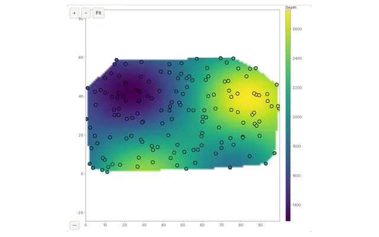
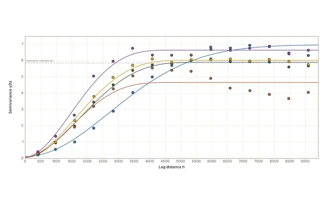
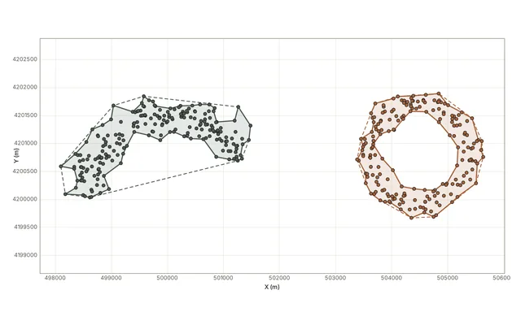
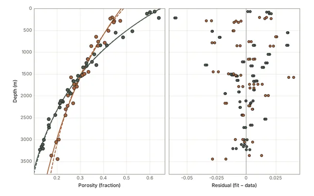

<svg class="hero-contours" viewBox="0 0 1000 420" preserveAspectRatio="xMaxYMin slice" aria-hidden="true">
<g class="contacts">
<path class="oil" d="M1001,120 L996,137 L982,152 L965,165 L946,176 L928,187 L911,197 L894,207 L874,215 L851,221 L827,224 L803,225 L780,225 L756,225 L731,227 L704,228 L675,227 L646,223 L622,213 L606,199 L599,182 L600,164 L606,147 L611,133 L613,120 L611,107 L608,93 L607,78 L610,62 L621,48 L637,36 L658,26 L680,18 L703,10 L727,4 L753,-1 L780,-3 L807,-1 L832,6 L852,17 L868,30 L882,42 L896,52 L913,60 L934,68 L958,77 L980,88 L995,103Z"/>
<path class="gas" d="M886,120 L890,129 L889,137 L883,145 L873,151 L861,156 L848,160 L837,164 L827,167 L816,171 L804,174 L792,175 L780,175 L768,174 L756,172 L744,171 L732,169 L718,167 L704,165 L691,160 L682,153 L677,145 L677,136 L682,128 L689,120 L695,113 L699,107 L701,101 L702,93 L704,86 L709,78 L717,72 L728,67 L740,64 L753,62 L767,60 L780,59 L794,59 L807,60 L820,63 L831,69 L838,75 L844,82 L848,89 L853,95 L859,101 L868,106 L878,112Z"/>
<path class="owc" pathLength="1" d="M1001,120 L996,137 L982,152 L965,165 L946,176 L928,187 L911,197 L894,207 L874,215 L851,221 L827,224 L803,225 L780,225 L756,225 L731,227 L704,228 L675,227 L646,223 L622,213 L606,199 L599,182 L600,164 L606,147 L611,133 L613,120 L611,107 L608,93 L607,78 L610,62 L621,48 L637,36 L658,26 L680,18 L703,10 L727,4 L753,-1 L780,-3 L807,-1 L832,6 L852,17 L868,30 L882,42 L896,52 L913,60 L934,68 L958,77 L980,88 L995,103Z"/>
<path class="goc" pathLength="1" d="M886,120 L890,129 L889,137 L883,145 L873,151 L861,156 L848,160 L837,164 L827,167 L816,171 L804,174 L792,175 L780,175 L768,174 L756,172 L744,171 L732,169 L718,167 L704,165 L691,160 L682,153 L677,145 L677,136 L682,128 L689,120 L695,113 L699,107 L701,101 L702,93 L704,86 L709,78 L717,72 L728,67 L740,64 L753,62 L767,60 L780,59 L794,59 L807,60 L820,63 L831,69 L838,75 L844,82 L848,89 L853,95 L859,101 L868,106 L878,112Z"/>
<text class="lbl-goc" x="806" y="192">GOC</text>
<text class="lbl-owc" x="690" y="246">OWC</text>
</g>
<g class="iso">
<path pathLength="1" style="--i:0" d="M831,120 L834,124 L836,129 L834,133 L830,137 L824,140 L817,142 L810,143 L804,145 L798,146 L792,147 L786,148 L780,149 L774,148 L768,147 L762,146 L756,145 L750,143 L743,142 L736,140 L730,137 L726,133 L724,129 L726,124 L729,120 L733,116 L737,113 L740,110 L742,107 L743,103 L745,99 L748,96 L753,93 L759,91 L766,89 L773,89 L780,89 L787,89 L794,89 L801,91 L807,93 L812,96 L815,99 L817,103 L818,107 L820,110 L823,113 L827,116Z"/>
<path pathLength="1" style="--i:1" d="M886,120 L890,129 L889,137 L883,145 L873,151 L861,156 L848,160 L837,164 L827,167 L816,171 L804,174 L792,175 L780,175 L768,174 L756,172 L744,171 L732,169 L718,167 L704,165 L691,160 L682,153 L677,145 L677,136 L682,128 L689,120 L695,113 L699,107 L701,101 L702,93 L704,86 L709,78 L717,72 L728,67 L740,64 L753,62 L767,60 L780,59 L794,59 L807,60 L820,63 L831,69 L838,75 L844,82 L848,89 L853,95 L859,101 L868,106 L878,112Z"/>
<path pathLength="1" style="--i:2" d="M944,120 L946,133 L939,145 L926,156 L910,164 L894,172 L879,178 L865,185 L850,191 L834,196 L816,200 L798,201 L780,200 L762,199 L745,198 L726,197 L705,196 L683,194 L663,189 L646,180 L637,169 L634,155 L638,142 L645,130 L652,120 L656,110 L656,101 L656,90 L657,78 L662,67 L672,57 L687,48 L704,42 L722,38 L741,34 L760,30 L780,28 L800,28 L820,32 L838,38 L851,47 L861,58 L870,67 L878,76 L890,83 L905,90 L921,98 L935,108Z"/>
<path pathLength="1" style="--i:3" d="M1001,120 L996,137 L982,152 L965,165 L946,176 L928,187 L911,197 L894,207 L874,215 L851,221 L827,224 L803,225 L780,225 L756,225 L731,227 L704,228 L675,227 L646,223 L622,213 L606,199 L599,182 L600,164 L606,147 L611,133 L613,120 L611,107 L608,93 L607,78 L610,62 L621,48 L637,36 L658,26 L680,18 L703,10 L727,4 L753,-1 L780,-3 L807,-1 L832,6 L852,17 L868,30 L882,42 L896,52 L913,60 L934,68 L958,77 L980,88 L995,103Z"/>
<path pathLength="1" style="--i:4" d="M1050,120 L1038,140 L1021,158 L1002,174 L983,189 L965,203 L945,217 L922,229 L896,238 L867,244 L838,247 L809,249 L780,252 L750,256 L716,260 L680,263 L643,260 L610,250 L586,234 L573,213 L570,191 L572,171 L574,152 L573,136 L567,120 L560,103 L554,84 L556,65 L565,47 L582,31 L604,16 L628,4 L655,-8 L682,-19 L713,-28 L746,-33 L780,-32 L813,-26 L841,-14 L864,0 L884,14 L904,25 L928,33 L956,41 L988,49 L1018,62 L1041,79 L1052,99Z"/>
<path pathLength="1" style="--i:5" d="M1091,120 L1076,143 L1058,164 L1041,184 L1023,203 L1003,221 L979,237 L949,250 L916,258 L882,264 L848,269 L815,275 L780,283 L741,292 L699,299 L654,299 L613,290 L580,273 L559,250 L549,224 L546,200 L543,178 L537,158 L526,140 L513,120 L503,99 L500,76 L507,53 L523,33 L545,14 L570,-4 L597,-20 L627,-36 L660,-50 L698,-59 L739,-62 L780,-57 L817,-45 L848,-30 L875,-15 L902,-4 L932,4 L968,10 L1008,17 L1046,30 L1077,48 L1096,70 L1100,95Z"/>
<path pathLength="1" style="--i:6" d="M1128,120 L1114,146 L1100,170 L1085,194 L1066,217 L1041,238 L1009,255 L972,267 L934,277 L896,285 L860,295 L822,308 L780,322 L732,334 L681,338 L631,332 L588,315 L558,290 L540,261 L529,233 L521,208 L508,186 L491,166 L471,144 L455,120 L447,94 L449,68 L463,43 L483,19 L507,-3 L533,-25 L562,-47 L597,-66 L639,-81 L686,-87 L734,-84 L780,-74 L820,-59 L855,-45 L888,-34 L925,-28 L968,-24 L1016,-19 L1063,-8 L1104,10 L1130,35 L1141,63 L1139,92Z"/>
<path pathLength="1" style="--i:7" d="M1166,120 L1157,149 L1146,178 L1130,205 L1106,231 L1073,252 L1034,269 L992,283 L952,296 L914,310 L875,329 L831,348 L780,366 L723,376 L665,373 L613,358 L572,332 L544,301 L524,270 L508,243 L488,219 L463,197 L436,174 L412,148 L398,120 L395,90 L404,61 L420,32 L440,5 L463,-23 L490,-50 L525,-76 L568,-96 L620,-107 L676,-108 L731,-100 L780,-86 L823,-73 L864,-64 L907,-60 L956,-59 L1011,-57 L1068,-49 L1117,-32 L1153,-7 L1173,24 L1178,57 L1174,89Z"/>
<path pathLength="1" style="--i:8" d="M1210,120 L1205,153 L1194,185 L1172,216 L1140,242 L1099,264 L1056,282 L1014,300 L976,320 L937,343 L894,370 L841,394 L780,410 L715,412 L653,399 L601,374 L561,343 L532,310 L506,281 L478,256 L445,234 L410,210 L378,183 L356,153 L346,120 L349,87 L360,54 L374,21 L392,-12 L414,-45 L445,-77 L489,-103 L544,-120 L607,-126 L670,-121 L729,-110 L780,-98 L827,-92 L876,-91 L931,-95 L993,-97 L1058,-93 L1117,-78 L1163,-53 L1193,-20 L1207,16 L1212,52 L1212,87Z"/>
<path pathLength="1" style="--i:9" d="M220,300 L219,304 L217,307 L214,310 L210,312 L207,315 L204,317 L200,319 L197,321 L193,322 L189,323 L184,323 L180,323 L176,323 L171,323 L166,323 L161,323 L156,322 L151,320 L148,317 L147,314 L147,310 L148,306 L149,303 L150,300 L150,297 L149,294 L149,291 L150,287 L151,284 L154,282 L158,279 L162,278 L166,276 L170,275 L175,274 L180,273 L185,273 L189,275 L193,277 L196,280 L199,283 L201,285 L204,287 L208,289 L212,291 L216,293 L219,296Z"/>
<path pathLength="1" style="--i:10" d="M266,300 L262,308 L257,315 L251,321 L245,327 L239,332 L233,338 L225,342 L217,346 L208,348 L198,349 L189,350 L180,351 L170,353 L160,354 L148,355 L136,354 L126,350 L118,344 L114,336 L113,328 L114,320 L114,313 L114,306 L112,300 L110,293 L108,286 L108,279 L111,272 L117,265 L124,260 L132,255 L140,250 L149,246 L159,243 L169,241 L180,241 L190,244 L199,248 L207,254 L213,259 L220,263 L227,266 L236,269 L246,273 L256,278 L263,284 L267,292Z"/>
<path pathLength="1" style="--i:11" d="M307,300 L301,311 L294,322 L287,332 L280,341 L272,350 L262,358 L249,365 L236,369 L222,372 L208,375 L194,378 L180,382 L164,387 L146,390 L128,390 L111,385 L98,376 L90,364 L86,352 L84,339 L83,329 L80,319 L75,310 L69,300 L65,289 L64,278 L67,267 L74,256 L83,247 L93,238 L105,230 L117,222 L131,215 L146,210 L163,209 L180,212 L195,218 L208,226 L219,233 L230,238 L243,241 L258,244 L275,248 L291,254 L303,264 L310,275 L311,288Z"/>
<path pathLength="1" style="--i:12" d="M345,300 L339,315 L333,329 L326,343 L317,356 L304,368 L289,378 L271,385 L253,390 L236,396 L219,403 L200,411 L180,420 L157,426 L132,428 L109,423 L89,412 L76,397 L67,380 L62,365 L57,351 L50,339 L40,327 L30,314 L23,300 L20,285 L22,270 L28,255 L38,241 L49,228 L61,215 L75,202 L92,191 L112,183 L135,181 L158,183 L180,190 L199,198 L215,205 L232,210 L250,213 L272,215 L295,218 L318,225 L336,236 L347,251 L351,267 L350,284Z"/>
<path pathLength="1" style="--i:13" d="M383,300 L379,319 L374,337 L365,355 L351,371 L333,384 L312,394 L291,403 L271,413 L252,424 L232,437 L208,451 L180,462 L149,466 L119,462 L93,450 L73,432 L59,413 L48,394 L38,378 L25,364 L10,350 L-5,335 L-17,319 L-23,300 L-23,281 L-18,262 L-10,244 L-0,226 L11,207 L25,189 L44,173 L68,162 L97,156 L126,157 L155,163 L180,172 L202,178 L224,182 L248,182 L276,181 L306,183 L335,189 L360,202 L376,219 L385,239 L387,260 L386,281Z"/>
</g>
<g class="wells">
<g transform="translate(780,118)"><g class="well" style="--d:3.4s"><circle r="5" class="full"/><line x1="7.0" y1="0.0" x2="11.0" y2="0.0"/><line x1="4.9" y1="4.9" x2="7.8" y2="7.8"/><line x1="0.0" y1="7.0" x2="0.0" y2="11.0"/><line x1="-4.9" y1="4.9" x2="-7.8" y2="7.8"/><line x1="-7.0" y1="0.0" x2="-11.0" y2="0.0"/><line x1="-4.9" y1="-4.9" x2="-7.8" y2="-7.8"/><line x1="-0.0" y1="-7.0" x2="-0.0" y2="-11.0"/><line x1="4.9" y1="-4.9" x2="7.8" y2="-7.8"/><text x="10" y="-9">W-1</text></g></g>
<g transform="translate(910,100)"><g class="well" style="--d:4.4s"><circle r="5" class="full"/><text x="10" y="-9">A-1</text></g></g>
<g transform="translate(862,236)"><g class="well" style="--d:5.0s"><circle r="5"/><line x1="-8" y1="-8" x2="8" y2="8"/><line x1="-8" y1="8" x2="8" y2="-8"/><text x="10" y="-9">A-2</text></g></g>
</g>
</svg>

Petroleum systems · Basin modeling · Applied AI

# Romain Giboreau

Lead Geoscientist at Beicip-Franlab. 15 years of petroleum systems assessment and basin modeling across 20+ basins on five continents, with a growing focus on applied AI/ML for geoscience workflows.

[CV](cv.md){ .md-button .md-button--primary } [Talks & publications](talks.md){ .md-button } [Notes](notes/index.md){ .md-button } [LinkedIn](https://www.linkedin.com/in/romain-giboreau){ .md-button }

!!! info "Last talks — November 2026"
    **APGCE 2026, Kuala Lumpur — 17 November.**
    *Closing the Exploration Gap: Probabilistic Petroleum Systems Analysis from Basin to Prospect* — Oral Session 9 (Basin Modelling and Reservoir Characterisation). Thanks to everyone who came by.

    **First EAGE Conference on Basin and Petroleum Systems Modeling, Houston — 18 November.**
    *From Basin Modeling to Storage Fairway Mapping: AI-Assisted Smart Maps for Offshore Norway CCUS Screening* — Session VII (Basin modeling applications to the energy transition, Part I). Presented by a colleague.

    [All talks & publications](talks.md)

## Expertise

01 / 08<button type="button" class="xp-prev" aria-label="Previous">&#8249;</button><button type="button" class="xp-next" aria-label="Next">&#8250;</button>

<ol class="xp-track" tabindex="0">
<li class="xp-card" aria-roledescription="slide" aria-label="01 of 08">
<svg viewBox="0 0 320 200" role="img" aria-label="Cross-section of a petroleum system: gas from the deeper kitchen and oil from the shallower one migrate along the carrier bed into a two-phase trap, gas cap over oil leg" font-family="Inter,sans-serif"><defs><marker id="m1g" viewBox="0 0 8 8" refX="6" refY="4" markerWidth="5" markerHeight="5" orient="auto"><path d="M0,0 L8,4 L0,8z" fill="#c8402f"/></marker></defs><defs><marker id="m1o" viewBox="0 0 8 8" refX="6" refY="4" markerWidth="5" markerHeight="5" orient="auto"><path d="M0,0 L8,4 L0,8z" fill="#3f7a3a"/></marker></defs><clipPath id="xc1"><rect x="30" y="14" width="290" height="172"/></clipPath><g clip-path="url(#xc1)"><path d="M30.0,14.0 L34.0,14.0 L38.0,14.0 L42.0,14.0 L46.0,14.0 L50.0,14.0 L54.0,14.0 L58.0,14.0 L62.0,14.0 L66.0,14.0 L70.0,14.0 L74.0,14.0 L78.0,14.0 L82.0,14.0 L86.0,14.0 L90.0,14.0 L94.0,14.0 L98.0,14.0 L102.0,14.0 L106.0,14.0 L110.0,14.0 L114.0,14.0 L118.0,14.0 L122.0,14.0 L126.0,14.0 L130.0,14.0 L134.0,14.0 L138.0,14.0 L142.0,14.0 L146.0,14.0 L150.0,14.0 L154.0,14.0 L158.0,14.0 L162.0,14.0 L166.0,14.0 L170.0,14.0 L174.0,14.0 L178.0,14.0 L182.0,14.0 L186.0,14.0 L190.0,14.0 L194.0,14.0 L198.0,14.0 L202.0,14.0 L206.0,14.0 L210.0,14.0 L214.0,14.0 L218.0,14.0 L222.0,14.0 L226.0,14.0 L230.0,14.0 L234.0,14.0 L238.0,14.0 L242.0,14.0 L246.0,14.0 L250.0,14.0 L254.0,14.0 L258.0,14.0 L262.0,14.0 L266.0,14.0 L270.0,14.0 L274.0,14.0 L278.0,14.0 L282.0,14.0 L286.0,14.0 L290.0,14.0 L294.0,14.0 L298.0,14.0 L302.0,14.0 L306.0,14.0 L310.0,14.0 L314.0,14.0 L318.0,14.0 L318.0,45.7 L314.0,45.9 L310.0,46.1 L306.0,46.1 L302.0,46.1 L298.0,45.9 L294.0,45.6 L290.0,45.1 L286.0,44.5 L282.0,43.7 L278.0,42.7 L274.0,41.6 L270.0,40.3 L266.0,38.9 L262.0,37.4 L258.0,35.8 L254.0,34.2 L250.0,32.7 L246.0,31.3 L242.0,30.0 L238.0,29.0 L234.0,28.2 L230.0,27.8 L226.0,27.7 L222.0,28.0 L218.0,28.7 L214.0,29.7 L210.0,31.1 L206.0,32.8 L202.0,34.8 L198.0,37.1 L194.0,39.4 L190.0,41.9 L186.0,44.5 L182.0,47.0 L178.0,49.5 L174.0,51.8 L170.0,54.1 L166.0,56.2 L162.0,58.1 L158.0,59.9 L154.0,61.4 L150.0,62.9 L146.0,64.1 L142.0,65.3 L138.0,66.3 L134.0,67.2 L130.0,68.0 L126.0,68.8 L122.0,69.5 L118.0,70.1 L114.0,70.7 L110.0,71.2 L106.0,71.8 L102.0,72.3 L98.0,72.8 L94.0,73.3 L90.0,73.8 L86.0,74.3 L82.0,74.8 L78.0,75.3 L74.0,75.8 L70.0,76.2 L66.0,76.7 L62.0,77.2 L58.0,77.7 L54.0,78.2 L50.0,78.6 L46.0,79.1 L42.0,79.6 L38.0,80.1 L34.0,80.6 L30.0,81.0Z" fill="#a9a291"/><path d="M30.0,81.0 L34.0,80.6 L38.0,80.1 L42.0,79.6 L46.0,79.1 L50.0,78.6 L54.0,78.2 L58.0,77.7 L62.0,77.2 L66.0,76.7 L70.0,76.2 L74.0,75.8 L78.0,75.3 L82.0,74.8 L86.0,74.3 L90.0,73.8 L94.0,73.3 L98.0,72.8 L102.0,72.3 L106.0,71.8 L110.0,71.2 L114.0,70.7 L118.0,70.1 L122.0,69.5 L126.0,68.8 L130.0,68.0 L134.0,67.2 L138.0,66.3 L142.0,65.3 L146.0,64.1 L150.0,62.9 L154.0,61.4 L158.0,59.9 L162.0,58.1 L166.0,56.2 L170.0,54.1 L174.0,51.8 L178.0,49.5 L182.0,47.0 L186.0,44.5 L190.0,41.9 L194.0,39.4 L198.0,37.1 L202.0,34.8 L206.0,32.8 L210.0,31.1 L214.0,29.7 L218.0,28.7 L222.0,28.0 L226.0,27.7 L230.0,27.8 L234.0,28.2 L238.0,29.0 L242.0,30.0 L246.0,31.3 L250.0,32.7 L254.0,34.2 L258.0,35.8 L262.0,37.4 L266.0,38.9 L270.0,40.3 L274.0,41.6 L278.0,42.7 L282.0,43.7 L286.0,44.5 L290.0,45.1 L294.0,45.6 L298.0,45.9 L302.0,46.1 L306.0,46.1 L310.0,46.1 L314.0,45.9 L318.0,45.7 L318.0,67.7 L314.0,67.9 L310.0,68.1 L306.0,68.1 L302.0,68.1 L298.0,67.9 L294.0,67.6 L290.0,67.1 L286.0,66.5 L282.0,65.7 L278.0,64.7 L274.0,63.6 L270.0,62.3 L266.0,60.9 L262.0,59.4 L258.0,57.8 L254.0,56.2 L250.0,54.7 L246.0,53.3 L242.0,52.0 L238.0,51.0 L234.0,50.2 L230.0,49.8 L226.0,49.7 L222.0,50.0 L218.0,50.7 L214.0,51.7 L210.0,53.1 L206.0,54.8 L202.0,56.8 L198.0,59.1 L194.0,61.4 L190.0,63.9 L186.0,66.5 L182.0,69.0 L178.0,71.5 L174.0,73.8 L170.0,76.1 L166.0,78.2 L162.0,80.1 L158.0,81.9 L154.0,83.4 L150.0,84.9 L146.0,86.1 L142.0,87.3 L138.0,88.3 L134.0,89.2 L130.0,90.0 L126.0,90.8 L122.0,91.5 L118.0,92.1 L114.0,92.7 L110.0,93.2 L106.0,93.8 L102.0,94.3 L98.0,94.8 L94.0,95.3 L90.0,95.8 L86.0,96.3 L82.0,96.8 L78.0,97.3 L74.0,97.8 L70.0,98.2 L66.0,98.7 L62.0,99.2 L58.0,99.7 L54.0,100.2 L50.0,100.6 L46.0,101.1 L42.0,101.6 L38.0,102.1 L34.0,102.6 L30.0,103.0Z" fill="#cfd3c8"/><path d="M30.0,103.0 L34.0,102.6 L38.0,102.1 L42.0,101.6 L46.0,101.1 L50.0,100.6 L54.0,100.2 L58.0,99.7 L62.0,99.2 L66.0,98.7 L70.0,98.2 L74.0,97.8 L78.0,97.3 L82.0,96.8 L86.0,96.3 L90.0,95.8 L94.0,95.3 L98.0,94.8 L102.0,94.3 L106.0,93.8 L110.0,93.2 L114.0,92.7 L118.0,92.1 L122.0,91.5 L126.0,90.8 L130.0,90.0 L134.0,89.2 L138.0,88.3 L142.0,87.3 L146.0,86.1 L150.0,84.9 L154.0,83.4 L158.0,81.9 L162.0,80.1 L166.0,78.2 L170.0,76.1 L174.0,73.8 L178.0,71.5 L182.0,69.0 L186.0,66.5 L190.0,63.9 L194.0,61.4 L198.0,59.1 L202.0,56.8 L206.0,54.8 L210.0,53.1 L214.0,51.7 L218.0,50.7 L222.0,50.0 L226.0,49.7 L230.0,49.8 L234.0,50.2 L238.0,51.0 L242.0,52.0 L246.0,53.3 L250.0,54.7 L254.0,56.2 L258.0,57.8 L262.0,59.4 L266.0,60.9 L270.0,62.3 L274.0,63.6 L278.0,64.7 L282.0,65.7 L286.0,66.5 L290.0,67.1 L294.0,67.6 L298.0,67.9 L302.0,68.1 L306.0,68.1 L310.0,68.1 L314.0,67.9 L318.0,67.7 L318.0,83.7 L314.0,83.9 L310.0,84.1 L306.0,84.1 L302.0,84.1 L298.0,83.9 L294.0,83.6 L290.0,83.1 L286.0,82.5 L282.0,81.7 L278.0,80.7 L274.0,79.6 L270.0,78.3 L266.0,76.9 L262.0,75.4 L258.0,73.8 L254.0,72.2 L250.0,70.7 L246.0,69.3 L242.0,68.0 L238.0,67.0 L234.0,66.2 L230.0,65.8 L226.0,65.7 L222.0,66.0 L218.0,66.7 L214.0,67.7 L210.0,69.1 L206.0,70.8 L202.0,72.8 L198.0,75.1 L194.0,77.4 L190.0,79.9 L186.0,82.5 L182.0,85.0 L178.0,87.5 L174.0,89.8 L170.0,92.1 L166.0,94.2 L162.0,96.1 L158.0,97.9 L154.0,99.4 L150.0,100.9 L146.0,102.1 L142.0,103.3 L138.0,104.3 L134.0,105.2 L130.0,106.0 L126.0,106.8 L122.0,107.5 L118.0,108.1 L114.0,108.7 L110.0,109.2 L106.0,109.8 L102.0,110.3 L98.0,110.8 L94.0,111.3 L90.0,111.8 L86.0,112.3 L82.0,112.8 L78.0,113.3 L74.0,113.8 L70.0,114.2 L66.0,114.7 L62.0,115.2 L58.0,115.7 L54.0,116.2 L50.0,116.6 L46.0,117.1 L42.0,117.6 L38.0,118.1 L34.0,118.6 L30.0,119.0Z" fill="#e6d6b0"/><path d="M30.0,119.0 L34.0,118.6 L38.0,118.1 L42.0,117.6 L46.0,117.1 L50.0,116.6 L54.0,116.2 L58.0,115.7 L62.0,115.2 L66.0,114.7 L70.0,114.2 L74.0,113.8 L78.0,113.3 L82.0,112.8 L86.0,112.3 L90.0,111.8 L94.0,111.3 L98.0,110.8 L102.0,110.3 L106.0,109.8 L110.0,109.2 L114.0,108.7 L118.0,108.1 L122.0,107.5 L126.0,106.8 L130.0,106.0 L134.0,105.2 L138.0,104.3 L142.0,103.3 L146.0,102.1 L150.0,100.9 L154.0,99.4 L158.0,97.9 L162.0,96.1 L166.0,94.2 L170.0,92.1 L174.0,89.8 L178.0,87.5 L182.0,85.0 L186.0,82.5 L190.0,79.9 L194.0,77.4 L198.0,75.1 L202.0,72.8 L206.0,70.8 L210.0,69.1 L214.0,67.7 L218.0,66.7 L222.0,66.0 L226.0,65.7 L230.0,65.8 L234.0,66.2 L238.0,67.0 L242.0,68.0 L246.0,69.3 L250.0,70.7 L254.0,72.2 L258.0,73.8 L262.0,75.4 L266.0,76.9 L270.0,78.3 L274.0,79.6 L278.0,80.7 L282.0,81.7 L286.0,82.5 L290.0,83.1 L294.0,83.6 L298.0,83.9 L302.0,84.1 L306.0,84.1 L310.0,84.1 L314.0,83.9 L318.0,83.7 L318.0,111.7 L314.0,111.9 L310.0,112.1 L306.0,112.1 L302.0,112.1 L298.0,111.9 L294.0,111.6 L290.0,111.1 L286.0,110.5 L282.0,109.7 L278.0,108.7 L274.0,107.6 L270.0,106.3 L266.0,104.9 L262.0,103.4 L258.0,101.8 L254.0,100.2 L250.0,98.7 L246.0,97.3 L242.0,96.0 L238.0,95.0 L234.0,94.2 L230.0,93.8 L226.0,93.7 L222.0,94.0 L218.0,94.7 L214.0,95.7 L210.0,97.1 L206.0,98.8 L202.0,100.8 L198.0,103.1 L194.0,105.4 L190.0,107.9 L186.0,110.5 L182.0,113.0 L178.0,115.5 L174.0,117.8 L170.0,120.1 L166.0,122.2 L162.0,124.1 L158.0,125.9 L154.0,127.4 L150.0,128.9 L146.0,130.1 L142.0,131.3 L138.0,132.3 L134.0,133.2 L130.0,134.0 L126.0,134.8 L122.0,135.5 L118.0,136.1 L114.0,136.7 L110.0,137.2 L106.0,137.8 L102.0,138.3 L98.0,138.8 L94.0,139.3 L90.0,139.8 L86.0,140.3 L82.0,140.8 L78.0,141.3 L74.0,141.8 L70.0,142.2 L66.0,142.7 L62.0,143.2 L58.0,143.7 L54.0,144.2 L50.0,144.6 L46.0,145.1 L42.0,145.6 L38.0,146.1 L34.0,146.6 L30.0,147.0Z" fill="#d9d5c8"/><path d="M30.0,147.0 L34.0,146.6 L38.0,146.1 L42.0,145.6 L46.0,145.1 L50.0,144.6 L54.0,144.2 L58.0,143.7 L62.0,143.2 L66.0,142.7 L70.0,142.2 L74.0,141.8 L78.0,141.3 L82.0,140.8 L86.0,140.3 L90.0,139.8 L94.0,139.3 L98.0,138.8 L102.0,138.3 L106.0,137.8 L110.0,137.2 L114.0,136.7 L118.0,136.1 L122.0,135.5 L126.0,134.8 L130.0,134.0 L134.0,133.2 L138.0,132.3 L142.0,131.3 L146.0,130.1 L150.0,128.9 L154.0,127.4 L158.0,125.9 L162.0,124.1 L166.0,122.2 L170.0,120.1 L174.0,117.8 L178.0,115.5 L182.0,113.0 L186.0,110.5 L190.0,107.9 L194.0,105.4 L198.0,103.1 L202.0,100.8 L206.0,98.8 L210.0,97.1 L214.0,95.7 L218.0,94.7 L222.0,94.0 L226.0,93.7 L230.0,93.8 L234.0,94.2 L238.0,95.0 L242.0,96.0 L246.0,97.3 L250.0,98.7 L254.0,100.2 L258.0,101.8 L262.0,103.4 L266.0,104.9 L270.0,106.3 L274.0,107.6 L278.0,108.7 L282.0,109.7 L286.0,110.5 L290.0,111.1 L294.0,111.6 L298.0,111.9 L302.0,112.1 L306.0,112.1 L310.0,112.1 L314.0,111.9 L318.0,111.7 L318.0,127.7 L314.0,127.9 L310.0,128.1 L306.0,128.1 L302.0,128.1 L298.0,127.9 L294.0,127.6 L290.0,127.1 L286.0,126.5 L282.0,125.7 L278.0,124.7 L274.0,123.6 L270.0,122.3 L266.0,120.9 L262.0,119.4 L258.0,117.8 L254.0,116.2 L250.0,114.7 L246.0,113.3 L242.0,112.0 L238.0,111.0 L234.0,110.2 L230.0,109.8 L226.0,109.7 L222.0,110.0 L218.0,110.7 L214.0,111.7 L210.0,113.1 L206.0,114.8 L202.0,116.8 L198.0,119.1 L194.0,121.4 L190.0,123.9 L186.0,126.5 L182.0,129.0 L178.0,131.5 L174.0,133.8 L170.0,136.1 L166.0,138.2 L162.0,140.1 L158.0,141.9 L154.0,143.4 L150.0,144.9 L146.0,146.1 L142.0,147.3 L138.0,148.3 L134.0,149.2 L130.0,150.0 L126.0,150.8 L122.0,151.5 L118.0,152.1 L114.0,152.7 L110.0,153.2 L106.0,153.8 L102.0,154.3 L98.0,154.8 L94.0,155.3 L90.0,155.8 L86.0,156.3 L82.0,156.8 L78.0,157.3 L74.0,157.8 L70.0,158.2 L66.0,158.7 L62.0,159.2 L58.0,159.7 L54.0,160.2 L50.0,160.6 L46.0,161.1 L42.0,161.6 L38.0,162.1 L34.0,162.6 L30.0,163.0Z" fill="#4f4d47"/><path d="M30.0,163.0 L34.0,162.6 L38.0,162.1 L42.0,161.6 L46.0,161.1 L50.0,160.6 L54.0,160.2 L58.0,159.7 L62.0,159.2 L66.0,158.7 L70.0,158.2 L74.0,157.8 L78.0,157.3 L82.0,156.8 L86.0,156.3 L90.0,155.8 L94.0,155.3 L98.0,154.8 L102.0,154.3 L106.0,153.8 L110.0,153.2 L114.0,152.7 L118.0,152.1 L122.0,151.5 L126.0,150.8 L130.0,150.0 L134.0,149.2 L138.0,148.3 L142.0,147.3 L146.0,146.1 L150.0,144.9 L154.0,143.4 L158.0,141.9 L162.0,140.1 L166.0,138.2 L170.0,136.1 L174.0,133.8 L178.0,131.5 L182.0,129.0 L186.0,126.5 L190.0,123.9 L194.0,121.4 L198.0,119.1 L202.0,116.8 L206.0,114.8 L210.0,113.1 L214.0,111.7 L218.0,110.7 L222.0,110.0 L226.0,109.7 L230.0,109.8 L234.0,110.2 L238.0,111.0 L242.0,112.0 L246.0,113.3 L250.0,114.7 L254.0,116.2 L258.0,117.8 L262.0,119.4 L266.0,120.9 L270.0,122.3 L274.0,123.6 L278.0,124.7 L282.0,125.7 L286.0,126.5 L290.0,127.1 L294.0,127.6 L298.0,127.9 L302.0,128.1 L306.0,128.1 L310.0,128.1 L314.0,127.9 L318.0,127.7 L318.0,186.0 L314.0,186.0 L310.0,186.0 L306.0,186.0 L302.0,186.0 L298.0,186.0 L294.0,186.0 L290.0,186.0 L286.0,186.0 L282.0,186.0 L278.0,186.0 L274.0,186.0 L270.0,186.0 L266.0,186.0 L262.0,186.0 L258.0,186.0 L254.0,186.0 L250.0,186.0 L246.0,186.0 L242.0,186.0 L238.0,186.0 L234.0,186.0 L230.0,186.0 L226.0,186.0 L222.0,186.0 L218.0,186.0 L214.0,186.0 L210.0,186.0 L206.0,186.0 L202.0,186.0 L198.0,186.0 L194.0,186.0 L190.0,186.0 L186.0,186.0 L182.0,186.0 L178.0,186.0 L174.0,186.0 L170.0,186.0 L166.0,186.0 L162.0,186.0 L158.0,186.0 L154.0,186.0 L150.0,186.0 L146.0,186.0 L142.0,186.0 L138.0,186.0 L134.0,186.0 L130.0,186.0 L126.0,186.0 L122.0,186.0 L118.0,186.0 L114.0,186.0 L110.0,186.0 L106.0,186.0 L102.0,186.0 L98.0,186.0 L94.0,186.0 L90.0,186.0 L86.0,186.0 L82.0,186.0 L78.0,186.0 L74.0,186.0 L70.0,186.0 L66.0,186.0 L62.0,186.0 L58.0,186.0 L54.0,186.0 L50.0,186.0 L46.0,186.0 L42.0,186.0 L38.0,186.0 L34.0,186.0 L30.0,186.0Z" fill="#c9c4b6"/><path d="M30.0,81.0 L34.0,80.6 L38.0,80.1 L42.0,79.6 L46.0,79.1 L50.0,78.6 L54.0,78.2 L58.0,77.7 L62.0,77.2 L66.0,76.7 L70.0,76.2 L74.0,75.8 L78.0,75.3 L82.0,74.8 L86.0,74.3 L90.0,73.8 L94.0,73.3 L98.0,72.8 L102.0,72.3 L106.0,71.8 L110.0,71.2 L114.0,70.7 L118.0,70.1 L122.0,69.5 L126.0,68.8 L130.0,68.0 L134.0,67.2 L138.0,66.3 L142.0,65.3 L146.0,64.1 L150.0,62.9 L154.0,61.4 L158.0,59.9 L162.0,58.1 L166.0,56.2 L170.0,54.1 L174.0,51.8 L178.0,49.5 L182.0,47.0 L186.0,44.5 L190.0,41.9 L194.0,39.4 L198.0,37.1 L202.0,34.8 L206.0,32.8 L210.0,31.1 L214.0,29.7 L218.0,28.7 L222.0,28.0 L226.0,27.7 L230.0,27.8 L234.0,28.2 L238.0,29.0 L242.0,30.0 L246.0,31.3 L250.0,32.7 L254.0,34.2 L258.0,35.8 L262.0,37.4 L266.0,38.9 L270.0,40.3 L274.0,41.6 L278.0,42.7 L282.0,43.7 L286.0,44.5 L290.0,45.1 L294.0,45.6 L298.0,45.9 L302.0,46.1 L306.0,46.1 L310.0,46.1 L314.0,45.9 L318.0,45.7" fill="none" stroke="#5c5a52" stroke-width=".6"/><path d="M30.0,103.0 L34.0,102.6 L38.0,102.1 L42.0,101.6 L46.0,101.1 L50.0,100.6 L54.0,100.2 L58.0,99.7 L62.0,99.2 L66.0,98.7 L70.0,98.2 L74.0,97.8 L78.0,97.3 L82.0,96.8 L86.0,96.3 L90.0,95.8 L94.0,95.3 L98.0,94.8 L102.0,94.3 L106.0,93.8 L110.0,93.2 L114.0,92.7 L118.0,92.1 L122.0,91.5 L126.0,90.8 L130.0,90.0 L134.0,89.2 L138.0,88.3 L142.0,87.3 L146.0,86.1 L150.0,84.9 L154.0,83.4 L158.0,81.9 L162.0,80.1 L166.0,78.2 L170.0,76.1 L174.0,73.8 L178.0,71.5 L182.0,69.0 L186.0,66.5 L190.0,63.9 L194.0,61.4 L198.0,59.1 L202.0,56.8 L206.0,54.8 L210.0,53.1 L214.0,51.7 L218.0,50.7 L222.0,50.0 L226.0,49.7 L230.0,49.8 L234.0,50.2 L238.0,51.0 L242.0,52.0 L246.0,53.3 L250.0,54.7 L254.0,56.2 L258.0,57.8 L262.0,59.4 L266.0,60.9 L270.0,62.3 L274.0,63.6 L278.0,64.7 L282.0,65.7 L286.0,66.5 L290.0,67.1 L294.0,67.6 L298.0,67.9 L302.0,68.1 L306.0,68.1 L310.0,68.1 L314.0,67.9 L318.0,67.7" fill="none" stroke="#5c5a52" stroke-width=".6"/><path d="M30.0,119.0 L34.0,118.6 L38.0,118.1 L42.0,117.6 L46.0,117.1 L50.0,116.6 L54.0,116.2 L58.0,115.7 L62.0,115.2 L66.0,114.7 L70.0,114.2 L74.0,113.8 L78.0,113.3 L82.0,112.8 L86.0,112.3 L90.0,111.8 L94.0,111.3 L98.0,110.8 L102.0,110.3 L106.0,109.8 L110.0,109.2 L114.0,108.7 L118.0,108.1 L122.0,107.5 L126.0,106.8 L130.0,106.0 L134.0,105.2 L138.0,104.3 L142.0,103.3 L146.0,102.1 L150.0,100.9 L154.0,99.4 L158.0,97.9 L162.0,96.1 L166.0,94.2 L170.0,92.1 L174.0,89.8 L178.0,87.5 L182.0,85.0 L186.0,82.5 L190.0,79.9 L194.0,77.4 L198.0,75.1 L202.0,72.8 L206.0,70.8 L210.0,69.1 L214.0,67.7 L218.0,66.7 L222.0,66.0 L226.0,65.7 L230.0,65.8 L234.0,66.2 L238.0,67.0 L242.0,68.0 L246.0,69.3 L250.0,70.7 L254.0,72.2 L258.0,73.8 L262.0,75.4 L266.0,76.9 L270.0,78.3 L274.0,79.6 L278.0,80.7 L282.0,81.7 L286.0,82.5 L290.0,83.1 L294.0,83.6 L298.0,83.9 L302.0,84.1 L306.0,84.1 L310.0,84.1 L314.0,83.9 L318.0,83.7" fill="none" stroke="#5c5a52" stroke-width=".6"/><path d="M30.0,147.0 L34.0,146.6 L38.0,146.1 L42.0,145.6 L46.0,145.1 L50.0,144.6 L54.0,144.2 L58.0,143.7 L62.0,143.2 L66.0,142.7 L70.0,142.2 L74.0,141.8 L78.0,141.3 L82.0,140.8 L86.0,140.3 L90.0,139.8 L94.0,139.3 L98.0,138.8 L102.0,138.3 L106.0,137.8 L110.0,137.2 L114.0,136.7 L118.0,136.1 L122.0,135.5 L126.0,134.8 L130.0,134.0 L134.0,133.2 L138.0,132.3 L142.0,131.3 L146.0,130.1 L150.0,128.9 L154.0,127.4 L158.0,125.9 L162.0,124.1 L166.0,122.2 L170.0,120.1 L174.0,117.8 L178.0,115.5 L182.0,113.0 L186.0,110.5 L190.0,107.9 L194.0,105.4 L198.0,103.1 L202.0,100.8 L206.0,98.8 L210.0,97.1 L214.0,95.7 L218.0,94.7 L222.0,94.0 L226.0,93.7 L230.0,93.8 L234.0,94.2 L238.0,95.0 L242.0,96.0 L246.0,97.3 L250.0,98.7 L254.0,100.2 L258.0,101.8 L262.0,103.4 L266.0,104.9 L270.0,106.3 L274.0,107.6 L278.0,108.7 L282.0,109.7 L286.0,110.5 L290.0,111.1 L294.0,111.6 L298.0,111.9 L302.0,112.1 L306.0,112.1 L310.0,112.1 L314.0,111.9 L318.0,111.7" fill="none" stroke="#5c5a52" stroke-width=".6"/><path d="M30.0,163.0 L34.0,162.6 L38.0,162.1 L42.0,161.6 L46.0,161.1 L50.0,160.6 L54.0,160.2 L58.0,159.7 L62.0,159.2 L66.0,158.7 L70.0,158.2 L74.0,157.8 L78.0,157.3 L82.0,156.8 L86.0,156.3 L90.0,155.8 L94.0,155.3 L98.0,154.8 L102.0,154.3 L106.0,153.8 L110.0,153.2 L114.0,152.7 L118.0,152.1 L122.0,151.5 L126.0,150.8 L130.0,150.0 L134.0,149.2 L138.0,148.3 L142.0,147.3 L146.0,146.1 L150.0,144.9 L154.0,143.4 L158.0,141.9 L162.0,140.1 L166.0,138.2 L170.0,136.1 L174.0,133.8 L178.0,131.5 L182.0,129.0 L186.0,126.5 L190.0,123.9 L194.0,121.4 L198.0,119.1 L202.0,116.8 L206.0,114.8 L210.0,113.1 L214.0,111.7 L218.0,110.7 L222.0,110.0 L226.0,109.7 L230.0,109.8 L234.0,110.2 L238.0,111.0 L242.0,112.0 L246.0,113.3 L250.0,114.7 L254.0,116.2 L258.0,117.8 L262.0,119.4 L266.0,120.9 L270.0,122.3 L274.0,123.6 L278.0,124.7 L282.0,125.7 L286.0,126.5 L290.0,127.1 L294.0,127.6 L298.0,127.9 L302.0,128.1 L306.0,128.1 L310.0,128.1 L314.0,127.9 L318.0,127.7" fill="none" stroke="#5c5a52" stroke-width=".6"/><clipPath id="xc1b"><path d="M30.0,103.0 L34.0,102.6 L38.0,102.1 L42.0,101.6 L46.0,101.1 L50.0,100.6 L54.0,100.2 L58.0,99.7 L62.0,99.2 L66.0,98.7 L70.0,98.2 L74.0,97.8 L78.0,97.3 L82.0,96.8 L86.0,96.3 L90.0,95.8 L94.0,95.3 L98.0,94.8 L102.0,94.3 L106.0,93.8 L110.0,93.2 L114.0,92.7 L118.0,92.1 L122.0,91.5 L126.0,90.8 L130.0,90.0 L134.0,89.2 L138.0,88.3 L142.0,87.3 L146.0,86.1 L150.0,84.9 L154.0,83.4 L158.0,81.9 L162.0,80.1 L166.0,78.2 L170.0,76.1 L174.0,73.8 L178.0,71.5 L182.0,69.0 L186.0,66.5 L190.0,63.9 L194.0,61.4 L198.0,59.1 L202.0,56.8 L206.0,54.8 L210.0,53.1 L214.0,51.7 L218.0,50.7 L222.0,50.0 L226.0,49.7 L230.0,49.8 L234.0,50.2 L238.0,51.0 L242.0,52.0 L246.0,53.3 L250.0,54.7 L254.0,56.2 L258.0,57.8 L262.0,59.4 L266.0,60.9 L270.0,62.3 L274.0,63.6 L278.0,64.7 L282.0,65.7 L286.0,66.5 L290.0,67.1 L294.0,67.6 L298.0,67.9 L302.0,68.1 L306.0,68.1 L310.0,68.1 L314.0,67.9 L318.0,67.7 L318.0,83.7 L314.0,83.9 L310.0,84.1 L306.0,84.1 L302.0,84.1 L298.0,83.9 L294.0,83.6 L290.0,83.1 L286.0,82.5 L282.0,81.7 L278.0,80.7 L274.0,79.6 L270.0,78.3 L266.0,76.9 L262.0,75.4 L258.0,73.8 L254.0,72.2 L250.0,70.7 L246.0,69.3 L242.0,68.0 L238.0,67.0 L234.0,66.2 L230.0,65.8 L226.0,65.7 L222.0,66.0 L218.0,66.7 L214.0,67.7 L210.0,69.1 L206.0,70.8 L202.0,72.8 L198.0,75.1 L194.0,77.4 L190.0,79.9 L186.0,82.5 L182.0,85.0 L178.0,87.5 L174.0,89.8 L170.0,92.1 L166.0,94.2 L162.0,96.1 L158.0,97.9 L154.0,99.4 L150.0,100.9 L146.0,102.1 L142.0,103.3 L138.0,104.3 L134.0,105.2 L130.0,106.0 L126.0,106.8 L122.0,107.5 L118.0,108.1 L114.0,108.7 L110.0,109.2 L106.0,109.8 L102.0,110.3 L98.0,110.8 L94.0,111.3 L90.0,111.8 L86.0,112.3 L82.0,112.8 L78.0,113.3 L74.0,113.8 L70.0,114.2 L66.0,114.7 L62.0,115.2 L58.0,115.7 L54.0,116.2 L50.0,116.6 L46.0,117.1 L42.0,117.6 L38.0,118.1 L34.0,118.6 L30.0,119.0Z"/></clipPath><g clip-path="url(#xc1b)"><rect x="30" y="56.7" width="290" height="8.0" fill="#3f7a3a" class="a-down" style="--d:1.5s"/><rect x="30" y="47.7" width="290" height="9.0" fill="#c8402f" class="a-down" style="--d:2.3s"/></g><path d="M92,138.6 L92,106.6" stroke="#c8402f" stroke-width="1.8" fill="none" class="a-flow" style="--d:0.3s"/><path d="M140,130.8 L140,98.8" stroke="#3f7a3a" stroke-width="1.8" fill="none" class="a-flow" style="--d:0.3s"/><path d="M92.0,101.0 L96.0,100.5 L100.0,100.0 L104.0,99.4 L108.0,98.9 L112.0,98.4 L116.0,97.8 L120.0,97.2 L124.0,96.5 L128.0,95.8 L132.0,95.0 L136.0,94.2 L140.0,93.2 L144.0,92.1 L148.0,90.9 L152.0,89.6 L156.0,88.1 L160.0,86.4 L164.0,84.5 L168.0,82.5 L172.0,80.4 L176.0,78.1 L180.0,75.6 L184.0,73.1 L188.0,70.6 L192.0,68.1 L196.0,65.6 L200.0,63.3 L204.0,61.2 L208.0,59.3 L212.0,57.8" stroke="#c8402f" stroke-width="1.8" fill="none" marker-end="url(#m1g)" class="a-flow" style="--d:0.6s"/><path d="M140.0,98.4 L144.0,97.3 L148.0,96.1 L152.0,94.8 L156.0,93.3 L160.0,91.6 L164.0,89.7 L168.0,87.7 L172.0,85.6 L176.0,83.3 L180.0,80.8 L184.0,78.3 L188.0,75.8 L192.0,73.3 L196.0,70.8 L200.0,68.5 L204.0,66.4 L208.0,64.5 L212.0,63.0" stroke="#3f7a3a" stroke-width="1.8" fill="none" marker-end="url(#m1o)" class="a-flow" style="--d:0.6s"/></g><line x1="30" y1="14" x2="30" y2="186" stroke="#232220" stroke-width=".9"/><line x1="27" y1="14" x2="30" y2="14" stroke="#232220" stroke-width=".9"/><text x="25.0" y="17.3" font-size="9.5" fill="#5c5a52" text-anchor="end" font-weight="400">0</text><line x1="27" y1="54" x2="30" y2="54" stroke="#232220" stroke-width=".9"/><text x="25.0" y="57.3" font-size="9.5" fill="#5c5a52" text-anchor="end" font-weight="400">1</text><line x1="27" y1="94" x2="30" y2="94" stroke="#232220" stroke-width=".9"/><text x="25.0" y="97.3" font-size="9.5" fill="#5c5a52" text-anchor="end" font-weight="400">2</text><line x1="27" y1="134" x2="30" y2="134" stroke="#232220" stroke-width=".9"/><text x="25.0" y="137.3" font-size="9.5" fill="#5c5a52" text-anchor="end" font-weight="400">3</text><line x1="27" y1="174" x2="30" y2="174" stroke="#232220" stroke-width=".9"/><text x="25.0" y="177.3" font-size="9.5" fill="#5c5a52" text-anchor="end" font-weight="400">4</text><text x="9" y="100" font-size="9.5" fill="#8a8778" text-anchor="middle" transform="rotate(-90 9 100)">depth (km)</text><rect x="242" y="170" width="70" height="13" rx="2" fill="#f5f3ed" opacity=".9"/><line x1="248" y1="178" x2="288" y2="178" stroke="#232220" stroke-width="2"/><text x="292.0" y="181.5" font-size="9" fill="#232220" text-anchor="start" font-weight="400">10 km</text><text x="36.0" y="52.0" font-size="10" fill="#232220" text-anchor="start" font-weight="400">overburden</text><text x="36.0" y="94.3" font-size="10" fill="#232220" text-anchor="start" font-weight="400">seal</text><text x="36.0" y="114.8" font-size="10" fill="#232220" text-anchor="start" font-weight="400">reservoir</text><text x="36.0" y="158.3" font-size="10" fill="#f5f3ed" text-anchor="start" font-weight="400">source rock</text><text x="222.0" y="41.7" font-size="10.5" fill="#232220" text-anchor="middle" font-weight="700" class="a-fade" style="--d:2.6s">two-phase trap</text><g class="a-fade" style="--d:0.1s"><rect x="36" y="20" width="96" height="16" rx="3" fill="#f5f3ed" opacity=".9"/><rect x="42" y="24" width="9" height="8" fill="#c8402f"/><text x="55.0" y="31.5" font-size="9.5" fill="#232220" text-anchor="start" font-weight="400">gas</text><rect x="80" y="24" width="9" height="8" fill="#3f7a3a"/><text x="93.0" y="31.5" font-size="9.5" fill="#232220" text-anchor="start" font-weight="400">oil</text></g></svg>
01 / 08<h3>Petroleum systems analysis</h3>
Source, migration, reservoir, seal and trap assessed together; play fairway analysis in 20+ basins on five continents.
</li>
<li class="xp-card" aria-roledescription="slide" aria-label="02 of 08">
<svg viewBox="0 0 320 200" role="img" aria-label="Burial history: sediment layers subsiding through the heavy oil, light oil, condensate and gas windows over 150 million years" font-family="Inter,sans-serif"><line x1="40" y1="30" x2="310" y2="30" stroke="#232220" stroke-width=".9"/><line x1="40" y1="30" x2="40" y2="190" stroke="#232220" stroke-width=".9"/><line x1="40.0" y1="30" x2="40.0" y2="27" stroke="#232220" stroke-width=".9"/><text x="40.0" y="24.0" font-size="9.5" fill="#5c5a52" text-anchor="middle" font-weight="400">150</text><line x1="130.0" y1="30" x2="130.0" y2="27" stroke="#232220" stroke-width=".9"/><text x="130.0" y="24.0" font-size="9.5" fill="#5c5a52" text-anchor="middle" font-weight="400">100</text><line x1="220.0" y1="30" x2="220.0" y2="27" stroke="#232220" stroke-width=".9"/><text x="220.0" y="24.0" font-size="9.5" fill="#5c5a52" text-anchor="middle" font-weight="400">50</text><line x1="310.0" y1="30" x2="310.0" y2="27" stroke="#232220" stroke-width=".9"/><text x="310.0" y="24.0" font-size="9.5" fill="#5c5a52" text-anchor="middle" font-weight="400">0</text><line x1="37" y1="30.0" x2="40" y2="30.0" stroke="#232220" stroke-width=".9"/><text x="35.0" y="33.3" font-size="9.5" fill="#5c5a52" text-anchor="end" font-weight="400">0</text><line x1="37" y1="62.0" x2="40" y2="62.0" stroke="#232220" stroke-width=".9"/><text x="35.0" y="65.3" font-size="9.5" fill="#5c5a52" text-anchor="end" font-weight="400">1</text><line x1="37" y1="94.0" x2="40" y2="94.0" stroke="#232220" stroke-width=".9"/><text x="35.0" y="97.3" font-size="9.5" fill="#5c5a52" text-anchor="end" font-weight="400">2</text><line x1="37" y1="126.0" x2="40" y2="126.0" stroke="#232220" stroke-width=".9"/><text x="35.0" y="129.3" font-size="9.5" fill="#5c5a52" text-anchor="end" font-weight="400">3</text><line x1="37" y1="158.0" x2="40" y2="158.0" stroke="#232220" stroke-width=".9"/><text x="35.0" y="161.3" font-size="9.5" fill="#5c5a52" text-anchor="end" font-weight="400">4</text><line x1="37" y1="190.0" x2="40" y2="190.0" stroke="#232220" stroke-width=".9"/><text x="35.0" y="193.3" font-size="9.5" fill="#5c5a52" text-anchor="end" font-weight="400">5</text><text x="175.0" y="13.0" font-size="9.5" fill="#8a8778" text-anchor="middle" font-weight="400">age (Ma)</text><text x="10" y="110.0" font-size="9.5" fill="#8a8778" text-anchor="middle" transform="rotate(-90 10 110.0)">depth (km)</text><path d="M40.0,30.0 L46.8,40.6 L53.5,47.4 L60.2,53.3 L67.0,58.7 L73.8,63.7 L80.5,68.4 L87.2,72.9 L94.0,77.2 L100.8,81.4 L107.5,85.4 L114.2,89.4 L121.0,93.2 L127.8,97.0 L134.5,100.6 L141.2,104.2 L148.0,107.8 L154.8,111.2 L161.5,114.6 L168.2,118.0 L175.0,121.3 L181.8,124.6 L188.5,127.8 L195.2,131.0 L202.0,134.1 L208.8,137.2 L215.5,140.3 L222.2,143.3 L229.0,146.3 L235.8,149.3 L242.5,152.3 L249.2,155.2 L256.0,158.1 L262.8,160.9 L269.5,163.8 L276.2,166.6 L283.0,169.4 L289.8,172.2 L296.5,174.9 L303.2,177.7 L310.0,180.4 L310.0,151.6 L310.0,151.6 L304.7,149.4 L299.4,147.2 L294.1,145.0 L288.8,142.7 L283.4,140.5 L278.1,138.2 L272.8,135.9 L267.5,133.6 L262.2,131.2 L256.9,128.9 L251.6,126.5 L246.3,124.1 L241.0,121.6 L235.7,119.2 L230.3,116.7 L225.0,114.2 L219.7,111.6 L214.4,109.1 L209.1,106.5 L203.8,103.8 L198.5,101.1 L193.2,98.4 L187.9,95.7 L182.6,92.9 L177.2,90.0 L171.9,87.1 L166.6,84.1 L161.3,81.1 L156.0,78.0 L150.7,74.8 L145.4,71.5 L140.1,68.2 L134.8,64.7 L129.5,61.0 L124.1,57.2 L118.8,53.2 L113.5,48.8 L108.2,44.1 L102.9,38.5 L97.6,30.0Z" fill="#d9d5c8" class="a-fade" style="--d:0.4s"/><path d="M97.6,30.0 L102.9,38.5 L108.2,44.1 L113.5,48.8 L118.8,53.2 L124.1,57.2 L129.5,61.0 L134.8,64.7 L140.1,68.2 L145.4,71.5 L150.7,74.8 L156.0,78.0 L161.3,81.1 L166.6,84.1 L171.9,87.1 L177.2,90.0 L182.6,92.9 L187.9,95.7 L193.2,98.4 L198.5,101.1 L203.8,103.8 L209.1,106.5 L214.4,109.1 L219.7,111.6 L225.0,114.2 L230.3,116.7 L235.7,119.2 L241.0,121.6 L246.3,124.1 L251.6,126.5 L256.9,128.9 L262.2,131.2 L267.5,133.6 L272.8,135.9 L278.1,138.2 L283.4,140.5 L288.8,142.7 L294.1,145.0 L299.4,147.2 L304.7,149.4 L310.0,151.6 L310.0,126.0 L310.0,126.0 L305.9,124.3 L301.7,122.5 L297.6,120.8 L293.4,119.0 L289.3,117.2 L285.2,115.4 L281.0,113.6 L276.9,111.8 L272.7,109.9 L268.6,108.0 L264.5,106.2 L260.3,104.3 L256.2,102.3 L252.0,100.4 L247.9,98.4 L243.8,96.5 L239.6,94.5 L235.5,92.4 L231.3,90.4 L227.2,88.3 L223.1,86.2 L218.9,84.0 L214.8,81.8 L210.6,79.6 L206.5,77.4 L202.4,75.1 L198.2,72.7 L194.1,70.3 L189.9,67.9 L185.8,65.4 L181.7,62.8 L177.5,60.1 L173.4,57.4 L169.2,54.5 L165.1,51.5 L161.0,48.3 L156.8,44.9 L152.7,41.1 L148.5,36.7 L144.4,30.0Z" fill="#4f4d47" class="a-fade" style="--d:0.62s"/><path d="M144.4,30.0 L148.5,36.7 L152.7,41.1 L156.8,44.9 L161.0,48.3 L165.1,51.5 L169.2,54.5 L173.4,57.4 L177.5,60.1 L181.7,62.8 L185.8,65.4 L189.9,67.9 L194.1,70.3 L198.2,72.7 L202.4,75.1 L206.5,77.4 L210.6,79.6 L214.8,81.8 L218.9,84.0 L223.1,86.2 L227.2,88.3 L231.3,90.4 L235.5,92.4 L239.6,94.5 L243.8,96.5 L247.9,98.4 L252.0,100.4 L256.2,102.3 L260.3,104.3 L264.5,106.2 L268.6,108.0 L272.7,109.9 L276.9,111.8 L281.0,113.6 L285.2,115.4 L289.3,117.2 L293.4,119.0 L297.6,120.8 L301.7,122.5 L305.9,124.3 L310.0,126.0 L310.0,98.8 L310.0,98.8 L307.0,97.6 L304.1,96.3 L301.1,95.0 L298.1,93.8 L295.1,92.5 L292.2,91.2 L289.2,89.9 L286.2,88.6 L283.3,87.3 L280.3,85.9 L277.3,84.6 L274.4,83.2 L271.4,81.8 L268.4,80.5 L265.4,79.0 L262.5,77.6 L259.5,76.2 L256.5,74.7 L253.6,73.3 L250.6,71.8 L247.6,70.3 L244.7,68.7 L241.7,67.2 L238.7,65.6 L235.8,64.0 L232.8,62.3 L229.8,60.6 L226.8,58.9 L223.9,57.2 L220.9,55.4 L217.9,53.5 L215.0,51.6 L212.0,49.6 L209.0,47.6 L206.1,45.4 L203.1,43.1 L200.1,40.7 L197.1,38.0 L194.2,34.8 L191.2,30.0Z" fill="#cfd3c8" class="a-fade" style="--d:0.8400000000000001s"/><path d="M191.2,30.0 L194.2,34.8 L197.1,38.0 L200.1,40.7 L203.1,43.1 L206.1,45.4 L209.0,47.6 L212.0,49.6 L215.0,51.6 L217.9,53.5 L220.9,55.4 L223.9,57.2 L226.8,58.9 L229.8,60.6 L232.8,62.3 L235.8,64.0 L238.7,65.6 L241.7,67.2 L244.7,68.7 L247.6,70.3 L250.6,71.8 L253.6,73.3 L256.5,74.7 L259.5,76.2 L262.5,77.6 L265.4,79.0 L268.4,80.5 L271.4,81.8 L274.4,83.2 L277.3,84.6 L280.3,85.9 L283.3,87.3 L286.2,88.6 L289.2,89.9 L292.2,91.2 L295.1,92.5 L298.1,93.8 L301.1,95.0 L304.1,96.3 L307.0,97.6 L310.0,98.8 L310.0,71.6 L310.0,71.6 L308.2,70.8 L306.4,70.1 L304.6,69.3 L302.8,68.6 L301.0,67.8 L299.2,67.0 L297.4,66.2 L295.6,65.4 L293.8,64.6 L292.0,63.8 L290.2,63.0 L288.4,62.2 L286.6,61.3 L284.8,60.5 L283.0,59.7 L281.2,58.8 L279.4,57.9 L277.6,57.0 L275.8,56.2 L274.0,55.3 L272.2,54.3 L270.4,53.4 L268.6,52.5 L266.8,51.5 L265.0,50.5 L263.2,49.5 L261.4,48.5 L259.6,47.5 L257.8,46.4 L256.0,45.3 L254.2,44.2 L252.4,43.1 L250.6,41.9 L248.8,40.6 L247.0,39.3 L245.2,37.9 L243.4,36.4 L241.6,34.8 L239.8,32.9 L238.0,30.0Z" fill="#e6d6b0" class="a-fade" style="--d:1.06s"/><path d="M238.0,30.0 L239.8,32.9 L241.6,34.8 L243.4,36.4 L245.2,37.9 L247.0,39.3 L248.8,40.6 L250.6,41.9 L252.4,43.1 L254.2,44.2 L256.0,45.3 L257.8,46.4 L259.6,47.5 L261.4,48.5 L263.2,49.5 L265.0,50.5 L266.8,51.5 L268.6,52.5 L270.4,53.4 L272.2,54.3 L274.0,55.3 L275.8,56.2 L277.6,57.0 L279.4,57.9 L281.2,58.8 L283.0,59.7 L284.8,60.5 L286.6,61.3 L288.4,62.2 L290.2,63.0 L292.0,63.8 L293.8,64.6 L295.6,65.4 L297.4,66.2 L299.2,67.0 L301.0,67.8 L302.8,68.6 L304.6,69.3 L306.4,70.1 L308.2,70.8 L310.0,71.6 L310.0,47.6 L310.0,47.6 L309.3,47.3 L308.6,47.0 L307.8,46.6 L307.1,46.3 L306.4,46.0 L305.7,45.7 L305.0,45.3 L304.2,45.0 L303.5,44.6 L302.8,44.3 L302.1,44.0 L301.4,43.6 L300.6,43.3 L299.9,42.9 L299.2,42.5 L298.5,42.2 L297.8,41.8 L297.0,41.4 L296.3,41.1 L295.6,40.7 L294.9,40.3 L294.2,39.9 L293.4,39.5 L292.7,39.1 L292.0,38.7 L291.3,38.3 L290.6,37.8 L289.8,37.4 L289.1,36.9 L288.4,36.5 L287.7,36.0 L287.0,35.5 L286.2,35.0 L285.5,34.5 L284.8,33.9 L284.1,33.4 L283.4,32.7 L282.6,32.0 L281.9,31.2 L281.2,30.0Z" fill="#d9d5c8" class="a-fade" style="--d:1.28s"/><path d="M281.2,30.0 L281.9,31.2 L282.6,32.0 L283.4,32.7 L284.1,33.4 L284.8,33.9 L285.5,34.5 L286.2,35.0 L287.0,35.5 L287.7,36.0 L288.4,36.5 L289.1,36.9 L289.8,37.4 L290.6,37.8 L291.3,38.3 L292.0,38.7 L292.7,39.1 L293.4,39.5 L294.2,39.9 L294.9,40.3 L295.6,40.7 L296.3,41.1 L297.0,41.4 L297.8,41.8 L298.5,42.2 L299.2,42.5 L299.9,42.9 L300.6,43.3 L301.4,43.6 L302.1,44.0 L302.8,44.3 L303.5,44.6 L304.2,45.0 L305.0,45.3 L305.7,45.7 L306.4,46.0 L307.1,46.3 L307.8,46.6 L308.6,47.0 L309.3,47.3 L310.0,47.6 L310.0,30.0Z" fill="#e6d6b0" class="a-fade" style="--d:1.5s"/><defs><linearGradient id="g2fl" gradientUnits="userSpaceOnUse" x1="0" y1="110.0" x2="0" y2="190"><stop offset="0.000" stop-color="#2f5d34"/><stop offset="0.320" stop-color="#a9cf8c"/><stop offset="0.480" stop-color="#efc04f"/><stop offset="0.600" stop-color="#e8913a"/><stop offset="0.720" stop-color="#c8402f"/><stop offset="1.000" stop-color="#c8402f"/></linearGradient></defs><clipPath id="xc2"><path d="M40.0,30.0 L46.8,40.6 L53.5,47.4 L60.2,53.3 L67.0,58.7 L73.8,63.7 L80.5,68.4 L87.2,72.9 L94.0,77.2 L100.8,81.4 L107.5,85.4 L114.2,89.4 L121.0,93.2 L127.8,97.0 L134.5,100.6 L141.2,104.2 L148.0,107.8 L154.8,111.2 L161.5,114.6 L168.2,118.0 L175.0,121.3 L181.8,124.6 L188.5,127.8 L195.2,131.0 L202.0,134.1 L208.8,137.2 L215.5,140.3 L222.2,143.3 L229.0,146.3 L235.8,149.3 L242.5,152.3 L249.2,155.2 L256.0,158.1 L262.8,160.9 L269.5,163.8 L276.2,166.6 L283.0,169.4 L289.8,172.2 L296.5,174.9 L303.2,177.7 L310.0,180.4 L310.0,30.0Z"/></clipPath><rect x="40" y="110.0" width="270" height="80.0" fill="url(#g2fl)" fill-opacity=".55" clip-path="url(#xc2)" class="a-fade" style="--d:1.8s"/><path d="M40.0,30.0 L46.8,40.6 L53.5,47.4 L60.2,53.3 L67.0,58.7 L73.8,63.7 L80.5,68.4 L87.2,72.9 L94.0,77.2 L100.8,81.4 L107.5,85.4 L114.2,89.4 L121.0,93.2 L127.8,97.0 L134.5,100.6 L141.2,104.2 L148.0,107.8 L154.8,111.2 L161.5,114.6 L168.2,118.0 L175.0,121.3 L181.8,124.6 L188.5,127.8 L195.2,131.0 L202.0,134.1 L208.8,137.2 L215.5,140.3 L222.2,143.3 L229.0,146.3 L235.8,149.3 L242.5,152.3 L249.2,155.2 L256.0,158.1 L262.8,160.9 L269.5,163.8 L276.2,166.6 L283.0,169.4 L289.8,172.2 L296.5,174.9 L303.2,177.7 L310.0,180.4" fill="none" stroke="#5c5a52" stroke-width=".9" pathLength="1" class="a-draw" style="--d:0.0s"/><path d="M97.6,30.0 L102.9,38.5 L108.2,44.1 L113.5,48.8 L118.8,53.2 L124.1,57.2 L129.5,61.0 L134.8,64.7 L140.1,68.2 L145.4,71.5 L150.7,74.8 L156.0,78.0 L161.3,81.1 L166.6,84.1 L171.9,87.1 L177.2,90.0 L182.6,92.9 L187.9,95.7 L193.2,98.4 L198.5,101.1 L203.8,103.8 L209.1,106.5 L214.4,109.1 L219.7,111.6 L225.0,114.2 L230.3,116.7 L235.7,119.2 L241.0,121.6 L246.3,124.1 L251.6,126.5 L256.9,128.9 L262.2,131.2 L267.5,133.6 L272.8,135.9 L278.1,138.2 L283.4,140.5 L288.8,142.7 L294.1,145.0 L299.4,147.2 L304.7,149.4 L310.0,151.6" fill="none" stroke="#5c5a52" stroke-width=".9" pathLength="1" class="a-draw" style="--d:0.22s"/><path d="M144.4,30.0 L148.5,36.7 L152.7,41.1 L156.8,44.9 L161.0,48.3 L165.1,51.5 L169.2,54.5 L173.4,57.4 L177.5,60.1 L181.7,62.8 L185.8,65.4 L189.9,67.9 L194.1,70.3 L198.2,72.7 L202.4,75.1 L206.5,77.4 L210.6,79.6 L214.8,81.8 L218.9,84.0 L223.1,86.2 L227.2,88.3 L231.3,90.4 L235.5,92.4 L239.6,94.5 L243.8,96.5 L247.9,98.4 L252.0,100.4 L256.2,102.3 L260.3,104.3 L264.5,106.2 L268.6,108.0 L272.7,109.9 L276.9,111.8 L281.0,113.6 L285.2,115.4 L289.3,117.2 L293.4,119.0 L297.6,120.8 L301.7,122.5 L305.9,124.3 L310.0,126.0" fill="none" stroke="#5c5a52" stroke-width=".9" pathLength="1" class="a-draw" style="--d:0.44s"/><path d="M191.2,30.0 L194.2,34.8 L197.1,38.0 L200.1,40.7 L203.1,43.1 L206.1,45.4 L209.0,47.6 L212.0,49.6 L215.0,51.6 L217.9,53.5 L220.9,55.4 L223.9,57.2 L226.8,58.9 L229.8,60.6 L232.8,62.3 L235.8,64.0 L238.7,65.6 L241.7,67.2 L244.7,68.7 L247.6,70.3 L250.6,71.8 L253.6,73.3 L256.5,74.7 L259.5,76.2 L262.5,77.6 L265.4,79.0 L268.4,80.5 L271.4,81.8 L274.4,83.2 L277.3,84.6 L280.3,85.9 L283.3,87.3 L286.2,88.6 L289.2,89.9 L292.2,91.2 L295.1,92.5 L298.1,93.8 L301.1,95.0 L304.1,96.3 L307.0,97.6 L310.0,98.8" fill="none" stroke="#5c5a52" stroke-width=".9" pathLength="1" class="a-draw" style="--d:0.66s"/><path d="M238.0,30.0 L239.8,32.9 L241.6,34.8 L243.4,36.4 L245.2,37.9 L247.0,39.3 L248.8,40.6 L250.6,41.9 L252.4,43.1 L254.2,44.2 L256.0,45.3 L257.8,46.4 L259.6,47.5 L261.4,48.5 L263.2,49.5 L265.0,50.5 L266.8,51.5 L268.6,52.5 L270.4,53.4 L272.2,54.3 L274.0,55.3 L275.8,56.2 L277.6,57.0 L279.4,57.9 L281.2,58.8 L283.0,59.7 L284.8,60.5 L286.6,61.3 L288.4,62.2 L290.2,63.0 L292.0,63.8 L293.8,64.6 L295.6,65.4 L297.4,66.2 L299.2,67.0 L301.0,67.8 L302.8,68.6 L304.6,69.3 L306.4,70.1 L308.2,70.8 L310.0,71.6" fill="none" stroke="#5c5a52" stroke-width=".9" pathLength="1" class="a-draw" style="--d:0.88s"/><path d="M281.2,30.0 L281.9,31.2 L282.6,32.0 L283.4,32.7 L284.1,33.4 L284.8,33.9 L285.5,34.5 L286.2,35.0 L287.0,35.5 L287.7,36.0 L288.4,36.5 L289.1,36.9 L289.8,37.4 L290.6,37.8 L291.3,38.3 L292.0,38.7 L292.7,39.1 L293.4,39.5 L294.2,39.9 L294.9,40.3 L295.6,40.7 L296.3,41.1 L297.0,41.4 L297.8,41.8 L298.5,42.2 L299.2,42.5 L299.9,42.9 L300.6,43.3 L301.4,43.6 L302.1,44.0 L302.8,44.3 L303.5,44.6 L304.2,45.0 L305.0,45.3 L305.7,45.7 L306.4,46.0 L307.1,46.3 L307.8,46.6 L308.6,47.0 L309.3,47.3 L310.0,47.6" fill="none" stroke="#5c5a52" stroke-width=".9" pathLength="1" class="a-draw" style="--d:1.1s"/><line x1="40" y1="30" x2="310" y2="30" stroke="#232220" stroke-width=".9"/><text x="175.0" y="77.0" font-size="9" fill="#f5f3ed" text-anchor="middle" font-weight="700" class="a-fade" style="--d:1.0s">source rock</text><g class="a-fade" style="--d:2.4s"><line x1="216.3" y1="30" x2="216.3" y2="110.0" stroke="#232220" stroke-width=".9" stroke-dasharray="3 2"/><circle cx="216.3" cy="110.0" r="3.5" fill="#2f5d34" stroke="#f5f3ed" stroke-width="1.2"/></g><text x="212.3" y="42.0" font-size="9" fill="#232220" text-anchor="end" font-weight="700" class="a-fade" style="--d:2.4s" paint-order="stroke" stroke="#f5f3ed" stroke-width="3" stroke-linejoin="round">generation starts ~52 Ma</text><text x="306.0" y="124.7" font-size="9.5" fill="#232220" text-anchor="end" font-weight="700" class="a-fade" style="--d:2.1s" paint-order="stroke" stroke="#f5f3ed" stroke-width="3" stroke-linejoin="round">heavy oil</text><text x="306.0" y="143.9" font-size="9.5" fill="#232220" text-anchor="end" font-weight="700" class="a-fade" style="--d:2.2s" paint-order="stroke" stroke="#f5f3ed" stroke-width="3" stroke-linejoin="round">light oil</text><text x="306.0" y="158.3" font-size="9.5" fill="#232220" text-anchor="end" font-weight="700" class="a-fade" style="--d:2.3000000000000003s" paint-order="stroke" stroke="#f5f3ed" stroke-width="3" stroke-linejoin="round">condensate</text><text x="306.0" y="177.5" font-size="9.5" fill="#232220" text-anchor="end" font-weight="700" class="a-fade" style="--d:2.4000000000000004s" paint-order="stroke" stroke="#f5f3ed" stroke-width="3" stroke-linejoin="round">gas</text></svg>
02 / 08<h3>Basin modelling</h3>
Burial, thermal and pressure histories reconstructed to time hydrocarbon generation and expulsion.
</li>
<li class="xp-card" aria-roledescription="slide" aria-label="03 of 08">
<svg viewBox="0 0 320 200" role="img" aria-label="Hydrogen index against Tmax with kerogen type curves over the hydrocarbon-generation zones, heavy oil to light oil, condensate and gas, with a vitrinite reflectance scale" font-family="Inter,sans-serif"><defs><linearGradient id="g3fl" gradientUnits="userSpaceOnUse" x1="42" y1="0" x2="306" y2="0"><stop offset="0.000" stop-color="#e4e1d6"/><stop offset="0.311" stop-color="#e4e1d6"/><stop offset="0.311" stop-color="#2f5d34"/><stop offset="0.506" stop-color="#a9cf8c"/><stop offset="0.589" stop-color="#efc04f"/><stop offset="0.672" stop-color="#e8913a"/><stop offset="0.756" stop-color="#c8402f"/><stop offset="1.000" stop-color="#c8402f"/></linearGradient></defs><rect x="42" y="34" width="264" height="132" fill="url(#g3fl)" fill-opacity=".6" class="a-fade" style="--d:0s"/><line x1="42.0" y1="34" x2="42.0" y2="166" stroke="#c9c4b6" stroke-width=".5" opacity=".7"/><line x1="108.0" y1="34" x2="108.0" y2="166" stroke="#c9c4b6" stroke-width=".5" opacity=".7"/><line x1="174.0" y1="34" x2="174.0" y2="166" stroke="#c9c4b6" stroke-width=".5" opacity=".7"/><line x1="240.0" y1="34" x2="240.0" y2="166" stroke="#c9c4b6" stroke-width=".5" opacity=".7"/><line x1="306.0" y1="34" x2="306.0" y2="166" stroke="#c9c4b6" stroke-width=".5" opacity=".7"/><line x1="42" y1="166.0" x2="306" y2="166.0" stroke="#c9c4b6" stroke-width=".5" opacity=".7"/><line x1="42" y1="133.0" x2="306" y2="133.0" stroke="#c9c4b6" stroke-width=".5" opacity=".7"/><line x1="42" y1="100.0" x2="306" y2="100.0" stroke="#c9c4b6" stroke-width=".5" opacity=".7"/><line x1="42" y1="67.0" x2="306" y2="67.0" stroke="#c9c4b6" stroke-width=".5" opacity=".7"/><line x1="42" y1="34.0" x2="306" y2="34.0" stroke="#c9c4b6" stroke-width=".5" opacity=".7"/><line x1="42" y1="166" x2="306" y2="166" stroke="#232220" stroke-width=".9"/><line x1="42" y1="34" x2="42" y2="166" stroke="#232220" stroke-width=".9"/><line x1="42.0" y1="166" x2="42.0" y2="169" stroke="#232220" stroke-width=".9"/><text x="42.0" y="179.0" font-size="9.5" fill="#5c5a52" text-anchor="middle" font-weight="400">400</text><line x1="108.0" y1="166" x2="108.0" y2="169" stroke="#232220" stroke-width=".9"/><text x="108.0" y="179.0" font-size="9.5" fill="#5c5a52" text-anchor="middle" font-weight="400">425</text><line x1="174.0" y1="166" x2="174.0" y2="169" stroke="#232220" stroke-width=".9"/><text x="174.0" y="179.0" font-size="9.5" fill="#5c5a52" text-anchor="middle" font-weight="400">450</text><line x1="240.0" y1="166" x2="240.0" y2="169" stroke="#232220" stroke-width=".9"/><text x="240.0" y="179.0" font-size="9.5" fill="#5c5a52" text-anchor="middle" font-weight="400">475</text><line x1="306.0" y1="166" x2="306.0" y2="169" stroke="#232220" stroke-width=".9"/><text x="306.0" y="179.0" font-size="9.5" fill="#5c5a52" text-anchor="middle" font-weight="400">500</text><line x1="39" y1="166.0" x2="42" y2="166.0" stroke="#232220" stroke-width=".9"/><text x="37.0" y="169.3" font-size="9.5" fill="#5c5a52" text-anchor="end" font-weight="400">0</text><line x1="39" y1="133.0" x2="42" y2="133.0" stroke="#232220" stroke-width=".9"/><text x="37.0" y="136.3" font-size="9.5" fill="#5c5a52" text-anchor="end" font-weight="400">250</text><line x1="39" y1="100.0" x2="42" y2="100.0" stroke="#232220" stroke-width=".9"/><text x="37.0" y="103.3" font-size="9.5" fill="#5c5a52" text-anchor="end" font-weight="400">500</text><line x1="39" y1="67.0" x2="42" y2="67.0" stroke="#232220" stroke-width=".9"/><text x="37.0" y="70.3" font-size="9.5" fill="#5c5a52" text-anchor="end" font-weight="400">750</text><line x1="39" y1="34.0" x2="42" y2="34.0" stroke="#232220" stroke-width=".9"/><text x="37.0" y="37.3" font-size="9.5" fill="#5c5a52" text-anchor="end" font-weight="400">1000</text><text x="174.0" y="191.0" font-size="9.5" fill="#8a8778" text-anchor="middle" font-weight="400">Tmax (°C)</text><text x="10" y="100.0" font-size="9.5" fill="#8a8778" text-anchor="middle" transform="rotate(-90 10 100.0)">HI (mg HC/g TOC)</text><line x1="124.1" y1="34" x2="124.1" y2="31" stroke="#232220" stroke-width=".9"/><text x="124.1" y="29.0" font-size="9" fill="#5c5a52" text-anchor="middle" font-weight="400">0.6</text><line x1="153.5" y1="34" x2="153.5" y2="31" stroke="#232220" stroke-width=".9"/><text x="153.5" y="29.0" font-size="9" fill="#5c5a52" text-anchor="middle" font-weight="400">0.8</text><line x1="182.8" y1="34" x2="182.8" y2="31" stroke="#232220" stroke-width=".9"/><text x="182.8" y="29.0" font-size="9" fill="#5c5a52" text-anchor="middle" font-weight="400">1.0</text><line x1="226.8" y1="34" x2="226.8" y2="31" stroke="#232220" stroke-width=".9"/><text x="226.8" y="29.0" font-size="9" fill="#5c5a52" text-anchor="middle" font-weight="400">1.3</text><line x1="270.8" y1="34" x2="270.8" y2="31" stroke="#232220" stroke-width=".9"/><text x="270.8" y="29.0" font-size="9" fill="#5c5a52" text-anchor="middle" font-weight="400">1.6</text><line x1="42" y1="34" x2="306" y2="34" stroke="#232220" stroke-width=".9"/><text x="42.0" y="29.0" font-size="9" fill="#8a8778" text-anchor="start" font-weight="400">%Ro</text><path d="M52.6,47.2 L54.7,47.2 L56.8,47.2 L58.9,47.2 L61.0,47.2 L63.1,47.2 L65.2,47.2 L67.3,47.2 L69.5,47.2 L71.6,47.2 L73.7,47.2 L75.8,47.2 L77.9,47.2 L80.0,47.2 L82.1,47.2 L84.2,47.2 L86.4,47.2 L88.5,47.2 L90.6,47.2 L92.7,47.2 L94.8,47.2 L96.9,47.2 L99.0,47.2 L101.1,47.3 L103.2,47.3 L105.4,47.3 L107.5,47.3 L109.6,47.3 L111.7,47.4 L113.8,47.4 L115.9,47.5 L118.0,47.6 L120.1,47.7 L122.3,47.9 L124.4,48.0 L126.5,48.3 L128.6,48.6 L130.7,49.0 L132.8,49.5 L134.9,50.1 L137.0,50.9 L139.2,51.9 L141.3,53.2 L143.4,54.8 L145.5,56.7 L147.6,59.2 L149.7,62.2 L151.8,65.7 L153.9,70.0 L156.0,75.0 L158.2,80.6 L160.3,86.9 L162.4,93.8 L164.5,101.0 L166.6,108.5 L168.7,115.8 L170.8,122.9 L172.9,129.5 L175.1,135.5 L177.2,140.8 L179.3,145.4 L181.4,149.3 L183.5,152.6 L185.6,155.3 L187.7,157.5 L189.8,159.3 L192.0,160.7 L194.1,161.8 L196.2,162.7 L198.3,163.4 L200.4,164.0 L202.5,164.4 L204.6,164.8 L206.7,165.0 L208.8,165.3 L211.0,165.4 L213.1,165.5 L215.2,165.6 L217.3,165.7 L219.4,165.8 L221.5,165.8 L223.6,165.9 L225.7,165.9 L227.9,165.9 L230.0,165.9 L232.1,166.0 L234.2,166.0 L236.3,166.0 L238.4,166.0 L240.5,166.0 L242.6,166.0 L244.8,166.0 L246.9,166.0 L249.0,166.0 L251.1,166.0 L253.2,166.0 L255.3,166.0 L257.4,166.0 L259.5,166.0 L261.6,166.0 L263.8,166.0 L265.9,166.0 L268.0,166.0 L270.1,166.0 L272.2,166.0 L274.3,166.0 L276.4,166.0 L278.5,166.0 L280.7,166.0 L282.8,166.0 L284.9,166.0 L287.0,166.0 L289.1,166.0 L291.2,166.0 L293.3,166.0 L295.4,166.0 L297.6,166.0 L299.7,166.0 L301.8,166.0 L303.9,166.0" fill="none" stroke="#f5f3ed" stroke-width="4" stroke-linecap="round" pathLength="1" class="a-draw" style="--d:0.6s"/><path d="M52.6,47.2 L54.7,47.2 L56.8,47.2 L58.9,47.2 L61.0,47.2 L63.1,47.2 L65.2,47.2 L67.3,47.2 L69.5,47.2 L71.6,47.2 L73.7,47.2 L75.8,47.2 L77.9,47.2 L80.0,47.2 L82.1,47.2 L84.2,47.2 L86.4,47.2 L88.5,47.2 L90.6,47.2 L92.7,47.2 L94.8,47.2 L96.9,47.2 L99.0,47.2 L101.1,47.3 L103.2,47.3 L105.4,47.3 L107.5,47.3 L109.6,47.3 L111.7,47.4 L113.8,47.4 L115.9,47.5 L118.0,47.6 L120.1,47.7 L122.3,47.9 L124.4,48.0 L126.5,48.3 L128.6,48.6 L130.7,49.0 L132.8,49.5 L134.9,50.1 L137.0,50.9 L139.2,51.9 L141.3,53.2 L143.4,54.8 L145.5,56.7 L147.6,59.2 L149.7,62.2 L151.8,65.7 L153.9,70.0 L156.0,75.0 L158.2,80.6 L160.3,86.9 L162.4,93.8 L164.5,101.0 L166.6,108.5 L168.7,115.8 L170.8,122.9 L172.9,129.5 L175.1,135.5 L177.2,140.8 L179.3,145.4 L181.4,149.3 L183.5,152.6 L185.6,155.3 L187.7,157.5 L189.8,159.3 L192.0,160.7 L194.1,161.8 L196.2,162.7 L198.3,163.4 L200.4,164.0 L202.5,164.4 L204.6,164.8 L206.7,165.0 L208.8,165.3 L211.0,165.4 L213.1,165.5 L215.2,165.6 L217.3,165.7 L219.4,165.8 L221.5,165.8 L223.6,165.9 L225.7,165.9 L227.9,165.9 L230.0,165.9 L232.1,166.0 L234.2,166.0 L236.3,166.0 L238.4,166.0 L240.5,166.0 L242.6,166.0 L244.8,166.0 L246.9,166.0 L249.0,166.0 L251.1,166.0 L253.2,166.0 L255.3,166.0 L257.4,166.0 L259.5,166.0 L261.6,166.0 L263.8,166.0 L265.9,166.0 L268.0,166.0 L270.1,166.0 L272.2,166.0 L274.3,166.0 L276.4,166.0 L278.5,166.0 L280.7,166.0 L282.8,166.0 L284.9,166.0 L287.0,166.0 L289.1,166.0 L291.2,166.0 L293.3,166.0 L295.4,166.0 L297.6,166.0 L299.7,166.0 L301.8,166.0 L303.9,166.0" fill="none" stroke="#232220" stroke-width="1.7" pathLength="1" class="a-draw" style="--d:0.6s"/><text x="68.4" y="60.2" font-size="10" fill="#232220" text-anchor="start" font-weight="700" class="a-fade" style="--d:1.5s">Type I</text><path d="M52.6,81.6 L54.7,81.6 L56.8,81.6 L58.9,81.6 L61.0,81.6 L63.1,81.6 L65.2,81.6 L67.3,81.6 L69.5,81.7 L71.6,81.7 L73.7,81.7 L75.8,81.7 L77.9,81.7 L80.0,81.8 L82.1,81.8 L84.2,81.9 L86.4,81.9 L88.5,81.9 L90.6,82.0 L92.7,82.1 L94.8,82.1 L96.9,82.2 L99.0,82.3 L101.1,82.4 L103.2,82.5 L105.4,82.6 L107.5,82.8 L109.6,83.0 L111.7,83.1 L113.8,83.3 L115.9,83.6 L118.0,83.8 L120.1,84.1 L122.3,84.5 L124.4,84.8 L126.5,85.2 L128.6,85.7 L130.7,86.2 L132.8,86.8 L134.9,87.4 L137.0,88.2 L139.2,89.0 L141.3,89.8 L143.4,90.8 L145.5,91.9 L147.6,93.0 L149.7,94.3 L151.8,95.7 L153.9,97.2 L156.0,98.9 L158.2,100.6 L160.3,102.5 L162.4,104.5 L164.5,106.6 L166.6,108.8 L168.7,111.2 L170.8,113.6 L172.9,116.0 L175.1,118.6 L177.2,121.2 L179.3,123.8 L181.4,126.4 L183.5,128.9 L185.6,131.5 L187.7,134.0 L189.8,136.4 L192.0,138.7 L194.1,140.9 L196.2,143.0 L198.3,145.0 L200.4,146.9 L202.5,148.7 L204.6,150.3 L206.7,151.8 L208.8,153.2 L211.0,154.5 L213.1,155.7 L215.2,156.7 L217.3,157.7 L219.4,158.6 L221.5,159.4 L223.6,160.1 L225.7,160.7 L227.9,161.3 L230.0,161.8 L232.1,162.3 L234.2,162.7 L236.3,163.1 L238.4,163.4 L240.5,163.7 L242.6,163.9 L244.8,164.2 L246.9,164.4 L249.0,164.6 L251.1,164.7 L253.2,164.9 L255.3,165.0 L257.4,165.1 L259.5,165.2 L261.6,165.3 L263.8,165.4 L265.9,165.5 L268.0,165.5 L270.1,165.6 L272.2,165.6 L274.3,165.7 L276.4,165.7 L278.5,165.7 L280.7,165.8 L282.8,165.8 L284.9,165.8 L287.0,165.8 L289.1,165.9 L291.2,165.9 L293.3,165.9 L295.4,165.9 L297.6,165.9 L299.7,165.9 L301.8,165.9 L303.9,165.9" fill="none" stroke="#f5f3ed" stroke-width="4" stroke-linecap="round" pathLength="1" class="a-draw" style="--d:0.6s"/><path d="M52.6,81.6 L54.7,81.6 L56.8,81.6 L58.9,81.6 L61.0,81.6 L63.1,81.6 L65.2,81.6 L67.3,81.6 L69.5,81.7 L71.6,81.7 L73.7,81.7 L75.8,81.7 L77.9,81.7 L80.0,81.8 L82.1,81.8 L84.2,81.9 L86.4,81.9 L88.5,81.9 L90.6,82.0 L92.7,82.1 L94.8,82.1 L96.9,82.2 L99.0,82.3 L101.1,82.4 L103.2,82.5 L105.4,82.6 L107.5,82.8 L109.6,83.0 L111.7,83.1 L113.8,83.3 L115.9,83.6 L118.0,83.8 L120.1,84.1 L122.3,84.5 L124.4,84.8 L126.5,85.2 L128.6,85.7 L130.7,86.2 L132.8,86.8 L134.9,87.4 L137.0,88.2 L139.2,89.0 L141.3,89.8 L143.4,90.8 L145.5,91.9 L147.6,93.0 L149.7,94.3 L151.8,95.7 L153.9,97.2 L156.0,98.9 L158.2,100.6 L160.3,102.5 L162.4,104.5 L164.5,106.6 L166.6,108.8 L168.7,111.2 L170.8,113.6 L172.9,116.0 L175.1,118.6 L177.2,121.2 L179.3,123.8 L181.4,126.4 L183.5,128.9 L185.6,131.5 L187.7,134.0 L189.8,136.4 L192.0,138.7 L194.1,140.9 L196.2,143.0 L198.3,145.0 L200.4,146.9 L202.5,148.7 L204.6,150.3 L206.7,151.8 L208.8,153.2 L211.0,154.5 L213.1,155.7 L215.2,156.7 L217.3,157.7 L219.4,158.6 L221.5,159.4 L223.6,160.1 L225.7,160.7 L227.9,161.3 L230.0,161.8 L232.1,162.3 L234.2,162.7 L236.3,163.1 L238.4,163.4 L240.5,163.7 L242.6,163.9 L244.8,164.2 L246.9,164.4 L249.0,164.6 L251.1,164.7 L253.2,164.9 L255.3,165.0 L257.4,165.1 L259.5,165.2 L261.6,165.3 L263.8,165.4 L265.9,165.5 L268.0,165.5 L270.1,165.6 L272.2,165.6 L274.3,165.7 L276.4,165.7 L278.5,165.7 L280.7,165.8 L282.8,165.8 L284.9,165.8 L287.0,165.8 L289.1,165.9 L291.2,165.9 L293.3,165.9 L295.4,165.9 L297.6,165.9 L299.7,165.9 L301.8,165.9 L303.9,165.9" fill="none" stroke="#232220" stroke-width="1.7" pathLength="1" class="a-draw" style="--d:0.6s"/><text x="68.4" y="94.5" font-size="10" fill="#232220" text-anchor="start" font-weight="700" class="a-fade" style="--d:1.5s">Type II</text><path d="M52.6,130.5 L54.7,130.6 L56.8,130.6 L58.9,130.6 L61.0,130.6 L63.1,130.6 L65.2,130.6 L67.3,130.7 L69.5,130.7 L71.6,130.7 L73.7,130.7 L75.8,130.8 L77.9,130.8 L80.0,130.8 L82.1,130.9 L84.2,130.9 L86.4,130.9 L88.5,131.0 L90.6,131.0 L92.7,131.1 L94.8,131.1 L96.9,131.2 L99.0,131.2 L101.1,131.3 L103.2,131.4 L105.4,131.5 L107.5,131.5 L109.6,131.6 L111.7,131.7 L113.8,131.8 L115.9,131.9 L118.0,132.0 L120.1,132.1 L122.3,132.3 L124.4,132.4 L126.5,132.5 L128.6,132.7 L130.7,132.9 L132.8,133.0 L134.9,133.2 L137.0,133.4 L139.2,133.6 L141.3,133.9 L143.4,134.1 L145.5,134.3 L147.6,134.6 L149.7,134.9 L151.8,135.2 L153.9,135.5 L156.0,135.8 L158.2,136.2 L160.3,136.5 L162.4,136.9 L164.5,137.3 L166.6,137.7 L168.7,138.2 L170.8,138.6 L172.9,139.1 L175.1,139.6 L177.2,140.1 L179.3,140.6 L181.4,141.1 L183.5,141.7 L185.6,142.3 L187.7,142.8 L189.8,143.4 L192.0,144.0 L194.1,144.7 L196.2,145.3 L198.3,145.9 L200.4,146.6 L202.5,147.2 L204.6,147.9 L206.7,148.5 L208.8,149.2 L211.0,149.8 L213.1,150.4 L215.2,151.1 L217.3,151.7 L219.4,152.3 L221.5,152.9 L223.6,153.5 L225.7,154.1 L227.9,154.7 L230.0,155.2 L232.1,155.8 L234.2,156.3 L236.3,156.8 L238.4,157.3 L240.5,157.8 L242.6,158.2 L244.8,158.6 L246.9,159.1 L249.0,159.4 L251.1,159.8 L253.2,160.2 L255.3,160.5 L257.4,160.9 L259.5,161.2 L261.6,161.5 L263.8,161.8 L265.9,162.0 L268.0,162.3 L270.1,162.5 L272.2,162.7 L274.3,162.9 L276.4,163.1 L278.5,163.3 L280.7,163.5 L282.8,163.7 L284.9,163.8 L287.0,164.0 L289.1,164.1 L291.2,164.2 L293.3,164.3 L295.4,164.5 L297.6,164.6 L299.7,164.7 L301.8,164.7 L303.9,164.8" fill="none" stroke="#f5f3ed" stroke-width="4" stroke-linecap="round" pathLength="1" class="a-draw" style="--d:0.6s"/><path d="M52.6,130.5 L54.7,130.6 L56.8,130.6 L58.9,130.6 L61.0,130.6 L63.1,130.6 L65.2,130.6 L67.3,130.7 L69.5,130.7 L71.6,130.7 L73.7,130.7 L75.8,130.8 L77.9,130.8 L80.0,130.8 L82.1,130.9 L84.2,130.9 L86.4,130.9 L88.5,131.0 L90.6,131.0 L92.7,131.1 L94.8,131.1 L96.9,131.2 L99.0,131.2 L101.1,131.3 L103.2,131.4 L105.4,131.5 L107.5,131.5 L109.6,131.6 L111.7,131.7 L113.8,131.8 L115.9,131.9 L118.0,132.0 L120.1,132.1 L122.3,132.3 L124.4,132.4 L126.5,132.5 L128.6,132.7 L130.7,132.9 L132.8,133.0 L134.9,133.2 L137.0,133.4 L139.2,133.6 L141.3,133.9 L143.4,134.1 L145.5,134.3 L147.6,134.6 L149.7,134.9 L151.8,135.2 L153.9,135.5 L156.0,135.8 L158.2,136.2 L160.3,136.5 L162.4,136.9 L164.5,137.3 L166.6,137.7 L168.7,138.2 L170.8,138.6 L172.9,139.1 L175.1,139.6 L177.2,140.1 L179.3,140.6 L181.4,141.1 L183.5,141.7 L185.6,142.3 L187.7,142.8 L189.8,143.4 L192.0,144.0 L194.1,144.7 L196.2,145.3 L198.3,145.9 L200.4,146.6 L202.5,147.2 L204.6,147.9 L206.7,148.5 L208.8,149.2 L211.0,149.8 L213.1,150.4 L215.2,151.1 L217.3,151.7 L219.4,152.3 L221.5,152.9 L223.6,153.5 L225.7,154.1 L227.9,154.7 L230.0,155.2 L232.1,155.8 L234.2,156.3 L236.3,156.8 L238.4,157.3 L240.5,157.8 L242.6,158.2 L244.8,158.6 L246.9,159.1 L249.0,159.4 L251.1,159.8 L253.2,160.2 L255.3,160.5 L257.4,160.9 L259.5,161.2 L261.6,161.5 L263.8,161.8 L265.9,162.0 L268.0,162.3 L270.1,162.5 L272.2,162.7 L274.3,162.9 L276.4,163.1 L278.5,163.3 L280.7,163.5 L282.8,163.7 L284.9,163.8 L287.0,164.0 L289.1,164.1 L291.2,164.2 L293.3,164.3 L295.4,164.5 L297.6,164.6 L299.7,164.7 L301.8,164.7 L303.9,164.8" fill="none" stroke="#232220" stroke-width="1.7" pathLength="1" class="a-draw" style="--d:0.6s"/><text x="68.4" y="143.4" font-size="10" fill="#232220" text-anchor="start" font-weight="700" class="a-fade" style="--d:1.5s">Type III</text><circle cx="122.5" cy="79.7" r="3" fill="#f5f3ed" stroke="#232220" stroke-width=".9" class="a-pop" style="--d:1.9s"/><circle cx="134.8" cy="94.9" r="3" fill="#f5f3ed" stroke="#232220" stroke-width=".9" class="a-pop" style="--d:1.96s"/><circle cx="145.1" cy="92.7" r="3" fill="#f5f3ed" stroke="#232220" stroke-width=".9" class="a-pop" style="--d:2.02s"/><circle cx="147.2" cy="99.5" r="3" fill="#f5f3ed" stroke="#232220" stroke-width=".9" class="a-pop" style="--d:2.08s"/><circle cx="151.4" cy="105.5" r="3" fill="#f5f3ed" stroke="#232220" stroke-width=".9" class="a-pop" style="--d:2.1399999999999997s"/><circle cx="156.4" cy="99.4" r="3" fill="#f5f3ed" stroke="#232220" stroke-width=".9" class="a-pop" style="--d:2.1999999999999997s"/><circle cx="158.3" cy="100.7" r="3" fill="#f5f3ed" stroke="#232220" stroke-width=".9" class="a-pop" style="--d:2.26s"/><circle cx="160.8" cy="99.8" r="3" fill="#f5f3ed" stroke="#232220" stroke-width=".9" class="a-pop" style="--d:2.32s"/><circle cx="165.8" cy="103.1" r="3" fill="#f5f3ed" stroke="#232220" stroke-width=".9" class="a-pop" style="--d:2.38s"/><circle cx="172.1" cy="117.8" r="3" fill="#f5f3ed" stroke="#232220" stroke-width=".9" class="a-pop" style="--d:2.44s"/><circle cx="173.7" cy="115.2" r="3" fill="#f5f3ed" stroke="#232220" stroke-width=".9" class="a-pop" style="--d:2.5s"/><circle cx="184.0" cy="134.4" r="3" fill="#f5f3ed" stroke="#232220" stroke-width=".9" class="a-pop" style="--d:2.5599999999999996s"/><circle cx="184.1" cy="132.3" r="3" fill="#f5f3ed" stroke="#232220" stroke-width=".9" class="a-pop" style="--d:2.62s"/><circle cx="184.9" cy="128.2" r="3" fill="#f5f3ed" stroke="#232220" stroke-width=".9" class="a-pop" style="--d:2.6799999999999997s"/><circle cx="185.3" cy="135.0" r="3" fill="#f5f3ed" stroke="#232220" stroke-width=".9" class="a-pop" style="--d:2.7399999999999998s"/><circle cx="188.6" cy="139.1" r="3" fill="#f5f3ed" stroke="#232220" stroke-width=".9" class="a-pop" style="--d:2.8s"/><circle cx="192.8" cy="137.5" r="3" fill="#f5f3ed" stroke="#232220" stroke-width=".9" class="a-pop" style="--d:2.86s"/><circle cx="193.3" cy="138.3" r="3" fill="#f5f3ed" stroke="#232220" stroke-width=".9" class="a-pop" style="--d:2.92s"/><circle cx="197.3" cy="144.1" r="3" fill="#f5f3ed" stroke="#232220" stroke-width=".9" class="a-pop" style="--d:2.98s"/><circle cx="205.1" cy="151.1" r="3" fill="#f5f3ed" stroke="#232220" stroke-width=".9" class="a-pop" style="--d:3.04s"/><circle cx="208.0" cy="153.1" r="3" fill="#f5f3ed" stroke="#232220" stroke-width=".9" class="a-pop" style="--d:3.0999999999999996s"/><circle cx="209.4" cy="155.1" r="3" fill="#f5f3ed" stroke="#232220" stroke-width=".9" class="a-pop" style="--d:3.16s"/><circle cx="218.1" cy="158.3" r="3" fill="#f5f3ed" stroke="#232220" stroke-width=".9" class="a-pop" style="--d:3.2199999999999998s"/><circle cx="221.1" cy="159.4" r="3" fill="#f5f3ed" stroke="#232220" stroke-width=".9" class="a-pop" style="--d:3.28s"/><g class="a-fade" style="--d:0.4s"><rect x="236" y="40" width="66" height="82" rx="3" fill="#f5f3ed" fill-opacity=".92" stroke="#c9c4b6"/><rect x="242" y="58.0" width="9" height="9" fill="#e4e1d6" stroke="#c9c4b6" stroke-width=".5"/><text x="255.0" y="66.0" font-size="9" fill="#232220" text-anchor="start" font-weight="400">immature</text><rect x="242" y="70.4" width="9" height="9" fill="#2f5d34" stroke="#c9c4b6" stroke-width=".5"/><text x="255.0" y="78.4" font-size="9" fill="#232220" text-anchor="start" font-weight="400">heavy oil</text><rect x="242" y="82.8" width="9" height="9" fill="#a9cf8c" stroke="#c9c4b6" stroke-width=".5"/><text x="255.0" y="90.8" font-size="9" fill="#232220" text-anchor="start" font-weight="400">light oil</text><rect x="242" y="95.2" width="9" height="9" fill="#efc04f" stroke="#c9c4b6" stroke-width=".5"/><text x="255.0" y="103.2" font-size="9" fill="#232220" text-anchor="start" font-weight="400">condensate</text><rect x="242" y="107.6" width="9" height="9" fill="#c8402f" stroke="#c9c4b6" stroke-width=".5"/><text x="255.0" y="115.6" font-size="9" fill="#232220" text-anchor="start" font-weight="400">gas</text><text x="242.0" y="51.0" font-size="8.5" fill="#5c5a52" text-anchor="start" font-weight="400">zones: type II</text></g></svg>
03 / 08<h3>Source rocks &amp; kinetics</h3>
Rock-Eval, biomarkers and kerogen kinetics to type source rocks and place them in the oil, condensate or gas window.
</li>
<li class="xp-card" aria-roledescription="slide" aria-label="04 of 08">
<svg viewBox="0 0 320 200" role="img" aria-label="Pressure against depth through a two-phase trap below a seal: gas and oil gradients built up from the free-water level, overpressured water and fracture pressure" font-family="Inter,sans-serif"><line x1="40.0" y1="30" x2="40.0" y2="190" stroke="#c9c4b6" stroke-width=".5" opacity=".7"/><line x1="94.0" y1="30" x2="94.0" y2="190" stroke="#c9c4b6" stroke-width=".5" opacity=".7"/><line x1="148.0" y1="30" x2="148.0" y2="190" stroke="#c9c4b6" stroke-width=".5" opacity=".7"/><line x1="202.0" y1="30" x2="202.0" y2="190" stroke="#c9c4b6" stroke-width=".5" opacity=".7"/><line x1="256.0" y1="30" x2="256.0" y2="190" stroke="#c9c4b6" stroke-width=".5" opacity=".7"/><line x1="310.0" y1="30" x2="310.0" y2="190" stroke="#c9c4b6" stroke-width=".5" opacity=".7"/><line x1="40" y1="30.0" x2="310" y2="30.0" stroke="#c9c4b6" stroke-width=".5" opacity=".7"/><line x1="40" y1="62.0" x2="310" y2="62.0" stroke="#c9c4b6" stroke-width=".5" opacity=".7"/><line x1="40" y1="94.0" x2="310" y2="94.0" stroke="#c9c4b6" stroke-width=".5" opacity=".7"/><line x1="40" y1="126.0" x2="310" y2="126.0" stroke="#c9c4b6" stroke-width=".5" opacity=".7"/><line x1="40" y1="158.0" x2="310" y2="158.0" stroke="#c9c4b6" stroke-width=".5" opacity=".7"/><line x1="40" y1="190.0" x2="310" y2="190.0" stroke="#c9c4b6" stroke-width=".5" opacity=".7"/><line x1="40" y1="30" x2="310" y2="30" stroke="#232220" stroke-width=".9"/><line x1="40" y1="30" x2="40" y2="190" stroke="#232220" stroke-width=".9"/><line x1="40.0" y1="30" x2="40.0" y2="27" stroke="#232220" stroke-width=".9"/><text x="40.0" y="24.0" font-size="9.5" fill="#5c5a52" text-anchor="middle" font-weight="400">10</text><line x1="94.0" y1="30" x2="94.0" y2="27" stroke="#232220" stroke-width=".9"/><text x="94.0" y="24.0" font-size="9.5" fill="#5c5a52" text-anchor="middle" font-weight="400">20</text><line x1="148.0" y1="30" x2="148.0" y2="27" stroke="#232220" stroke-width=".9"/><text x="148.0" y="24.0" font-size="9.5" fill="#5c5a52" text-anchor="middle" font-weight="400">30</text><line x1="202.0" y1="30" x2="202.0" y2="27" stroke="#232220" stroke-width=".9"/><text x="202.0" y="24.0" font-size="9.5" fill="#5c5a52" text-anchor="middle" font-weight="400">40</text><line x1="256.0" y1="30" x2="256.0" y2="27" stroke="#232220" stroke-width=".9"/><text x="256.0" y="24.0" font-size="9.5" fill="#5c5a52" text-anchor="middle" font-weight="400">50</text><line x1="310.0" y1="30" x2="310.0" y2="27" stroke="#232220" stroke-width=".9"/><text x="310.0" y="24.0" font-size="9.5" fill="#5c5a52" text-anchor="middle" font-weight="400">60</text><line x1="37" y1="30.0" x2="40" y2="30.0" stroke="#232220" stroke-width=".9"/><text x="35.0" y="33.3" font-size="9.5" fill="#5c5a52" text-anchor="end" font-weight="400">1.0</text><line x1="37" y1="62.0" x2="40" y2="62.0" stroke="#232220" stroke-width=".9"/><text x="35.0" y="65.3" font-size="9.5" fill="#5c5a52" text-anchor="end" font-weight="400">1.5</text><line x1="37" y1="94.0" x2="40" y2="94.0" stroke="#232220" stroke-width=".9"/><text x="35.0" y="97.3" font-size="9.5" fill="#5c5a52" text-anchor="end" font-weight="400">2.0</text><line x1="37" y1="126.0" x2="40" y2="126.0" stroke="#232220" stroke-width=".9"/><text x="35.0" y="129.3" font-size="9.5" fill="#5c5a52" text-anchor="end" font-weight="400">2.5</text><line x1="37" y1="158.0" x2="40" y2="158.0" stroke="#232220" stroke-width=".9"/><text x="35.0" y="161.3" font-size="9.5" fill="#5c5a52" text-anchor="end" font-weight="400">3.0</text><line x1="37" y1="190.0" x2="40" y2="190.0" stroke="#232220" stroke-width=".9"/><text x="35.0" y="193.3" font-size="9.5" fill="#5c5a52" text-anchor="end" font-weight="400">3.5</text><text x="175.0" y="13.0" font-size="9.5" fill="#8a8778" text-anchor="middle" font-weight="400">pressure (MPa)</text><text x="10" y="110.0" font-size="9.5" fill="#8a8778" text-anchor="middle" transform="rotate(-90 10 110.0)">depth (km)</text><rect x="40" y="100.4" width="270" height="22.4" fill="#c8402f" fill-opacity=".16" class="a-fade" style="--d:0.3s"/><rect x="40" y="122.8" width="270" height="22.4" fill="#3f7a3a" fill-opacity=".16" class="a-fade" style="--d:0.3s"/><rect x="40" y="87.6" width="270" height="12.8" fill="#5c5a52" fill-opacity=".4" class="a-fade" style="--d:0.2s"/><text x="44.0" y="97.3" font-size="9.5" fill="#232220" text-anchor="start" font-weight="600" class="a-fade" style="--d:0.2s">seal</text><line x1="40" y1="122.8" x2="310" y2="122.8" stroke="#5c5a52" stroke-width=".6" stroke-dasharray="2 2" class="a-fade" style="--d:0.3s"/><text x="44.0" y="120.3" font-size="9" fill="#232220" text-anchor="start" font-weight="600" class="a-fade" style="--d:0.3s">GOC</text><line x1="40" y1="145.2" x2="310" y2="145.2" stroke="#5c5a52" stroke-width=".6" stroke-dasharray="2 2" class="a-fade" style="--d:0.3s"/><text x="44.0" y="142.7" font-size="9" fill="#232220" text-anchor="start" font-weight="600" class="a-fade" style="--d:0.3s">FWL</text><path d="M40.0,30.0 L175.0,190.0" stroke="#4a6f8f" stroke-width="1.4" pathLength="1" class="a-draw" style="--d:0.1s"/><path d="M76.7,30.0 L303.5,190.0" stroke="#5c5a52" stroke-width="1.4" pathLength="1" class="a-draw" style="--d:0.1s"/><path d="M40.0,30.0 L88.6,87.6 L162.4,100.4" fill="none" stroke="#232220" stroke-width="2" pathLength="1" class="a-draw" style="--d:0.5s"/><path d="M142.6,100.4 L180.4,145.2" stroke="#232220" stroke-width="1" stroke-dasharray="3 2" class="a-fade" style="--d:1.2s"/><path d="M180.4,145.2 L218.2,190.0" stroke="#232220" stroke-width="2" pathLength="1" class="a-draw" style="--d:1.0s"/><path d="M180.4,145.2 L166.2,122.8" stroke="#3f7a3a" stroke-width="3" stroke-linecap="round" pathLength="1" class="a-draw" style="--d:1.4s"/><path d="M166.2,122.8 L162.4,100.4" stroke="#c8402f" stroke-width="3" stroke-linecap="round" pathLength="1" class="a-draw" style="--d:2.1s"/><text x="204.7" y="116.2" font-size="9" fill="#c8402f" text-anchor="start" font-weight="700" class="a-fade" style="--d:2.6s" paint-order="stroke" stroke="#f5f3ed" stroke-width="3" stroke-linejoin="round">gas 2 MPa/km</text><text x="236.4" y="138.6" font-size="9" fill="#2f6b2f" text-anchor="start" font-weight="700" class="a-fade" style="--d:2.0s" paint-order="stroke" stroke="#f5f3ed" stroke-width="3" stroke-linejoin="round">oil 7.5 MPa/km</text><text x="211.7" y="177.0" font-size="9" fill="#232220" text-anchor="start" font-weight="700" class="a-fade" style="--d:2.0s" paint-order="stroke" stroke="#f5f3ed" stroke-width="3" stroke-linejoin="round">water 10 MPa/km</text><g class="a-fade" style="--d:0.3s"><rect x="200" y="38" width="106" height="46" rx="3" fill="#f5f3ed" stroke="#c9c4b6"/><line x1="206" y1="49" x2="220" y2="49" stroke="#4a6f8f" stroke-width="2"/><text x="225.0" y="52.5" font-size="9.5" fill="#232220" text-anchor="start" font-weight="400">hydrostatic</text><line x1="206" y1="62" x2="220" y2="62" stroke="#5c5a52" stroke-width="2"/><text x="225.0" y="65.5" font-size="9.5" fill="#232220" text-anchor="start" font-weight="400">fracture (Shmin)</text><line x1="206" y1="75" x2="220" y2="75" stroke="#232220" stroke-width="2"/><text x="225.0" y="78.5" font-size="9.5" fill="#232220" text-anchor="start" font-weight="400">pore pressure</text></g></svg>
04 / 08<h3>Pressure &amp; trap integrity</h3>
Pore-pressure prediction, overpressure, fluid gradients and seal capacity for prospect studies.
</li>
<li class="xp-card" aria-roledescription="slide" aria-label="05 of 08">
<svg viewBox="0 0 320 200" role="img" aria-label="Unrisked and risked volume exceedance curves with P90, P50 and P10, the volume frequency distribution and the probability of success" font-family="Inter,sans-serif"><line x1="42.0" y1="16" x2="42.0" y2="166" stroke="#c9c4b6" stroke-width=".5" opacity=".7"/><line x1="128.0" y1="16" x2="128.0" y2="166" stroke="#c9c4b6" stroke-width=".5" opacity=".7"/><line x1="214.0" y1="16" x2="214.0" y2="166" stroke="#c9c4b6" stroke-width=".5" opacity=".7"/><line x1="300.0" y1="16" x2="300.0" y2="166" stroke="#c9c4b6" stroke-width=".5" opacity=".7"/><line x1="42" y1="166.0" x2="300" y2="166.0" stroke="#c9c4b6" stroke-width=".5" opacity=".7"/><line x1="42" y1="128.5" x2="300" y2="128.5" stroke="#c9c4b6" stroke-width=".5" opacity=".7"/><line x1="42" y1="91.0" x2="300" y2="91.0" stroke="#c9c4b6" stroke-width=".5" opacity=".7"/><line x1="42" y1="53.5" x2="300" y2="53.5" stroke="#c9c4b6" stroke-width=".5" opacity=".7"/><line x1="42" y1="16.0" x2="300" y2="16.0" stroke="#c9c4b6" stroke-width=".5" opacity=".7"/><line x1="42" y1="166" x2="300" y2="166" stroke="#232220" stroke-width=".9"/><line x1="42" y1="16" x2="42" y2="166" stroke="#232220" stroke-width=".9"/><line x1="42.0" y1="166" x2="42.0" y2="169" stroke="#232220" stroke-width=".9"/><text x="42.0" y="179.0" font-size="9.5" fill="#5c5a52" text-anchor="middle" font-weight="400">1</text><line x1="128.0" y1="166" x2="128.0" y2="169" stroke="#232220" stroke-width=".9"/><text x="128.0" y="179.0" font-size="9.5" fill="#5c5a52" text-anchor="middle" font-weight="400">10</text><line x1="214.0" y1="166" x2="214.0" y2="169" stroke="#232220" stroke-width=".9"/><text x="214.0" y="179.0" font-size="9.5" fill="#5c5a52" text-anchor="middle" font-weight="400">100</text><line x1="300.0" y1="166" x2="300.0" y2="169" stroke="#232220" stroke-width=".9"/><text x="300.0" y="179.0" font-size="9.5" fill="#5c5a52" text-anchor="middle" font-weight="400">1000</text><line x1="39" y1="166.0" x2="42" y2="166.0" stroke="#232220" stroke-width=".9"/><text x="37.0" y="169.3" font-size="9.5" fill="#5c5a52" text-anchor="end" font-weight="400">0</text><line x1="39" y1="128.5" x2="42" y2="128.5" stroke="#232220" stroke-width=".9"/><text x="37.0" y="131.8" font-size="9.5" fill="#5c5a52" text-anchor="end" font-weight="400">25</text><line x1="39" y1="91.0" x2="42" y2="91.0" stroke="#232220" stroke-width=".9"/><text x="37.0" y="94.3" font-size="9.5" fill="#5c5a52" text-anchor="end" font-weight="400">50</text><line x1="39" y1="53.5" x2="42" y2="53.5" stroke="#232220" stroke-width=".9"/><text x="37.0" y="56.8" font-size="9.5" fill="#5c5a52" text-anchor="end" font-weight="400">75</text><line x1="39" y1="16.0" x2="42" y2="16.0" stroke="#232220" stroke-width=".9"/><text x="37.0" y="19.3" font-size="9.5" fill="#5c5a52" text-anchor="end" font-weight="400">100</text><text x="171.0" y="191.0" font-size="9.5" fill="#8a8778" text-anchor="middle" font-weight="400">recoverable volume (MMbbl, log)</text><text x="10" y="91.0" font-size="9.5" fill="#8a8778" text-anchor="middle" transform="rotate(-90 10 91.0)">exceedance (%)</text><rect x="85.7" y="164.2" width="7.2" height="1.8" fill="#c9c4b6" fill-opacity=".8" class="a-rise" style="--d:0.15s"/><rect x="94.3" y="162.9" width="7.2" height="3.1" fill="#c9c4b6" fill-opacity=".8" class="a-rise" style="--d:0.18s"/><rect x="102.9" y="160.7" width="7.2" height="5.3" fill="#c9c4b6" fill-opacity=".8" class="a-rise" style="--d:0.21s"/><rect x="111.5" y="157.4" width="7.2" height="8.6" fill="#c9c4b6" fill-opacity=".8" class="a-rise" style="--d:0.24s"/><rect x="120.1" y="152.9" width="7.2" height="13.1" fill="#c9c4b6" fill-opacity=".8" class="a-rise" style="--d:0.27s"/><rect x="128.7" y="147.0" width="7.2" height="19.0" fill="#c9c4b6" fill-opacity=".8" class="a-rise" style="--d:0.3s"/><rect x="137.3" y="139.9" width="7.2" height="26.1" fill="#c9c4b6" fill-opacity=".8" class="a-rise" style="--d:0.32999999999999996s"/><rect x="145.9" y="132.0" width="7.2" height="34.0" fill="#c9c4b6" fill-opacity=".8" class="a-rise" style="--d:0.36s"/><rect x="154.5" y="124.0" width="7.2" height="42.0" fill="#c9c4b6" fill-opacity=".8" class="a-rise" style="--d:0.39s"/><rect x="163.1" y="116.8" width="7.2" height="49.2" fill="#c9c4b6" fill-opacity=".8" class="a-rise" style="--d:0.42s"/><rect x="171.7" y="111.3" width="7.2" height="54.7" fill="#c9c4b6" fill-opacity=".8" class="a-rise" style="--d:0.44999999999999996s"/><rect x="180.3" y="108.4" width="7.2" height="57.6" fill="#c9c4b6" fill-opacity=".8" class="a-rise" style="--d:0.48s"/><rect x="188.9" y="108.4" width="7.2" height="57.6" fill="#c9c4b6" fill-opacity=".8" class="a-rise" style="--d:0.51s"/><rect x="197.5" y="111.4" width="7.2" height="54.6" fill="#c9c4b6" fill-opacity=".8" class="a-rise" style="--d:0.54s"/><rect x="206.1" y="116.9" width="7.2" height="49.1" fill="#c9c4b6" fill-opacity=".8" class="a-rise" style="--d:0.57s"/><rect x="214.7" y="124.2" width="7.2" height="41.8" fill="#c9c4b6" fill-opacity=".8" class="a-rise" style="--d:0.6s"/><rect x="223.3" y="132.2" width="7.2" height="33.8" fill="#c9c4b6" fill-opacity=".8" class="a-rise" style="--d:0.63s"/><rect x="231.9" y="140.1" width="7.2" height="25.9" fill="#c9c4b6" fill-opacity=".8" class="a-rise" style="--d:0.6599999999999999s"/><rect x="240.5" y="147.1" width="7.2" height="18.9" fill="#c9c4b6" fill-opacity=".8" class="a-rise" style="--d:0.69s"/><rect x="249.1" y="153.0" width="7.2" height="13.0" fill="#c9c4b6" fill-opacity=".8" class="a-rise" style="--d:0.72s"/><rect x="257.7" y="157.5" width="7.2" height="8.5" fill="#c9c4b6" fill-opacity=".8" class="a-rise" style="--d:0.75s"/><rect x="266.3" y="160.7" width="7.2" height="5.3" fill="#c9c4b6" fill-opacity=".8" class="a-rise" style="--d:0.78s"/><rect x="274.9" y="162.9" width="7.2" height="3.1" fill="#c9c4b6" fill-opacity=".8" class="a-rise" style="--d:0.8099999999999999s"/><rect x="283.5" y="164.3" width="7.2" height="1.7" fill="#c9c4b6" fill-opacity=".8" class="a-rise" style="--d:0.84s"/><text x="122.1" y="154.0" font-size="9" fill="#8a8778" text-anchor="end" font-weight="400" class="a-fade" style="--d:0.6s" font-style="italic">frequency</text><path d="M42.0,16.0 L44.1,16.0 L46.3,16.0 L48.5,16.0 L50.6,16.0 L52.8,16.0 L54.9,16.0 L57.0,16.0 L59.2,16.0 L61.3,16.1 L63.5,16.1 L65.7,16.1 L67.8,16.1 L70.0,16.1 L72.1,16.1 L74.2,16.2 L76.4,16.2 L78.5,16.3 L80.7,16.3 L82.8,16.4 L85.0,16.4 L87.2,16.5 L89.3,16.6 L91.4,16.7 L93.6,16.9 L95.8,17.0 L97.9,17.2 L100.1,17.4 L102.2,17.6 L104.3,17.9 L106.5,18.2 L108.7,18.5 L110.8,18.9 L112.9,19.3 L115.1,19.8 L117.2,20.3 L119.4,20.9 L121.5,21.6 L123.7,22.3 L125.9,23.2 L128.0,24.1 L130.1,25.1 L132.3,26.1 L134.4,27.3 L136.6,28.6 L138.8,30.0 L140.9,31.5 L143.1,33.1 L145.2,34.8 L147.4,36.6 L149.5,38.6 L151.6,40.7 L153.8,42.9 L155.9,45.2 L158.1,47.6 L160.2,50.2 L162.4,52.8 L164.6,55.6 L166.7,58.5 L168.9,61.5 L171.0,64.5 L173.2,67.7 L175.3,70.9 L177.5,74.1 L179.6,77.5 L181.8,80.9 L183.9,84.3 L186.1,87.7 L188.2,91.1 L190.4,94.6 L192.5,98.0 L194.7,101.4 L196.8,104.8 L198.9,108.1 L201.1,111.4 L203.2,114.6 L205.4,117.7 L207.6,120.8 L209.7,123.8 L211.8,126.6 L214.0,129.4 L216.1,132.0 L218.3,134.6 L220.5,137.0 L222.6,139.3 L224.8,141.5 L226.9,143.6 L229.0,145.5 L231.2,147.4 L233.3,149.1 L235.5,150.7 L237.7,152.1 L239.8,153.5 L242.0,154.8 L244.1,156.0 L246.2,157.0 L248.4,158.0 L250.5,158.9 L252.7,159.7 L254.9,160.5 L257.0,161.1 L259.1,161.7 L261.3,162.2 L263.5,162.7 L265.6,163.1 L267.8,163.5 L269.9,163.9 L272.0,164.2 L274.2,164.4 L276.4,164.6 L278.5,164.8 L280.6,165.0 L282.8,165.2 L285.0,165.3 L287.1,165.4 L289.2,165.5 L291.4,165.6 L293.5,165.6 L295.7,165.7 L297.9,165.8 L300.0,165.8" fill="none" stroke="#4a5a4e" stroke-width="2.2" pathLength="1" class="a-draw" style="--d:0.9s"/><path d="M42.0,118.0 L44.1,118.0 L46.3,118.0 L48.5,118.0 L50.6,118.0 L52.8,118.0 L54.9,118.0 L57.0,118.0 L59.2,118.0 L61.3,118.0 L63.5,118.0 L65.7,118.0 L67.8,118.0 L70.0,118.0 L72.1,118.0 L74.2,118.1 L76.4,118.1 L78.5,118.1 L80.7,118.1 L82.8,118.1 L85.0,118.1 L87.2,118.2 L89.3,118.2 L91.4,118.2 L93.6,118.3 L95.8,118.3 L97.9,118.4 L100.1,118.4 L102.2,118.5 L104.3,118.6 L106.5,118.7 L108.7,118.8 L110.8,118.9 L112.9,119.1 L115.1,119.2 L117.2,119.4 L119.4,119.6 L121.5,119.8 L123.7,120.0 L125.9,120.3 L128.0,120.6 L130.1,120.9 L132.3,121.2 L134.4,121.6 L136.6,122.0 L138.8,122.5 L140.9,122.9 L143.1,123.5 L145.2,124.0 L147.4,124.6 L149.5,125.2 L151.6,125.9 L153.8,126.6 L155.9,127.3 L158.1,128.1 L160.2,128.9 L162.4,129.8 L164.6,130.7 L166.7,131.6 L168.9,132.5 L171.0,133.5 L173.2,134.5 L175.3,135.6 L177.5,136.6 L179.6,137.7 L181.8,138.8 L183.9,139.8 L186.1,140.9 L188.2,142.0 L190.4,143.1 L192.5,144.2 L194.7,145.3 L196.8,146.4 L198.9,147.5 L201.1,148.5 L203.2,149.6 L205.4,150.6 L207.6,151.5 L209.7,152.5 L211.8,153.4 L214.0,154.3 L216.1,155.1 L218.3,155.9 L220.5,156.7 L222.6,157.5 L224.8,158.2 L226.9,158.8 L229.0,159.4 L231.2,160.0 L233.3,160.6 L235.5,161.1 L237.7,161.6 L239.8,162.0 L242.0,162.4 L244.1,162.8 L246.2,163.1 L248.4,163.4 L250.5,163.7 L252.7,164.0 L254.9,164.2 L257.0,164.4 L259.1,164.6 L261.3,164.8 L263.5,165.0 L265.6,165.1 L267.8,165.2 L269.9,165.3 L272.0,165.4 L274.2,165.5 L276.4,165.6 L278.5,165.6 L280.6,165.7 L282.8,165.7 L285.0,165.8 L287.1,165.8 L289.2,165.8 L291.4,165.9 L293.5,165.9 L295.7,165.9 L297.9,165.9 L300.0,165.9" fill="none" stroke="#4a5a4e" stroke-width="1.6" stroke-dasharray="4 3" class="a-fade" style="--d:2.0s"/><text x="47.2" y="28.0" font-size="9" fill="#4a5a4e" text-anchor="start" font-weight="700" class="a-fade" style="--d:1.6s">unrisked</text><text x="47.2" y="113.0" font-size="9" fill="#4a5a4e" text-anchor="start" font-weight="700" class="a-fade" style="--d:2.2s">risked (× POS)</text><g class="a-fade" style="--d:2.1s"><line x1="140.2" y1="31.0" x2="140.2" y2="166" stroke="#a8623a" stroke-dasharray="3 2"/><circle cx="140.2" cy="31.0" r="3.5" fill="#a8623a"/></g><text x="146.2" y="26.0" font-size="10" fill="#a8623a" text-anchor="start" font-weight="700" class="a-fade" style="--d:2.1s">P90 · 14</text><g class="a-fade" style="--d:2.35s"><line x1="188.1" y1="91.0" x2="188.1" y2="166" stroke="#a8623a" stroke-dasharray="3 2"/><circle cx="188.1" cy="91.0" r="3.5" fill="#a8623a"/></g><text x="194.1" y="86.0" font-size="10" fill="#a8623a" text-anchor="start" font-weight="700" class="a-fade" style="--d:2.35s">P50 · 50</text><g class="a-fade" style="--d:2.6s"><line x1="236.0" y1="151.0" x2="236.0" y2="166" stroke="#a8623a" stroke-dasharray="3 2"/><circle cx="236.0" cy="151.0" r="3.5" fill="#a8623a"/></g><text x="242.0" y="146.0" font-size="10" fill="#a8623a" text-anchor="start" font-weight="700" class="a-fade" style="--d:2.6s">P10 · 180</text><g class="a-fade" style="--d:3s"><rect x="228" y="26" width="66" height="24" rx="3" fill="#f5f3ed" stroke="#4a5a4e"/></g><text x="261.0" y="42.0" font-size="10.5" fill="#4a5a4e" text-anchor="middle" font-weight="700" class="a-fade" style="--d:3s">POS 32 %</text></svg>
05 / 08<h3>Prospect evaluation &amp; risking</h3>
Volumetric uncertainty (P90 / P50 / P10) and probability of success to rank prospects.
</li>
<li class="xp-card" aria-roledescription="slide" aria-label="06 of 08">
<svg viewBox="0 0 320 200" role="img" aria-label="Forward stratigraphic model through one relative sea-level cycle: highstand progradation, falling-stage downstepping, lowstand fan and wedge, thin transgressive backstepping and highstand clinoforms downlapping onto the maximum flooding surface; shoreface sand passing into offshore shale" font-family="Inter,sans-serif"><rect x="0" y="0" width="320" height="200" fill="#f5f3ed"/><g class="a-sl6"><rect x="0" y="28" width="320" height="200" fill="#dbe5e8"/><line x1="0" y1="28" x2="320" y2="28" stroke="#4a6f8f" stroke-width="1.2" stroke-dasharray="5 3"/></g><path d="M0.0,45.6 L3.0,45.8 L6.0,46.0 L9.0,46.3 L12.0,46.6 L15.0,47.0 L18.0,47.5 L21.0,48.3 L24.0,49.2 L27.0,50.5 L30.0,52.2 L33.0,54.6 L36.0,57.7 L39.0,61.9 L42.0,67.3 L45.0,74.1 L48.0,82.3 L51.0,91.9 L54.0,102.5 L57.0,113.5 L60.0,124.2 L63.0,134.2 L66.0,142.8 L69.0,149.9 L72.0,155.7 L75.0,160.1 L78.0,163.4 L81.0,165.8 L84.0,167.6 L87.0,168.9 L90.0,169.8 L93.0,170.4 L96.0,170.9 L99.0,171.2 L102.0,171.5 L105.0,171.6 L108.0,171.7 L111.0,171.8 L114.0,171.9 L117.0,171.9 L120.0,171.9 L123.0,172.0 L126.0,172.0 L129.0,172.0 L132.0,172.0 L135.0,172.0 L138.0,172.0 L141.0,172.0 L144.0,172.0 L147.0,172.0 L150.0,172.0 L153.0,172.0 L156.0,172.0 L159.0,172.0 L162.0,172.0 L165.0,172.0 L168.0,172.0 L171.0,172.0 L174.0,172.0 L177.0,172.0 L180.0,172.0 L183.0,172.0 L186.0,172.0 L189.0,172.0 L192.0,172.0 L195.0,172.0 L198.0,172.0 L201.0,172.0 L204.0,172.0 L207.0,172.0 L210.0,172.0 L213.0,172.0 L216.0,172.0 L219.0,172.0 L222.0,172.0 L225.0,172.0 L228.0,172.0 L231.0,172.0 L234.0,172.0 L237.0,172.0 L240.0,172.0 L243.0,172.0 L246.0,172.0 L249.0,172.0 L252.0,172.0 L255.0,172.0 L258.0,172.0 L261.0,172.0 L264.0,172.0 L267.0,172.0 L270.0,172.0 L273.0,172.0 L276.0,172.0 L279.0,172.0 L282.0,172.0 L285.0,172.0 L288.0,172.0 L291.0,172.0 L294.0,172.0 L297.0,172.0 L300.0,172.0 L303.0,172.0 L306.0,172.0 L309.0,172.0 L312.0,172.0 L315.0,172.0 L318.0,172.0 L320,200 L0,200Z" fill="#c9c4b6"/><defs><linearGradient id="g6v0" gradientUnits="userSpaceOnUse" x1="0" y1="42" x2="0" y2="88"><stop offset=".5" stop-color="#e3c46f"/><stop offset="1" stop-color="#a4a79b"/></linearGradient><linearGradient id="g6h0" gradientUnits="userSpaceOnUse" x1="0" y1="0" x2="320" y2="0"><stop offset="0.000" stop-color="#a4a79b" stop-opacity="1"/><stop offset="0.034" stop-color="#a4a79b" stop-opacity="0"/></linearGradient><path id="p6_0" d="M0.0,42.8 L3.0,42.9 L6.0,43.1 L9.0,43.2 L12.0,43.4 L15.0,43.5 L18.0,43.7 L21.0,43.9 L24.0,44.2 L27.0,44.5 L30.0,44.9 L33.0,45.4 L36.0,46.0 L39.0,46.9 L42.0,48.1 L45.0,49.7 L48.0,51.8 L51.0,54.7 L54.0,58.6 L57.0,63.6 L60.0,70.0 L63.0,77.9 L66.0,87.2 L69.0,97.7 L72.0,108.8 L75.0,119.9 L78.0,130.3 L81.0,139.6 L84.0,147.3 L87.0,153.6 L90.0,158.5 L93.0,162.2 L96.0,165.0 L99.0,167.0 L102.0,168.4 L105.0,169.5 L108.0,170.2 L111.0,170.7 L114.0,171.1 L117.0,171.4 L120.0,171.6 L123.0,171.7 L126.0,171.8 L129.0,171.8 L132.0,171.9 L135.0,171.9 L138.0,171.9 L141.0,172.0 L144.0,172.0 L147.0,172.0 L150.0,172.0 L153.0,172.0 L156.0,172.0 L159.0,172.0 L162.0,172.0 L165.0,172.0 L168.0,172.0 L171.0,172.0 L174.0,172.0 L177.0,172.0 L180.0,172.0 L183.0,172.0 L186.0,172.0 L189.0,172.0 L192.0,172.0 L195.0,172.0 L198.0,172.0 L201.0,172.0 L204.0,172.0 L207.0,172.0 L210.0,172.0 L213.0,172.0 L216.0,172.0 L219.0,172.0 L222.0,172.0 L225.0,172.0 L228.0,172.0 L231.0,172.0 L234.0,172.0 L237.0,172.0 L240.0,172.0 L243.0,172.0 L246.0,172.0 L249.0,172.0 L252.0,172.0 L255.0,172.0 L258.0,172.0 L261.0,172.0 L264.0,172.0 L267.0,172.0 L270.0,172.0 L273.0,172.0 L276.0,172.0 L279.0,172.0 L282.0,172.0 L285.0,172.0 L288.0,172.0 L291.0,172.0 L294.0,172.0 L297.0,172.0 L300.0,172.0 L303.0,172.0 L306.0,172.0 L309.0,172.0 L312.0,172.0 L315.0,172.0 L318.0,172.0 L318.0,172.0 L315.0,172.0 L312.0,172.0 L309.0,172.0 L306.0,172.0 L303.0,172.0 L300.0,172.0 L297.0,172.0 L294.0,172.0 L291.0,172.0 L288.0,172.0 L285.0,172.0 L282.0,172.0 L279.0,172.0 L276.0,172.0 L273.0,172.0 L270.0,172.0 L267.0,172.0 L264.0,172.0 L261.0,172.0 L258.0,172.0 L255.0,172.0 L252.0,172.0 L249.0,172.0 L246.0,172.0 L243.0,172.0 L240.0,172.0 L237.0,172.0 L234.0,172.0 L231.0,172.0 L228.0,172.0 L225.0,172.0 L222.0,172.0 L219.0,172.0 L216.0,172.0 L213.0,172.0 L210.0,172.0 L207.0,172.0 L204.0,172.0 L201.0,172.0 L198.0,172.0 L195.0,172.0 L192.0,172.0 L189.0,172.0 L186.0,172.0 L183.0,172.0 L180.0,172.0 L177.0,172.0 L174.0,172.0 L171.0,172.0 L168.0,172.0 L165.0,172.0 L162.0,172.0 L159.0,172.0 L156.0,172.0 L153.0,172.0 L150.0,172.0 L147.0,172.0 L144.0,172.0 L141.0,172.0 L138.0,172.0 L135.0,172.0 L132.0,172.0 L129.0,172.0 L126.0,172.0 L123.0,172.0 L120.0,171.9 L117.0,171.9 L114.0,171.9 L111.0,171.8 L108.0,171.7 L105.0,171.6 L102.0,171.5 L99.0,171.2 L96.0,170.9 L93.0,170.4 L90.0,169.8 L87.0,168.9 L84.0,167.6 L81.0,165.8 L78.0,163.4 L75.0,160.1 L72.0,155.7 L69.0,149.9 L66.0,142.8 L63.0,134.2 L60.0,124.2 L57.0,113.5 L54.0,102.5 L51.0,91.9 L48.0,82.3 L45.0,74.1 L42.0,67.3 L39.0,61.9 L36.0,57.7 L33.0,54.6 L30.0,52.2 L27.0,50.5 L24.0,49.2 L21.0,48.3 L18.0,47.5 L15.0,47.0 L12.0,46.6 L9.0,46.3 L6.0,46.0 L3.0,45.8 L0.0,45.6Z"/><linearGradient id="g6v1" gradientUnits="userSpaceOnUse" x1="0" y1="41" x2="0" y2="87"><stop offset=".5" stop-color="#e3c46f"/><stop offset="1" stop-color="#a4a79b"/></linearGradient><linearGradient id="g6h1" gradientUnits="userSpaceOnUse" x1="0" y1="0" x2="320" y2="0"><stop offset="0.000" stop-color="#a4a79b" stop-opacity="1"/><stop offset="0.084" stop-color="#a4a79b" stop-opacity="0"/></linearGradient><path id="p6_1" d="M0.0,41.1 L3.0,41.2 L6.0,41.4 L9.0,41.5 L12.0,41.6 L15.0,41.7 L18.0,41.9 L21.0,42.0 L24.0,42.1 L27.0,42.3 L30.0,42.5 L33.0,42.6 L36.0,42.8 L39.0,43.1 L42.0,43.4 L45.0,43.7 L48.0,44.2 L51.0,44.8 L54.0,45.6 L57.0,46.7 L60.0,48.1 L63.0,50.1 L66.0,52.7 L69.0,56.3 L72.0,60.9 L75.0,66.9 L78.0,74.4 L81.0,83.3 L84.0,93.5 L87.0,104.6 L90.0,115.8 L93.0,126.6 L96.0,136.3 L99.0,144.7 L102.0,151.5 L105.0,156.9 L108.0,161.0 L111.0,164.1 L114.0,166.3 L117.0,168.0 L120.0,169.1 L123.0,170.0 L126.0,170.6 L129.0,171.0 L132.0,171.3 L135.0,171.5 L138.0,171.7 L141.0,171.8 L144.0,171.8 L147.0,171.9 L150.0,171.9 L153.0,171.9 L156.0,172.0 L159.0,172.0 L162.0,172.0 L165.0,172.0 L168.0,172.0 L171.0,172.0 L174.0,172.0 L177.0,172.0 L180.0,172.0 L183.0,172.0 L186.0,172.0 L189.0,172.0 L192.0,172.0 L195.0,172.0 L198.0,172.0 L201.0,172.0 L204.0,172.0 L207.0,172.0 L210.0,172.0 L213.0,172.0 L216.0,172.0 L219.0,172.0 L222.0,172.0 L225.0,172.0 L228.0,172.0 L231.0,172.0 L234.0,172.0 L237.0,172.0 L240.0,172.0 L243.0,172.0 L246.0,172.0 L249.0,172.0 L252.0,172.0 L255.0,172.0 L258.0,172.0 L261.0,172.0 L264.0,172.0 L267.0,172.0 L270.0,172.0 L273.0,172.0 L276.0,172.0 L279.0,172.0 L282.0,172.0 L285.0,172.0 L288.0,172.0 L291.0,172.0 L294.0,172.0 L297.0,172.0 L300.0,172.0 L303.0,172.0 L306.0,172.0 L309.0,172.0 L312.0,172.0 L315.0,172.0 L318.0,172.0 L318.0,172.0 L315.0,172.0 L312.0,172.0 L309.0,172.0 L306.0,172.0 L303.0,172.0 L300.0,172.0 L297.0,172.0 L294.0,172.0 L291.0,172.0 L288.0,172.0 L285.0,172.0 L282.0,172.0 L279.0,172.0 L276.0,172.0 L273.0,172.0 L270.0,172.0 L267.0,172.0 L264.0,172.0 L261.0,172.0 L258.0,172.0 L255.0,172.0 L252.0,172.0 L249.0,172.0 L246.0,172.0 L243.0,172.0 L240.0,172.0 L237.0,172.0 L234.0,172.0 L231.0,172.0 L228.0,172.0 L225.0,172.0 L222.0,172.0 L219.0,172.0 L216.0,172.0 L213.0,172.0 L210.0,172.0 L207.0,172.0 L204.0,172.0 L201.0,172.0 L198.0,172.0 L195.0,172.0 L192.0,172.0 L189.0,172.0 L186.0,172.0 L183.0,172.0 L180.0,172.0 L177.0,172.0 L174.0,172.0 L171.0,172.0 L168.0,172.0 L165.0,172.0 L162.0,172.0 L159.0,172.0 L156.0,172.0 L153.0,172.0 L150.0,172.0 L147.0,172.0 L144.0,172.0 L141.0,172.0 L138.0,171.9 L135.0,171.9 L132.0,171.9 L129.0,171.8 L126.0,171.8 L123.0,171.7 L120.0,171.6 L117.0,171.4 L114.0,171.1 L111.0,170.7 L108.0,170.2 L105.0,169.5 L102.0,168.4 L99.0,167.0 L96.0,165.0 L93.0,162.2 L90.0,158.5 L87.0,153.6 L84.0,147.3 L81.0,139.6 L78.0,130.3 L75.0,119.9 L72.0,108.8 L69.0,97.7 L66.0,87.2 L63.0,77.9 L60.0,70.0 L57.0,63.6 L54.0,58.6 L51.0,54.7 L48.0,51.8 L45.0,49.7 L42.0,48.1 L39.0,46.9 L36.0,46.0 L33.0,45.4 L30.0,44.9 L27.0,44.5 L24.0,44.2 L21.0,43.9 L18.0,43.7 L15.0,43.5 L12.0,43.4 L9.0,43.2 L6.0,43.1 L3.0,42.9 L0.0,42.8Z"/><linearGradient id="g6v2" gradientUnits="userSpaceOnUse" x1="0" y1="40" x2="0" y2="86"><stop offset=".5" stop-color="#e3c46f"/><stop offset="1" stop-color="#a4a79b"/></linearGradient><linearGradient id="g6h2" gradientUnits="userSpaceOnUse" x1="0" y1="0" x2="320" y2="0"><stop offset="0.041" stop-color="#a4a79b" stop-opacity="1"/><stop offset="0.134" stop-color="#a4a79b" stop-opacity="0"/></linearGradient><path id="p6_2" d="M0.0,39.5 L3.0,39.6 L6.0,39.7 L9.0,39.8 L12.0,40.0 L15.0,40.1 L18.0,40.2 L21.0,40.3 L24.0,40.5 L27.0,40.6 L30.0,40.7 L33.0,40.8 L36.0,41.0 L39.0,41.1 L42.0,41.2 L45.0,41.4 L48.0,41.6 L51.0,41.8 L54.0,42.0 L57.0,42.3 L60.0,42.6 L63.0,43.0 L66.0,43.6 L69.0,44.3 L72.0,45.3 L75.0,46.6 L78.0,48.4 L81.0,50.8 L84.0,54.1 L87.0,58.3 L90.0,63.9 L93.0,70.9 L96.0,79.4 L99.0,89.3 L102.0,100.3 L105.0,111.6 L108.0,122.7 L111.0,132.9 L114.0,141.8 L117.0,149.2 L120.0,155.1 L123.0,159.7 L126.0,163.1 L129.0,165.6 L132.0,167.4 L135.0,168.8 L138.0,169.7 L141.0,170.4 L144.0,170.9 L147.0,171.2 L150.0,171.4 L153.0,171.6 L156.0,171.7 L159.0,171.8 L162.0,171.9 L165.0,171.9 L168.0,171.9 L171.0,172.0 L174.0,172.0 L177.0,172.0 L180.0,172.0 L183.0,172.0 L186.0,172.0 L189.0,172.0 L192.0,172.0 L195.0,172.0 L198.0,172.0 L201.0,172.0 L204.0,172.0 L207.0,172.0 L210.0,172.0 L213.0,172.0 L216.0,172.0 L219.0,172.0 L222.0,172.0 L225.0,172.0 L228.0,172.0 L231.0,172.0 L234.0,172.0 L237.0,172.0 L240.0,172.0 L243.0,172.0 L246.0,172.0 L249.0,172.0 L252.0,172.0 L255.0,172.0 L258.0,172.0 L261.0,172.0 L264.0,172.0 L267.0,172.0 L270.0,172.0 L273.0,172.0 L276.0,172.0 L279.0,172.0 L282.0,172.0 L285.0,172.0 L288.0,172.0 L291.0,172.0 L294.0,172.0 L297.0,172.0 L300.0,172.0 L303.0,172.0 L306.0,172.0 L309.0,172.0 L312.0,172.0 L315.0,172.0 L318.0,172.0 L318.0,172.0 L315.0,172.0 L312.0,172.0 L309.0,172.0 L306.0,172.0 L303.0,172.0 L300.0,172.0 L297.0,172.0 L294.0,172.0 L291.0,172.0 L288.0,172.0 L285.0,172.0 L282.0,172.0 L279.0,172.0 L276.0,172.0 L273.0,172.0 L270.0,172.0 L267.0,172.0 L264.0,172.0 L261.0,172.0 L258.0,172.0 L255.0,172.0 L252.0,172.0 L249.0,172.0 L246.0,172.0 L243.0,172.0 L240.0,172.0 L237.0,172.0 L234.0,172.0 L231.0,172.0 L228.0,172.0 L225.0,172.0 L222.0,172.0 L219.0,172.0 L216.0,172.0 L213.0,172.0 L210.0,172.0 L207.0,172.0 L204.0,172.0 L201.0,172.0 L198.0,172.0 L195.0,172.0 L192.0,172.0 L189.0,172.0 L186.0,172.0 L183.0,172.0 L180.0,172.0 L177.0,172.0 L174.0,172.0 L171.0,172.0 L168.0,172.0 L165.0,172.0 L162.0,172.0 L159.0,172.0 L156.0,172.0 L153.0,171.9 L150.0,171.9 L147.0,171.9 L144.0,171.8 L141.0,171.8 L138.0,171.7 L135.0,171.5 L132.0,171.3 L129.0,171.0 L126.0,170.6 L123.0,170.0 L120.0,169.1 L117.0,168.0 L114.0,166.3 L111.0,164.1 L108.0,161.0 L105.0,156.9 L102.0,151.5 L99.0,144.7 L96.0,136.3 L93.0,126.6 L90.0,115.8 L87.0,104.6 L84.0,93.5 L81.0,83.3 L78.0,74.4 L75.0,66.9 L72.0,60.9 L69.0,56.3 L66.0,52.7 L63.0,50.1 L60.0,48.1 L57.0,46.7 L54.0,45.6 L51.0,44.8 L48.0,44.2 L45.0,43.7 L42.0,43.4 L39.0,43.1 L36.0,42.8 L33.0,42.6 L30.0,42.5 L27.0,42.3 L24.0,42.1 L21.0,42.0 L18.0,41.9 L15.0,41.7 L12.0,41.6 L9.0,41.5 L6.0,41.4 L3.0,41.2 L0.0,41.1Z"/><linearGradient id="g6v3" gradientUnits="userSpaceOnUse" x1="0" y1="39.5" x2="0" y2="85.5"><stop offset=".5" stop-color="#e3c46f"/><stop offset="1" stop-color="#a4a79b"/></linearGradient><linearGradient id="g6h3" gradientUnits="userSpaceOnUse" x1="0" y1="0" x2="320" y2="0"><stop offset="0.091" stop-color="#a4a79b" stop-opacity="1"/><stop offset="0.184" stop-color="#a4a79b" stop-opacity="0"/></linearGradient><path id="p6_3" d="M0.0,38.3 L3.0,38.5 L6.0,38.6 L9.0,38.7 L12.0,38.8 L15.0,38.9 L18.0,39.1 L21.0,39.2 L24.0,39.3 L27.0,39.4 L30.0,39.5 L33.0,39.7 L36.0,39.8 L39.0,39.9 L42.0,40.0 L45.0,40.2 L48.0,40.3 L51.0,40.4 L54.0,40.6 L57.0,40.7 L60.0,40.9 L63.0,41.0 L66.0,41.2 L69.0,41.4 L72.0,41.7 L75.0,42.0 L78.0,42.4 L81.0,42.9 L84.0,43.6 L87.0,44.4 L90.0,45.6 L93.0,47.3 L96.0,49.5 L99.0,52.4 L102.0,56.3 L105.0,61.5 L108.0,68.0 L111.0,76.1 L114.0,85.6 L117.0,96.2 L120.0,107.6 L123.0,118.9 L126.0,129.5 L129.0,138.9 L132.0,146.8 L135.0,153.2 L138.0,158.2 L141.0,162.0 L144.0,164.8 L147.0,166.9 L150.0,168.4 L153.0,169.4 L156.0,170.2 L159.0,170.7 L162.0,171.1 L165.0,171.4 L168.0,171.6 L171.0,171.7 L174.0,171.8 L177.0,171.8 L180.0,171.9 L183.0,171.9 L186.0,171.9 L189.0,172.0 L192.0,172.0 L195.0,172.0 L198.0,172.0 L201.0,172.0 L204.0,172.0 L207.0,172.0 L210.0,172.0 L213.0,172.0 L216.0,172.0 L219.0,172.0 L222.0,172.0 L225.0,172.0 L228.0,172.0 L231.0,172.0 L234.0,172.0 L237.0,172.0 L240.0,172.0 L243.0,172.0 L246.0,172.0 L249.0,172.0 L252.0,172.0 L255.0,172.0 L258.0,172.0 L261.0,172.0 L264.0,172.0 L267.0,172.0 L270.0,172.0 L273.0,172.0 L276.0,172.0 L279.0,172.0 L282.0,172.0 L285.0,172.0 L288.0,172.0 L291.0,172.0 L294.0,172.0 L297.0,172.0 L300.0,172.0 L303.0,172.0 L306.0,172.0 L309.0,172.0 L312.0,172.0 L315.0,172.0 L318.0,172.0 L318.0,172.0 L315.0,172.0 L312.0,172.0 L309.0,172.0 L306.0,172.0 L303.0,172.0 L300.0,172.0 L297.0,172.0 L294.0,172.0 L291.0,172.0 L288.0,172.0 L285.0,172.0 L282.0,172.0 L279.0,172.0 L276.0,172.0 L273.0,172.0 L270.0,172.0 L267.0,172.0 L264.0,172.0 L261.0,172.0 L258.0,172.0 L255.0,172.0 L252.0,172.0 L249.0,172.0 L246.0,172.0 L243.0,172.0 L240.0,172.0 L237.0,172.0 L234.0,172.0 L231.0,172.0 L228.0,172.0 L225.0,172.0 L222.0,172.0 L219.0,172.0 L216.0,172.0 L213.0,172.0 L210.0,172.0 L207.0,172.0 L204.0,172.0 L201.0,172.0 L198.0,172.0 L195.0,172.0 L192.0,172.0 L189.0,172.0 L186.0,172.0 L183.0,172.0 L180.0,172.0 L177.0,172.0 L174.0,172.0 L171.0,172.0 L168.0,171.9 L165.0,171.9 L162.0,171.9 L159.0,171.8 L156.0,171.7 L153.0,171.6 L150.0,171.4 L147.0,171.2 L144.0,170.9 L141.0,170.4 L138.0,169.7 L135.0,168.8 L132.0,167.4 L129.0,165.6 L126.0,163.1 L123.0,159.7 L120.0,155.1 L117.0,149.2 L114.0,141.8 L111.0,132.9 L108.0,122.7 L105.0,111.6 L102.0,100.3 L99.0,89.3 L96.0,79.4 L93.0,70.9 L90.0,63.9 L87.0,58.3 L84.0,54.1 L81.0,50.8 L78.0,48.4 L75.0,46.6 L72.0,45.3 L69.0,44.3 L66.0,43.6 L63.0,43.0 L60.0,42.6 L57.0,42.3 L54.0,42.0 L51.0,41.8 L48.0,41.6 L45.0,41.4 L42.0,41.2 L39.0,41.1 L36.0,41.0 L33.0,40.8 L30.0,40.7 L27.0,40.6 L24.0,40.5 L21.0,40.3 L18.0,40.2 L15.0,40.1 L12.0,40.0 L9.0,39.8 L6.0,39.7 L3.0,39.6 L0.0,39.5Z"/><linearGradient id="g6v4" gradientUnits="userSpaceOnUse" x1="0" y1="52" x2="0" y2="98"><stop offset=".5" stop-color="#e3c46f"/><stop offset="1" stop-color="#a4a79b"/></linearGradient><linearGradient id="g6h4" gradientUnits="userSpaceOnUse" x1="0" y1="0" x2="320" y2="0"><stop offset="0.153" stop-color="#a4a79b" stop-opacity="1"/><stop offset="0.247" stop-color="#a4a79b" stop-opacity="0"/></linearGradient><path id="p6_4" d="M0.0,38.3 L3.0,38.5 L6.0,38.6 L9.0,38.7 L12.0,38.8 L15.0,38.9 L18.0,39.1 L21.0,39.2 L24.0,39.3 L27.0,39.4 L30.0,39.5 L33.0,39.7 L36.0,39.8 L39.0,39.9 L42.0,40.0 L45.0,40.2 L48.0,40.3 L51.0,40.4 L54.0,40.6 L57.0,40.7 L60.0,40.9 L63.0,41.0 L66.0,41.2 L69.0,41.4 L72.0,41.7 L75.0,42.0 L78.0,42.4 L81.0,42.9 L84.0,43.6 L87.0,44.4 L90.0,45.6 L93.0,47.3 L96.0,49.5 L99.0,52.4 L102.0,55.5 L105.0,56.1 L108.0,57.0 L111.0,58.2 L114.0,59.9 L117.0,62.1 L120.0,65.0 L123.0,68.9 L126.0,74.0 L129.0,80.3 L132.0,88.1 L135.0,97.1 L138.0,107.0 L141.0,117.3 L144.0,127.3 L147.0,136.6 L150.0,144.7 L153.0,151.4 L156.0,156.7 L159.0,160.8 L162.0,163.9 L165.0,166.2 L168.0,167.9 L171.0,169.1 L174.0,169.9 L177.0,170.5 L180.0,171.0 L183.0,171.3 L186.0,171.5 L189.0,171.6 L192.0,171.7 L195.0,171.8 L198.0,171.9 L201.0,171.9 L204.0,171.9 L207.0,172.0 L210.0,172.0 L213.0,172.0 L216.0,172.0 L219.0,172.0 L222.0,172.0 L225.0,172.0 L228.0,172.0 L231.0,172.0 L234.0,172.0 L237.0,172.0 L240.0,172.0 L243.0,172.0 L246.0,172.0 L249.0,172.0 L252.0,172.0 L255.0,172.0 L258.0,172.0 L261.0,172.0 L264.0,172.0 L267.0,172.0 L270.0,172.0 L273.0,172.0 L276.0,172.0 L279.0,172.0 L282.0,172.0 L285.0,172.0 L288.0,172.0 L291.0,172.0 L294.0,172.0 L297.0,172.0 L300.0,172.0 L303.0,172.0 L306.0,172.0 L309.0,172.0 L312.0,172.0 L315.0,172.0 L318.0,172.0 L318.0,172.0 L315.0,172.0 L312.0,172.0 L309.0,172.0 L306.0,172.0 L303.0,172.0 L300.0,172.0 L297.0,172.0 L294.0,172.0 L291.0,172.0 L288.0,172.0 L285.0,172.0 L282.0,172.0 L279.0,172.0 L276.0,172.0 L273.0,172.0 L270.0,172.0 L267.0,172.0 L264.0,172.0 L261.0,172.0 L258.0,172.0 L255.0,172.0 L252.0,172.0 L249.0,172.0 L246.0,172.0 L243.0,172.0 L240.0,172.0 L237.0,172.0 L234.0,172.0 L231.0,172.0 L228.0,172.0 L225.0,172.0 L222.0,172.0 L219.0,172.0 L216.0,172.0 L213.0,172.0 L210.0,172.0 L207.0,172.0 L204.0,172.0 L201.0,172.0 L198.0,172.0 L195.0,172.0 L192.0,172.0 L189.0,172.0 L186.0,171.9 L183.0,171.9 L180.0,171.9 L177.0,171.8 L174.0,171.8 L171.0,171.7 L168.0,171.6 L165.0,171.4 L162.0,171.1 L159.0,170.7 L156.0,170.2 L153.0,169.4 L150.0,168.4 L147.0,166.9 L144.0,164.8 L141.0,162.0 L138.0,158.2 L135.0,153.2 L132.0,146.8 L129.0,138.9 L126.0,129.5 L123.0,118.9 L120.0,107.6 L117.0,96.2 L114.0,85.6 L111.0,76.1 L108.0,68.0 L105.0,61.5 L102.0,56.3 L99.0,52.4 L96.0,49.5 L93.0,47.3 L90.0,45.6 L87.0,44.4 L84.0,43.6 L81.0,42.9 L78.0,42.4 L75.0,42.0 L72.0,41.7 L69.0,41.4 L66.0,41.2 L63.0,41.0 L60.0,40.9 L57.0,40.7 L54.0,40.6 L51.0,40.4 L48.0,40.3 L45.0,40.2 L42.0,40.0 L39.0,39.9 L36.0,39.8 L33.0,39.7 L30.0,39.5 L27.0,39.4 L24.0,39.3 L21.0,39.2 L18.0,39.1 L15.0,38.9 L12.0,38.8 L9.0,38.7 L6.0,38.6 L3.0,38.5 L0.0,38.3Z"/><linearGradient id="g6v5" gradientUnits="userSpaceOnUse" x1="0" y1="66" x2="0" y2="112"><stop offset=".5" stop-color="#e3c46f"/><stop offset="1" stop-color="#a4a79b"/></linearGradient><linearGradient id="g6h5" gradientUnits="userSpaceOnUse" x1="0" y1="0" x2="320" y2="0"><stop offset="0.216" stop-color="#a4a79b" stop-opacity="1"/><stop offset="0.309" stop-color="#a4a79b" stop-opacity="0"/></linearGradient><path id="p6_5" d="M0.0,38.3 L3.0,38.5 L6.0,38.6 L9.0,38.7 L12.0,38.8 L15.0,38.9 L18.0,39.1 L21.0,39.2 L24.0,39.3 L27.0,39.4 L30.0,39.5 L33.0,39.7 L36.0,39.8 L39.0,39.9 L42.0,40.0 L45.0,40.2 L48.0,40.3 L51.0,40.4 L54.0,40.6 L57.0,40.7 L60.0,40.9 L63.0,41.0 L66.0,41.2 L69.0,41.4 L72.0,41.7 L75.0,42.0 L78.0,42.4 L81.0,42.9 L84.0,43.6 L87.0,44.4 L90.0,45.6 L93.0,47.3 L96.0,49.5 L99.0,52.4 L102.0,55.5 L105.0,56.1 L108.0,57.0 L111.0,58.2 L114.0,59.9 L117.0,62.1 L120.0,65.0 L123.0,68.9 L126.0,70.1 L129.0,71.0 L132.0,72.2 L135.0,73.8 L138.0,76.0 L141.0,78.8 L144.0,82.6 L147.0,87.4 L150.0,93.5 L153.0,100.7 L156.0,108.9 L159.0,117.8 L162.0,126.8 L165.0,135.5 L168.0,143.4 L171.0,150.1 L174.0,155.6 L177.0,159.9 L180.0,163.2 L183.0,165.6 L186.0,167.5 L189.0,168.8 L192.0,169.7 L195.0,170.4 L198.0,170.9 L201.0,171.2 L204.0,171.4 L207.0,171.6 L210.0,171.7 L213.0,171.8 L216.0,171.9 L219.0,171.9 L222.0,171.9 L225.0,172.0 L228.0,172.0 L231.0,172.0 L234.0,172.0 L237.0,172.0 L240.0,172.0 L243.0,172.0 L246.0,172.0 L249.0,172.0 L252.0,172.0 L255.0,172.0 L258.0,172.0 L261.0,172.0 L264.0,172.0 L267.0,172.0 L270.0,172.0 L273.0,172.0 L276.0,172.0 L279.0,172.0 L282.0,172.0 L285.0,172.0 L288.0,172.0 L291.0,172.0 L294.0,172.0 L297.0,172.0 L300.0,172.0 L303.0,172.0 L306.0,172.0 L309.0,172.0 L312.0,172.0 L315.0,172.0 L318.0,172.0 L318.0,172.0 L315.0,172.0 L312.0,172.0 L309.0,172.0 L306.0,172.0 L303.0,172.0 L300.0,172.0 L297.0,172.0 L294.0,172.0 L291.0,172.0 L288.0,172.0 L285.0,172.0 L282.0,172.0 L279.0,172.0 L276.0,172.0 L273.0,172.0 L270.0,172.0 L267.0,172.0 L264.0,172.0 L261.0,172.0 L258.0,172.0 L255.0,172.0 L252.0,172.0 L249.0,172.0 L246.0,172.0 L243.0,172.0 L240.0,172.0 L237.0,172.0 L234.0,172.0 L231.0,172.0 L228.0,172.0 L225.0,172.0 L222.0,172.0 L219.0,172.0 L216.0,172.0 L213.0,172.0 L210.0,172.0 L207.0,172.0 L204.0,171.9 L201.0,171.9 L198.0,171.9 L195.0,171.8 L192.0,171.7 L189.0,171.6 L186.0,171.5 L183.0,171.3 L180.0,171.0 L177.0,170.5 L174.0,169.9 L171.0,169.1 L168.0,167.9 L165.0,166.2 L162.0,163.9 L159.0,160.8 L156.0,156.7 L153.0,151.4 L150.0,144.7 L147.0,136.6 L144.0,127.3 L141.0,117.3 L138.0,107.0 L135.0,97.1 L132.0,88.1 L129.0,80.3 L126.0,74.0 L123.0,68.9 L120.0,65.0 L117.0,62.1 L114.0,59.9 L111.0,58.2 L108.0,57.0 L105.0,56.1 L102.0,55.5 L99.0,52.4 L96.0,49.5 L93.0,47.3 L90.0,45.6 L87.0,44.4 L84.0,43.6 L81.0,42.9 L78.0,42.4 L75.0,42.0 L72.0,41.7 L69.0,41.4 L66.0,41.2 L63.0,41.0 L60.0,40.9 L57.0,40.7 L54.0,40.6 L51.0,40.4 L48.0,40.3 L45.0,40.2 L42.0,40.0 L39.0,39.9 L36.0,39.8 L33.0,39.7 L30.0,39.5 L27.0,39.4 L24.0,39.3 L21.0,39.2 L18.0,39.1 L15.0,38.9 L12.0,38.8 L9.0,38.7 L6.0,38.6 L3.0,38.5 L0.0,38.3Z"/><linearGradient id="g6v6" gradientUnits="userSpaceOnUse" x1="0" y1="80" x2="0" y2="126"><stop offset=".5" stop-color="#e3c46f"/><stop offset="1" stop-color="#a4a79b"/></linearGradient><linearGradient id="g6h6" gradientUnits="userSpaceOnUse" x1="0" y1="0" x2="320" y2="0"><stop offset="0.272" stop-color="#a4a79b" stop-opacity="1"/><stop offset="0.366" stop-color="#a4a79b" stop-opacity="0"/><stop offset="0.606" stop-color="#e3c46f" stop-opacity="0"/><stop offset="0.637" stop-color="#e3c46f" stop-opacity="1"/><stop offset="0.738" stop-color="#e3c46f" stop-opacity="1"/><stop offset="0.775" stop-color="#e3c46f" stop-opacity="0"/></linearGradient><path id="p6_6" d="M0.0,38.3 L3.0,38.5 L6.0,38.6 L9.0,38.7 L12.0,38.8 L15.0,38.9 L18.0,39.1 L21.0,39.2 L24.0,39.3 L27.0,39.4 L30.0,39.5 L33.0,39.7 L36.0,39.8 L39.0,39.9 L42.0,40.0 L45.0,40.2 L48.0,40.3 L51.0,40.4 L54.0,40.6 L57.0,40.7 L60.0,40.9 L63.0,41.0 L66.0,41.2 L69.0,41.4 L72.0,41.7 L75.0,42.0 L78.0,42.4 L81.0,42.9 L84.0,43.6 L87.0,44.4 L90.0,45.6 L93.0,47.3 L96.0,49.5 L99.0,52.4 L102.0,55.5 L105.0,56.1 L108.0,57.0 L111.0,58.2 L114.0,59.9 L117.0,62.1 L120.0,65.0 L123.0,68.9 L126.0,70.1 L129.0,71.0 L132.0,72.2 L135.0,73.8 L138.0,76.0 L141.0,78.8 L144.0,82.6 L147.0,84.7 L150.0,85.7 L153.0,87.1 L156.0,89.0 L159.0,91.5 L162.0,94.8 L165.0,98.9 L168.0,104.1 L171.0,110.3 L174.0,117.4 L177.0,125.0 L180.0,132.7 L183.0,140.1 L186.0,146.6 L189.0,152.0 L192.0,156.2 L195.0,159.3 L198.0,161.5 L201.0,162.7 L204.0,163.4 L207.0,163.6 L210.0,163.5 L213.0,163.4 L216.0,163.3 L219.0,163.3 L222.0,163.6 L225.0,164.1 L228.0,164.8 L231.0,165.6 L234.0,166.5 L237.0,167.5 L240.0,168.4 L243.0,169.3 L246.0,170.0 L249.0,170.6 L252.0,171.0 L255.0,171.4 L258.0,171.6 L261.0,171.7 L264.0,171.9 L267.0,171.9 L270.0,172.0 L273.0,172.0 L276.0,172.0 L279.0,172.0 L282.0,172.0 L285.0,172.0 L288.0,172.0 L291.0,172.0 L294.0,172.0 L297.0,172.0 L300.0,172.0 L303.0,172.0 L306.0,172.0 L309.0,172.0 L312.0,172.0 L315.0,172.0 L318.0,172.0 L318.0,172.0 L315.0,172.0 L312.0,172.0 L309.0,172.0 L306.0,172.0 L303.0,172.0 L300.0,172.0 L297.0,172.0 L294.0,172.0 L291.0,172.0 L288.0,172.0 L285.0,172.0 L282.0,172.0 L279.0,172.0 L276.0,172.0 L273.0,172.0 L270.0,172.0 L267.0,172.0 L264.0,172.0 L261.0,172.0 L258.0,172.0 L255.0,172.0 L252.0,172.0 L249.0,172.0 L246.0,172.0 L243.0,172.0 L240.0,172.0 L237.0,172.0 L234.0,172.0 L231.0,172.0 L228.0,172.0 L225.0,172.0 L222.0,171.9 L219.0,171.9 L216.0,171.9 L213.0,171.8 L210.0,171.7 L207.0,171.6 L204.0,171.4 L201.0,171.2 L198.0,170.9 L195.0,170.4 L192.0,169.7 L189.0,168.8 L186.0,167.5 L183.0,165.6 L180.0,163.2 L177.0,159.9 L174.0,155.6 L171.0,150.1 L168.0,143.4 L165.0,135.5 L162.0,126.8 L159.0,117.8 L156.0,108.9 L153.0,100.7 L150.0,93.5 L147.0,87.4 L144.0,82.6 L141.0,78.8 L138.0,76.0 L135.0,73.8 L132.0,72.2 L129.0,71.0 L126.0,70.1 L123.0,68.9 L120.0,65.0 L117.0,62.1 L114.0,59.9 L111.0,58.2 L108.0,57.0 L105.0,56.1 L102.0,55.5 L99.0,52.4 L96.0,49.5 L93.0,47.3 L90.0,45.6 L87.0,44.4 L84.0,43.6 L81.0,42.9 L78.0,42.4 L75.0,42.0 L72.0,41.7 L69.0,41.4 L66.0,41.2 L63.0,41.0 L60.0,40.9 L57.0,40.7 L54.0,40.6 L51.0,40.4 L48.0,40.3 L45.0,40.2 L42.0,40.0 L39.0,39.9 L36.0,39.8 L33.0,39.7 L30.0,39.5 L27.0,39.4 L24.0,39.3 L21.0,39.2 L18.0,39.1 L15.0,38.9 L12.0,38.8 L9.0,38.7 L6.0,38.6 L3.0,38.5 L0.0,38.3Z"/><linearGradient id="g6v7" gradientUnits="userSpaceOnUse" x1="0" y1="86" x2="0" y2="132"><stop offset=".5" stop-color="#e3c46f"/><stop offset="1" stop-color="#a4a79b"/></linearGradient><linearGradient id="g6h7" gradientUnits="userSpaceOnUse" x1="0" y1="0" x2="320" y2="0"><stop offset="0.316" stop-color="#a4a79b" stop-opacity="1"/><stop offset="0.409" stop-color="#a4a79b" stop-opacity="0"/><stop offset="0.650" stop-color="#e3c46f" stop-opacity="0"/><stop offset="0.681" stop-color="#e3c46f" stop-opacity="1"/><stop offset="0.781" stop-color="#e3c46f" stop-opacity="1"/><stop offset="0.819" stop-color="#e3c46f" stop-opacity="0"/></linearGradient><path id="p6_7" d="M0.0,38.3 L3.0,38.5 L6.0,38.6 L9.0,38.7 L12.0,38.8 L15.0,38.9 L18.0,39.1 L21.0,39.2 L24.0,39.3 L27.0,39.4 L30.0,39.5 L33.0,39.7 L36.0,39.8 L39.0,39.9 L42.0,40.0 L45.0,40.2 L48.0,40.3 L51.0,40.4 L54.0,40.6 L57.0,40.7 L60.0,40.9 L63.0,41.0 L66.0,41.2 L69.0,41.4 L72.0,41.7 L75.0,42.0 L78.0,42.4 L81.0,42.9 L84.0,43.6 L87.0,44.4 L90.0,45.6 L93.0,47.3 L96.0,49.5 L99.0,52.4 L102.0,55.5 L105.0,56.1 L108.0,57.0 L111.0,58.2 L114.0,59.9 L117.0,62.1 L120.0,65.0 L123.0,68.9 L126.0,70.1 L129.0,71.0 L132.0,72.2 L135.0,73.8 L138.0,76.0 L141.0,78.8 L144.0,82.6 L147.0,84.7 L150.0,85.7 L153.0,87.1 L156.0,89.0 L159.0,90.0 L162.0,90.8 L165.0,91.9 L168.0,93.3 L171.0,95.3 L174.0,97.8 L177.0,101.2 L180.0,105.4 L183.0,110.5 L186.0,116.6 L189.0,123.4 L192.0,130.5 L195.0,137.5 L198.0,144.0 L201.0,149.5 L204.0,153.9 L207.0,157.2 L210.0,159.3 L213.0,160.4 L216.0,160.8 L219.0,160.6 L222.0,160.0 L225.0,159.4 L228.0,158.8 L231.0,158.4 L234.0,158.4 L237.0,158.8 L240.0,159.6 L243.0,160.8 L246.0,162.2 L249.0,163.7 L252.0,165.3 L255.0,166.7 L258.0,168.0 L261.0,169.1 L264.0,170.0 L267.0,170.6 L270.0,171.1 L273.0,171.4 L276.0,171.7 L279.0,171.8 L282.0,171.9 L285.0,171.9 L288.0,172.0 L291.0,172.0 L294.0,172.0 L297.0,172.0 L300.0,172.0 L303.0,172.0 L306.0,172.0 L309.0,172.0 L312.0,172.0 L315.0,172.0 L318.0,172.0 L318.0,172.0 L315.0,172.0 L312.0,172.0 L309.0,172.0 L306.0,172.0 L303.0,172.0 L300.0,172.0 L297.0,172.0 L294.0,172.0 L291.0,172.0 L288.0,172.0 L285.0,172.0 L282.0,172.0 L279.0,172.0 L276.0,172.0 L273.0,172.0 L270.0,172.0 L267.0,171.9 L264.0,171.9 L261.0,171.7 L258.0,171.6 L255.0,171.4 L252.0,171.0 L249.0,170.6 L246.0,170.0 L243.0,169.3 L240.0,168.4 L237.0,167.5 L234.0,166.5 L231.0,165.6 L228.0,164.8 L225.0,164.1 L222.0,163.6 L219.0,163.3 L216.0,163.3 L213.0,163.4 L210.0,163.5 L207.0,163.6 L204.0,163.4 L201.0,162.7 L198.0,161.5 L195.0,159.3 L192.0,156.2 L189.0,152.0 L186.0,146.6 L183.0,140.1 L180.0,132.7 L177.0,125.0 L174.0,117.4 L171.0,110.3 L168.0,104.1 L165.0,98.9 L162.0,94.8 L159.0,91.5 L156.0,89.0 L153.0,87.1 L150.0,85.7 L147.0,84.7 L144.0,82.6 L141.0,78.8 L138.0,76.0 L135.0,73.8 L132.0,72.2 L129.0,71.0 L126.0,70.1 L123.0,68.9 L120.0,65.0 L117.0,62.1 L114.0,59.9 L111.0,58.2 L108.0,57.0 L105.0,56.1 L102.0,55.5 L99.0,52.4 L96.0,49.5 L93.0,47.3 L90.0,45.6 L87.0,44.4 L84.0,43.6 L81.0,42.9 L78.0,42.4 L75.0,42.0 L72.0,41.7 L69.0,41.4 L66.0,41.2 L63.0,41.0 L60.0,40.9 L57.0,40.7 L54.0,40.6 L51.0,40.4 L48.0,40.3 L45.0,40.2 L42.0,40.0 L39.0,39.9 L36.0,39.8 L33.0,39.7 L30.0,39.5 L27.0,39.4 L24.0,39.3 L21.0,39.2 L18.0,39.1 L15.0,38.9 L12.0,38.8 L9.0,38.7 L6.0,38.6 L3.0,38.5 L0.0,38.3Z"/><linearGradient id="g6v8" gradientUnits="userSpaceOnUse" x1="0" y1="84" x2="0" y2="130"><stop offset=".5" stop-color="#e3c46f"/><stop offset="1" stop-color="#a4a79b"/></linearGradient><linearGradient id="g6h8" gradientUnits="userSpaceOnUse" x1="0" y1="0" x2="320" y2="0"><stop offset="0.353" stop-color="#a4a79b" stop-opacity="1"/><stop offset="0.447" stop-color="#a4a79b" stop-opacity="0"/><stop offset="0.688" stop-color="#e3c46f" stop-opacity="0"/><stop offset="0.719" stop-color="#e3c46f" stop-opacity="1"/><stop offset="0.819" stop-color="#e3c46f" stop-opacity="1"/><stop offset="0.856" stop-color="#e3c46f" stop-opacity="0"/></linearGradient><path id="p6_8" d="M0.0,38.3 L3.0,38.5 L6.0,38.6 L9.0,38.7 L12.0,38.8 L15.0,38.9 L18.0,39.1 L21.0,39.2 L24.0,39.3 L27.0,39.4 L30.0,39.5 L33.0,39.7 L36.0,39.8 L39.0,39.9 L42.0,40.0 L45.0,40.2 L48.0,40.3 L51.0,40.4 L54.0,40.6 L57.0,40.7 L60.0,40.9 L63.0,41.0 L66.0,41.2 L69.0,41.4 L72.0,41.7 L75.0,42.0 L78.0,42.4 L81.0,42.9 L84.0,43.6 L87.0,44.4 L90.0,45.6 L93.0,47.3 L96.0,49.5 L99.0,52.4 L102.0,55.5 L105.0,56.1 L108.0,57.0 L111.0,58.2 L114.0,59.9 L117.0,62.1 L120.0,65.0 L123.0,68.9 L126.0,70.1 L129.0,71.0 L132.0,72.2 L135.0,73.8 L138.0,76.0 L141.0,78.8 L144.0,82.6 L147.0,84.7 L150.0,85.6 L153.0,85.8 L156.0,86.0 L159.0,86.3 L162.0,86.6 L165.0,86.9 L168.0,87.4 L171.0,88.0 L174.0,88.9 L177.0,90.0 L180.0,91.5 L183.0,93.4 L186.0,96.1 L189.0,99.5 L192.0,103.8 L195.0,109.1 L198.0,115.3 L201.0,122.3 L204.0,129.7 L207.0,137.0 L210.0,143.8 L213.0,149.7 L216.0,154.6 L219.0,158.4 L222.0,160.0 L225.0,159.4 L228.0,158.8 L231.0,158.4 L234.0,158.4 L237.0,158.8 L240.0,159.6 L243.0,160.8 L246.0,162.2 L249.0,163.7 L252.0,165.3 L255.0,166.7 L258.0,167.4 L261.0,168.1 L264.0,168.9 L267.0,169.5 L270.0,170.1 L273.0,170.6 L276.0,171.0 L279.0,171.4 L282.0,171.6 L285.0,171.7 L288.0,171.8 L291.0,171.9 L294.0,171.9 L297.0,172.0 L300.0,172.0 L303.0,172.0 L306.0,172.0 L309.0,172.0 L312.0,172.0 L315.0,172.0 L318.0,172.0 L318.0,172.0 L315.0,172.0 L312.0,172.0 L309.0,172.0 L306.0,172.0 L303.0,172.0 L300.0,172.0 L297.0,172.0 L294.0,172.0 L291.0,172.0 L288.0,172.0 L285.0,171.9 L282.0,171.9 L279.0,171.8 L276.0,171.7 L273.0,171.4 L270.0,171.1 L267.0,170.6 L264.0,170.0 L261.0,169.1 L258.0,168.0 L255.0,166.7 L252.0,165.3 L249.0,163.7 L246.0,162.2 L243.0,160.8 L240.0,159.6 L237.0,158.8 L234.0,158.4 L231.0,158.4 L228.0,158.8 L225.0,159.4 L222.0,160.0 L219.0,160.6 L216.0,160.8 L213.0,160.4 L210.0,159.3 L207.0,157.2 L204.0,153.9 L201.0,149.5 L198.0,144.0 L195.0,137.5 L192.0,130.5 L189.0,123.4 L186.0,116.6 L183.0,110.5 L180.0,105.4 L177.0,101.2 L174.0,97.8 L171.0,95.3 L168.0,93.3 L165.0,91.9 L162.0,90.8 L159.0,90.0 L156.0,89.0 L153.0,87.1 L150.0,85.7 L147.0,84.7 L144.0,82.6 L141.0,78.8 L138.0,76.0 L135.0,73.8 L132.0,72.2 L129.0,71.0 L126.0,70.1 L123.0,68.9 L120.0,65.0 L117.0,62.1 L114.0,59.9 L111.0,58.2 L108.0,57.0 L105.0,56.1 L102.0,55.5 L99.0,52.4 L96.0,49.5 L93.0,47.3 L90.0,45.6 L87.0,44.4 L84.0,43.6 L81.0,42.9 L78.0,42.4 L75.0,42.0 L72.0,41.7 L69.0,41.4 L66.0,41.2 L63.0,41.0 L60.0,40.9 L57.0,40.7 L54.0,40.6 L51.0,40.4 L48.0,40.3 L45.0,40.2 L42.0,40.0 L39.0,39.9 L36.0,39.8 L33.0,39.7 L30.0,39.5 L27.0,39.4 L24.0,39.3 L21.0,39.2 L18.0,39.1 L15.0,38.9 L12.0,38.8 L9.0,38.7 L6.0,38.6 L3.0,38.5 L0.0,38.3Z"/><linearGradient id="g6v9" gradientUnits="userSpaceOnUse" x1="0" y1="70" x2="0" y2="116"><stop offset=".5" stop-color="#e3c46f"/><stop offset="1" stop-color="#a4a79b"/></linearGradient><linearGradient id="g6h9" gradientUnits="userSpaceOnUse" x1="0" y1="0" x2="320" y2="0"><stop offset="0.234" stop-color="#a4a79b" stop-opacity="1"/><stop offset="0.328" stop-color="#a4a79b" stop-opacity="0"/></linearGradient><path id="p6_9" d="M0.0,38.3 L3.0,38.5 L6.0,38.6 L9.0,38.7 L12.0,38.8 L15.0,38.9 L18.0,39.1 L21.0,39.2 L24.0,39.3 L27.0,39.4 L30.0,39.5 L33.0,39.7 L36.0,39.8 L39.0,39.9 L42.0,40.0 L45.0,40.2 L48.0,40.3 L51.0,40.4 L54.0,40.6 L57.0,40.7 L60.0,40.9 L63.0,41.0 L66.0,41.2 L69.0,41.4 L72.0,41.7 L75.0,42.0 L78.0,42.4 L81.0,42.9 L84.0,43.6 L87.0,44.4 L90.0,45.6 L93.0,47.3 L96.0,49.5 L99.0,52.4 L102.0,55.5 L105.0,56.1 L108.0,57.0 L111.0,58.2 L114.0,59.9 L117.0,62.1 L120.0,65.0 L123.0,68.9 L126.0,70.1 L129.0,71.0 L132.0,72.2 L135.0,73.8 L138.0,76.0 L141.0,77.6 L144.0,79.7 L147.0,82.5 L150.0,85.6 L153.0,85.8 L156.0,86.0 L159.0,86.3 L162.0,86.6 L165.0,86.9 L168.0,87.4 L171.0,88.0 L174.0,88.9 L177.0,90.0 L180.0,91.5 L183.0,93.4 L186.0,96.1 L189.0,99.5 L192.0,103.8 L195.0,109.1 L198.0,115.3 L201.0,122.3 L204.0,129.7 L207.0,137.0 L210.0,143.8 L213.0,149.7 L216.0,154.6 L219.0,158.4 L222.0,160.0 L225.0,159.4 L228.0,158.8 L231.0,158.4 L234.0,158.4 L237.0,158.8 L240.0,159.6 L243.0,160.8 L246.0,162.2 L249.0,163.7 L252.0,165.3 L255.0,166.7 L258.0,167.4 L261.0,168.1 L264.0,168.9 L267.0,169.5 L270.0,170.1 L273.0,170.6 L276.0,171.0 L279.0,171.4 L282.0,171.6 L285.0,171.7 L288.0,171.8 L291.0,171.9 L294.0,171.9 L297.0,172.0 L300.0,172.0 L303.0,172.0 L306.0,172.0 L309.0,172.0 L312.0,172.0 L315.0,172.0 L318.0,172.0 L318.0,172.0 L315.0,172.0 L312.0,172.0 L309.0,172.0 L306.0,172.0 L303.0,172.0 L300.0,172.0 L297.0,172.0 L294.0,171.9 L291.0,171.9 L288.0,171.8 L285.0,171.7 L282.0,171.6 L279.0,171.4 L276.0,171.0 L273.0,170.6 L270.0,170.1 L267.0,169.5 L264.0,168.9 L261.0,168.1 L258.0,167.4 L255.0,166.7 L252.0,165.3 L249.0,163.7 L246.0,162.2 L243.0,160.8 L240.0,159.6 L237.0,158.8 L234.0,158.4 L231.0,158.4 L228.0,158.8 L225.0,159.4 L222.0,160.0 L219.0,158.4 L216.0,154.6 L213.0,149.7 L210.0,143.8 L207.0,137.0 L204.0,129.7 L201.0,122.3 L198.0,115.3 L195.0,109.1 L192.0,103.8 L189.0,99.5 L186.0,96.1 L183.0,93.4 L180.0,91.5 L177.0,90.0 L174.0,88.9 L171.0,88.0 L168.0,87.4 L165.0,86.9 L162.0,86.6 L159.0,86.3 L156.0,86.0 L153.0,85.8 L150.0,85.6 L147.0,84.7 L144.0,82.6 L141.0,78.8 L138.0,76.0 L135.0,73.8 L132.0,72.2 L129.0,71.0 L126.0,70.1 L123.0,68.9 L120.0,65.0 L117.0,62.1 L114.0,59.9 L111.0,58.2 L108.0,57.0 L105.0,56.1 L102.0,55.5 L99.0,52.4 L96.0,49.5 L93.0,47.3 L90.0,45.6 L87.0,44.4 L84.0,43.6 L81.0,42.9 L78.0,42.4 L75.0,42.0 L72.0,41.7 L69.0,41.4 L66.0,41.2 L63.0,41.0 L60.0,40.9 L57.0,40.7 L54.0,40.6 L51.0,40.4 L48.0,40.3 L45.0,40.2 L42.0,40.0 L39.0,39.9 L36.0,39.8 L33.0,39.7 L30.0,39.5 L27.0,39.4 L24.0,39.3 L21.0,39.2 L18.0,39.1 L15.0,38.9 L12.0,38.8 L9.0,38.7 L6.0,38.6 L3.0,38.5 L0.0,38.3Z"/><linearGradient id="g6v10" gradientUnits="userSpaceOnUse" x1="0" y1="55" x2="0" y2="101"><stop offset=".5" stop-color="#e3c46f"/><stop offset="1" stop-color="#a4a79b"/></linearGradient><linearGradient id="g6h10" gradientUnits="userSpaceOnUse" x1="0" y1="0" x2="320" y2="0"><stop offset="0.141" stop-color="#a4a79b" stop-opacity="1"/><stop offset="0.234" stop-color="#a4a79b" stop-opacity="0"/></linearGradient><path id="p6_10" d="M0.0,38.3 L3.0,38.5 L6.0,38.6 L9.0,38.7 L12.0,38.8 L15.0,38.9 L18.0,39.1 L21.0,39.2 L24.0,39.3 L27.0,39.4 L30.0,39.5 L33.0,39.7 L36.0,39.8 L39.0,39.9 L42.0,40.0 L45.0,40.2 L48.0,40.3 L51.0,40.4 L54.0,40.6 L57.0,40.7 L60.0,40.9 L63.0,41.0 L66.0,41.2 L69.0,41.4 L72.0,41.7 L75.0,42.0 L78.0,42.4 L81.0,42.9 L84.0,43.6 L87.0,44.4 L90.0,45.6 L93.0,47.3 L96.0,49.5 L99.0,52.4 L102.0,55.5 L105.0,56.1 L108.0,57.0 L111.0,58.2 L114.0,59.9 L117.0,62.1 L120.0,65.0 L123.0,68.9 L126.0,70.1 L129.0,71.0 L132.0,72.2 L135.0,73.8 L138.0,76.0 L141.0,77.6 L144.0,79.7 L147.0,82.5 L150.0,85.6 L153.0,85.8 L156.0,86.0 L159.0,86.3 L162.0,86.6 L165.0,86.9 L168.0,87.4 L171.0,88.0 L174.0,88.9 L177.0,90.0 L180.0,91.5 L183.0,93.4 L186.0,96.1 L189.0,99.5 L192.0,103.8 L195.0,109.1 L198.0,115.3 L201.0,122.3 L204.0,129.7 L207.0,137.0 L210.0,143.8 L213.0,149.7 L216.0,154.6 L219.0,158.4 L222.0,160.0 L225.0,159.4 L228.0,158.8 L231.0,158.4 L234.0,158.4 L237.0,158.8 L240.0,159.6 L243.0,160.8 L246.0,162.2 L249.0,163.7 L252.0,165.3 L255.0,166.7 L258.0,167.4 L261.0,168.1 L264.0,168.9 L267.0,169.5 L270.0,170.1 L273.0,170.6 L276.0,171.0 L279.0,171.4 L282.0,171.6 L285.0,171.7 L288.0,171.8 L291.0,171.9 L294.0,171.9 L297.0,172.0 L300.0,172.0 L303.0,172.0 L306.0,172.0 L309.0,172.0 L312.0,172.0 L315.0,172.0 L318.0,172.0 L318.0,172.0 L315.0,172.0 L312.0,172.0 L309.0,172.0 L306.0,172.0 L303.0,172.0 L300.0,172.0 L297.0,172.0 L294.0,171.9 L291.0,171.9 L288.0,171.8 L285.0,171.7 L282.0,171.6 L279.0,171.4 L276.0,171.0 L273.0,170.6 L270.0,170.1 L267.0,169.5 L264.0,168.9 L261.0,168.1 L258.0,167.4 L255.0,166.7 L252.0,165.3 L249.0,163.7 L246.0,162.2 L243.0,160.8 L240.0,159.6 L237.0,158.8 L234.0,158.4 L231.0,158.4 L228.0,158.8 L225.0,159.4 L222.0,160.0 L219.0,158.4 L216.0,154.6 L213.0,149.7 L210.0,143.8 L207.0,137.0 L204.0,129.7 L201.0,122.3 L198.0,115.3 L195.0,109.1 L192.0,103.8 L189.0,99.5 L186.0,96.1 L183.0,93.4 L180.0,91.5 L177.0,90.0 L174.0,88.9 L171.0,88.0 L168.0,87.4 L165.0,86.9 L162.0,86.6 L159.0,86.3 L156.0,86.0 L153.0,85.8 L150.0,85.6 L147.0,82.5 L144.0,79.7 L141.0,77.6 L138.0,76.0 L135.0,73.8 L132.0,72.2 L129.0,71.0 L126.0,70.1 L123.0,68.9 L120.0,65.0 L117.0,62.1 L114.0,59.9 L111.0,58.2 L108.0,57.0 L105.0,56.1 L102.0,55.5 L99.0,52.4 L96.0,49.5 L93.0,47.3 L90.0,45.6 L87.0,44.4 L84.0,43.6 L81.0,42.9 L78.0,42.4 L75.0,42.0 L72.0,41.7 L69.0,41.4 L66.0,41.2 L63.0,41.0 L60.0,40.9 L57.0,40.7 L54.0,40.6 L51.0,40.4 L48.0,40.3 L45.0,40.2 L42.0,40.0 L39.0,39.9 L36.0,39.8 L33.0,39.7 L30.0,39.5 L27.0,39.4 L24.0,39.3 L21.0,39.2 L18.0,39.1 L15.0,38.9 L12.0,38.8 L9.0,38.7 L6.0,38.6 L3.0,38.5 L0.0,38.3Z"/><linearGradient id="g6v11" gradientUnits="userSpaceOnUse" x1="0" y1="41" x2="0" y2="87"><stop offset=".5" stop-color="#e3c46f"/><stop offset="1" stop-color="#a4a79b"/></linearGradient><linearGradient id="g6h11" gradientUnits="userSpaceOnUse" x1="0" y1="0" x2="320" y2="0"><stop offset="0.053" stop-color="#a4a79b" stop-opacity="1"/><stop offset="0.147" stop-color="#a4a79b" stop-opacity="0"/></linearGradient><path id="p6_11" d="M0.0,38.3 L3.0,38.5 L6.0,38.6 L9.0,38.7 L12.0,38.8 L15.0,38.9 L18.0,39.1 L21.0,39.2 L24.0,39.3 L27.0,39.4 L30.0,39.5 L33.0,39.7 L36.0,39.8 L39.0,39.9 L42.0,40.0 L45.0,40.2 L48.0,40.3 L51.0,40.4 L54.0,40.6 L57.0,40.7 L60.0,40.9 L63.0,41.0 L66.0,41.2 L69.0,41.4 L72.0,41.7 L75.0,42.0 L78.0,42.4 L81.0,42.9 L84.0,43.6 L87.0,44.4 L90.0,45.6 L93.0,47.3 L96.0,49.5 L99.0,52.4 L102.0,55.5 L105.0,56.1 L108.0,57.0 L111.0,58.2 L114.0,59.9 L117.0,62.1 L120.0,65.0 L123.0,68.9 L126.0,70.1 L129.0,71.0 L132.0,72.2 L135.0,73.8 L138.0,76.0 L141.0,77.6 L144.0,79.7 L147.0,82.5 L150.0,85.6 L153.0,85.8 L156.0,86.0 L159.0,86.3 L162.0,86.6 L165.0,86.9 L168.0,87.4 L171.0,88.0 L174.0,88.9 L177.0,90.0 L180.0,91.5 L183.0,93.4 L186.0,96.1 L189.0,99.5 L192.0,103.8 L195.0,109.1 L198.0,115.3 L201.0,122.3 L204.0,129.7 L207.0,137.0 L210.0,143.8 L213.0,149.7 L216.0,154.6 L219.0,158.4 L222.0,160.0 L225.0,159.4 L228.0,158.8 L231.0,158.4 L234.0,158.4 L237.0,158.8 L240.0,159.6 L243.0,160.8 L246.0,162.2 L249.0,163.7 L252.0,165.3 L255.0,166.7 L258.0,167.4 L261.0,168.1 L264.0,168.9 L267.0,169.5 L270.0,170.1 L273.0,170.6 L276.0,171.0 L279.0,171.4 L282.0,171.6 L285.0,171.7 L288.0,171.8 L291.0,171.9 L294.0,171.9 L297.0,172.0 L300.0,172.0 L303.0,172.0 L306.0,172.0 L309.0,172.0 L312.0,172.0 L315.0,172.0 L318.0,172.0 L318.0,172.0 L315.0,172.0 L312.0,172.0 L309.0,172.0 L306.0,172.0 L303.0,172.0 L300.0,172.0 L297.0,172.0 L294.0,171.9 L291.0,171.9 L288.0,171.8 L285.0,171.7 L282.0,171.6 L279.0,171.4 L276.0,171.0 L273.0,170.6 L270.0,170.1 L267.0,169.5 L264.0,168.9 L261.0,168.1 L258.0,167.4 L255.0,166.7 L252.0,165.3 L249.0,163.7 L246.0,162.2 L243.0,160.8 L240.0,159.6 L237.0,158.8 L234.0,158.4 L231.0,158.4 L228.0,158.8 L225.0,159.4 L222.0,160.0 L219.0,158.4 L216.0,154.6 L213.0,149.7 L210.0,143.8 L207.0,137.0 L204.0,129.7 L201.0,122.3 L198.0,115.3 L195.0,109.1 L192.0,103.8 L189.0,99.5 L186.0,96.1 L183.0,93.4 L180.0,91.5 L177.0,90.0 L174.0,88.9 L171.0,88.0 L168.0,87.4 L165.0,86.9 L162.0,86.6 L159.0,86.3 L156.0,86.0 L153.0,85.8 L150.0,85.6 L147.0,82.5 L144.0,79.7 L141.0,77.6 L138.0,76.0 L135.0,73.8 L132.0,72.2 L129.0,71.0 L126.0,70.1 L123.0,68.9 L120.0,65.0 L117.0,62.1 L114.0,59.9 L111.0,58.2 L108.0,57.0 L105.0,56.1 L102.0,55.5 L99.0,52.4 L96.0,49.5 L93.0,47.3 L90.0,45.6 L87.0,44.4 L84.0,43.6 L81.0,42.9 L78.0,42.4 L75.0,42.0 L72.0,41.7 L69.0,41.4 L66.0,41.2 L63.0,41.0 L60.0,40.9 L57.0,40.7 L54.0,40.6 L51.0,40.4 L48.0,40.3 L45.0,40.2 L42.0,40.0 L39.0,39.9 L36.0,39.8 L33.0,39.7 L30.0,39.5 L27.0,39.4 L24.0,39.3 L21.0,39.2 L18.0,39.1 L15.0,38.9 L12.0,38.8 L9.0,38.7 L6.0,38.6 L3.0,38.5 L0.0,38.3Z"/><linearGradient id="g6v12" gradientUnits="userSpaceOnUse" x1="0" y1="30" x2="0" y2="76"><stop offset=".5" stop-color="#e3c46f"/><stop offset="1" stop-color="#a4a79b"/></linearGradient><linearGradient id="g6h12" gradientUnits="userSpaceOnUse" x1="0" y1="0" x2="320" y2="0"><stop offset="0.000" stop-color="#a4a79b" stop-opacity="1"/><stop offset="0.078" stop-color="#a4a79b" stop-opacity="0"/></linearGradient><path id="p6_12" d="M0.0,34.3 L3.0,34.5 L6.0,34.6 L9.0,34.7 L12.0,34.8 L15.0,34.9 L18.0,35.1 L21.0,35.2 L24.0,35.3 L27.0,35.4 L30.0,35.5 L33.0,35.7 L36.0,35.8 L39.0,35.9 L42.0,36.0 L45.0,36.2 L48.0,36.3 L51.0,36.4 L54.0,36.6 L57.0,36.9 L60.0,38.9 L63.0,41.0 L66.0,41.2 L69.0,41.4 L72.0,41.7 L75.0,42.0 L78.0,42.4 L81.0,42.9 L84.0,43.6 L87.0,44.4 L90.0,45.6 L93.0,47.3 L96.0,49.5 L99.0,52.4 L102.0,55.5 L105.0,56.1 L108.0,57.0 L111.0,58.2 L114.0,59.9 L117.0,62.1 L120.0,65.0 L123.0,68.9 L126.0,70.1 L129.0,71.0 L132.0,72.2 L135.0,73.8 L138.0,76.0 L141.0,77.6 L144.0,79.7 L147.0,82.5 L150.0,85.6 L153.0,85.8 L156.0,86.0 L159.0,86.3 L162.0,86.6 L165.0,86.9 L168.0,87.4 L171.0,88.0 L174.0,88.9 L177.0,90.0 L180.0,91.5 L183.0,93.4 L186.0,96.1 L189.0,99.5 L192.0,103.8 L195.0,109.1 L198.0,115.3 L201.0,122.3 L204.0,129.7 L207.0,137.0 L210.0,143.8 L213.0,149.7 L216.0,154.6 L219.0,158.4 L222.0,160.0 L225.0,159.4 L228.0,158.8 L231.0,158.4 L234.0,158.4 L237.0,158.8 L240.0,159.6 L243.0,160.8 L246.0,162.2 L249.0,163.7 L252.0,165.3 L255.0,166.7 L258.0,167.4 L261.0,168.1 L264.0,168.9 L267.0,169.5 L270.0,170.1 L273.0,170.6 L276.0,171.0 L279.0,171.4 L282.0,171.6 L285.0,171.7 L288.0,171.8 L291.0,171.9 L294.0,171.9 L297.0,172.0 L300.0,172.0 L303.0,172.0 L306.0,172.0 L309.0,172.0 L312.0,172.0 L315.0,172.0 L318.0,172.0 L318.0,172.0 L315.0,172.0 L312.0,172.0 L309.0,172.0 L306.0,172.0 L303.0,172.0 L300.0,172.0 L297.0,172.0 L294.0,171.9 L291.0,171.9 L288.0,171.8 L285.0,171.7 L282.0,171.6 L279.0,171.4 L276.0,171.0 L273.0,170.6 L270.0,170.1 L267.0,169.5 L264.0,168.9 L261.0,168.1 L258.0,167.4 L255.0,166.7 L252.0,165.3 L249.0,163.7 L246.0,162.2 L243.0,160.8 L240.0,159.6 L237.0,158.8 L234.0,158.4 L231.0,158.4 L228.0,158.8 L225.0,159.4 L222.0,160.0 L219.0,158.4 L216.0,154.6 L213.0,149.7 L210.0,143.8 L207.0,137.0 L204.0,129.7 L201.0,122.3 L198.0,115.3 L195.0,109.1 L192.0,103.8 L189.0,99.5 L186.0,96.1 L183.0,93.4 L180.0,91.5 L177.0,90.0 L174.0,88.9 L171.0,88.0 L168.0,87.4 L165.0,86.9 L162.0,86.6 L159.0,86.3 L156.0,86.0 L153.0,85.8 L150.0,85.6 L147.0,82.5 L144.0,79.7 L141.0,77.6 L138.0,76.0 L135.0,73.8 L132.0,72.2 L129.0,71.0 L126.0,70.1 L123.0,68.9 L120.0,65.0 L117.0,62.1 L114.0,59.9 L111.0,58.2 L108.0,57.0 L105.0,56.1 L102.0,55.5 L99.0,52.4 L96.0,49.5 L93.0,47.3 L90.0,45.6 L87.0,44.4 L84.0,43.6 L81.0,42.9 L78.0,42.4 L75.0,42.0 L72.0,41.7 L69.0,41.4 L66.0,41.2 L63.0,41.0 L60.0,40.9 L57.0,40.7 L54.0,40.6 L51.0,40.4 L48.0,40.3 L45.0,40.2 L42.0,40.0 L39.0,39.9 L36.0,39.8 L33.0,39.7 L30.0,39.5 L27.0,39.4 L24.0,39.3 L21.0,39.2 L18.0,39.1 L15.0,38.9 L12.0,38.8 L9.0,38.7 L6.0,38.6 L3.0,38.5 L0.0,38.3Z"/><linearGradient id="g6v13" gradientUnits="userSpaceOnUse" x1="0" y1="29" x2="0" y2="75"><stop offset=".5" stop-color="#e3c46f"/><stop offset="1" stop-color="#a4a79b"/></linearGradient><linearGradient id="g6h13" gradientUnits="userSpaceOnUse" x1="0" y1="0" x2="320" y2="0"><stop offset="0.059" stop-color="#a4a79b" stop-opacity="1"/><stop offset="0.153" stop-color="#a4a79b" stop-opacity="0"/></linearGradient><path id="p6_13" d="M0.0,28.2 L3.0,28.4 L6.0,28.5 L9.0,28.6 L12.0,28.7 L15.0,28.8 L18.0,29.0 L21.0,29.1 L24.0,29.2 L27.0,29.3 L30.0,29.5 L33.0,29.6 L36.0,29.7 L39.0,29.8 L42.0,30.0 L45.0,30.1 L48.0,30.3 L51.0,30.4 L54.0,30.6 L57.0,30.8 L60.0,31.0 L63.0,31.3 L66.0,31.7 L69.0,32.1 L72.0,32.7 L75.0,33.5 L78.0,34.5 L81.0,36.0 L84.0,37.9 L87.0,40.5 L90.0,44.0 L93.0,47.3 L96.0,49.5 L99.0,52.4 L102.0,55.5 L105.0,56.1 L108.0,57.0 L111.0,58.2 L114.0,59.9 L117.0,62.1 L120.0,65.0 L123.0,68.9 L126.0,70.1 L129.0,71.0 L132.0,72.2 L135.0,73.8 L138.0,76.0 L141.0,77.6 L144.0,79.7 L147.0,82.5 L150.0,85.6 L153.0,85.8 L156.0,86.0 L159.0,86.3 L162.0,86.6 L165.0,86.9 L168.0,87.4 L171.0,88.0 L174.0,88.9 L177.0,90.0 L180.0,91.5 L183.0,93.4 L186.0,96.1 L189.0,99.5 L192.0,103.8 L195.0,109.1 L198.0,115.3 L201.0,122.3 L204.0,129.7 L207.0,137.0 L210.0,143.8 L213.0,149.7 L216.0,154.6 L219.0,158.4 L222.0,160.0 L225.0,159.4 L228.0,158.8 L231.0,158.4 L234.0,158.4 L237.0,158.8 L240.0,159.6 L243.0,160.8 L246.0,162.2 L249.0,163.7 L252.0,165.3 L255.0,166.7 L258.0,167.4 L261.0,168.1 L264.0,168.9 L267.0,169.5 L270.0,170.1 L273.0,170.6 L276.0,171.0 L279.0,171.4 L282.0,171.6 L285.0,171.7 L288.0,171.8 L291.0,171.9 L294.0,171.9 L297.0,172.0 L300.0,172.0 L303.0,172.0 L306.0,172.0 L309.0,172.0 L312.0,172.0 L315.0,172.0 L318.0,172.0 L318.0,172.0 L315.0,172.0 L312.0,172.0 L309.0,172.0 L306.0,172.0 L303.0,172.0 L300.0,172.0 L297.0,172.0 L294.0,171.9 L291.0,171.9 L288.0,171.8 L285.0,171.7 L282.0,171.6 L279.0,171.4 L276.0,171.0 L273.0,170.6 L270.0,170.1 L267.0,169.5 L264.0,168.9 L261.0,168.1 L258.0,167.4 L255.0,166.7 L252.0,165.3 L249.0,163.7 L246.0,162.2 L243.0,160.8 L240.0,159.6 L237.0,158.8 L234.0,158.4 L231.0,158.4 L228.0,158.8 L225.0,159.4 L222.0,160.0 L219.0,158.4 L216.0,154.6 L213.0,149.7 L210.0,143.8 L207.0,137.0 L204.0,129.7 L201.0,122.3 L198.0,115.3 L195.0,109.1 L192.0,103.8 L189.0,99.5 L186.0,96.1 L183.0,93.4 L180.0,91.5 L177.0,90.0 L174.0,88.9 L171.0,88.0 L168.0,87.4 L165.0,86.9 L162.0,86.6 L159.0,86.3 L156.0,86.0 L153.0,85.8 L150.0,85.6 L147.0,82.5 L144.0,79.7 L141.0,77.6 L138.0,76.0 L135.0,73.8 L132.0,72.2 L129.0,71.0 L126.0,70.1 L123.0,68.9 L120.0,65.0 L117.0,62.1 L114.0,59.9 L111.0,58.2 L108.0,57.0 L105.0,56.1 L102.0,55.5 L99.0,52.4 L96.0,49.5 L93.0,47.3 L90.0,45.6 L87.0,44.4 L84.0,43.6 L81.0,42.9 L78.0,42.4 L75.0,42.0 L72.0,41.7 L69.0,41.4 L66.0,41.2 L63.0,41.0 L60.0,38.9 L57.0,36.9 L54.0,36.6 L51.0,36.4 L48.0,36.3 L45.0,36.2 L42.0,36.0 L39.0,35.9 L36.0,35.8 L33.0,35.7 L30.0,35.5 L27.0,35.4 L24.0,35.3 L21.0,35.2 L18.0,35.1 L15.0,34.9 L12.0,34.8 L9.0,34.7 L6.0,34.6 L3.0,34.5 L0.0,34.3Z"/><linearGradient id="g6v14" gradientUnits="userSpaceOnUse" x1="0" y1="28.5" x2="0" y2="74.5"><stop offset=".5" stop-color="#e3c46f"/><stop offset="1" stop-color="#a4a79b"/></linearGradient><linearGradient id="g6h14" gradientUnits="userSpaceOnUse" x1="0" y1="0" x2="320" y2="0"><stop offset="0.134" stop-color="#a4a79b" stop-opacity="1"/><stop offset="0.228" stop-color="#a4a79b" stop-opacity="0"/></linearGradient><path id="p6_14" d="M0.0,26.8 L3.0,26.9 L6.0,27.0 L9.0,27.1 L12.0,27.3 L15.0,27.4 L18.0,27.5 L21.0,27.6 L24.0,27.7 L27.0,27.9 L30.0,28.0 L33.0,28.1 L36.0,28.2 L39.0,28.3 L42.0,28.5 L45.0,28.6 L48.0,28.7 L51.0,28.8 L54.0,29.0 L57.0,29.1 L60.0,29.2 L63.0,29.3 L66.0,29.5 L69.0,29.6 L72.0,29.8 L75.0,29.9 L78.0,30.1 L81.0,30.3 L84.0,30.5 L87.0,30.8 L90.0,31.2 L93.0,31.6 L96.0,32.2 L99.0,33.0 L102.0,34.1 L105.0,35.5 L108.0,37.4 L111.0,40.0 L114.0,43.6 L117.0,48.2 L120.0,54.3 L123.0,61.9 L126.0,70.1 L129.0,71.0 L132.0,72.2 L135.0,73.8 L138.0,76.0 L141.0,77.6 L144.0,79.7 L147.0,82.5 L150.0,85.6 L153.0,85.8 L156.0,86.0 L159.0,86.3 L162.0,86.6 L165.0,86.9 L168.0,87.4 L171.0,88.0 L174.0,88.9 L177.0,90.0 L180.0,91.5 L183.0,93.4 L186.0,96.1 L189.0,99.5 L192.0,103.8 L195.0,109.1 L198.0,115.3 L201.0,122.3 L204.0,129.7 L207.0,137.0 L210.0,143.8 L213.0,149.7 L216.0,154.6 L219.0,158.4 L222.0,160.0 L225.0,159.4 L228.0,158.8 L231.0,158.4 L234.0,158.4 L237.0,158.8 L240.0,159.6 L243.0,160.8 L246.0,162.2 L249.0,163.7 L252.0,165.3 L255.0,166.7 L258.0,167.4 L261.0,168.1 L264.0,168.9 L267.0,169.5 L270.0,170.1 L273.0,170.6 L276.0,171.0 L279.0,171.4 L282.0,171.6 L285.0,171.7 L288.0,171.8 L291.0,171.9 L294.0,171.9 L297.0,172.0 L300.0,172.0 L303.0,172.0 L306.0,172.0 L309.0,172.0 L312.0,172.0 L315.0,172.0 L318.0,172.0 L318.0,172.0 L315.0,172.0 L312.0,172.0 L309.0,172.0 L306.0,172.0 L303.0,172.0 L300.0,172.0 L297.0,172.0 L294.0,171.9 L291.0,171.9 L288.0,171.8 L285.0,171.7 L282.0,171.6 L279.0,171.4 L276.0,171.0 L273.0,170.6 L270.0,170.1 L267.0,169.5 L264.0,168.9 L261.0,168.1 L258.0,167.4 L255.0,166.7 L252.0,165.3 L249.0,163.7 L246.0,162.2 L243.0,160.8 L240.0,159.6 L237.0,158.8 L234.0,158.4 L231.0,158.4 L228.0,158.8 L225.0,159.4 L222.0,160.0 L219.0,158.4 L216.0,154.6 L213.0,149.7 L210.0,143.8 L207.0,137.0 L204.0,129.7 L201.0,122.3 L198.0,115.3 L195.0,109.1 L192.0,103.8 L189.0,99.5 L186.0,96.1 L183.0,93.4 L180.0,91.5 L177.0,90.0 L174.0,88.9 L171.0,88.0 L168.0,87.4 L165.0,86.9 L162.0,86.6 L159.0,86.3 L156.0,86.0 L153.0,85.8 L150.0,85.6 L147.0,82.5 L144.0,79.7 L141.0,77.6 L138.0,76.0 L135.0,73.8 L132.0,72.2 L129.0,71.0 L126.0,70.1 L123.0,68.9 L120.0,65.0 L117.0,62.1 L114.0,59.9 L111.0,58.2 L108.0,57.0 L105.0,56.1 L102.0,55.5 L99.0,52.4 L96.0,49.5 L93.0,47.3 L90.0,44.0 L87.0,40.5 L84.0,37.9 L81.0,36.0 L78.0,34.5 L75.0,33.5 L72.0,32.7 L69.0,32.1 L66.0,31.7 L63.0,31.3 L60.0,31.0 L57.0,30.8 L54.0,30.6 L51.0,30.4 L48.0,30.3 L45.0,30.1 L42.0,30.0 L39.0,29.8 L36.0,29.7 L33.0,29.6 L30.0,29.5 L27.0,29.3 L24.0,29.2 L21.0,29.1 L18.0,29.0 L15.0,28.8 L12.0,28.7 L9.0,28.6 L6.0,28.5 L3.0,28.4 L0.0,28.2Z"/><linearGradient id="g6v15" gradientUnits="userSpaceOnUse" x1="0" y1="28" x2="0" y2="74"><stop offset=".5" stop-color="#e3c46f"/><stop offset="1" stop-color="#a4a79b"/></linearGradient><linearGradient id="g6h15" gradientUnits="userSpaceOnUse" x1="0" y1="0" x2="320" y2="0"><stop offset="0.209" stop-color="#a4a79b" stop-opacity="1"/><stop offset="0.303" stop-color="#a4a79b" stop-opacity="0"/></linearGradient><path id="p6_15" d="M0.0,25.3 L3.0,25.4 L6.0,25.6 L9.0,25.7 L12.0,25.8 L15.0,25.9 L18.0,26.0 L21.0,26.2 L24.0,26.3 L27.0,26.4 L30.0,26.5 L33.0,26.6 L36.0,26.8 L39.0,26.9 L42.0,27.0 L45.0,27.1 L48.0,27.2 L51.0,27.4 L54.0,27.5 L57.0,27.6 L60.0,27.7 L63.0,27.8 L66.0,28.0 L69.0,28.1 L72.0,28.2 L75.0,28.3 L78.0,28.5 L81.0,28.6 L84.0,28.7 L87.0,28.8 L90.0,29.0 L93.0,29.1 L96.0,29.3 L99.0,29.4 L102.0,29.6 L105.0,29.8 L108.0,30.0 L111.0,30.3 L114.0,30.7 L117.0,31.1 L120.0,31.7 L123.0,32.5 L126.0,33.6 L129.0,35.0 L132.0,36.9 L135.0,39.6 L138.0,43.1 L141.0,47.8 L144.0,53.8 L147.0,61.5 L150.0,70.8 L153.0,81.6 L156.0,86.0 L159.0,86.3 L162.0,86.6 L165.0,86.9 L168.0,87.4 L171.0,88.0 L174.0,88.9 L177.0,90.0 L180.0,91.5 L183.0,93.4 L186.0,96.1 L189.0,99.5 L192.0,103.8 L195.0,109.1 L198.0,115.3 L201.0,122.3 L204.0,129.7 L207.0,137.0 L210.0,143.8 L213.0,149.7 L216.0,154.6 L219.0,158.4 L222.0,160.0 L225.0,159.4 L228.0,158.8 L231.0,158.4 L234.0,158.4 L237.0,158.8 L240.0,159.6 L243.0,160.8 L246.0,162.2 L249.0,163.7 L252.0,165.3 L255.0,166.7 L258.0,167.4 L261.0,168.1 L264.0,168.9 L267.0,169.5 L270.0,170.1 L273.0,170.6 L276.0,171.0 L279.0,171.4 L282.0,171.6 L285.0,171.7 L288.0,171.8 L291.0,171.9 L294.0,171.9 L297.0,172.0 L300.0,172.0 L303.0,172.0 L306.0,172.0 L309.0,172.0 L312.0,172.0 L315.0,172.0 L318.0,172.0 L318.0,172.0 L315.0,172.0 L312.0,172.0 L309.0,172.0 L306.0,172.0 L303.0,172.0 L300.0,172.0 L297.0,172.0 L294.0,171.9 L291.0,171.9 L288.0,171.8 L285.0,171.7 L282.0,171.6 L279.0,171.4 L276.0,171.0 L273.0,170.6 L270.0,170.1 L267.0,169.5 L264.0,168.9 L261.0,168.1 L258.0,167.4 L255.0,166.7 L252.0,165.3 L249.0,163.7 L246.0,162.2 L243.0,160.8 L240.0,159.6 L237.0,158.8 L234.0,158.4 L231.0,158.4 L228.0,158.8 L225.0,159.4 L222.0,160.0 L219.0,158.4 L216.0,154.6 L213.0,149.7 L210.0,143.8 L207.0,137.0 L204.0,129.7 L201.0,122.3 L198.0,115.3 L195.0,109.1 L192.0,103.8 L189.0,99.5 L186.0,96.1 L183.0,93.4 L180.0,91.5 L177.0,90.0 L174.0,88.9 L171.0,88.0 L168.0,87.4 L165.0,86.9 L162.0,86.6 L159.0,86.3 L156.0,86.0 L153.0,85.8 L150.0,85.6 L147.0,82.5 L144.0,79.7 L141.0,77.6 L138.0,76.0 L135.0,73.8 L132.0,72.2 L129.0,71.0 L126.0,70.1 L123.0,61.9 L120.0,54.3 L117.0,48.2 L114.0,43.6 L111.0,40.0 L108.0,37.4 L105.0,35.5 L102.0,34.1 L99.0,33.0 L96.0,32.2 L93.0,31.6 L90.0,31.2 L87.0,30.8 L84.0,30.5 L81.0,30.3 L78.0,30.1 L75.0,29.9 L72.0,29.8 L69.0,29.6 L66.0,29.5 L63.0,29.3 L60.0,29.2 L57.0,29.1 L54.0,29.0 L51.0,28.8 L48.0,28.7 L45.0,28.6 L42.0,28.5 L39.0,28.3 L36.0,28.2 L33.0,28.1 L30.0,28.0 L27.0,27.9 L24.0,27.7 L21.0,27.6 L18.0,27.5 L15.0,27.4 L12.0,27.3 L9.0,27.1 L6.0,27.0 L3.0,26.9 L0.0,26.8Z"/></defs><g class="a-fade" style="--d:0.2s"><use href="#p6_0" fill="url(#g6v0)"/><use href="#p6_0" fill="url(#g6h0)"/><path d="M0.0,42.8 L3.0,42.9 L6.0,43.1 L9.0,43.2 L12.0,43.4 L15.0,43.5 L18.0,43.7 L21.0,43.9 L24.0,44.2 L27.0,44.5 L30.0,44.9 L33.0,45.4 L36.0,46.0 L39.0,46.9 L42.0,48.1 L45.0,49.7 L48.0,51.8 L51.0,54.7 L54.0,58.6 L57.0,63.6 L60.0,70.0 L63.0,77.9 L66.0,87.2 L69.0,97.7 L72.0,108.8 L75.0,119.9 L78.0,130.3 L81.0,139.6 L84.0,147.3 L87.0,153.6 L90.0,158.5 L93.0,162.2 L96.0,165.0 L99.0,167.0 L102.0,168.4 L105.0,169.5 L108.0,170.2 L111.0,170.7 L114.0,171.1 L117.0,171.4 L120.0,171.6 L123.0,171.7 L126.0,171.8 L129.0,171.8 L132.0,171.9 L135.0,171.9 L138.0,171.9 L141.0,172.0 L144.0,172.0 L147.0,172.0 L150.0,172.0 L153.0,172.0 L156.0,172.0 L159.0,172.0 L162.0,172.0 L165.0,172.0 L168.0,172.0 L171.0,172.0 L174.0,172.0 L177.0,172.0 L180.0,172.0 L183.0,172.0 L186.0,172.0 L189.0,172.0 L192.0,172.0 L195.0,172.0 L198.0,172.0 L201.0,172.0 L204.0,172.0 L207.0,172.0 L210.0,172.0 L213.0,172.0 L216.0,172.0 L219.0,172.0 L222.0,172.0 L225.0,172.0 L228.0,172.0 L231.0,172.0 L234.0,172.0 L237.0,172.0 L240.0,172.0 L243.0,172.0 L246.0,172.0 L249.0,172.0 L252.0,172.0 L255.0,172.0 L258.0,172.0 L261.0,172.0 L264.0,172.0 L267.0,172.0 L270.0,172.0 L273.0,172.0 L276.0,172.0 L279.0,172.0 L282.0,172.0 L285.0,172.0 L288.0,172.0 L291.0,172.0 L294.0,172.0 L297.0,172.0 L300.0,172.0 L303.0,172.0 L306.0,172.0 L309.0,172.0 L312.0,172.0 L315.0,172.0 L318.0,172.0" fill="none" stroke="#5c5a52" stroke-width=".45"/></g><g class="a-fade" style="--d:0.5s"><use href="#p6_1" fill="url(#g6v1)"/><use href="#p6_1" fill="url(#g6h1)"/><path d="M0.0,41.1 L3.0,41.2 L6.0,41.4 L9.0,41.5 L12.0,41.6 L15.0,41.7 L18.0,41.9 L21.0,42.0 L24.0,42.1 L27.0,42.3 L30.0,42.5 L33.0,42.6 L36.0,42.8 L39.0,43.1 L42.0,43.4 L45.0,43.7 L48.0,44.2 L51.0,44.8 L54.0,45.6 L57.0,46.7 L60.0,48.1 L63.0,50.1 L66.0,52.7 L69.0,56.3 L72.0,60.9 L75.0,66.9 L78.0,74.4 L81.0,83.3 L84.0,93.5 L87.0,104.6 L90.0,115.8 L93.0,126.6 L96.0,136.3 L99.0,144.7 L102.0,151.5 L105.0,156.9 L108.0,161.0 L111.0,164.1 L114.0,166.3 L117.0,168.0 L120.0,169.1 L123.0,170.0 L126.0,170.6 L129.0,171.0 L132.0,171.3 L135.0,171.5 L138.0,171.7 L141.0,171.8 L144.0,171.8 L147.0,171.9 L150.0,171.9 L153.0,171.9 L156.0,172.0 L159.0,172.0 L162.0,172.0 L165.0,172.0 L168.0,172.0 L171.0,172.0 L174.0,172.0 L177.0,172.0 L180.0,172.0 L183.0,172.0 L186.0,172.0 L189.0,172.0 L192.0,172.0 L195.0,172.0 L198.0,172.0 L201.0,172.0 L204.0,172.0 L207.0,172.0 L210.0,172.0 L213.0,172.0 L216.0,172.0 L219.0,172.0 L222.0,172.0 L225.0,172.0 L228.0,172.0 L231.0,172.0 L234.0,172.0 L237.0,172.0 L240.0,172.0 L243.0,172.0 L246.0,172.0 L249.0,172.0 L252.0,172.0 L255.0,172.0 L258.0,172.0 L261.0,172.0 L264.0,172.0 L267.0,172.0 L270.0,172.0 L273.0,172.0 L276.0,172.0 L279.0,172.0 L282.0,172.0 L285.0,172.0 L288.0,172.0 L291.0,172.0 L294.0,172.0 L297.0,172.0 L300.0,172.0 L303.0,172.0 L306.0,172.0 L309.0,172.0 L312.0,172.0 L315.0,172.0 L318.0,172.0" fill="none" stroke="#5c5a52" stroke-width=".45"/></g><g class="a-fade" style="--d:0.8s"><use href="#p6_2" fill="url(#g6v2)"/><use href="#p6_2" fill="url(#g6h2)"/><path d="M0.0,39.5 L3.0,39.6 L6.0,39.7 L9.0,39.8 L12.0,40.0 L15.0,40.1 L18.0,40.2 L21.0,40.3 L24.0,40.5 L27.0,40.6 L30.0,40.7 L33.0,40.8 L36.0,41.0 L39.0,41.1 L42.0,41.2 L45.0,41.4 L48.0,41.6 L51.0,41.8 L54.0,42.0 L57.0,42.3 L60.0,42.6 L63.0,43.0 L66.0,43.6 L69.0,44.3 L72.0,45.3 L75.0,46.6 L78.0,48.4 L81.0,50.8 L84.0,54.1 L87.0,58.3 L90.0,63.9 L93.0,70.9 L96.0,79.4 L99.0,89.3 L102.0,100.3 L105.0,111.6 L108.0,122.7 L111.0,132.9 L114.0,141.8 L117.0,149.2 L120.0,155.1 L123.0,159.7 L126.0,163.1 L129.0,165.6 L132.0,167.4 L135.0,168.8 L138.0,169.7 L141.0,170.4 L144.0,170.9 L147.0,171.2 L150.0,171.4 L153.0,171.6 L156.0,171.7 L159.0,171.8 L162.0,171.9 L165.0,171.9 L168.0,171.9 L171.0,172.0 L174.0,172.0 L177.0,172.0 L180.0,172.0 L183.0,172.0 L186.0,172.0 L189.0,172.0 L192.0,172.0 L195.0,172.0 L198.0,172.0 L201.0,172.0 L204.0,172.0 L207.0,172.0 L210.0,172.0 L213.0,172.0 L216.0,172.0 L219.0,172.0 L222.0,172.0 L225.0,172.0 L228.0,172.0 L231.0,172.0 L234.0,172.0 L237.0,172.0 L240.0,172.0 L243.0,172.0 L246.0,172.0 L249.0,172.0 L252.0,172.0 L255.0,172.0 L258.0,172.0 L261.0,172.0 L264.0,172.0 L267.0,172.0 L270.0,172.0 L273.0,172.0 L276.0,172.0 L279.0,172.0 L282.0,172.0 L285.0,172.0 L288.0,172.0 L291.0,172.0 L294.0,172.0 L297.0,172.0 L300.0,172.0 L303.0,172.0 L306.0,172.0 L309.0,172.0 L312.0,172.0 L315.0,172.0 L318.0,172.0" fill="none" stroke="#5c5a52" stroke-width=".45"/></g><g class="a-fade" style="--d:1.1s"><use href="#p6_3" fill="url(#g6v3)"/><use href="#p6_3" fill="url(#g6h3)"/><path d="M0.0,38.3 L3.0,38.5 L6.0,38.6 L9.0,38.7 L12.0,38.8 L15.0,38.9 L18.0,39.1 L21.0,39.2 L24.0,39.3 L27.0,39.4 L30.0,39.5 L33.0,39.7 L36.0,39.8 L39.0,39.9 L42.0,40.0 L45.0,40.2 L48.0,40.3 L51.0,40.4 L54.0,40.6 L57.0,40.7 L60.0,40.9 L63.0,41.0 L66.0,41.2 L69.0,41.4 L72.0,41.7 L75.0,42.0 L78.0,42.4 L81.0,42.9 L84.0,43.6 L87.0,44.4 L90.0,45.6 L93.0,47.3 L96.0,49.5 L99.0,52.4 L102.0,56.3 L105.0,61.5 L108.0,68.0 L111.0,76.1 L114.0,85.6 L117.0,96.2 L120.0,107.6 L123.0,118.9 L126.0,129.5 L129.0,138.9 L132.0,146.8 L135.0,153.2 L138.0,158.2 L141.0,162.0 L144.0,164.8 L147.0,166.9 L150.0,168.4 L153.0,169.4 L156.0,170.2 L159.0,170.7 L162.0,171.1 L165.0,171.4 L168.0,171.6 L171.0,171.7 L174.0,171.8 L177.0,171.8 L180.0,171.9 L183.0,171.9 L186.0,171.9 L189.0,172.0 L192.0,172.0 L195.0,172.0 L198.0,172.0 L201.0,172.0 L204.0,172.0 L207.0,172.0 L210.0,172.0 L213.0,172.0 L216.0,172.0 L219.0,172.0 L222.0,172.0 L225.0,172.0 L228.0,172.0 L231.0,172.0 L234.0,172.0 L237.0,172.0 L240.0,172.0 L243.0,172.0 L246.0,172.0 L249.0,172.0 L252.0,172.0 L255.0,172.0 L258.0,172.0 L261.0,172.0 L264.0,172.0 L267.0,172.0 L270.0,172.0 L273.0,172.0 L276.0,172.0 L279.0,172.0 L282.0,172.0 L285.0,172.0 L288.0,172.0 L291.0,172.0 L294.0,172.0 L297.0,172.0 L300.0,172.0 L303.0,172.0 L306.0,172.0 L309.0,172.0 L312.0,172.0 L315.0,172.0 L318.0,172.0" fill="none" stroke="#5c5a52" stroke-width=".45"/></g><g class="a-fade" style="--d:1.4s"><use href="#p6_4" fill="url(#g6v4)"/><use href="#p6_4" fill="url(#g6h4)"/><path d="M0.0,38.3 L3.0,38.5 L6.0,38.6 L9.0,38.7 L12.0,38.8 L15.0,38.9 L18.0,39.1 L21.0,39.2 L24.0,39.3 L27.0,39.4 L30.0,39.5 L33.0,39.7 L36.0,39.8 L39.0,39.9 L42.0,40.0 L45.0,40.2 L48.0,40.3 L51.0,40.4 L54.0,40.6 L57.0,40.7 L60.0,40.9 L63.0,41.0 L66.0,41.2 L69.0,41.4 L72.0,41.7 L75.0,42.0 L78.0,42.4 L81.0,42.9 L84.0,43.6 L87.0,44.4 L90.0,45.6 L93.0,47.3 L96.0,49.5 L99.0,52.4 L102.0,55.5 L105.0,56.1 L108.0,57.0 L111.0,58.2 L114.0,59.9 L117.0,62.1 L120.0,65.0 L123.0,68.9 L126.0,74.0 L129.0,80.3 L132.0,88.1 L135.0,97.1 L138.0,107.0 L141.0,117.3 L144.0,127.3 L147.0,136.6 L150.0,144.7 L153.0,151.4 L156.0,156.7 L159.0,160.8 L162.0,163.9 L165.0,166.2 L168.0,167.9 L171.0,169.1 L174.0,169.9 L177.0,170.5 L180.0,171.0 L183.0,171.3 L186.0,171.5 L189.0,171.6 L192.0,171.7 L195.0,171.8 L198.0,171.9 L201.0,171.9 L204.0,171.9 L207.0,172.0 L210.0,172.0 L213.0,172.0 L216.0,172.0 L219.0,172.0 L222.0,172.0 L225.0,172.0 L228.0,172.0 L231.0,172.0 L234.0,172.0 L237.0,172.0 L240.0,172.0 L243.0,172.0 L246.0,172.0 L249.0,172.0 L252.0,172.0 L255.0,172.0 L258.0,172.0 L261.0,172.0 L264.0,172.0 L267.0,172.0 L270.0,172.0 L273.0,172.0 L276.0,172.0 L279.0,172.0 L282.0,172.0 L285.0,172.0 L288.0,172.0 L291.0,172.0 L294.0,172.0 L297.0,172.0 L300.0,172.0 L303.0,172.0 L306.0,172.0 L309.0,172.0 L312.0,172.0 L315.0,172.0 L318.0,172.0" fill="none" stroke="#5c5a52" stroke-width=".45"/></g><g class="a-fade" style="--d:1.7s"><use href="#p6_5" fill="url(#g6v5)"/><use href="#p6_5" fill="url(#g6h5)"/><path d="M0.0,38.3 L3.0,38.5 L6.0,38.6 L9.0,38.7 L12.0,38.8 L15.0,38.9 L18.0,39.1 L21.0,39.2 L24.0,39.3 L27.0,39.4 L30.0,39.5 L33.0,39.7 L36.0,39.8 L39.0,39.9 L42.0,40.0 L45.0,40.2 L48.0,40.3 L51.0,40.4 L54.0,40.6 L57.0,40.7 L60.0,40.9 L63.0,41.0 L66.0,41.2 L69.0,41.4 L72.0,41.7 L75.0,42.0 L78.0,42.4 L81.0,42.9 L84.0,43.6 L87.0,44.4 L90.0,45.6 L93.0,47.3 L96.0,49.5 L99.0,52.4 L102.0,55.5 L105.0,56.1 L108.0,57.0 L111.0,58.2 L114.0,59.9 L117.0,62.1 L120.0,65.0 L123.0,68.9 L126.0,70.1 L129.0,71.0 L132.0,72.2 L135.0,73.8 L138.0,76.0 L141.0,78.8 L144.0,82.6 L147.0,87.4 L150.0,93.5 L153.0,100.7 L156.0,108.9 L159.0,117.8 L162.0,126.8 L165.0,135.5 L168.0,143.4 L171.0,150.1 L174.0,155.6 L177.0,159.9 L180.0,163.2 L183.0,165.6 L186.0,167.5 L189.0,168.8 L192.0,169.7 L195.0,170.4 L198.0,170.9 L201.0,171.2 L204.0,171.4 L207.0,171.6 L210.0,171.7 L213.0,171.8 L216.0,171.9 L219.0,171.9 L222.0,171.9 L225.0,172.0 L228.0,172.0 L231.0,172.0 L234.0,172.0 L237.0,172.0 L240.0,172.0 L243.0,172.0 L246.0,172.0 L249.0,172.0 L252.0,172.0 L255.0,172.0 L258.0,172.0 L261.0,172.0 L264.0,172.0 L267.0,172.0 L270.0,172.0 L273.0,172.0 L276.0,172.0 L279.0,172.0 L282.0,172.0 L285.0,172.0 L288.0,172.0 L291.0,172.0 L294.0,172.0 L297.0,172.0 L300.0,172.0 L303.0,172.0 L306.0,172.0 L309.0,172.0 L312.0,172.0 L315.0,172.0 L318.0,172.0" fill="none" stroke="#5c5a52" stroke-width=".45"/></g><g class="a-fade" style="--d:2.0s"><use href="#p6_6" fill="url(#g6v6)"/><use href="#p6_6" fill="url(#g6h6)"/><path d="M0.0,38.3 L3.0,38.5 L6.0,38.6 L9.0,38.7 L12.0,38.8 L15.0,38.9 L18.0,39.1 L21.0,39.2 L24.0,39.3 L27.0,39.4 L30.0,39.5 L33.0,39.7 L36.0,39.8 L39.0,39.9 L42.0,40.0 L45.0,40.2 L48.0,40.3 L51.0,40.4 L54.0,40.6 L57.0,40.7 L60.0,40.9 L63.0,41.0 L66.0,41.2 L69.0,41.4 L72.0,41.7 L75.0,42.0 L78.0,42.4 L81.0,42.9 L84.0,43.6 L87.0,44.4 L90.0,45.6 L93.0,47.3 L96.0,49.5 L99.0,52.4 L102.0,55.5 L105.0,56.1 L108.0,57.0 L111.0,58.2 L114.0,59.9 L117.0,62.1 L120.0,65.0 L123.0,68.9 L126.0,70.1 L129.0,71.0 L132.0,72.2 L135.0,73.8 L138.0,76.0 L141.0,78.8 L144.0,82.6 L147.0,84.7 L150.0,85.7 L153.0,87.1 L156.0,89.0 L159.0,91.5 L162.0,94.8 L165.0,98.9 L168.0,104.1 L171.0,110.3 L174.0,117.4 L177.0,125.0 L180.0,132.7 L183.0,140.1 L186.0,146.6 L189.0,152.0 L192.0,156.2 L195.0,159.3 L198.0,161.5 L201.0,162.7 L204.0,163.4 L207.0,163.6 L210.0,163.5 L213.0,163.4 L216.0,163.3 L219.0,163.3 L222.0,163.6 L225.0,164.1 L228.0,164.8 L231.0,165.6 L234.0,166.5 L237.0,167.5 L240.0,168.4 L243.0,169.3 L246.0,170.0 L249.0,170.6 L252.0,171.0 L255.0,171.4 L258.0,171.6 L261.0,171.7 L264.0,171.9 L267.0,171.9 L270.0,172.0 L273.0,172.0 L276.0,172.0 L279.0,172.0 L282.0,172.0 L285.0,172.0 L288.0,172.0 L291.0,172.0 L294.0,172.0 L297.0,172.0 L300.0,172.0 L303.0,172.0 L306.0,172.0 L309.0,172.0 L312.0,172.0 L315.0,172.0 L318.0,172.0" fill="none" stroke="#5c5a52" stroke-width=".45"/></g><g class="a-fade" style="--d:2.3s"><use href="#p6_7" fill="url(#g6v7)"/><use href="#p6_7" fill="url(#g6h7)"/><path d="M0.0,38.3 L3.0,38.5 L6.0,38.6 L9.0,38.7 L12.0,38.8 L15.0,38.9 L18.0,39.1 L21.0,39.2 L24.0,39.3 L27.0,39.4 L30.0,39.5 L33.0,39.7 L36.0,39.8 L39.0,39.9 L42.0,40.0 L45.0,40.2 L48.0,40.3 L51.0,40.4 L54.0,40.6 L57.0,40.7 L60.0,40.9 L63.0,41.0 L66.0,41.2 L69.0,41.4 L72.0,41.7 L75.0,42.0 L78.0,42.4 L81.0,42.9 L84.0,43.6 L87.0,44.4 L90.0,45.6 L93.0,47.3 L96.0,49.5 L99.0,52.4 L102.0,55.5 L105.0,56.1 L108.0,57.0 L111.0,58.2 L114.0,59.9 L117.0,62.1 L120.0,65.0 L123.0,68.9 L126.0,70.1 L129.0,71.0 L132.0,72.2 L135.0,73.8 L138.0,76.0 L141.0,78.8 L144.0,82.6 L147.0,84.7 L150.0,85.7 L153.0,87.1 L156.0,89.0 L159.0,90.0 L162.0,90.8 L165.0,91.9 L168.0,93.3 L171.0,95.3 L174.0,97.8 L177.0,101.2 L180.0,105.4 L183.0,110.5 L186.0,116.6 L189.0,123.4 L192.0,130.5 L195.0,137.5 L198.0,144.0 L201.0,149.5 L204.0,153.9 L207.0,157.2 L210.0,159.3 L213.0,160.4 L216.0,160.8 L219.0,160.6 L222.0,160.0 L225.0,159.4 L228.0,158.8 L231.0,158.4 L234.0,158.4 L237.0,158.8 L240.0,159.6 L243.0,160.8 L246.0,162.2 L249.0,163.7 L252.0,165.3 L255.0,166.7 L258.0,168.0 L261.0,169.1 L264.0,170.0 L267.0,170.6 L270.0,171.1 L273.0,171.4 L276.0,171.7 L279.0,171.8 L282.0,171.9 L285.0,171.9 L288.0,172.0 L291.0,172.0 L294.0,172.0 L297.0,172.0 L300.0,172.0 L303.0,172.0 L306.0,172.0 L309.0,172.0 L312.0,172.0 L315.0,172.0 L318.0,172.0" fill="none" stroke="#5c5a52" stroke-width=".45"/></g><g class="a-fade" style="--d:2.6s"><use href="#p6_8" fill="url(#g6v8)"/><use href="#p6_8" fill="url(#g6h8)"/><path d="M0.0,38.3 L3.0,38.5 L6.0,38.6 L9.0,38.7 L12.0,38.8 L15.0,38.9 L18.0,39.1 L21.0,39.2 L24.0,39.3 L27.0,39.4 L30.0,39.5 L33.0,39.7 L36.0,39.8 L39.0,39.9 L42.0,40.0 L45.0,40.2 L48.0,40.3 L51.0,40.4 L54.0,40.6 L57.0,40.7 L60.0,40.9 L63.0,41.0 L66.0,41.2 L69.0,41.4 L72.0,41.7 L75.0,42.0 L78.0,42.4 L81.0,42.9 L84.0,43.6 L87.0,44.4 L90.0,45.6 L93.0,47.3 L96.0,49.5 L99.0,52.4 L102.0,55.5 L105.0,56.1 L108.0,57.0 L111.0,58.2 L114.0,59.9 L117.0,62.1 L120.0,65.0 L123.0,68.9 L126.0,70.1 L129.0,71.0 L132.0,72.2 L135.0,73.8 L138.0,76.0 L141.0,78.8 L144.0,82.6 L147.0,84.7 L150.0,85.6 L153.0,85.8 L156.0,86.0 L159.0,86.3 L162.0,86.6 L165.0,86.9 L168.0,87.4 L171.0,88.0 L174.0,88.9 L177.0,90.0 L180.0,91.5 L183.0,93.4 L186.0,96.1 L189.0,99.5 L192.0,103.8 L195.0,109.1 L198.0,115.3 L201.0,122.3 L204.0,129.7 L207.0,137.0 L210.0,143.8 L213.0,149.7 L216.0,154.6 L219.0,158.4 L222.0,160.0 L225.0,159.4 L228.0,158.8 L231.0,158.4 L234.0,158.4 L237.0,158.8 L240.0,159.6 L243.0,160.8 L246.0,162.2 L249.0,163.7 L252.0,165.3 L255.0,166.7 L258.0,167.4 L261.0,168.1 L264.0,168.9 L267.0,169.5 L270.0,170.1 L273.0,170.6 L276.0,171.0 L279.0,171.4 L282.0,171.6 L285.0,171.7 L288.0,171.8 L291.0,171.9 L294.0,171.9 L297.0,172.0 L300.0,172.0 L303.0,172.0 L306.0,172.0 L309.0,172.0 L312.0,172.0 L315.0,172.0 L318.0,172.0" fill="none" stroke="#5c5a52" stroke-width=".45"/></g><g class="a-fade" style="--d:2.9s"><use href="#p6_9" fill="url(#g6v9)"/><use href="#p6_9" fill="url(#g6h9)"/><path d="M0.0,38.3 L3.0,38.5 L6.0,38.6 L9.0,38.7 L12.0,38.8 L15.0,38.9 L18.0,39.1 L21.0,39.2 L24.0,39.3 L27.0,39.4 L30.0,39.5 L33.0,39.7 L36.0,39.8 L39.0,39.9 L42.0,40.0 L45.0,40.2 L48.0,40.3 L51.0,40.4 L54.0,40.6 L57.0,40.7 L60.0,40.9 L63.0,41.0 L66.0,41.2 L69.0,41.4 L72.0,41.7 L75.0,42.0 L78.0,42.4 L81.0,42.9 L84.0,43.6 L87.0,44.4 L90.0,45.6 L93.0,47.3 L96.0,49.5 L99.0,52.4 L102.0,55.5 L105.0,56.1 L108.0,57.0 L111.0,58.2 L114.0,59.9 L117.0,62.1 L120.0,65.0 L123.0,68.9 L126.0,70.1 L129.0,71.0 L132.0,72.2 L135.0,73.8 L138.0,76.0 L141.0,77.6 L144.0,79.7 L147.0,82.5 L150.0,85.6 L153.0,85.8 L156.0,86.0 L159.0,86.3 L162.0,86.6 L165.0,86.9 L168.0,87.4 L171.0,88.0 L174.0,88.9 L177.0,90.0 L180.0,91.5 L183.0,93.4 L186.0,96.1 L189.0,99.5 L192.0,103.8 L195.0,109.1 L198.0,115.3 L201.0,122.3 L204.0,129.7 L207.0,137.0 L210.0,143.8 L213.0,149.7 L216.0,154.6 L219.0,158.4 L222.0,160.0 L225.0,159.4 L228.0,158.8 L231.0,158.4 L234.0,158.4 L237.0,158.8 L240.0,159.6 L243.0,160.8 L246.0,162.2 L249.0,163.7 L252.0,165.3 L255.0,166.7 L258.0,167.4 L261.0,168.1 L264.0,168.9 L267.0,169.5 L270.0,170.1 L273.0,170.6 L276.0,171.0 L279.0,171.4 L282.0,171.6 L285.0,171.7 L288.0,171.8 L291.0,171.9 L294.0,171.9 L297.0,172.0 L300.0,172.0 L303.0,172.0 L306.0,172.0 L309.0,172.0 L312.0,172.0 L315.0,172.0 L318.0,172.0" fill="none" stroke="#5c5a52" stroke-width=".45"/></g><g class="a-fade" style="--d:3.2s"><use href="#p6_10" fill="url(#g6v10)"/><use href="#p6_10" fill="url(#g6h10)"/><path d="M0.0,38.3 L3.0,38.5 L6.0,38.6 L9.0,38.7 L12.0,38.8 L15.0,38.9 L18.0,39.1 L21.0,39.2 L24.0,39.3 L27.0,39.4 L30.0,39.5 L33.0,39.7 L36.0,39.8 L39.0,39.9 L42.0,40.0 L45.0,40.2 L48.0,40.3 L51.0,40.4 L54.0,40.6 L57.0,40.7 L60.0,40.9 L63.0,41.0 L66.0,41.2 L69.0,41.4 L72.0,41.7 L75.0,42.0 L78.0,42.4 L81.0,42.9 L84.0,43.6 L87.0,44.4 L90.0,45.6 L93.0,47.3 L96.0,49.5 L99.0,52.4 L102.0,55.5 L105.0,56.1 L108.0,57.0 L111.0,58.2 L114.0,59.9 L117.0,62.1 L120.0,65.0 L123.0,68.9 L126.0,70.1 L129.0,71.0 L132.0,72.2 L135.0,73.8 L138.0,76.0 L141.0,77.6 L144.0,79.7 L147.0,82.5 L150.0,85.6 L153.0,85.8 L156.0,86.0 L159.0,86.3 L162.0,86.6 L165.0,86.9 L168.0,87.4 L171.0,88.0 L174.0,88.9 L177.0,90.0 L180.0,91.5 L183.0,93.4 L186.0,96.1 L189.0,99.5 L192.0,103.8 L195.0,109.1 L198.0,115.3 L201.0,122.3 L204.0,129.7 L207.0,137.0 L210.0,143.8 L213.0,149.7 L216.0,154.6 L219.0,158.4 L222.0,160.0 L225.0,159.4 L228.0,158.8 L231.0,158.4 L234.0,158.4 L237.0,158.8 L240.0,159.6 L243.0,160.8 L246.0,162.2 L249.0,163.7 L252.0,165.3 L255.0,166.7 L258.0,167.4 L261.0,168.1 L264.0,168.9 L267.0,169.5 L270.0,170.1 L273.0,170.6 L276.0,171.0 L279.0,171.4 L282.0,171.6 L285.0,171.7 L288.0,171.8 L291.0,171.9 L294.0,171.9 L297.0,172.0 L300.0,172.0 L303.0,172.0 L306.0,172.0 L309.0,172.0 L312.0,172.0 L315.0,172.0 L318.0,172.0" fill="none" stroke="#5c5a52" stroke-width=".45"/></g><g class="a-fade" style="--d:3.5s"><use href="#p6_11" fill="url(#g6v11)"/><use href="#p6_11" fill="url(#g6h11)"/><path d="M0.0,38.3 L3.0,38.5 L6.0,38.6 L9.0,38.7 L12.0,38.8 L15.0,38.9 L18.0,39.1 L21.0,39.2 L24.0,39.3 L27.0,39.4 L30.0,39.5 L33.0,39.7 L36.0,39.8 L39.0,39.9 L42.0,40.0 L45.0,40.2 L48.0,40.3 L51.0,40.4 L54.0,40.6 L57.0,40.7 L60.0,40.9 L63.0,41.0 L66.0,41.2 L69.0,41.4 L72.0,41.7 L75.0,42.0 L78.0,42.4 L81.0,42.9 L84.0,43.6 L87.0,44.4 L90.0,45.6 L93.0,47.3 L96.0,49.5 L99.0,52.4 L102.0,55.5 L105.0,56.1 L108.0,57.0 L111.0,58.2 L114.0,59.9 L117.0,62.1 L120.0,65.0 L123.0,68.9 L126.0,70.1 L129.0,71.0 L132.0,72.2 L135.0,73.8 L138.0,76.0 L141.0,77.6 L144.0,79.7 L147.0,82.5 L150.0,85.6 L153.0,85.8 L156.0,86.0 L159.0,86.3 L162.0,86.6 L165.0,86.9 L168.0,87.4 L171.0,88.0 L174.0,88.9 L177.0,90.0 L180.0,91.5 L183.0,93.4 L186.0,96.1 L189.0,99.5 L192.0,103.8 L195.0,109.1 L198.0,115.3 L201.0,122.3 L204.0,129.7 L207.0,137.0 L210.0,143.8 L213.0,149.7 L216.0,154.6 L219.0,158.4 L222.0,160.0 L225.0,159.4 L228.0,158.8 L231.0,158.4 L234.0,158.4 L237.0,158.8 L240.0,159.6 L243.0,160.8 L246.0,162.2 L249.0,163.7 L252.0,165.3 L255.0,166.7 L258.0,167.4 L261.0,168.1 L264.0,168.9 L267.0,169.5 L270.0,170.1 L273.0,170.6 L276.0,171.0 L279.0,171.4 L282.0,171.6 L285.0,171.7 L288.0,171.8 L291.0,171.9 L294.0,171.9 L297.0,172.0 L300.0,172.0 L303.0,172.0 L306.0,172.0 L309.0,172.0 L312.0,172.0 L315.0,172.0 L318.0,172.0" fill="none" stroke="#5c5a52" stroke-width=".45"/></g><g class="a-fade" style="--d:3.8s"><use href="#p6_12" fill="url(#g6v12)"/><use href="#p6_12" fill="url(#g6h12)"/><path d="M0.0,34.3 L3.0,34.5 L6.0,34.6 L9.0,34.7 L12.0,34.8 L15.0,34.9 L18.0,35.1 L21.0,35.2 L24.0,35.3 L27.0,35.4 L30.0,35.5 L33.0,35.7 L36.0,35.8 L39.0,35.9 L42.0,36.0 L45.0,36.2 L48.0,36.3 L51.0,36.4 L54.0,36.6 L57.0,36.9 L60.0,38.9 L63.0,41.0 L66.0,41.2 L69.0,41.4 L72.0,41.7 L75.0,42.0 L78.0,42.4 L81.0,42.9 L84.0,43.6 L87.0,44.4 L90.0,45.6 L93.0,47.3 L96.0,49.5 L99.0,52.4 L102.0,55.5 L105.0,56.1 L108.0,57.0 L111.0,58.2 L114.0,59.9 L117.0,62.1 L120.0,65.0 L123.0,68.9 L126.0,70.1 L129.0,71.0 L132.0,72.2 L135.0,73.8 L138.0,76.0 L141.0,77.6 L144.0,79.7 L147.0,82.5 L150.0,85.6 L153.0,85.8 L156.0,86.0 L159.0,86.3 L162.0,86.6 L165.0,86.9 L168.0,87.4 L171.0,88.0 L174.0,88.9 L177.0,90.0 L180.0,91.5 L183.0,93.4 L186.0,96.1 L189.0,99.5 L192.0,103.8 L195.0,109.1 L198.0,115.3 L201.0,122.3 L204.0,129.7 L207.0,137.0 L210.0,143.8 L213.0,149.7 L216.0,154.6 L219.0,158.4 L222.0,160.0 L225.0,159.4 L228.0,158.8 L231.0,158.4 L234.0,158.4 L237.0,158.8 L240.0,159.6 L243.0,160.8 L246.0,162.2 L249.0,163.7 L252.0,165.3 L255.0,166.7 L258.0,167.4 L261.0,168.1 L264.0,168.9 L267.0,169.5 L270.0,170.1 L273.0,170.6 L276.0,171.0 L279.0,171.4 L282.0,171.6 L285.0,171.7 L288.0,171.8 L291.0,171.9 L294.0,171.9 L297.0,172.0 L300.0,172.0 L303.0,172.0 L306.0,172.0 L309.0,172.0 L312.0,172.0 L315.0,172.0 L318.0,172.0" fill="none" stroke="#5c5a52" stroke-width=".45"/></g><g class="a-fade" style="--d:4.1s"><use href="#p6_13" fill="url(#g6v13)"/><use href="#p6_13" fill="url(#g6h13)"/><path d="M0.0,28.2 L3.0,28.4 L6.0,28.5 L9.0,28.6 L12.0,28.7 L15.0,28.8 L18.0,29.0 L21.0,29.1 L24.0,29.2 L27.0,29.3 L30.0,29.5 L33.0,29.6 L36.0,29.7 L39.0,29.8 L42.0,30.0 L45.0,30.1 L48.0,30.3 L51.0,30.4 L54.0,30.6 L57.0,30.8 L60.0,31.0 L63.0,31.3 L66.0,31.7 L69.0,32.1 L72.0,32.7 L75.0,33.5 L78.0,34.5 L81.0,36.0 L84.0,37.9 L87.0,40.5 L90.0,44.0 L93.0,47.3 L96.0,49.5 L99.0,52.4 L102.0,55.5 L105.0,56.1 L108.0,57.0 L111.0,58.2 L114.0,59.9 L117.0,62.1 L120.0,65.0 L123.0,68.9 L126.0,70.1 L129.0,71.0 L132.0,72.2 L135.0,73.8 L138.0,76.0 L141.0,77.6 L144.0,79.7 L147.0,82.5 L150.0,85.6 L153.0,85.8 L156.0,86.0 L159.0,86.3 L162.0,86.6 L165.0,86.9 L168.0,87.4 L171.0,88.0 L174.0,88.9 L177.0,90.0 L180.0,91.5 L183.0,93.4 L186.0,96.1 L189.0,99.5 L192.0,103.8 L195.0,109.1 L198.0,115.3 L201.0,122.3 L204.0,129.7 L207.0,137.0 L210.0,143.8 L213.0,149.7 L216.0,154.6 L219.0,158.4 L222.0,160.0 L225.0,159.4 L228.0,158.8 L231.0,158.4 L234.0,158.4 L237.0,158.8 L240.0,159.6 L243.0,160.8 L246.0,162.2 L249.0,163.7 L252.0,165.3 L255.0,166.7 L258.0,167.4 L261.0,168.1 L264.0,168.9 L267.0,169.5 L270.0,170.1 L273.0,170.6 L276.0,171.0 L279.0,171.4 L282.0,171.6 L285.0,171.7 L288.0,171.8 L291.0,171.9 L294.0,171.9 L297.0,172.0 L300.0,172.0 L303.0,172.0 L306.0,172.0 L309.0,172.0 L312.0,172.0 L315.0,172.0 L318.0,172.0" fill="none" stroke="#5c5a52" stroke-width=".45"/></g><g class="a-fade" style="--d:4.4s"><use href="#p6_14" fill="url(#g6v14)"/><use href="#p6_14" fill="url(#g6h14)"/><path d="M0.0,26.8 L3.0,26.9 L6.0,27.0 L9.0,27.1 L12.0,27.3 L15.0,27.4 L18.0,27.5 L21.0,27.6 L24.0,27.7 L27.0,27.9 L30.0,28.0 L33.0,28.1 L36.0,28.2 L39.0,28.3 L42.0,28.5 L45.0,28.6 L48.0,28.7 L51.0,28.8 L54.0,29.0 L57.0,29.1 L60.0,29.2 L63.0,29.3 L66.0,29.5 L69.0,29.6 L72.0,29.8 L75.0,29.9 L78.0,30.1 L81.0,30.3 L84.0,30.5 L87.0,30.8 L90.0,31.2 L93.0,31.6 L96.0,32.2 L99.0,33.0 L102.0,34.1 L105.0,35.5 L108.0,37.4 L111.0,40.0 L114.0,43.6 L117.0,48.2 L120.0,54.3 L123.0,61.9 L126.0,70.1 L129.0,71.0 L132.0,72.2 L135.0,73.8 L138.0,76.0 L141.0,77.6 L144.0,79.7 L147.0,82.5 L150.0,85.6 L153.0,85.8 L156.0,86.0 L159.0,86.3 L162.0,86.6 L165.0,86.9 L168.0,87.4 L171.0,88.0 L174.0,88.9 L177.0,90.0 L180.0,91.5 L183.0,93.4 L186.0,96.1 L189.0,99.5 L192.0,103.8 L195.0,109.1 L198.0,115.3 L201.0,122.3 L204.0,129.7 L207.0,137.0 L210.0,143.8 L213.0,149.7 L216.0,154.6 L219.0,158.4 L222.0,160.0 L225.0,159.4 L228.0,158.8 L231.0,158.4 L234.0,158.4 L237.0,158.8 L240.0,159.6 L243.0,160.8 L246.0,162.2 L249.0,163.7 L252.0,165.3 L255.0,166.7 L258.0,167.4 L261.0,168.1 L264.0,168.9 L267.0,169.5 L270.0,170.1 L273.0,170.6 L276.0,171.0 L279.0,171.4 L282.0,171.6 L285.0,171.7 L288.0,171.8 L291.0,171.9 L294.0,171.9 L297.0,172.0 L300.0,172.0 L303.0,172.0 L306.0,172.0 L309.0,172.0 L312.0,172.0 L315.0,172.0 L318.0,172.0" fill="none" stroke="#5c5a52" stroke-width=".45"/></g><g class="a-fade" style="--d:4.7s"><use href="#p6_15" fill="url(#g6v15)"/><use href="#p6_15" fill="url(#g6h15)"/><path d="M0.0,25.3 L3.0,25.4 L6.0,25.6 L9.0,25.7 L12.0,25.8 L15.0,25.9 L18.0,26.0 L21.0,26.2 L24.0,26.3 L27.0,26.4 L30.0,26.5 L33.0,26.6 L36.0,26.8 L39.0,26.9 L42.0,27.0 L45.0,27.1 L48.0,27.2 L51.0,27.4 L54.0,27.5 L57.0,27.6 L60.0,27.7 L63.0,27.8 L66.0,28.0 L69.0,28.1 L72.0,28.2 L75.0,28.3 L78.0,28.5 L81.0,28.6 L84.0,28.7 L87.0,28.8 L90.0,29.0 L93.0,29.1 L96.0,29.3 L99.0,29.4 L102.0,29.6 L105.0,29.8 L108.0,30.0 L111.0,30.3 L114.0,30.7 L117.0,31.1 L120.0,31.7 L123.0,32.5 L126.0,33.6 L129.0,35.0 L132.0,36.9 L135.0,39.6 L138.0,43.1 L141.0,47.8 L144.0,53.8 L147.0,61.5 L150.0,70.8 L153.0,81.6 L156.0,86.0 L159.0,86.3 L162.0,86.6 L165.0,86.9 L168.0,87.4 L171.0,88.0 L174.0,88.9 L177.0,90.0 L180.0,91.5 L183.0,93.4 L186.0,96.1 L189.0,99.5 L192.0,103.8 L195.0,109.1 L198.0,115.3 L201.0,122.3 L204.0,129.7 L207.0,137.0 L210.0,143.8 L213.0,149.7 L216.0,154.6 L219.0,158.4 L222.0,160.0 L225.0,159.4 L228.0,158.8 L231.0,158.4 L234.0,158.4 L237.0,158.8 L240.0,159.6 L243.0,160.8 L246.0,162.2 L249.0,163.7 L252.0,165.3 L255.0,166.7 L258.0,167.4 L261.0,168.1 L264.0,168.9 L267.0,169.5 L270.0,170.1 L273.0,170.6 L276.0,171.0 L279.0,171.4 L282.0,171.6 L285.0,171.7 L288.0,171.8 L291.0,171.9 L294.0,171.9 L297.0,172.0 L300.0,172.0 L303.0,172.0 L306.0,172.0 L309.0,172.0 L312.0,172.0 L315.0,172.0 L318.0,172.0" fill="none" stroke="#5c5a52" stroke-width=".45"/></g><path d="M0.0,38.3 L3.0,38.5 L6.0,38.6 L9.0,38.7 L12.0,38.8 L15.0,38.9 L18.0,39.1 L21.0,39.2 L24.0,39.3 L27.0,39.4 L30.0,39.5 L33.0,39.7 L36.0,39.8 L39.0,39.9 L42.0,40.0 L45.0,40.2 L48.0,40.3 L51.0,40.4 L54.0,40.6 L57.0,40.7 L60.0,40.9 L63.0,41.0 L66.0,41.2 L69.0,41.4 L72.0,41.7 L75.0,42.0 L78.0,42.4 L81.0,42.9 L84.0,43.6 L87.0,44.4 L90.0,45.6 L93.0,47.3 L96.0,49.5 L99.0,52.4 L102.0,56.3 L105.0,61.5 L108.0,68.0 L111.0,76.1 L114.0,85.6 L117.0,96.2 L120.0,107.6 L123.0,118.9 L126.0,129.5 L129.0,138.9 L132.0,146.8 L135.0,153.2 L138.0,158.2 L141.0,162.0 L144.0,164.8 L147.0,166.9 L150.0,168.4 L153.0,169.4 L156.0,170.2 L159.0,170.7 L162.0,171.1 L165.0,171.4 L168.0,171.6 L171.0,171.7 L174.0,171.8 L177.0,171.8 L180.0,171.9 L183.0,171.9 L186.0,171.9 L189.0,172.0 L192.0,172.0 L195.0,172.0 L198.0,172.0 L201.0,172.0 L204.0,172.0 L207.0,172.0 L210.0,172.0 L213.0,172.0 L216.0,172.0 L219.0,172.0 L222.0,172.0 L225.0,172.0 L228.0,172.0 L231.0,172.0 L234.0,172.0 L237.0,172.0 L240.0,172.0 L243.0,172.0 L246.0,172.0 L249.0,172.0 L252.0,172.0 L255.0,172.0 L258.0,172.0 L261.0,172.0 L264.0,172.0 L267.0,172.0 L270.0,172.0 L273.0,172.0 L276.0,172.0 L279.0,172.0 L282.0,172.0 L285.0,172.0 L288.0,172.0 L291.0,172.0 L294.0,172.0 L297.0,172.0 L300.0,172.0 L303.0,172.0 L306.0,172.0 L309.0,172.0 L312.0,172.0 L315.0,172.0 L318.0,172.0" fill="none" stroke="#c8402f" stroke-width="1.4" class="a-fade" style="--d:1.3s"/><text x="4.0" y="49.6" font-size="9" fill="#c8402f" text-anchor="start" font-weight="700" class="a-fade" style="--d:1.3s" paint-order="stroke" stroke="#f5f3ed" stroke-width="3" stroke-linejoin="round">SB</text><path d="M0.0,34.3 L3.0,34.5 L6.0,34.6 L9.0,34.7 L12.0,34.8 L15.0,34.9 L18.0,35.1 L21.0,35.2 L24.0,35.3 L27.0,35.4 L30.0,35.5 L33.0,35.7 L36.0,35.8 L39.0,35.9 L42.0,36.0 L45.0,36.2 L48.0,36.3 L51.0,36.4 L54.0,36.6 L57.0,36.9 L60.0,38.9 L63.0,41.0 L66.0,41.2 L69.0,41.4 L72.0,41.7 L75.0,42.0 L78.0,42.4 L81.0,42.9 L84.0,43.6 L87.0,44.4 L90.0,45.6 L93.0,47.3 L96.0,49.5 L99.0,52.4 L102.0,55.5 L105.0,56.1 L108.0,57.0 L111.0,58.2 L114.0,59.9 L117.0,62.1 L120.0,65.0 L123.0,68.9 L126.0,70.1 L129.0,71.0 L132.0,72.2 L135.0,73.8 L138.0,76.0 L141.0,77.6 L144.0,79.7 L147.0,82.5 L150.0,85.6 L153.0,85.8 L156.0,86.0 L159.0,86.3 L162.0,86.6 L165.0,86.9 L168.0,87.4 L171.0,88.0 L174.0,88.9 L177.0,90.0 L180.0,91.5 L183.0,93.4 L186.0,96.1 L189.0,99.5 L192.0,103.8 L195.0,109.1 L198.0,115.3 L201.0,122.3 L204.0,129.7 L207.0,137.0 L210.0,143.8 L213.0,149.7 L216.0,154.6 L219.0,158.4 L222.0,160.0 L225.0,159.4 L228.0,158.8 L231.0,158.4 L234.0,158.4 L237.0,158.8 L240.0,159.6 L243.0,160.8 L246.0,162.2 L249.0,163.7 L252.0,165.3 L255.0,166.7 L258.0,167.4 L261.0,168.1 L264.0,168.9 L267.0,169.5 L270.0,170.1 L273.0,170.6 L276.0,171.0 L279.0,171.4 L282.0,171.6 L285.0,171.7 L288.0,171.8 L291.0,171.9 L294.0,171.9 L297.0,172.0 L300.0,172.0 L303.0,172.0 L306.0,172.0 L309.0,172.0 L312.0,172.0 L315.0,172.0 L318.0,172.0" fill="none" stroke="#4a6f8f" stroke-width="1.4" class="a-fade" style="--d:3.6s"/><text x="4.0" y="31.6" font-size="9" fill="#4a6f8f" text-anchor="start" font-weight="700" class="a-fade" style="--d:3.6s" paint-order="stroke" stroke="#f5f3ed" stroke-width="3" stroke-linejoin="round">MFS</text><text x="87.0" y="110.0" font-size="9" fill="#232220" text-anchor="middle" font-weight="700" class="a-fade" style="--d:1.4s" paint-order="stroke" stroke="#f5f3ed" stroke-width="3" stroke-linejoin="round">HST</text><text x="141.0" y="123.7" font-size="9" fill="#232220" text-anchor="middle" font-weight="700" class="a-fade" style="--d:2.2s" paint-order="stroke" stroke="#f5f3ed" stroke-width="3" stroke-linejoin="round">FSST</text><text x="189.0" y="129.0" font-size="9" fill="#232220" text-anchor="middle" font-weight="700" class="a-fade" style="--d:2.8s" paint-order="stroke" stroke="#f5f3ed" stroke-width="3" stroke-linejoin="round">LST</text><text x="54.0" y="41.9" font-size="9" fill="#232220" text-anchor="middle" font-weight="700" class="a-fade" style="--d:3.7s" paint-order="stroke" stroke="#f5f3ed" stroke-width="3" stroke-linejoin="round">TST</text><text x="126.0" y="55.2" font-size="9" fill="#232220" text-anchor="middle" font-weight="700" class="a-fade" style="--d:4.6s" paint-order="stroke" stroke="#f5f3ed" stroke-width="3" stroke-linejoin="round">HST</text><line x1="150" y1="86" x2="320" y2="86" stroke="#4a6f8f" stroke-width=".8" stroke-dasharray="2 2" class="a-fade" style="--d:2.6s"/><text x="314.0" y="83.0" font-size="8.5" fill="#4a6f8f" text-anchor="end" font-weight="400" class="a-fade" style="--d:2.6s">lowstand</text><rect x="202" y="35" width="114" height="33" rx="3" fill="#f5f3ed" stroke="#c9c4b6"/><text x="206.0" y="49.0" font-size="8.5" fill="#5c5a52" text-anchor="start" font-weight="400">sea</text><text x="206.0" y="59.0" font-size="8.5" fill="#5c5a52" text-anchor="start" font-weight="400">level</text><line x1="228" y1="65" x2="310" y2="65" stroke="#8a8778" stroke-width=".6"/><path d="M228.0,45.8 L233.5,45.4" stroke="#4a6f8f" stroke-width="1.6" stroke-linecap="round" pathLength="1" class="a-draw" style="--d:0.5s"/><path d="M233.5,45.4 L238.9,45.0" stroke="#4a6f8f" stroke-width="1.6" stroke-linecap="round" pathLength="1" class="a-draw" style="--d:0.8s"/><path d="M238.9,45.0 L244.4,44.8" stroke="#4a6f8f" stroke-width="1.6" stroke-linecap="round" pathLength="1" class="a-draw" style="--d:1.1s"/><path d="M244.4,44.8 L249.9,49.9" stroke="#4a6f8f" stroke-width="1.6" stroke-linecap="round" pathLength="1" class="a-draw" style="--d:1.4s"/><path d="M249.9,49.9 L255.3,55.7" stroke="#4a6f8f" stroke-width="1.6" stroke-linecap="round" pathLength="1" class="a-draw" style="--d:1.7s"/><path d="M255.3,55.7 L260.8,61.5" stroke="#4a6f8f" stroke-width="1.6" stroke-linecap="round" pathLength="1" class="a-draw" style="--d:2.0s"/><path d="M260.8,61.5 L266.3,64.0" stroke="#4a6f8f" stroke-width="1.6" stroke-linecap="round" pathLength="1" class="a-draw" style="--d:2.3s"/><path d="M266.3,64.0 L271.7,63.2" stroke="#4a6f8f" stroke-width="1.6" stroke-linecap="round" pathLength="1" class="a-draw" style="--d:2.6s"/><path d="M271.7,63.2 L277.2,57.4" stroke="#4a6f8f" stroke-width="1.6" stroke-linecap="round" pathLength="1" class="a-draw" style="--d:2.9s"/><path d="M277.2,57.4 L282.7,51.2" stroke="#4a6f8f" stroke-width="1.6" stroke-linecap="round" pathLength="1" class="a-draw" style="--d:3.2s"/><path d="M282.7,51.2 L288.1,45.4" stroke="#4a6f8f" stroke-width="1.6" stroke-linecap="round" pathLength="1" class="a-draw" style="--d:3.5s"/><path d="M288.1,45.4 L293.6,40.8" stroke="#4a6f8f" stroke-width="1.6" stroke-linecap="round" pathLength="1" class="a-draw" style="--d:3.8s"/><path d="M293.6,40.8 L299.1,40.4" stroke="#4a6f8f" stroke-width="1.6" stroke-linecap="round" pathLength="1" class="a-draw" style="--d:4.1s"/><path d="M299.1,40.4 L304.5,40.2" stroke="#4a6f8f" stroke-width="1.6" stroke-linecap="round" pathLength="1" class="a-draw" style="--d:4.4s"/><path d="M304.5,40.2 L310.0,40.0" stroke="#4a6f8f" stroke-width="1.6" stroke-linecap="round" pathLength="1" class="a-draw" style="--d:4.7s"/><circle cx="310.0" cy="40.0" r="3" fill="#4a6f8f" stroke="#f5f3ed" class="a-sl6d"/><g class="a-fade" style="--d:0.1s"><rect x="6" y="8" width="9" height="9" fill="#e3c46f" stroke="#5c5a52" stroke-width=".4"/><text x="18.0" y="16.0" font-size="9" fill="#232220" text-anchor="start" font-weight="400">sand</text><rect x="50" y="8" width="9" height="9" fill="#a4a79b" stroke="#5c5a52" stroke-width=".4"/><text x="62.0" y="16.0" font-size="9" fill="#232220" text-anchor="start" font-weight="400">shale</text></g><line x1="10" y1="190" x2="70" y2="190" stroke="#232220" stroke-width="2"/><text x="76.0" y="193.5" font-size="9" fill="#232220" text-anchor="start" font-weight="400">10 km</text><line x1="308" y1="176" x2="308" y2="196" stroke="#232220" stroke-width="2"/><text x="304.0" y="189.0" font-size="9" fill="#232220" text-anchor="end" font-weight="400">50 m</text></svg>
06 / 08<h3>Forward stratigraphic modelling</h3>
Process-based models of basin fill through sea-level cycles to predict reservoir and source distribution, ML-assisted in the JDA2 Basin AI project.
</li>
<li class="xp-card" aria-roledescription="slide" aria-label="07 of 08">
<svg viewBox="0 0 320 200" role="img" aria-label="Map of CO2 storage suitability from geospatial machine learning, with a storage fairway and wells" font-family="Inter,sans-serif"><rect x="0" y="0" width="320" height="200" fill="#f5f3ed"/><rect x="2.0" y="0.0" width="11.3" height="11.3" fill="#ece9df" class="a-fade" style="--d:0.0s"/><rect x="2.0" y="12.5" width="11.3" height="11.3" fill="#ece9df" class="a-fade" style="--d:0.04s"/><rect x="2.0" y="25.0" width="11.3" height="11.3" fill="#ece9df" class="a-fade" style="--d:0.09s"/><rect x="2.0" y="37.5" width="11.3" height="11.3" fill="#ece9df" class="a-fade" style="--d:0.14s"/><rect x="2.0" y="50.0" width="11.3" height="11.3" fill="#ece9df" class="a-fade" style="--d:0.18s"/><rect x="2.0" y="62.5" width="11.3" height="11.3" fill="#ece9df" class="a-fade" style="--d:0.22s"/><rect x="2.0" y="75.0" width="11.3" height="11.3" fill="#ece9df" class="a-fade" style="--d:0.27s"/><rect x="2.0" y="87.5" width="11.3" height="11.3" fill="#ece9df" class="a-fade" style="--d:0.32s"/><rect x="2.0" y="100.0" width="11.3" height="11.3" fill="#ece9df" class="a-fade" style="--d:0.36s"/><rect x="2.0" y="112.5" width="11.3" height="11.3" fill="#ece9df" class="a-fade" style="--d:0.4s"/><rect x="2.0" y="125.0" width="11.3" height="11.3" fill="#ece9df" class="a-fade" style="--d:0.45s"/><rect x="2.0" y="137.5" width="11.3" height="11.3" fill="#ece9df" class="a-fade" style="--d:0.49s"/><rect x="2.0" y="150.0" width="11.3" height="11.3" fill="#ece9df" class="a-fade" style="--d:0.54s"/><rect x="2.0" y="162.5" width="11.3" height="11.3" fill="#ece9df" class="a-fade" style="--d:0.58s"/><rect x="2.0" y="175.0" width="11.3" height="11.3" fill="#ece9df" class="a-fade" style="--d:0.63s"/><rect x="2.0" y="187.5" width="11.3" height="11.3" fill="#ece9df" class="a-fade" style="--d:0.67s"/><rect x="14.5" y="0.0" width="11.3" height="11.3" fill="#ece9df" class="a-fade" style="--d:0.04s"/><rect x="14.5" y="12.5" width="11.3" height="11.3" fill="#ece9df" class="a-fade" style="--d:0.09s"/><rect x="14.5" y="25.0" width="11.3" height="11.3" fill="#ece9df" class="a-fade" style="--d:0.14s"/><rect x="14.5" y="37.5" width="11.3" height="11.3" fill="#ece9df" class="a-fade" style="--d:0.18s"/><rect x="14.5" y="50.0" width="11.3" height="11.3" fill="#cfd3c8" class="a-fade" style="--d:0.22s"/><rect x="14.5" y="62.5" width="11.3" height="11.3" fill="#cfd3c8" class="a-fade" style="--d:0.27s"/><rect x="14.5" y="75.0" width="11.3" height="11.3" fill="#cfd3c8" class="a-fade" style="--d:0.32s"/><rect x="14.5" y="87.5" width="11.3" height="11.3" fill="#cfd3c8" class="a-fade" style="--d:0.36s"/><rect x="14.5" y="100.0" width="11.3" height="11.3" fill="#cfd3c8" class="a-fade" style="--d:0.4s"/><rect x="14.5" y="112.5" width="11.3" height="11.3" fill="#cfd3c8" class="a-fade" style="--d:0.45s"/><rect x="14.5" y="125.0" width="11.3" height="11.3" fill="#ece9df" class="a-fade" style="--d:0.49s"/><rect x="14.5" y="137.5" width="11.3" height="11.3" fill="#ece9df" class="a-fade" style="--d:0.54s"/><rect x="14.5" y="150.0" width="11.3" height="11.3" fill="#ece9df" class="a-fade" style="--d:0.58s"/><rect x="14.5" y="162.5" width="11.3" height="11.3" fill="#ece9df" class="a-fade" style="--d:0.63s"/><rect x="14.5" y="175.0" width="11.3" height="11.3" fill="#ece9df" class="a-fade" style="--d:0.67s"/><rect x="14.5" y="187.5" width="11.3" height="11.3" fill="#ece9df" class="a-fade" style="--d:0.72s"/><rect x="27.0" y="0.0" width="11.3" height="11.3" fill="#ece9df" class="a-fade" style="--d:0.09s"/><rect x="27.0" y="12.5" width="11.3" height="11.3" fill="#ece9df" class="a-fade" style="--d:0.14s"/><rect x="27.0" y="25.0" width="11.3" height="11.3" fill="#cfd3c8" class="a-fade" style="--d:0.18s"/><rect x="27.0" y="37.5" width="11.3" height="11.3" fill="#cfd3c8" class="a-fade" style="--d:0.22s"/><rect x="27.0" y="50.0" width="11.3" height="11.3" fill="#cfd3c8" class="a-fade" style="--d:0.27s"/><rect x="27.0" y="62.5" width="11.3" height="11.3" fill="#cfd3c8" class="a-fade" style="--d:0.32s"/><rect x="27.0" y="75.0" width="11.3" height="11.3" fill="#cfd3c8" class="a-fade" style="--d:0.36s"/><rect x="27.0" y="87.5" width="11.3" height="11.3" fill="#cfd3c8" class="a-fade" style="--d:0.4s"/><rect x="27.0" y="100.0" width="11.3" height="11.3" fill="#cfd3c8" class="a-fade" style="--d:0.45s"/><rect x="27.0" y="112.5" width="11.3" height="11.3" fill="#cfd3c8" class="a-fade" style="--d:0.49s"/><rect x="27.0" y="125.0" width="11.3" height="11.3" fill="#cfd3c8" class="a-fade" style="--d:0.54s"/><rect x="27.0" y="137.5" width="11.3" height="11.3" fill="#ece9df" class="a-fade" style="--d:0.58s"/><rect x="27.0" y="150.0" width="11.3" height="11.3" fill="#ece9df" class="a-fade" style="--d:0.63s"/><rect x="27.0" y="162.5" width="11.3" height="11.3" fill="#ece9df" class="a-fade" style="--d:0.67s"/><rect x="27.0" y="175.0" width="11.3" height="11.3" fill="#ece9df" class="a-fade" style="--d:0.72s"/><rect x="27.0" y="187.5" width="11.3" height="11.3" fill="#ece9df" class="a-fade" style="--d:0.77s"/><rect x="39.5" y="0.0" width="11.3" height="11.3" fill="#ece9df" class="a-fade" style="--d:0.14s"/><rect x="39.5" y="12.5" width="11.3" height="11.3" fill="#ece9df" class="a-fade" style="--d:0.18s"/><rect x="39.5" y="25.0" width="11.3" height="11.3" fill="#cfd3c8" class="a-fade" style="--d:0.22s"/><rect x="39.5" y="37.5" width="11.3" height="11.3" fill="#cfd3c8" class="a-fade" style="--d:0.27s"/><rect x="39.5" y="50.0" width="11.3" height="11.3" fill="#9fae9c" class="a-fade" style="--d:0.32s"/><rect x="39.5" y="62.5" width="11.3" height="11.3" fill="#9fae9c" class="a-fade" style="--d:0.36s"/><rect x="39.5" y="75.0" width="11.3" height="11.3" fill="#9fae9c" class="a-fade" style="--d:0.4s"/><rect x="39.5" y="87.5" width="11.3" height="11.3" fill="#9fae9c" class="a-fade" style="--d:0.45s"/><rect x="39.5" y="100.0" width="11.3" height="11.3" fill="#9fae9c" class="a-fade" style="--d:0.49s"/><rect x="39.5" y="112.5" width="11.3" height="11.3" fill="#cfd3c8" class="a-fade" style="--d:0.54s"/><rect x="39.5" y="125.0" width="11.3" height="11.3" fill="#cfd3c8" class="a-fade" style="--d:0.58s"/><rect x="39.5" y="137.5" width="11.3" height="11.3" fill="#cfd3c8" class="a-fade" style="--d:0.63s"/><rect x="39.5" y="150.0" width="11.3" height="11.3" fill="#ece9df" class="a-fade" style="--d:0.67s"/><rect x="39.5" y="162.5" width="11.3" height="11.3" fill="#ece9df" class="a-fade" style="--d:0.72s"/><rect x="39.5" y="175.0" width="11.3" height="11.3" fill="#ece9df" class="a-fade" style="--d:0.77s"/><rect x="39.5" y="187.5" width="11.3" height="11.3" fill="#ece9df" class="a-fade" style="--d:0.81s"/><rect x="52.0" y="0.0" width="11.3" height="11.3" fill="#ece9df" class="a-fade" style="--d:0.18s"/><rect x="52.0" y="12.5" width="11.3" height="11.3" fill="#cfd3c8" class="a-fade" style="--d:0.22s"/><rect x="52.0" y="25.0" width="11.3" height="11.3" fill="#cfd3c8" class="a-fade" style="--d:0.27s"/><rect x="52.0" y="37.5" width="11.3" height="11.3" fill="#9fae9c" class="a-fade" style="--d:0.32s"/><rect x="52.0" y="50.0" width="11.3" height="11.3" fill="#9fae9c" class="a-fade" style="--d:0.36s"/><rect x="52.0" y="62.5" width="11.3" height="11.3" fill="#9fae9c" class="a-fade" style="--d:0.4s"/><rect x="52.0" y="75.0" width="11.3" height="11.3" fill="#a8623a" class="a-fade" style="--d:0.45s"/><rect x="52.0" y="87.5" width="11.3" height="11.3" fill="#a8623a" class="a-fade" style="--d:0.49s"/><rect x="52.0" y="100.0" width="11.3" height="11.3" fill="#9fae9c" class="a-fade" style="--d:0.54s"/><rect x="52.0" y="112.5" width="11.3" height="11.3" fill="#9fae9c" class="a-fade" style="--d:0.58s"/><rect x="52.0" y="125.0" width="11.3" height="11.3" fill="#9fae9c" class="a-fade" style="--d:0.63s"/><rect x="52.0" y="137.5" width="11.3" height="11.3" fill="#cfd3c8" class="a-fade" style="--d:0.67s"/><rect x="52.0" y="150.0" width="11.3" height="11.3" fill="#cfd3c8" class="a-fade" style="--d:0.72s"/><rect x="52.0" y="162.5" width="11.3" height="11.3" fill="#ece9df" class="a-fade" style="--d:0.77s"/><rect x="52.0" y="175.0" width="11.3" height="11.3" fill="#ece9df" class="a-fade" style="--d:0.81s"/><rect x="52.0" y="187.5" width="11.3" height="11.3" fill="#ece9df" class="a-fade" style="--d:0.85s"/><rect x="64.5" y="0.0" width="11.3" height="11.3" fill="#ece9df" class="a-fade" style="--d:0.22s"/><rect x="64.5" y="12.5" width="11.3" height="11.3" fill="#cfd3c8" class="a-fade" style="--d:0.27s"/><rect x="64.5" y="25.0" width="11.3" height="11.3" fill="#cfd3c8" class="a-fade" style="--d:0.32s"/><rect x="64.5" y="37.5" width="11.3" height="11.3" fill="#9fae9c" class="a-fade" style="--d:0.36s"/><rect x="64.5" y="50.0" width="11.3" height="11.3" fill="#9fae9c" class="a-fade" style="--d:0.4s"/><rect x="64.5" y="62.5" width="11.3" height="11.3" fill="#a8623a" class="a-fade" style="--d:0.45s"/><rect x="64.5" y="75.0" width="11.3" height="11.3" fill="#a8623a" class="a-fade" style="--d:0.49s"/><rect x="64.5" y="87.5" width="11.3" height="11.3" fill="#a8623a" class="a-fade" style="--d:0.54s"/><rect x="64.5" y="100.0" width="11.3" height="11.3" fill="#a8623a" class="a-fade" style="--d:0.58s"/><rect x="64.5" y="112.5" width="11.3" height="11.3" fill="#a8623a" class="a-fade" style="--d:0.63s"/><rect x="64.5" y="125.0" width="11.3" height="11.3" fill="#9fae9c" class="a-fade" style="--d:0.67s"/><rect x="64.5" y="137.5" width="11.3" height="11.3" fill="#cfd3c8" class="a-fade" style="--d:0.72s"/><rect x="64.5" y="150.0" width="11.3" height="11.3" fill="#cfd3c8" class="a-fade" style="--d:0.77s"/><rect x="64.5" y="162.5" width="11.3" height="11.3" fill="#ece9df" class="a-fade" style="--d:0.81s"/><rect x="64.5" y="175.0" width="11.3" height="11.3" fill="#ece9df" class="a-fade" style="--d:0.85s"/><rect x="64.5" y="187.5" width="11.3" height="11.3" fill="#ece9df" class="a-fade" style="--d:0.9s"/><rect x="77.0" y="0.0" width="11.3" height="11.3" fill="#ece9df" class="a-fade" style="--d:0.27s"/><rect x="77.0" y="12.5" width="11.3" height="11.3" fill="#cfd3c8" class="a-fade" style="--d:0.32s"/><rect x="77.0" y="25.0" width="11.3" height="11.3" fill="#cfd3c8" class="a-fade" style="--d:0.36s"/><rect x="77.0" y="37.5" width="11.3" height="11.3" fill="#9fae9c" class="a-fade" style="--d:0.4s"/><rect x="77.0" y="50.0" width="11.3" height="11.3" fill="#a8623a" class="a-fade" style="--d:0.45s"/><rect x="77.0" y="62.5" width="11.3" height="11.3" fill="#a8623a" class="a-fade" style="--d:0.49s"/><rect x="77.0" y="75.0" width="11.3" height="11.3" fill="#a8623a" class="a-fade" style="--d:0.54s"/><rect x="77.0" y="87.5" width="11.3" height="11.3" fill="#a8623a" class="a-fade" style="--d:0.58s"/><rect x="77.0" y="100.0" width="11.3" height="11.3" fill="#a8623a" class="a-fade" style="--d:0.63s"/><rect x="77.0" y="112.5" width="11.3" height="11.3" fill="#a8623a" class="a-fade" style="--d:0.67s"/><rect x="77.0" y="125.0" width="11.3" height="11.3" fill="#9fae9c" class="a-fade" style="--d:0.72s"/><rect x="77.0" y="137.5" width="11.3" height="11.3" fill="#9fae9c" class="a-fade" style="--d:0.77s"/><rect x="77.0" y="150.0" width="11.3" height="11.3" fill="#cfd3c8" class="a-fade" style="--d:0.81s"/><rect x="77.0" y="162.5" width="11.3" height="11.3" fill="#cfd3c8" class="a-fade" style="--d:0.85s"/><rect x="77.0" y="175.0" width="11.3" height="11.3" fill="#ece9df" class="a-fade" style="--d:0.9s"/><rect x="77.0" y="187.5" width="11.3" height="11.3" fill="#ece9df" class="a-fade" style="--d:0.94s"/><rect x="89.5" y="0.0" width="11.3" height="11.3" fill="#ece9df" class="a-fade" style="--d:0.32s"/><rect x="89.5" y="12.5" width="11.3" height="11.3" fill="#cfd3c8" class="a-fade" style="--d:0.36s"/><rect x="89.5" y="25.0" width="11.3" height="11.3" fill="#cfd3c8" class="a-fade" style="--d:0.4s"/><rect x="89.5" y="37.5" width="11.3" height="11.3" fill="#9fae9c" class="a-fade" style="--d:0.45s"/><rect x="89.5" y="50.0" width="11.3" height="11.3" fill="#a8623a" class="a-fade" style="--d:0.49s"/><rect x="89.5" y="62.5" width="11.3" height="11.3" fill="#a8623a" class="a-fade" style="--d:0.54s"/><rect x="89.5" y="75.0" width="11.3" height="11.3" fill="#a8623a" class="a-fade" style="--d:0.58s"/><rect x="89.5" y="87.5" width="11.3" height="11.3" fill="#a8623a" class="a-fade" style="--d:0.63s"/><rect x="89.5" y="100.0" width="11.3" height="11.3" fill="#a8623a" class="a-fade" style="--d:0.67s"/><rect x="89.5" y="112.5" width="11.3" height="11.3" fill="#a8623a" class="a-fade" style="--d:0.72s"/><rect x="89.5" y="125.0" width="11.3" height="11.3" fill="#a8623a" class="a-fade" style="--d:0.77s"/><rect x="89.5" y="137.5" width="11.3" height="11.3" fill="#9fae9c" class="a-fade" style="--d:0.81s"/><rect x="89.5" y="150.0" width="11.3" height="11.3" fill="#cfd3c8" class="a-fade" style="--d:0.85s"/><rect x="89.5" y="162.5" width="11.3" height="11.3" fill="#cfd3c8" class="a-fade" style="--d:0.9s"/><rect x="89.5" y="175.0" width="11.3" height="11.3" fill="#ece9df" class="a-fade" style="--d:0.94s"/><rect x="89.5" y="187.5" width="11.3" height="11.3" fill="#ece9df" class="a-fade" style="--d:0.99s"/><rect x="102.0" y="0.0" width="11.3" height="11.3" fill="#ece9df" class="a-fade" style="--d:0.36s"/><rect x="102.0" y="12.5" width="11.3" height="11.3" fill="#ece9df" class="a-fade" style="--d:0.4s"/><rect x="102.0" y="25.0" width="11.3" height="11.3" fill="#cfd3c8" class="a-fade" style="--d:0.45s"/><rect x="102.0" y="37.5" width="11.3" height="11.3" fill="#cfd3c8" class="a-fade" style="--d:0.49s"/><rect x="102.0" y="50.0" width="11.3" height="11.3" fill="#9fae9c" class="a-fade" style="--d:0.54s"/><rect x="102.0" y="62.5" width="11.3" height="11.3" fill="#a8623a" class="a-fade" style="--d:0.58s"/><rect x="102.0" y="75.0" width="11.3" height="11.3" fill="#a8623a" class="a-fade" style="--d:0.63s"/><rect x="102.0" y="87.5" width="11.3" height="11.3" fill="#a8623a" class="a-fade" style="--d:0.67s"/><rect x="102.0" y="100.0" width="11.3" height="11.3" fill="#a8623a" class="a-fade" style="--d:0.72s"/><rect x="102.0" y="112.5" width="11.3" height="11.3" fill="#a8623a" class="a-fade" style="--d:0.77s"/><rect x="102.0" y="125.0" width="11.3" height="11.3" fill="#a8623a" class="a-fade" style="--d:0.81s"/><rect x="102.0" y="137.5" width="11.3" height="11.3" fill="#9fae9c" class="a-fade" style="--d:0.85s"/><rect x="102.0" y="150.0" width="11.3" height="11.3" fill="#cfd3c8" class="a-fade" style="--d:0.9s"/><rect x="102.0" y="162.5" width="11.3" height="11.3" fill="#cfd3c8" class="a-fade" style="--d:0.94s"/><rect x="102.0" y="175.0" width="11.3" height="11.3" fill="#ece9df" class="a-fade" style="--d:0.99s"/><rect x="102.0" y="187.5" width="11.3" height="11.3" fill="#ece9df" class="a-fade" style="--d:1.03s"/><rect x="114.5" y="0.0" width="11.3" height="11.3" fill="#ece9df" class="a-fade" style="--d:0.4s"/><rect x="114.5" y="12.5" width="11.3" height="11.3" fill="#ece9df" class="a-fade" style="--d:0.45s"/><rect x="114.5" y="25.0" width="11.3" height="11.3" fill="#ece9df" class="a-fade" style="--d:0.49s"/><rect x="114.5" y="37.5" width="11.3" height="11.3" fill="#cfd3c8" class="a-fade" style="--d:0.54s"/><rect x="114.5" y="50.0" width="11.3" height="11.3" fill="#9fae9c" class="a-fade" style="--d:0.58s"/><rect x="114.5" y="62.5" width="11.3" height="11.3" fill="#9fae9c" class="a-fade" style="--d:0.63s"/><rect x="114.5" y="75.0" width="11.3" height="11.3" fill="#a8623a" class="a-fade" style="--d:0.67s"/><rect x="114.5" y="87.5" width="11.3" height="11.3" fill="#a8623a" class="a-fade" style="--d:0.72s"/><rect x="114.5" y="100.0" width="11.3" height="11.3" fill="#a8623a" class="a-fade" style="--d:0.77s"/><rect x="114.5" y="112.5" width="11.3" height="11.3" fill="#a8623a" class="a-fade" style="--d:0.81s"/><rect x="114.5" y="125.0" width="11.3" height="11.3" fill="#a8623a" class="a-fade" style="--d:0.85s"/><rect x="114.5" y="137.5" width="11.3" height="11.3" fill="#9fae9c" class="a-fade" style="--d:0.9s"/><rect x="114.5" y="150.0" width="11.3" height="11.3" fill="#cfd3c8" class="a-fade" style="--d:0.94s"/><rect x="114.5" y="162.5" width="11.3" height="11.3" fill="#cfd3c8" class="a-fade" style="--d:0.99s"/><rect x="114.5" y="175.0" width="11.3" height="11.3" fill="#ece9df" class="a-fade" style="--d:1.03s"/><rect x="114.5" y="187.5" width="11.3" height="11.3" fill="#ece9df" class="a-fade" style="--d:1.08s"/><rect x="127.0" y="0.0" width="11.3" height="11.3" fill="#ece9df" class="a-fade" style="--d:0.45s"/><rect x="127.0" y="12.5" width="11.3" height="11.3" fill="#ece9df" class="a-fade" style="--d:0.49s"/><rect x="127.0" y="25.0" width="11.3" height="11.3" fill="#ece9df" class="a-fade" style="--d:0.54s"/><rect x="127.0" y="37.5" width="11.3" height="11.3" fill="#ece9df" class="a-fade" style="--d:0.58s"/><rect x="127.0" y="50.0" width="11.3" height="11.3" fill="#cfd3c8" class="a-fade" style="--d:0.63s"/><rect x="127.0" y="62.5" width="11.3" height="11.3" fill="#9fae9c" class="a-fade" style="--d:0.67s"/><rect x="127.0" y="75.0" width="11.3" height="11.3" fill="#a8623a" class="a-fade" style="--d:0.72s"/><rect x="127.0" y="87.5" width="11.3" height="11.3" fill="#a8623a" class="a-fade" style="--d:0.77s"/><rect x="127.0" y="100.0" width="11.3" height="11.3" fill="#a8623a" class="a-fade" style="--d:0.81s"/><rect x="127.0" y="112.5" width="11.3" height="11.3" fill="#a8623a" class="a-fade" style="--d:0.85s"/><rect x="127.0" y="125.0" width="11.3" height="11.3" fill="#a8623a" class="a-fade" style="--d:0.9s"/><rect x="127.0" y="137.5" width="11.3" height="11.3" fill="#9fae9c" class="a-fade" style="--d:0.94s"/><rect x="127.0" y="150.0" width="11.3" height="11.3" fill="#9fae9c" class="a-fade" style="--d:0.99s"/><rect x="127.0" y="162.5" width="11.3" height="11.3" fill="#cfd3c8" class="a-fade" style="--d:1.03s"/><rect x="127.0" y="175.0" width="11.3" height="11.3" fill="#cfd3c8" class="a-fade" style="--d:1.08s"/><rect x="127.0" y="187.5" width="11.3" height="11.3" fill="#ece9df" class="a-fade" style="--d:1.12s"/><rect x="139.5" y="0.0" width="11.3" height="11.3" fill="#ece9df" class="a-fade" style="--d:0.49s"/><rect x="139.5" y="12.5" width="11.3" height="11.3" fill="#ece9df" class="a-fade" style="--d:0.54s"/><rect x="139.5" y="25.0" width="11.3" height="11.3" fill="#ece9df" class="a-fade" style="--d:0.58s"/><rect x="139.5" y="37.5" width="11.3" height="11.3" fill="#ece9df" class="a-fade" style="--d:0.63s"/><rect x="139.5" y="50.0" width="11.3" height="11.3" fill="#cfd3c8" class="a-fade" style="--d:0.67s"/><rect x="139.5" y="62.5" width="11.3" height="11.3" fill="#cfd3c8" class="a-fade" style="--d:0.72s"/><rect x="139.5" y="75.0" width="11.3" height="11.3" fill="#9fae9c" class="a-fade" style="--d:0.77s"/><rect x="139.5" y="87.5" width="11.3" height="11.3" fill="#a8623a" class="a-fade" style="--d:0.81s"/><rect x="139.5" y="100.0" width="11.3" height="11.3" fill="#a8623a" class="a-fade" style="--d:0.85s"/><rect x="139.5" y="112.5" width="11.3" height="11.3" fill="#a8623a" class="a-fade" style="--d:0.9s"/><rect x="139.5" y="125.0" width="11.3" height="11.3" fill="#a8623a" class="a-fade" style="--d:0.94s"/><rect x="139.5" y="137.5" width="11.3" height="11.3" fill="#9fae9c" class="a-fade" style="--d:0.99s"/><rect x="139.5" y="150.0" width="11.3" height="11.3" fill="#9fae9c" class="a-fade" style="--d:1.03s"/><rect x="139.5" y="162.5" width="11.3" height="11.3" fill="#cfd3c8" class="a-fade" style="--d:1.08s"/><rect x="139.5" y="175.0" width="11.3" height="11.3" fill="#cfd3c8" class="a-fade" style="--d:1.12s"/><rect x="139.5" y="187.5" width="11.3" height="11.3" fill="#ece9df" class="a-fade" style="--d:1.17s"/><rect x="152.0" y="0.0" width="11.3" height="11.3" fill="#ece9df" class="a-fade" style="--d:0.54s"/><rect x="152.0" y="12.5" width="11.3" height="11.3" fill="#ece9df" class="a-fade" style="--d:0.58s"/><rect x="152.0" y="25.0" width="11.3" height="11.3" fill="#ece9df" class="a-fade" style="--d:0.63s"/><rect x="152.0" y="37.5" width="11.3" height="11.3" fill="#ece9df" class="a-fade" style="--d:0.67s"/><rect x="152.0" y="50.0" width="11.3" height="11.3" fill="#ece9df" class="a-fade" style="--d:0.72s"/><rect x="152.0" y="62.5" width="11.3" height="11.3" fill="#cfd3c8" class="a-fade" style="--d:0.77s"/><rect x="152.0" y="75.0" width="11.3" height="11.3" fill="#9fae9c" class="a-fade" style="--d:0.81s"/><rect x="152.0" y="87.5" width="11.3" height="11.3" fill="#a8623a" class="a-fade" style="--d:0.85s"/><rect x="152.0" y="100.0" width="11.3" height="11.3" fill="#a8623a" class="a-fade" style="--d:0.9s"/><rect x="152.0" y="112.5" width="11.3" height="11.3" fill="#a8623a" class="a-fade" style="--d:0.94s"/><rect x="152.0" y="125.0" width="11.3" height="11.3" fill="#a8623a" class="a-fade" style="--d:0.99s"/><rect x="152.0" y="137.5" width="11.3" height="11.3" fill="#9fae9c" class="a-fade" style="--d:1.03s"/><rect x="152.0" y="150.0" width="11.3" height="11.3" fill="#9fae9c" class="a-fade" style="--d:1.08s"/><rect x="152.0" y="162.5" width="11.3" height="11.3" fill="#cfd3c8" class="a-fade" style="--d:1.12s"/><rect x="152.0" y="175.0" width="11.3" height="11.3" fill="#cfd3c8" class="a-fade" style="--d:1.17s"/><rect x="152.0" y="187.5" width="11.3" height="11.3" fill="#cfd3c8" class="a-fade" style="--d:1.21s"/><rect x="164.5" y="0.0" width="11.3" height="11.3" fill="#ece9df" class="a-fade" style="--d:0.58s"/><rect x="164.5" y="12.5" width="11.3" height="11.3" fill="#ece9df" class="a-fade" style="--d:0.63s"/><rect x="164.5" y="25.0" width="11.3" height="11.3" fill="#ece9df" class="a-fade" style="--d:0.67s"/><rect x="164.5" y="37.5" width="11.3" height="11.3" fill="#ece9df" class="a-fade" style="--d:0.72s"/><rect x="164.5" y="50.0" width="11.3" height="11.3" fill="#ece9df" class="a-fade" style="--d:0.77s"/><rect x="164.5" y="62.5" width="11.3" height="11.3" fill="#cfd3c8" class="a-fade" style="--d:0.81s"/><rect x="164.5" y="75.0" width="11.3" height="11.3" fill="#9fae9c" class="a-fade" style="--d:0.85s"/><rect x="164.5" y="87.5" width="11.3" height="11.3" fill="#a8623a" class="a-fade" style="--d:0.9s"/><rect x="164.5" y="100.0" width="11.3" height="11.3" fill="#a8623a" class="a-fade" style="--d:0.94s"/><rect x="164.5" y="112.5" width="11.3" height="11.3" fill="#a8623a" class="a-fade" style="--d:0.99s"/><rect x="164.5" y="125.0" width="11.3" height="11.3" fill="#a8623a" class="a-fade" style="--d:1.03s"/><rect x="164.5" y="137.5" width="11.3" height="11.3" fill="#a8623a" class="a-fade" style="--d:1.08s"/><rect x="164.5" y="150.0" width="11.3" height="11.3" fill="#9fae9c" class="a-fade" style="--d:1.12s"/><rect x="164.5" y="162.5" width="11.3" height="11.3" fill="#9fae9c" class="a-fade" style="--d:1.17s"/><rect x="164.5" y="175.0" width="11.3" height="11.3" fill="#cfd3c8" class="a-fade" style="--d:1.21s"/><rect x="164.5" y="187.5" width="11.3" height="11.3" fill="#cfd3c8" class="a-fade" style="--d:1.26s"/><rect x="177.0" y="0.0" width="11.3" height="11.3" fill="#ece9df" class="a-fade" style="--d:0.63s"/><rect x="177.0" y="12.5" width="11.3" height="11.3" fill="#ece9df" class="a-fade" style="--d:0.67s"/><rect x="177.0" y="25.0" width="11.3" height="11.3" fill="#ece9df" class="a-fade" style="--d:0.72s"/><rect x="177.0" y="37.5" width="11.3" height="11.3" fill="#ece9df" class="a-fade" style="--d:0.77s"/><rect x="177.0" y="50.0" width="11.3" height="11.3" fill="#cfd3c8" class="a-fade" style="--d:0.81s"/><rect x="177.0" y="62.5" width="11.3" height="11.3" fill="#cfd3c8" class="a-fade" style="--d:0.85s"/><rect x="177.0" y="75.0" width="11.3" height="11.3" fill="#9fae9c" class="a-fade" style="--d:0.9s"/><rect x="177.0" y="87.5" width="11.3" height="11.3" fill="#a8623a" class="a-fade" style="--d:0.94s"/><rect x="177.0" y="100.0" width="11.3" height="11.3" fill="#a8623a" class="a-fade" style="--d:0.99s"/><rect x="177.0" y="112.5" width="11.3" height="11.3" fill="#a8623a" class="a-fade" style="--d:1.03s"/><rect x="177.0" y="125.0" width="11.3" height="11.3" fill="#a8623a" class="a-fade" style="--d:1.08s"/><rect x="177.0" y="137.5" width="11.3" height="11.3" fill="#a8623a" class="a-fade" style="--d:1.12s"/><rect x="177.0" y="150.0" width="11.3" height="11.3" fill="#9fae9c" class="a-fade" style="--d:1.17s"/><rect x="177.0" y="162.5" width="11.3" height="11.3" fill="#9fae9c" class="a-fade" style="--d:1.21s"/><rect x="177.0" y="175.0" width="11.3" height="11.3" fill="#cfd3c8" class="a-fade" style="--d:1.26s"/><rect x="177.0" y="187.5" width="11.3" height="11.3" fill="#cfd3c8" class="a-fade" style="--d:1.3s"/><rect x="189.5" y="0.0" width="11.3" height="11.3" fill="#ece9df" class="a-fade" style="--d:0.67s"/><rect x="189.5" y="12.5" width="11.3" height="11.3" fill="#ece9df" class="a-fade" style="--d:0.72s"/><rect x="189.5" y="25.0" width="11.3" height="11.3" fill="#ece9df" class="a-fade" style="--d:0.77s"/><rect x="189.5" y="37.5" width="11.3" height="11.3" fill="#ece9df" class="a-fade" style="--d:0.81s"/><rect x="189.5" y="50.0" width="11.3" height="11.3" fill="#cfd3c8" class="a-fade" style="--d:0.85s"/><rect x="189.5" y="62.5" width="11.3" height="11.3" fill="#9fae9c" class="a-fade" style="--d:0.9s"/><rect x="189.5" y="75.0" width="11.3" height="11.3" fill="#9fae9c" class="a-fade" style="--d:0.94s"/><rect x="189.5" y="87.5" width="11.3" height="11.3" fill="#a8623a" class="a-fade" style="--d:0.99s"/><rect x="189.5" y="100.0" width="11.3" height="11.3" fill="#a8623a" class="a-fade" style="--d:1.03s"/><rect x="189.5" y="112.5" width="11.3" height="11.3" fill="#a8623a" class="a-fade" style="--d:1.08s"/><rect x="189.5" y="125.0" width="11.3" height="11.3" fill="#a8623a" class="a-fade" style="--d:1.12s"/><rect x="189.5" y="137.5" width="11.3" height="11.3" fill="#a8623a" class="a-fade" style="--d:1.17s"/><rect x="189.5" y="150.0" width="11.3" height="11.3" fill="#a8623a" class="a-fade" style="--d:1.21s"/><rect x="189.5" y="162.5" width="11.3" height="11.3" fill="#9fae9c" class="a-fade" style="--d:1.26s"/><rect x="189.5" y="175.0" width="11.3" height="11.3" fill="#cfd3c8" class="a-fade" style="--d:1.3s"/><rect x="189.5" y="187.5" width="11.3" height="11.3" fill="#cfd3c8" class="a-fade" style="--d:1.35s"/><rect x="202.0" y="0.0" width="11.3" height="11.3" fill="#ece9df" class="a-fade" style="--d:0.72s"/><rect x="202.0" y="12.5" width="11.3" height="11.3" fill="#ece9df" class="a-fade" style="--d:0.77s"/><rect x="202.0" y="25.0" width="11.3" height="11.3" fill="#ece9df" class="a-fade" style="--d:0.81s"/><rect x="202.0" y="37.5" width="11.3" height="11.3" fill="#cfd3c8" class="a-fade" style="--d:0.85s"/><rect x="202.0" y="50.0" width="11.3" height="11.3" fill="#9fae9c" class="a-fade" style="--d:0.9s"/><rect x="202.0" y="62.5" width="11.3" height="11.3" fill="#9fae9c" class="a-fade" style="--d:0.94s"/><rect x="202.0" y="75.0" width="11.3" height="11.3" fill="#a8623a" class="a-fade" style="--d:0.99s"/><rect x="202.0" y="87.5" width="11.3" height="11.3" fill="#a8623a" class="a-fade" style="--d:1.03s"/><rect x="202.0" y="100.0" width="11.3" height="11.3" fill="#a8623a" class="a-fade" style="--d:1.08s"/><rect x="202.0" y="112.5" width="11.3" height="11.3" fill="#a8623a" class="a-fade" style="--d:1.12s"/><rect x="202.0" y="125.0" width="11.3" height="11.3" fill="#a8623a" class="a-fade" style="--d:1.17s"/><rect x="202.0" y="137.5" width="11.3" height="11.3" fill="#a8623a" class="a-fade" style="--d:1.21s"/><rect x="202.0" y="150.0" width="11.3" height="11.3" fill="#a8623a" class="a-fade" style="--d:1.26s"/><rect x="202.0" y="162.5" width="11.3" height="11.3" fill="#9fae9c" class="a-fade" style="--d:1.3s"/><rect x="202.0" y="175.0" width="11.3" height="11.3" fill="#cfd3c8" class="a-fade" style="--d:1.35s"/><rect x="202.0" y="187.5" width="11.3" height="11.3" fill="#cfd3c8" class="a-fade" style="--d:1.4s"/><rect x="214.5" y="0.0" width="11.3" height="11.3" fill="#ece9df" class="a-fade" style="--d:0.77s"/><rect x="214.5" y="12.5" width="11.3" height="11.3" fill="#ece9df" class="a-fade" style="--d:0.81s"/><rect x="214.5" y="25.0" width="11.3" height="11.3" fill="#cfd3c8" class="a-fade" style="--d:0.85s"/><rect x="214.5" y="37.5" width="11.3" height="11.3" fill="#9fae9c" class="a-fade" style="--d:0.9s"/><rect x="214.5" y="50.0" width="11.3" height="11.3" fill="#9fae9c" class="a-fade" style="--d:0.94s"/><rect x="214.5" y="62.5" width="11.3" height="11.3" fill="#a8623a" class="a-fade" style="--d:0.99s"/><rect x="214.5" y="75.0" width="11.3" height="11.3" fill="#a8623a" class="a-fade" style="--d:1.03s"/><rect x="214.5" y="87.5" width="11.3" height="11.3" fill="#a8623a" class="a-fade" style="--d:1.08s"/><rect x="214.5" y="100.0" width="11.3" height="11.3" fill="#a8623a" class="a-fade" style="--d:1.12s"/><rect x="214.5" y="112.5" width="11.3" height="11.3" fill="#a8623a" class="a-fade" style="--d:1.17s"/><rect x="214.5" y="125.0" width="11.3" height="11.3" fill="#a8623a" class="a-fade" style="--d:1.21s"/><rect x="214.5" y="137.5" width="11.3" height="11.3" fill="#a8623a" class="a-fade" style="--d:1.26s"/><rect x="214.5" y="150.0" width="11.3" height="11.3" fill="#a8623a" class="a-fade" style="--d:1.3s"/><rect x="214.5" y="162.5" width="11.3" height="11.3" fill="#9fae9c" class="a-fade" style="--d:1.35s"/><rect x="214.5" y="175.0" width="11.3" height="11.3" fill="#cfd3c8" class="a-fade" style="--d:1.4s"/><rect x="214.5" y="187.5" width="11.3" height="11.3" fill="#cfd3c8" class="a-fade" style="--d:1.44s"/><rect x="227.0" y="0.0" width="11.3" height="11.3" fill="#ece9df" class="a-fade" style="--d:0.81s"/><rect x="227.0" y="12.5" width="11.3" height="11.3" fill="#cfd3c8" class="a-fade" style="--d:0.85s"/><rect x="227.0" y="25.0" width="11.3" height="11.3" fill="#cfd3c8" class="a-fade" style="--d:0.9s"/><rect x="227.0" y="37.5" width="11.3" height="11.3" fill="#9fae9c" class="a-fade" style="--d:0.94s"/><rect x="227.0" y="50.0" width="11.3" height="11.3" fill="#a8623a" class="a-fade" style="--d:0.99s"/><rect x="227.0" y="62.5" width="11.3" height="11.3" fill="#a8623a" class="a-fade" style="--d:1.03s"/><rect x="227.0" y="75.0" width="11.3" height="11.3" fill="#a8623a" class="a-fade" style="--d:1.08s"/><rect x="227.0" y="87.5" width="11.3" height="11.3" fill="#a8623a" class="a-fade" style="--d:1.12s"/><rect x="227.0" y="100.0" width="11.3" height="11.3" fill="#a8623a" class="a-fade" style="--d:1.17s"/><rect x="227.0" y="112.5" width="11.3" height="11.3" fill="#a8623a" class="a-fade" style="--d:1.21s"/><rect x="227.0" y="125.0" width="11.3" height="11.3" fill="#a8623a" class="a-fade" style="--d:1.26s"/><rect x="227.0" y="137.5" width="11.3" height="11.3" fill="#a8623a" class="a-fade" style="--d:1.3s"/><rect x="227.0" y="150.0" width="11.3" height="11.3" fill="#9fae9c" class="a-fade" style="--d:1.35s"/><rect x="227.0" y="162.5" width="11.3" height="11.3" fill="#9fae9c" class="a-fade" style="--d:1.4s"/><rect x="227.0" y="175.0" width="11.3" height="11.3" fill="#cfd3c8" class="a-fade" style="--d:1.44s"/><rect x="227.0" y="187.5" width="11.3" height="11.3" fill="#cfd3c8" class="a-fade" style="--d:1.48s"/><rect x="239.5" y="0.0" width="11.3" height="11.3" fill="#cfd3c8" class="a-fade" style="--d:0.85s"/><rect x="239.5" y="12.5" width="11.3" height="11.3" fill="#cfd3c8" class="a-fade" style="--d:0.9s"/><rect x="239.5" y="25.0" width="11.3" height="11.3" fill="#9fae9c" class="a-fade" style="--d:0.94s"/><rect x="239.5" y="37.5" width="11.3" height="11.3" fill="#9fae9c" class="a-fade" style="--d:0.99s"/><rect x="239.5" y="50.0" width="11.3" height="11.3" fill="#a8623a" class="a-fade" style="--d:1.03s"/><rect x="239.5" y="62.5" width="11.3" height="11.3" fill="#a8623a" class="a-fade" style="--d:1.08s"/><rect x="239.5" y="75.0" width="11.3" height="11.3" fill="#a8623a" class="a-fade" style="--d:1.12s"/><rect x="239.5" y="87.5" width="11.3" height="11.3" fill="#a8623a" class="a-fade" style="--d:1.17s"/><rect x="239.5" y="100.0" width="11.3" height="11.3" fill="#a8623a" class="a-fade" style="--d:1.21s"/><rect x="239.5" y="112.5" width="11.3" height="11.3" fill="#a8623a" class="a-fade" style="--d:1.26s"/><rect x="239.5" y="125.0" width="11.3" height="11.3" fill="#a8623a" class="a-fade" style="--d:1.3s"/><rect x="239.5" y="137.5" width="11.3" height="11.3" fill="#9fae9c" class="a-fade" style="--d:1.35s"/><rect x="239.5" y="150.0" width="11.3" height="11.3" fill="#9fae9c" class="a-fade" style="--d:1.4s"/><rect x="239.5" y="162.5" width="11.3" height="11.3" fill="#9fae9c" class="a-fade" style="--d:1.44s"/><rect x="239.5" y="175.0" width="11.3" height="11.3" fill="#cfd3c8" class="a-fade" style="--d:1.48s"/><rect x="239.5" y="187.5" width="11.3" height="11.3" fill="#cfd3c8" class="a-fade" style="--d:1.53s"/><rect x="252.0" y="0.0" width="11.3" height="11.3" fill="#cfd3c8" class="a-fade" style="--d:0.9s"/><rect x="252.0" y="12.5" width="11.3" height="11.3" fill="#cfd3c8" class="a-fade" style="--d:0.94s"/><rect x="252.0" y="25.0" width="11.3" height="11.3" fill="#9fae9c" class="a-fade" style="--d:0.99s"/><rect x="252.0" y="37.5" width="11.3" height="11.3" fill="#a8623a" class="a-fade" style="--d:1.03s"/><rect x="252.0" y="50.0" width="11.3" height="11.3" fill="#a8623a" class="a-fade" style="--d:1.08s"/><rect x="252.0" y="62.5" width="11.3" height="11.3" fill="#a8623a" class="a-fade" style="--d:1.12s"/><rect x="252.0" y="75.0" width="11.3" height="11.3" fill="#a8623a" class="a-fade" style="--d:1.17s"/><rect x="252.0" y="87.5" width="11.3" height="11.3" fill="#a8623a" class="a-fade" style="--d:1.21s"/><rect x="252.0" y="100.0" width="11.3" height="11.3" fill="#a8623a" class="a-fade" style="--d:1.26s"/><rect x="252.0" y="112.5" width="11.3" height="11.3" fill="#a8623a" class="a-fade" style="--d:1.3s"/><rect x="252.0" y="125.0" width="11.3" height="11.3" fill="#9fae9c" class="a-fade" style="--d:1.35s"/><rect x="252.0" y="137.5" width="11.3" height="11.3" fill="#9fae9c" class="a-fade" style="--d:1.4s"/><rect x="252.0" y="150.0" width="11.3" height="11.3" fill="#9fae9c" class="a-fade" style="--d:1.44s"/><rect x="252.0" y="162.5" width="11.3" height="11.3" fill="#cfd3c8" class="a-fade" style="--d:1.48s"/><rect x="252.0" y="175.0" width="11.3" height="11.3" fill="#cfd3c8" class="a-fade" style="--d:1.53s"/><rect x="252.0" y="187.5" width="11.3" height="11.3" fill="#cfd3c8" class="a-fade" style="--d:1.57s"/><rect x="264.5" y="0.0" width="11.3" height="11.3" fill="#cfd3c8" class="a-fade" style="--d:0.94s"/><rect x="264.5" y="12.5" width="11.3" height="11.3" fill="#cfd3c8" class="a-fade" style="--d:0.99s"/><rect x="264.5" y="25.0" width="11.3" height="11.3" fill="#9fae9c" class="a-fade" style="--d:1.03s"/><rect x="264.5" y="37.5" width="11.3" height="11.3" fill="#9fae9c" class="a-fade" style="--d:1.08s"/><rect x="264.5" y="50.0" width="11.3" height="11.3" fill="#a8623a" class="a-fade" style="--d:1.12s"/><rect x="264.5" y="62.5" width="11.3" height="11.3" fill="#a8623a" class="a-fade" style="--d:1.17s"/><rect x="264.5" y="75.0" width="11.3" height="11.3" fill="#a8623a" class="a-fade" style="--d:1.21s"/><rect x="264.5" y="87.5" width="11.3" height="11.3" fill="#9fae9c" class="a-fade" style="--d:1.26s"/><rect x="264.5" y="100.0" width="11.3" height="11.3" fill="#9fae9c" class="a-fade" style="--d:1.3s"/><rect x="264.5" y="112.5" width="11.3" height="11.3" fill="#9fae9c" class="a-fade" style="--d:1.35s"/><rect x="264.5" y="125.0" width="11.3" height="11.3" fill="#9fae9c" class="a-fade" style="--d:1.4s"/><rect x="264.5" y="137.5" width="11.3" height="11.3" fill="#cfd3c8" class="a-fade" style="--d:1.44s"/><rect x="264.5" y="150.0" width="11.3" height="11.3" fill="#cfd3c8" class="a-fade" style="--d:1.48s"/><rect x="264.5" y="162.5" width="11.3" height="11.3" fill="#cfd3c8" class="a-fade" style="--d:1.53s"/><rect x="264.5" y="175.0" width="11.3" height="11.3" fill="#cfd3c8" class="a-fade" style="--d:1.57s"/><rect x="264.5" y="187.5" width="11.3" height="11.3" fill="#ece9df" class="a-fade" style="--d:1.62s"/><rect x="277.0" y="0.0" width="11.3" height="11.3" fill="#ece9df" class="a-fade" style="--d:0.99s"/><rect x="277.0" y="12.5" width="11.3" height="11.3" fill="#cfd3c8" class="a-fade" style="--d:1.03s"/><rect x="277.0" y="25.0" width="11.3" height="11.3" fill="#cfd3c8" class="a-fade" style="--d:1.08s"/><rect x="277.0" y="37.5" width="11.3" height="11.3" fill="#9fae9c" class="a-fade" style="--d:1.12s"/><rect x="277.0" y="50.0" width="11.3" height="11.3" fill="#9fae9c" class="a-fade" style="--d:1.17s"/><rect x="277.0" y="62.5" width="11.3" height="11.3" fill="#9fae9c" class="a-fade" style="--d:1.21s"/><rect x="277.0" y="75.0" width="11.3" height="11.3" fill="#9fae9c" class="a-fade" style="--d:1.26s"/><rect x="277.0" y="87.5" width="11.3" height="11.3" fill="#9fae9c" class="a-fade" style="--d:1.3s"/><rect x="277.0" y="100.0" width="11.3" height="11.3" fill="#cfd3c8" class="a-fade" style="--d:1.35s"/><rect x="277.0" y="112.5" width="11.3" height="11.3" fill="#cfd3c8" class="a-fade" style="--d:1.4s"/><rect x="277.0" y="125.0" width="11.3" height="11.3" fill="#cfd3c8" class="a-fade" style="--d:1.44s"/><rect x="277.0" y="137.5" width="11.3" height="11.3" fill="#cfd3c8" class="a-fade" style="--d:1.48s"/><rect x="277.0" y="150.0" width="11.3" height="11.3" fill="#cfd3c8" class="a-fade" style="--d:1.53s"/><rect x="277.0" y="162.5" width="11.3" height="11.3" fill="#cfd3c8" class="a-fade" style="--d:1.57s"/><rect x="277.0" y="175.0" width="11.3" height="11.3" fill="#ece9df" class="a-fade" style="--d:1.62s"/><rect x="277.0" y="187.5" width="11.3" height="11.3" fill="#ece9df" class="a-fade" style="--d:1.67s"/><rect x="289.5" y="0.0" width="11.3" height="11.3" fill="#ece9df" class="a-fade" style="--d:1.03s"/><rect x="289.5" y="12.5" width="11.3" height="11.3" fill="#cfd3c8" class="a-fade" style="--d:1.08s"/><rect x="289.5" y="25.0" width="11.3" height="11.3" fill="#cfd3c8" class="a-fade" style="--d:1.12s"/><rect x="289.5" y="37.5" width="11.3" height="11.3" fill="#cfd3c8" class="a-fade" style="--d:1.17s"/><rect x="289.5" y="50.0" width="11.3" height="11.3" fill="#cfd3c8" class="a-fade" style="--d:1.21s"/><rect x="289.5" y="62.5" width="11.3" height="11.3" fill="#cfd3c8" class="a-fade" style="--d:1.26s"/><rect x="289.5" y="75.0" width="11.3" height="11.3" fill="#cfd3c8" class="a-fade" style="--d:1.3s"/><rect x="289.5" y="87.5" width="11.3" height="11.3" fill="#cfd3c8" class="a-fade" style="--d:1.35s"/><rect x="289.5" y="100.0" width="11.3" height="11.3" fill="#cfd3c8" class="a-fade" style="--d:1.4s"/><rect x="289.5" y="112.5" width="11.3" height="11.3" fill="#cfd3c8" class="a-fade" style="--d:1.44s"/><rect x="289.5" y="125.0" width="11.3" height="11.3" fill="#cfd3c8" class="a-fade" style="--d:1.48s"/><rect x="289.5" y="137.5" width="11.3" height="11.3" fill="#cfd3c8" class="a-fade" style="--d:1.53s"/><rect x="289.5" y="150.0" width="11.3" height="11.3" fill="#ece9df" class="a-fade" style="--d:1.57s"/><rect x="289.5" y="162.5" width="11.3" height="11.3" fill="#ece9df" class="a-fade" style="--d:1.62s"/><rect x="289.5" y="175.0" width="11.3" height="11.3" fill="#ece9df" class="a-fade" style="--d:1.67s"/><rect x="289.5" y="187.5" width="11.3" height="11.3" fill="#ece9df" class="a-fade" style="--d:1.71s"/><rect x="302.0" y="0.0" width="11.3" height="11.3" fill="#ece9df" class="a-fade" style="--d:1.08s"/><rect x="302.0" y="12.5" width="11.3" height="11.3" fill="#ece9df" class="a-fade" style="--d:1.12s"/><rect x="302.0" y="25.0" width="11.3" height="11.3" fill="#ece9df" class="a-fade" style="--d:1.17s"/><rect x="302.0" y="37.5" width="11.3" height="11.3" fill="#cfd3c8" class="a-fade" style="--d:1.21s"/><rect x="302.0" y="50.0" width="11.3" height="11.3" fill="#cfd3c8" class="a-fade" style="--d:1.26s"/><rect x="302.0" y="62.5" width="11.3" height="11.3" fill="#cfd3c8" class="a-fade" style="--d:1.3s"/><rect x="302.0" y="75.0" width="11.3" height="11.3" fill="#cfd3c8" class="a-fade" style="--d:1.35s"/><rect x="302.0" y="87.5" width="11.3" height="11.3" fill="#cfd3c8" class="a-fade" style="--d:1.4s"/><rect x="302.0" y="100.0" width="11.3" height="11.3" fill="#cfd3c8" class="a-fade" style="--d:1.44s"/><rect x="302.0" y="112.5" width="11.3" height="11.3" fill="#ece9df" class="a-fade" style="--d:1.48s"/><rect x="302.0" y="125.0" width="11.3" height="11.3" fill="#ece9df" class="a-fade" style="--d:1.53s"/><rect x="302.0" y="137.5" width="11.3" height="11.3" fill="#ece9df" class="a-fade" style="--d:1.57s"/><rect x="302.0" y="150.0" width="11.3" height="11.3" fill="#ece9df" class="a-fade" style="--d:1.62s"/><rect x="302.0" y="162.5" width="11.3" height="11.3" fill="#ece9df" class="a-fade" style="--d:1.67s"/><rect x="302.0" y="175.0" width="11.3" height="11.3" fill="#ece9df" class="a-fade" style="--d:1.71s"/><rect x="302.0" y="187.5" width="11.3" height="11.3" fill="#ece9df" class="a-fade" style="--d:1.75s"/><circle cx="71.7" cy="32.8" r="2.6" fill="#232220" class="a-pop" style="--d:1.9s"/><circle cx="128.9" cy="22.0" r="2.6" fill="#232220" class="a-pop" style="--d:1.96s"/><circle cx="108.8" cy="62.5" r="2.6" fill="#232220" class="a-pop" style="--d:2.02s"/><circle cx="25.1" cy="82.0" r="2.6" fill="#232220" class="a-pop" style="--d:2.08s"/><circle cx="21.6" cy="71.8" r="2.6" fill="#232220" class="a-pop" style="--d:2.1399999999999997s"/><circle cx="27.2" cy="24.5" r="2.6" fill="#232220" class="a-pop" style="--d:2.1999999999999997s"/><circle cx="89.3" cy="126.1" r="2.6" fill="#232220" class="a-pop" style="--d:2.26s"/><circle cx="36.7" cy="42.8" r="2.6" fill="#232220" class="a-pop" style="--d:2.32s"/><circle cx="124.8" cy="142.8" r="2.6" fill="#232220" class="a-pop" style="--d:2.38s"/><circle cx="116.0" cy="66.7" r="2.6" fill="#232220" class="a-pop" style="--d:2.44s"/><circle cx="185.8" cy="18.4" r="2.6" fill="#232220" class="a-pop" style="--d:2.5s"/><circle cx="165.2" cy="52.0" r="2.6" fill="#232220" class="a-pop" style="--d:2.5599999999999996s"/><g class="a-fade" style="--d:0.1s"><rect x="200" y="132" width="114" height="62" rx="3" fill="#f5f3ed" opacity=".95" stroke="#c9c4b6"/><rect x="207" y="139" width="9" height="9" fill="#a8623a"/><text x="221.0" y="147.0" font-size="9.5" fill="#232220" text-anchor="start" font-weight="400">storage fairway</text><rect x="207" y="152" width="9" height="9" fill="#9fae9c"/><text x="221.0" y="160.0" font-size="9.5" fill="#232220" text-anchor="start" font-weight="400">high</text><rect x="207" y="165" width="9" height="9" fill="#cfd3c8"/><text x="221.0" y="173.0" font-size="9.5" fill="#232220" text-anchor="start" font-weight="400">medium</text><circle cx="211.5" cy="182.5" r="2.6" fill="#232220"/><text x="221.0" y="186.0" font-size="9.5" fill="#232220" text-anchor="start" font-weight="400">wells</text></g><rect x="8" y="172" width="84" height="22" rx="2" fill="#f5f3ed" opacity=".9"/><line x1="14" y1="186" x2="64" y2="186" stroke="#232220" stroke-width="2"/><line x1="14" y1="183" x2="14" y2="189" stroke="#232220"/><line x1="64" y1="183" x2="64" y2="189" stroke="#232220"/><text x="68.0" y="189.5" font-size="9.5" fill="#232220" text-anchor="start" font-weight="400">25 km</text><g transform="translate(300,22)"><circle r="11" fill="#f5f3ed" opacity=".9"/><path d="M0,-8 L4,5 L0,2 L-4,5Z" fill="#232220"/><text x="0.0" y="-12.5" font-size="9" fill="#232220" text-anchor="middle" font-weight="700">N</text></g></svg>
07 / 08<h3>Geospatial ML &amp; CCUS screening</h3>
Machine-learning property maps and multi-criteria site selection for carbon storage.
</li>
<li class="xp-card" aria-roledescription="slide" aria-label="08 of 08">
<svg viewBox="0 0 320 200" role="img" aria-label="Knowledge graph built from reports by an LLM: entities linked by named relations, and the evidence path answering a question about the source rock" font-family="Inter,sans-serif"><g class="a-fade" style="--d:0.0s"><rect x="16" y="40" width="32" height="40" rx="2" fill="#f5f3ed" stroke="#5c5a52"/><line x1="22" y1="50" x2="42" y2="50" stroke="#8a8778" stroke-width="1.3"/><line x1="22" y1="56" x2="35" y2="56" stroke="#8a8778" stroke-width="1.3"/><line x1="22" y1="62" x2="42" y2="62" stroke="#8a8778" stroke-width="1.3"/><line x1="22" y1="68" x2="35" y2="68" stroke="#8a8778" stroke-width="1.3"/></g><g class="a-fade" style="--d:0.15s"><rect x="16" y="90" width="32" height="40" rx="2" fill="#f5f3ed" stroke="#5c5a52"/><line x1="22" y1="100" x2="42" y2="100" stroke="#8a8778" stroke-width="1.3"/><line x1="22" y1="106" x2="35" y2="106" stroke="#8a8778" stroke-width="1.3"/><line x1="22" y1="112" x2="42" y2="112" stroke="#8a8778" stroke-width="1.3"/><line x1="22" y1="118" x2="35" y2="118" stroke="#8a8778" stroke-width="1.3"/></g><g class="a-fade" style="--d:0.3s"><rect x="16" y="140" width="32" height="40" rx="2" fill="#f5f3ed" stroke="#5c5a52"/><line x1="22" y1="150" x2="42" y2="150" stroke="#8a8778" stroke-width="1.3"/><line x1="22" y1="156" x2="35" y2="156" stroke="#8a8778" stroke-width="1.3"/><line x1="22" y1="162" x2="42" y2="162" stroke="#8a8778" stroke-width="1.3"/><line x1="22" y1="168" x2="35" y2="168" stroke="#8a8778" stroke-width="1.3"/></g><text x="32.0" y="194.0" font-size="9.5" fill="#8a8778" text-anchor="middle" font-weight="400">reports</text><defs><marker id="m8" viewBox="0 0 8 8" refX="6" refY="4" markerWidth="5" markerHeight="5" orient="auto"><path d="M0,0 L8,4 L0,8z" fill="#a8623a"/></marker></defs><path d="M58,110 L94,110" stroke="#a8623a" stroke-width="1.8" pathLength="1" marker-end="url(#m8)" class="a-draw" style="--d:0.5s"/><text x="76.0" y="102.0" font-size="10" fill="#a8623a" text-anchor="middle" font-weight="700" class="a-fade" style="--d:0.5s">LLM</text><path d="M150,56 L206,44" stroke="#c9c4b6" stroke-width="1.5" pathLength="1" class="a-draw" style="--d:1.0s"/><path d="M150,56 L132,124" stroke="#c9c4b6" stroke-width="1.5" pathLength="1" class="a-draw" style="--d:1.08s"/><path d="M206,44 L220,104" stroke="#c9c4b6" stroke-width="1.5" pathLength="1" class="a-draw" style="--d:1.16s"/><path d="M206,44 L282,104" stroke="#c9c4b6" stroke-width="1.5" pathLength="1" class="a-draw" style="--d:1.24s"/><path d="M220,104 L282,104" stroke="#c9c4b6" stroke-width="1.5" pathLength="1" class="a-draw" style="--d:1.32s"/><path d="M132,124 L220,104" stroke="#c9c4b6" stroke-width="1.5" pathLength="1" class="a-draw" style="--d:1.4s"/><path d="M132,124 L228,158" stroke="#c9c4b6" stroke-width="1.5" pathLength="1" class="a-draw" style="--d:1.48s"/><path d="M228,158 L282,104" stroke="#c9c4b6" stroke-width="1.5" pathLength="1" class="a-draw" style="--d:1.56s"/><path d="M148,166 L132,124" stroke="#c9c4b6" stroke-width="1.5" pathLength="1" class="a-draw" style="--d:1.6400000000000001s"/><path d="M148,166 L228,158" stroke="#c9c4b6" stroke-width="1.5" pathLength="1" class="a-draw" style="--d:1.72s"/><path d="M148.0,166.0 L132.0,124.0 L228.0,158.0 L282.0,104.0" fill="none" stroke="#a8623a" stroke-width="2.2" class="a-flow" style="--d:2.4s"/><circle cx="150" cy="56" r="7.5" fill="#4f6b3c" stroke="#f5f3ed" stroke-width="1.5" class="a-pop" style="--d:0.8s"/><text x="150.0" y="44.0" font-size="10" fill="#232220" text-anchor="middle" font-weight="400" class="a-fade" style="--d:0.9s">Basin</text><circle cx="206" cy="44" r="7.5" fill="#4f6b3c" stroke="#f5f3ed" stroke-width="1.5" class="a-pop" style="--d:0.9s"/><text x="206.0" y="32.0" font-size="10" fill="#232220" text-anchor="middle" font-weight="400" class="a-fade" style="--d:1.0s">Formation</text><circle cx="220" cy="104" r="7.5" fill="#4f6b3c" stroke="#f5f3ed" stroke-width="1.5" class="a-pop" style="--d:1.0s"/><text x="220.0" y="92.0" font-size="10" fill="#232220" text-anchor="middle" font-weight="400" class="a-fade" style="--d:1.1s">Seal</text><circle cx="282" cy="104" r="7.5" fill="#4f6b3c" stroke="#f5f3ed" stroke-width="1.5" class="a-pop" style="--d:1.1s"/><text x="282.0" y="92.0" font-size="10" fill="#232220" text-anchor="middle" font-weight="400" class="a-fade" style="--d:1.2000000000000002s">Source rock</text><circle cx="132" cy="124" r="7.5" fill="#4a6f8f" stroke="#f5f3ed" stroke-width="1.5" class="a-pop" style="--d:1.2000000000000002s"/><text x="132.0" y="112.0" font-size="10" fill="#232220" text-anchor="middle" font-weight="400" class="a-fade" style="--d:1.3s">Well A-1</text><circle cx="228" cy="158" r="7.5" fill="#a8623a" stroke="#f5f3ed" stroke-width="1.5" class="a-pop" style="--d:1.3s"/><text x="228.0" y="178.0" font-size="10" fill="#232220" text-anchor="middle" font-weight="400" class="a-fade" style="--d:1.4s">TOC 4.2 %</text><circle cx="148" cy="166" r="7.5" fill="#5c5a52" stroke="#f5f3ed" stroke-width="1.5" class="a-pop" style="--d:1.4000000000000001s"/><text x="148.0" y="186.0" font-size="10" fill="#232220" text-anchor="middle" font-weight="400" class="a-fade" style="--d:1.5s">Report 2019</text><text x="251.0" y="116.0" font-size="8" fill="#5c5a52" text-anchor="middle" font-weight="400" class="a-fade" style="--d:1.9s" font-style="italic" paint-order="stroke" stroke="#f5f3ed" stroke-width="3" stroke-linejoin="round">overlies</text><text x="176.0" y="137.0" font-size="8" fill="#5c5a52" text-anchor="middle" font-weight="400" class="a-fade" style="--d:1.9s" font-style="italic" paint-order="stroke" stroke="#f5f3ed" stroke-width="3" stroke-linejoin="round">measured</text><text x="261.0" y="131.0" font-size="8" fill="#5c5a52" text-anchor="start" font-weight="400" class="a-fade" style="--d:1.9s" font-style="italic" paint-order="stroke" stroke="#f5f3ed" stroke-width="3" stroke-linejoin="round">characterises</text><text x="135.0" y="147.0" font-size="8" fill="#5c5a52" text-anchor="end" font-weight="400" class="a-fade" style="--d:1.9s" font-style="italic" paint-order="stroke" stroke="#f5f3ed" stroke-width="3" stroke-linejoin="round">describes</text><g class="a-fade" style="--d:2.2s"><rect x="244" y="18" width="73" height="30" rx="3" fill="#f5f3ed" stroke="#a8623a"/><text x="249.0" y="30.0" font-size="8.5" fill="#a8623a" text-anchor="start" font-weight="700">Q: source rock</text><text x="249.0" y="42.0" font-size="8.5" fill="#a8623a" text-anchor="start" font-weight="700">proven?</text></g><g class="a-fade" style="--d:0.2s"><circle cx="62" cy="11" r="3.5" fill="#4f6b3c"/><text x="68.0" y="14.0" font-size="8.5" fill="#5c5a52" text-anchor="start" font-weight="400">geology</text><circle cx="118" cy="11" r="3.5" fill="#4a6f8f"/><text x="124.0" y="14.0" font-size="8.5" fill="#5c5a52" text-anchor="start" font-weight="400">well</text><circle cx="154" cy="11" r="3.5" fill="#a8623a"/><text x="160.0" y="14.0" font-size="8.5" fill="#5c5a52" text-anchor="start" font-weight="400">measurement</text><circle cx="226" cy="11" r="3.5" fill="#5c5a52"/><text x="232.0" y="14.0" font-size="8.5" fill="#5c5a52" text-anchor="start" font-weight="400">report</text></g></svg>
08 / 08<h3>LLMs &amp; knowledge graphs</h3>
GraphRAG and agentic workflows that pull geological insight out of reports and unstructured data.
</li>
</ol>

## Tools

Personal side projects, built for fun. Free to use in the browser; your data stays on your computer.

### :material-chart-scatter-plot: Digitization

Pull numbers back out of published plots and maps.

-   [{ loading=lazy }](digitizer/index.html)

    [**Plot digitizer**](digitizer/index.html)

    Calibrate the axes of a chart image, click or auto-extract points, export CSV.

-   [{ loading=lazy }](mapdigitizer/index.html)

    [**Map digitizer**](mapdigitizer/index.html)

    Turn a colour-coded map (e.g. a depth map) into a regular XY grid using its legend.

### :material-map-outline: Mapping & spatial statistics

Gridding, spatial correlation and grouping of point data.

-   [{ loading=lazy }](gridding/index.html)

    [**Map interpolation**](gridding/index.html)

    Kriging, IDW, splines, TIN, minimum curvature, with cross-validation.

-   [{ loading=lazy }](variogram/index.html)

    [**Variogram**](variogram/index.html)

    Directional variograms, variogram map, nested models and anisotropy.

-   [{ loading=lazy }](hull/index.html)

    [**Convex & concave hulls**](hull/index.html)

    Convex hull and alpha shapes per group, with area, perimeter and WKT/GeoJSON export.

-   [{ loading=lazy }](clustering/index.html)

    [**Clustering**](clustering/index.html)

    k-means, hierarchical, DBSCAN and Gaussian mixture, with silhouette, elbow and PCA.

### :material-flask-outline: Organic geochemistry

Screening and interpreting source rock and oil data.

-   [{ loading=lazy }](rockeval/index.html)

    [**Rock-Eval QC**](rockeval/index.html)

    Automatic quality flags, HI–Tmax, HI–OI, S2–TOC, depth profiles and control charts.

-   [{ loading=lazy }](source/index.html)

    [**Source rock potential**](source/index.html)

    Richness, kerogen quality, maturity, SPI, original TOC and transformation ratio.

-   [{ loading=lazy }](maturity/index.html)

    [**Thermal maturity**](maturity/index.html)

    EASY%Ro, Easy%RoDL, Basin%Ro and Lopatin TTI from a burial and temperature history.

-   [{ loading=lazy }](biomarkers/index.html)

    [**Biomarkers**](biomarkers/index.html)

    Pr/n-C17 vs Ph/n-C18, Pr/Ph vs DBT/P, sterane ternary, maturity ratios.

-   [{ loading=lazy }](chromatogram/index.html)

    [**Chromatogram**](chromatogram/index.html)

    Detect peaks, integrate areas above a baseline, label and export.

-   [{ loading=lazy }](ternary/index.html)

    [**Ternary diagram**](ternary/index.html)

    Ternary plots by group, with arithmetic and compositional centres.

### :material-layers-triple-outline: Basin modelling & petrophysics

Inputs for burial and thermal history models.

-   [{ loading=lazy }](compaction/index.html)

    [**Compaction fit**](compaction/index.html)

    Fit porosity–depth curves (Athy, hyperbolic, effective stress…) and decompact a layer.

-   [{ loading=lazy }](bht/index.html)

    [**BHT correction**](bht/index.html)

    Horner, last-resort and Waples corrections, and geothermal gradient.

-   [{ loading=lazy }](tr-cycles/index.html)

    [**TR cycles**](tr-cycles/index.html)

    Spectral analysis of sea-level or proxy series, candidate Milankovitch bands.

### :material-scale-balance: Decision support

Ranking options against several criteria. [Background note](notes/mcda_promethee_ahp.md).

-   [{ loading=lazy }](mcda/index.html)

    [**MCDA — AHP & PROMETHEE**](mcda/index.html)

    AHP weights with consistency ratio, PROMETHEE I and II, weight sensitivity.

### :material-chess-knight: Chess

A side project.

-   [{ loading=lazy }](chess/index.html)

    [**Chess training**](chess/index.html)

    Game analysis and training.

---

*These pages reflect my own understanding, built over time. Errors are mine — if you spot one, [I'd like to hear about it](contact.md).*
