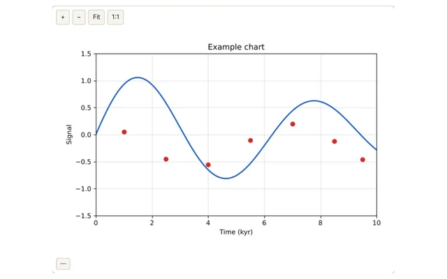
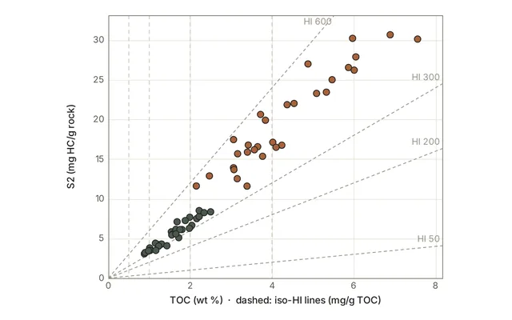
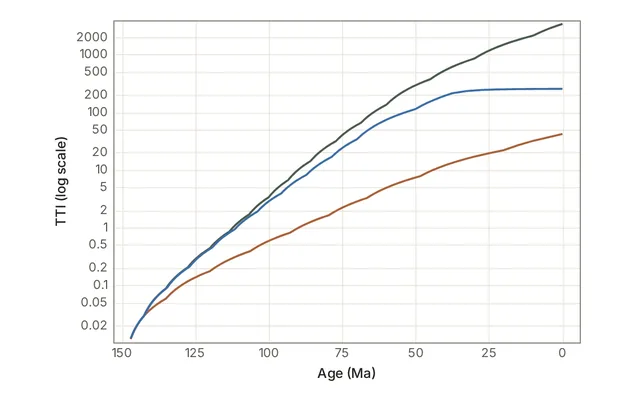
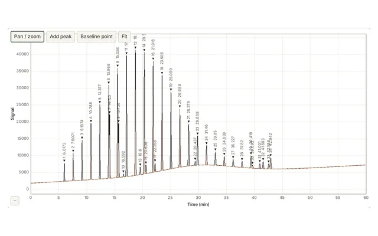
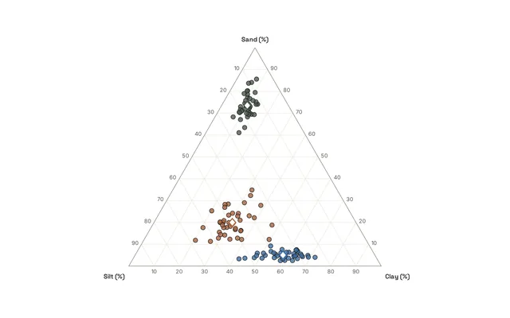

<svg class="hero-contours" viewBox="0 0 1000 420" preserveAspectRatio="xMaxYMin slice" aria-hidden="true">
<g class="contacts">
<path class="oil" d="M1001,120 L996,137 L982,152 L965,165 L946,176 L928,187 L911,197 L894,207 L874,215 L851,221 L827,224 L803,225 L780,225 L756,225 L731,227 L704,228 L675,227 L646,223 L622,213 L606,199 L599,182 L600,164 L606,147 L611,133 L613,120 L611,107 L608,93 L607,78 L610,62 L621,48 L637,36 L658,26 L680,18 L703,10 L727,4 L753,-1 L780,-3 L807,-1 L832,6 L852,17 L868,30 L882,42 L896,52 L913,60 L934,68 L958,77 L980,88 L995,103Z"/>
<path class="gas" d="M886,120 L890,129 L889,137 L883,145 L873,151 L861,156 L848,160 L837,164 L827,167 L816,171 L804,174 L792,175 L780,175 L768,174 L756,172 L744,171 L732,169 L718,167 L704,165 L691,160 L682,153 L677,145 L677,136 L682,128 L689,120 L695,113 L699,107 L701,101 L702,93 L704,86 L709,78 L717,72 L728,67 L740,64 L753,62 L767,60 L780,59 L794,59 L807,60 L820,63 L831,69 L838,75 L844,82 L848,89 L853,95 L859,101 L868,106 L878,112Z"/>
<path class="owc" pathLength="1" d="M1001,120 L996,137 L982,152 L965,165 L946,176 L928,187 L911,197 L894,207 L874,215 L851,221 L827,224 L803,225 L780,225 L756,225 L731,227 L704,228 L675,227 L646,223 L622,213 L606,199 L599,182 L600,164 L606,147 L611,133 L613,120 L611,107 L608,93 L607,78 L610,62 L621,48 L637,36 L658,26 L680,18 L703,10 L727,4 L753,-1 L780,-3 L807,-1 L832,6 L852,17 L868,30 L882,42 L896,52 L913,60 L934,68 L958,77 L980,88 L995,103Z"/>
<path class="goc" pathLength="1" d="M886,120 L890,129 L889,137 L883,145 L873,151 L861,156 L848,160 L837,164 L827,167 L816,171 L804,174 L792,175 L780,175 L768,174 L756,172 L744,171 L732,169 L718,167 L704,165 L691,160 L682,153 L677,145 L677,136 L682,128 L689,120 L695,113 L699,107 L701,101 L702,93 L704,86 L709,78 L717,72 L728,67 L740,64 L753,62 L767,60 L780,59 L794,59 L807,60 L820,63 L831,69 L838,75 L844,82 L848,89 L853,95 L859,101 L868,106 L878,112Z"/>
<text class="lbl-goc" x="806" y="192">GOC</text>
<text class="lbl-owc" x="690" y="246">OWC</text>
</g>
<g class="iso">
<path pathLength="1" style="--i:0" d="M831,120 L834,124 L836,129 L834,133 L830,137 L824,140 L817,142 L810,143 L804,145 L798,146 L792,147 L786,148 L780,149 L774,148 L768,147 L762,146 L756,145 L750,143 L743,142 L736,140 L730,137 L726,133 L724,129 L726,124 L729,120 L733,116 L737,113 L740,110 L742,107 L743,103 L745,99 L748,96 L753,93 L759,91 L766,89 L773,89 L780,89 L787,89 L794,89 L801,91 L807,93 L812,96 L815,99 L817,103 L818,107 L820,110 L823,113 L827,116Z"/>
<path pathLength="1" style="--i:1" d="M886,120 L890,129 L889,137 L883,145 L873,151 L861,156 L848,160 L837,164 L827,167 L816,171 L804,174 L792,175 L780,175 L768,174 L756,172 L744,171 L732,169 L718,167 L704,165 L691,160 L682,153 L677,145 L677,136 L682,128 L689,120 L695,113 L699,107 L701,101 L702,93 L704,86 L709,78 L717,72 L728,67 L740,64 L753,62 L767,60 L780,59 L794,59 L807,60 L820,63 L831,69 L838,75 L844,82 L848,89 L853,95 L859,101 L868,106 L878,112Z"/>
<path pathLength="1" style="--i:2" d="M944,120 L946,133 L939,145 L926,156 L910,164 L894,172 L879,178 L865,185 L850,191 L834,196 L816,200 L798,201 L780,200 L762,199 L745,198 L726,197 L705,196 L683,194 L663,189 L646,180 L637,169 L634,155 L638,142 L645,130 L652,120 L656,110 L656,101 L656,90 L657,78 L662,67 L672,57 L687,48 L704,42 L722,38 L741,34 L760,30 L780,28 L800,28 L820,32 L838,38 L851,47 L861,58 L870,67 L878,76 L890,83 L905,90 L921,98 L935,108Z"/>
<path pathLength="1" style="--i:3" d="M1001,120 L996,137 L982,152 L965,165 L946,176 L928,187 L911,197 L894,207 L874,215 L851,221 L827,224 L803,225 L780,225 L756,225 L731,227 L704,228 L675,227 L646,223 L622,213 L606,199 L599,182 L600,164 L606,147 L611,133 L613,120 L611,107 L608,93 L607,78 L610,62 L621,48 L637,36 L658,26 L680,18 L703,10 L727,4 L753,-1 L780,-3 L807,-1 L832,6 L852,17 L868,30 L882,42 L896,52 L913,60 L934,68 L958,77 L980,88 L995,103Z"/>
<path pathLength="1" style="--i:4" d="M1050,120 L1038,140 L1021,158 L1002,174 L983,189 L965,203 L945,217 L922,229 L896,238 L867,244 L838,247 L809,249 L780,252 L750,256 L716,260 L680,263 L643,260 L610,250 L586,234 L573,213 L570,191 L572,171 L574,152 L573,136 L567,120 L560,103 L554,84 L556,65 L565,47 L582,31 L604,16 L628,4 L655,-8 L682,-19 L713,-28 L746,-33 L780,-32 L813,-26 L841,-14 L864,0 L884,14 L904,25 L928,33 L956,41 L988,49 L1018,62 L1041,79 L1052,99Z"/>
<path pathLength="1" style="--i:5" d="M1091,120 L1076,143 L1058,164 L1041,184 L1023,203 L1003,221 L979,237 L949,250 L916,258 L882,264 L848,269 L815,275 L780,283 L741,292 L699,299 L654,299 L613,290 L580,273 L559,250 L549,224 L546,200 L543,178 L537,158 L526,140 L513,120 L503,99 L500,76 L507,53 L523,33 L545,14 L570,-4 L597,-20 L627,-36 L660,-50 L698,-59 L739,-62 L780,-57 L817,-45 L848,-30 L875,-15 L902,-4 L932,4 L968,10 L1008,17 L1046,30 L1077,48 L1096,70 L1100,95Z"/>
<path pathLength="1" style="--i:6" d="M1128,120 L1114,146 L1100,170 L1085,194 L1066,217 L1041,238 L1009,255 L972,267 L934,277 L896,285 L860,295 L822,308 L780,322 L732,334 L681,338 L631,332 L588,315 L558,290 L540,261 L529,233 L521,208 L508,186 L491,166 L471,144 L455,120 L447,94 L449,68 L463,43 L483,19 L507,-3 L533,-25 L562,-47 L597,-66 L639,-81 L686,-87 L734,-84 L780,-74 L820,-59 L855,-45 L888,-34 L925,-28 L968,-24 L1016,-19 L1063,-8 L1104,10 L1130,35 L1141,63 L1139,92Z"/>
<path pathLength="1" style="--i:7" d="M1166,120 L1157,149 L1146,178 L1130,205 L1106,231 L1073,252 L1034,269 L992,283 L952,296 L914,310 L875,329 L831,348 L780,366 L723,376 L665,373 L613,358 L572,332 L544,301 L524,270 L508,243 L488,219 L463,197 L436,174 L412,148 L398,120 L395,90 L404,61 L420,32 L440,5 L463,-23 L490,-50 L525,-76 L568,-96 L620,-107 L676,-108 L731,-100 L780,-86 L823,-73 L864,-64 L907,-60 L956,-59 L1011,-57 L1068,-49 L1117,-32 L1153,-7 L1173,24 L1178,57 L1174,89Z"/>
<path pathLength="1" style="--i:8" d="M1210,120 L1205,153 L1194,185 L1172,216 L1140,242 L1099,264 L1056,282 L1014,300 L976,320 L937,343 L894,370 L841,394 L780,410 L715,412 L653,399 L601,374 L561,343 L532,310 L506,281 L478,256 L445,234 L410,210 L378,183 L356,153 L346,120 L349,87 L360,54 L374,21 L392,-12 L414,-45 L445,-77 L489,-103 L544,-120 L607,-126 L670,-121 L729,-110 L780,-98 L827,-92 L876,-91 L931,-95 L993,-97 L1058,-93 L1117,-78 L1163,-53 L1193,-20 L1207,16 L1212,52 L1212,87Z"/>
<path pathLength="1" style="--i:9" d="M220,300 L219,304 L217,307 L214,310 L210,312 L207,315 L204,317 L200,319 L197,321 L193,322 L189,323 L184,323 L180,323 L176,323 L171,323 L166,323 L161,323 L156,322 L151,320 L148,317 L147,314 L147,310 L148,306 L149,303 L150,300 L150,297 L149,294 L149,291 L150,287 L151,284 L154,282 L158,279 L162,278 L166,276 L170,275 L175,274 L180,273 L185,273 L189,275 L193,277 L196,280 L199,283 L201,285 L204,287 L208,289 L212,291 L216,293 L219,296Z"/>
<path pathLength="1" style="--i:10" d="M266,300 L262,308 L257,315 L251,321 L245,327 L239,332 L233,338 L225,342 L217,346 L208,348 L198,349 L189,350 L180,351 L170,353 L160,354 L148,355 L136,354 L126,350 L118,344 L114,336 L113,328 L114,320 L114,313 L114,306 L112,300 L110,293 L108,286 L108,279 L111,272 L117,265 L124,260 L132,255 L140,250 L149,246 L159,243 L169,241 L180,241 L190,244 L199,248 L207,254 L213,259 L220,263 L227,266 L236,269 L246,273 L256,278 L263,284 L267,292Z"/>
<path pathLength="1" style="--i:11" d="M307,300 L301,311 L294,322 L287,332 L280,341 L272,350 L262,358 L249,365 L236,369 L222,372 L208,375 L194,378 L180,382 L164,387 L146,390 L128,390 L111,385 L98,376 L90,364 L86,352 L84,339 L83,329 L80,319 L75,310 L69,300 L65,289 L64,278 L67,267 L74,256 L83,247 L93,238 L105,230 L117,222 L131,215 L146,210 L163,209 L180,212 L195,218 L208,226 L219,233 L230,238 L243,241 L258,244 L275,248 L291,254 L303,264 L310,275 L311,288Z"/>
<path pathLength="1" style="--i:12" d="M345,300 L339,315 L333,329 L326,343 L317,356 L304,368 L289,378 L271,385 L253,390 L236,396 L219,403 L200,411 L180,420 L157,426 L132,428 L109,423 L89,412 L76,397 L67,380 L62,365 L57,351 L50,339 L40,327 L30,314 L23,300 L20,285 L22,270 L28,255 L38,241 L49,228 L61,215 L75,202 L92,191 L112,183 L135,181 L158,183 L180,190 L199,198 L215,205 L232,210 L250,213 L272,215 L295,218 L318,225 L336,236 L347,251 L351,267 L350,284Z"/>
<path pathLength="1" style="--i:13" d="M383,300 L379,319 L374,337 L365,355 L351,371 L333,384 L312,394 L291,403 L271,413 L252,424 L232,437 L208,451 L180,462 L149,466 L119,462 L93,450 L73,432 L59,413 L48,394 L38,378 L25,364 L10,350 L-5,335 L-17,319 L-23,300 L-23,281 L-18,262 L-10,244 L-0,226 L11,207 L25,189 L44,173 L68,162 L97,156 L126,157 L155,163 L180,172 L202,178 L224,182 L248,182 L276,181 L306,183 L335,189 L360,202 L376,219 L385,239 L387,260 L386,281Z"/>
</g>
<g class="wells">
<g transform="translate(780,118)"><g class="well" style="--d:3.4s"><circle r="5" class="full"/><line x1="7.0" y1="0.0" x2="11.0" y2="0.0"/><line x1="4.9" y1="4.9" x2="7.8" y2="7.8"/><line x1="0.0" y1="7.0" x2="0.0" y2="11.0"/><line x1="-4.9" y1="4.9" x2="-7.8" y2="7.8"/><line x1="-7.0" y1="0.0" x2="-11.0" y2="0.0"/><line x1="-4.9" y1="-4.9" x2="-7.8" y2="-7.8"/><line x1="-0.0" y1="-7.0" x2="-0.0" y2="-11.0"/><line x1="4.9" y1="-4.9" x2="7.8" y2="-7.8"/><text x="10" y="-9">W-1</text></g></g>
<g transform="translate(910,100)"><g class="well" style="--d:4.4s"><circle r="5" class="full"/><text x="10" y="-9">A-1</text></g></g>
<g transform="translate(862,236)"><g class="well" style="--d:5.0s"><circle r="5"/><line x1="-8" y1="-8" x2="8" y2="8"/><line x1="-8" y1="8" x2="8" y2="-8"/><text x="10" y="-9">A-2</text></g></g>
</g>
</svg>

Petroleum systems · Basin modeling · Applied AI

# Romain Giboreau

Lead Geoscientist at Beicip-Franlab. 15 years of petroleum systems assessment and basin modeling across 20+ basins on five continents, with a growing focus on applied AI/ML for geoscience workflows.

[CV](cv.md){ .md-button .md-button--primary } [Talks & publications](talks.md){ .md-button } [Notes](notes/index.md){ .md-button } [LinkedIn](https://www.linkedin.com/in/romain-giboreau){ .md-button }

!!! info "Last talks — November 2026"
    **APGCE 2026, Kuala Lumpur — 17 November.**
    *Closing the Exploration Gap: Probabilistic Petroleum Systems Analysis from Basin to Prospect* — Oral Session 9 (Basin Modelling and Reservoir Characterisation). Thanks to everyone who came by.

    **First EAGE Conference on Basin and Petroleum Systems Modeling, Houston — 18 November.**
    *From Basin Modeling to Storage Fairway Mapping: AI-Assisted Smart Maps for Offshore Norway CCUS Screening* — Session VII (Basin modeling applications to the energy transition, Part I). Presented by a colleague.

    [All talks & publications](talks.md)

## Expertise

01 / 08<button type="button" class="xp-prev" aria-label="Previous">&#8249;</button><button type="button" class="xp-next" aria-label="Next">&#8250;</button>

<ol class="xp-track" tabindex="0">
<li class="xp-card" aria-roledescription="slide" aria-label="01 of 08">
<svg viewBox="0 0 320 200" role="img" aria-label="Petroleum system cross-section: source rock, migration pathways and an anticlinal trap" font-family="Inter,sans-serif"><defs><marker id="a1" viewBox="0 0 8 8" refX="6" refY="4" markerWidth="6" markerHeight="6" orient="auto"><path d="M0,0 L8,4 L0,8z" fill="#a8623a"/></marker></defs><polygon points="0.0,0.0 5.0,0.0 10.0,0.0 15.0,0.0 20.0,0.0 25.0,0.0 30.0,0.0 35.0,0.0 40.0,0.0 45.0,0.0 50.0,0.0 55.0,0.0 60.0,0.0 65.0,0.0 70.0,0.0 75.0,0.0 80.0,0.0 85.0,0.0 90.0,0.0 95.0,0.0 100.0,0.0 105.0,0.0 110.0,0.0 115.0,0.0 120.0,0.0 125.0,0.0 130.0,0.0 135.0,0.0 140.0,0.0 145.0,0.0 150.0,0.0 155.0,0.0 160.0,0.0 165.0,0.0 170.0,0.0 175.0,0.0 180.0,0.0 185.0,0.0 190.0,0.0 195.0,0.0 200.0,0.0 205.0,0.0 210.0,0.0 215.0,0.0 220.0,0.0 225.0,0.0 230.0,0.0 235.0,0.0 240.0,0.0 245.0,0.0 250.0,0.0 255.0,0.0 260.0,0.0 265.0,0.0 270.0,0.0 275.0,0.0 280.0,0.0 285.0,0.0 290.0,0.0 295.0,0.0 300.0,0.0 305.0,0.0 310.0,0.0 315.0,0.0 320.0,0.0 320.0,37.1 315.0,37.3 310.0,37.3 305.0,37.2 300.0,37.0 295.0,36.5 290.0,35.9 285.0,35.0 280.0,33.9 275.0,32.5 270.0,31.0 265.0,29.3 260.0,27.5 255.0,25.7 250.0,23.8 245.0,22.1 240.0,20.5 235.0,19.2 230.0,18.2 225.0,17.7 220.0,17.6 215.0,18.0 210.0,18.9 205.0,20.3 200.0,22.1 195.0,24.4 190.0,27.0 185.0,29.9 180.0,32.9 175.0,36.1 170.0,39.2 165.0,42.3 160.0,45.3 155.0,48.1 150.0,50.8 145.0,53.2 140.0,55.4 135.0,57.3 130.0,59.1 125.0,60.6 120.0,62.0 115.0,63.3 110.0,64.4 105.0,65.4 100.0,66.3 95.0,67.1 90.0,67.9 85.0,68.7 80.0,69.4 75.0,70.1 70.0,70.8 65.0,71.5 60.0,72.1 55.0,72.8 50.0,73.4 45.0,74.1 40.0,74.7 35.0,75.4 30.0,76.0 25.0,76.7 20.0,77.3 15.0,78.0 10.0,78.6 5.0,79.3 0.0,79.9" fill="#ece9df"/><polygon points="0.0,79.9 5.0,79.3 10.0,78.6 15.0,78.0 20.0,77.3 25.0,76.7 30.0,76.0 35.0,75.4 40.0,74.7 45.0,74.1 50.0,73.4 55.0,72.8 60.0,72.1 65.0,71.5 70.0,70.8 75.0,70.1 80.0,69.4 85.0,68.7 90.0,67.9 95.0,67.1 100.0,66.3 105.0,65.4 110.0,64.4 115.0,63.3 120.0,62.0 125.0,60.6 130.0,59.1 135.0,57.3 140.0,55.4 145.0,53.2 150.0,50.8 155.0,48.1 160.0,45.3 165.0,42.3 170.0,39.2 175.0,36.1 180.0,32.9 185.0,29.9 190.0,27.0 195.0,24.4 200.0,22.1 205.0,20.3 210.0,18.9 215.0,18.0 220.0,17.6 225.0,17.7 230.0,18.2 235.0,19.2 240.0,20.5 245.0,22.1 250.0,23.8 255.0,25.7 260.0,27.5 265.0,29.3 270.0,31.0 275.0,32.5 280.0,33.9 285.0,35.0 290.0,35.9 295.0,36.5 300.0,37.0 305.0,37.2 310.0,37.3 315.0,37.3 320.0,37.1 320.0,59.1 315.0,59.3 310.0,59.3 305.0,59.2 300.0,59.0 295.0,58.5 290.0,57.9 285.0,57.0 280.0,55.9 275.0,54.5 270.0,53.0 265.0,51.3 260.0,49.5 255.0,47.7 250.0,45.8 245.0,44.1 240.0,42.5 235.0,41.2 230.0,40.2 225.0,39.7 220.0,39.6 215.0,40.0 210.0,40.9 205.0,42.3 200.0,44.1 195.0,46.4 190.0,49.0 185.0,51.9 180.0,54.9 175.0,58.1 170.0,61.2 165.0,64.3 160.0,67.3 155.0,70.1 150.0,72.8 145.0,75.2 140.0,77.4 135.0,79.3 130.0,81.1 125.0,82.6 120.0,84.0 115.0,85.3 110.0,86.4 105.0,87.4 100.0,88.3 95.0,89.1 90.0,89.9 85.0,90.7 80.0,91.4 75.0,92.1 70.0,92.8 65.0,93.5 60.0,94.1 55.0,94.8 50.0,95.4 45.0,96.1 40.0,96.7 35.0,97.4 30.0,98.0 25.0,98.7 20.0,99.3 15.0,100.0 10.0,100.6 5.0,101.3 0.0,101.9" fill="#cfd3c8"/><polygon points="0.0,101.9 5.0,101.3 10.0,100.6 15.0,100.0 20.0,99.3 25.0,98.7 30.0,98.0 35.0,97.4 40.0,96.7 45.0,96.1 50.0,95.4 55.0,94.8 60.0,94.1 65.0,93.5 70.0,92.8 75.0,92.1 80.0,91.4 85.0,90.7 90.0,89.9 95.0,89.1 100.0,88.3 105.0,87.4 110.0,86.4 115.0,85.3 120.0,84.0 125.0,82.6 130.0,81.1 135.0,79.3 140.0,77.4 145.0,75.2 150.0,72.8 155.0,70.1 160.0,67.3 165.0,64.3 170.0,61.2 175.0,58.1 180.0,54.9 185.0,51.9 190.0,49.0 195.0,46.4 200.0,44.1 205.0,42.3 210.0,40.9 215.0,40.0 220.0,39.6 225.0,39.7 230.0,40.2 235.0,41.2 240.0,42.5 245.0,44.1 250.0,45.8 255.0,47.7 260.0,49.5 265.0,51.3 270.0,53.0 275.0,54.5 280.0,55.9 285.0,57.0 290.0,57.9 295.0,58.5 300.0,59.0 305.0,59.2 310.0,59.3 315.0,59.3 320.0,59.1 320.0,77.1 315.0,77.3 310.0,77.3 305.0,77.2 300.0,77.0 295.0,76.5 290.0,75.9 285.0,75.0 280.0,73.9 275.0,72.5 270.0,71.0 265.0,69.3 260.0,67.5 255.0,65.7 250.0,63.8 245.0,62.1 240.0,60.5 235.0,59.2 230.0,58.2 225.0,57.7 220.0,57.6 215.0,58.0 210.0,58.9 205.0,60.3 200.0,62.1 195.0,64.4 190.0,67.0 185.0,69.9 180.0,72.9 175.0,76.1 170.0,79.2 165.0,82.3 160.0,85.3 155.0,88.1 150.0,90.8 145.0,93.2 140.0,95.4 135.0,97.3 130.0,99.1 125.0,100.6 120.0,102.0 115.0,103.3 110.0,104.4 105.0,105.4 100.0,106.3 95.0,107.1 90.0,107.9 85.0,108.7 80.0,109.4 75.0,110.1 70.0,110.8 65.0,111.5 60.0,112.1 55.0,112.8 50.0,113.4 45.0,114.1 40.0,114.7 35.0,115.4 30.0,116.0 25.0,116.7 20.0,117.3 15.0,118.0 10.0,118.6 5.0,119.3 0.0,119.9" fill="#e6d6b0"/><polygon points="0.0,119.9 5.0,119.3 10.0,118.6 15.0,118.0 20.0,117.3 25.0,116.7 30.0,116.0 35.0,115.4 40.0,114.7 45.0,114.1 50.0,113.4 55.0,112.8 60.0,112.1 65.0,111.5 70.0,110.8 75.0,110.1 80.0,109.4 85.0,108.7 90.0,107.9 95.0,107.1 100.0,106.3 105.0,105.4 110.0,104.4 115.0,103.3 120.0,102.0 125.0,100.6 130.0,99.1 135.0,97.3 140.0,95.4 145.0,93.2 150.0,90.8 155.0,88.1 160.0,85.3 165.0,82.3 170.0,79.2 175.0,76.1 180.0,72.9 185.0,69.9 190.0,67.0 195.0,64.4 200.0,62.1 205.0,60.3 210.0,58.9 215.0,58.0 220.0,57.6 225.0,57.7 230.0,58.2 235.0,59.2 240.0,60.5 245.0,62.1 250.0,63.8 255.0,65.7 260.0,67.5 265.0,69.3 270.0,71.0 275.0,72.5 280.0,73.9 285.0,75.0 290.0,75.9 295.0,76.5 300.0,77.0 305.0,77.2 310.0,77.3 315.0,77.3 320.0,77.1 320.0,107.1 315.0,107.3 310.0,107.3 305.0,107.2 300.0,107.0 295.0,106.5 290.0,105.9 285.0,105.0 280.0,103.9 275.0,102.5 270.0,101.0 265.0,99.3 260.0,97.5 255.0,95.7 250.0,93.8 245.0,92.1 240.0,90.5 235.0,89.2 230.0,88.2 225.0,87.7 220.0,87.6 215.0,88.0 210.0,88.9 205.0,90.3 200.0,92.1 195.0,94.4 190.0,97.0 185.0,99.9 180.0,102.9 175.0,106.1 170.0,109.2 165.0,112.3 160.0,115.3 155.0,118.1 150.0,120.8 145.0,123.2 140.0,125.4 135.0,127.3 130.0,129.1 125.0,130.6 120.0,132.0 115.0,133.3 110.0,134.4 105.0,135.4 100.0,136.3 95.0,137.1 90.0,137.9 85.0,138.7 80.0,139.4 75.0,140.1 70.0,140.8 65.0,141.5 60.0,142.1 55.0,142.8 50.0,143.4 45.0,144.1 40.0,144.7 35.0,145.4 30.0,146.0 25.0,146.7 20.0,147.3 15.0,148.0 10.0,148.6 5.0,149.3 0.0,149.9" fill="#d9d5c8"/><polygon points="0.0,149.9 5.0,149.3 10.0,148.6 15.0,148.0 20.0,147.3 25.0,146.7 30.0,146.0 35.0,145.4 40.0,144.7 45.0,144.1 50.0,143.4 55.0,142.8 60.0,142.1 65.0,141.5 70.0,140.8 75.0,140.1 80.0,139.4 85.0,138.7 90.0,137.9 95.0,137.1 100.0,136.3 105.0,135.4 110.0,134.4 115.0,133.3 120.0,132.0 125.0,130.6 130.0,129.1 135.0,127.3 140.0,125.4 145.0,123.2 150.0,120.8 155.0,118.1 160.0,115.3 165.0,112.3 170.0,109.2 175.0,106.1 180.0,102.9 185.0,99.9 190.0,97.0 195.0,94.4 200.0,92.1 205.0,90.3 210.0,88.9 215.0,88.0 220.0,87.6 225.0,87.7 230.0,88.2 235.0,89.2 240.0,90.5 245.0,92.1 250.0,93.8 255.0,95.7 260.0,97.5 265.0,99.3 270.0,101.0 275.0,102.5 280.0,103.9 285.0,105.0 290.0,105.9 295.0,106.5 300.0,107.0 305.0,107.2 310.0,107.3 315.0,107.3 320.0,107.1 320.0,125.1 315.0,125.3 310.0,125.3 305.0,125.2 300.0,125.0 295.0,124.5 290.0,123.9 285.0,123.0 280.0,121.9 275.0,120.5 270.0,119.0 265.0,117.3 260.0,115.5 255.0,113.7 250.0,111.8 245.0,110.1 240.0,108.5 235.0,107.2 230.0,106.2 225.0,105.7 220.0,105.6 215.0,106.0 210.0,106.9 205.0,108.3 200.0,110.1 195.0,112.4 190.0,115.0 185.0,117.9 180.0,120.9 175.0,124.1 170.0,127.2 165.0,130.3 160.0,133.3 155.0,136.1 150.0,138.8 145.0,141.2 140.0,143.4 135.0,145.3 130.0,147.1 125.0,148.6 120.0,150.0 115.0,151.3 110.0,152.4 105.0,153.4 100.0,154.3 95.0,155.1 90.0,155.9 85.0,156.7 80.0,157.4 75.0,158.1 70.0,158.8 65.0,159.5 60.0,160.1 55.0,160.8 50.0,161.4 45.0,162.1 40.0,162.7 35.0,163.4 30.0,164.0 25.0,164.7 20.0,165.3 15.0,166.0 10.0,166.6 5.0,167.3 0.0,167.9" fill="#5c5a52"/><polygon points="0.0,167.9 5.0,167.3 10.0,166.6 15.0,166.0 20.0,165.3 25.0,164.7 30.0,164.0 35.0,163.4 40.0,162.7 45.0,162.1 50.0,161.4 55.0,160.8 60.0,160.1 65.0,159.5 70.0,158.8 75.0,158.1 80.0,157.4 85.0,156.7 90.0,155.9 95.0,155.1 100.0,154.3 105.0,153.4 110.0,152.4 115.0,151.3 120.0,150.0 125.0,148.6 130.0,147.1 135.0,145.3 140.0,143.4 145.0,141.2 150.0,138.8 155.0,136.1 160.0,133.3 165.0,130.3 170.0,127.2 175.0,124.1 180.0,120.9 185.0,117.9 190.0,115.0 195.0,112.4 200.0,110.1 205.0,108.3 210.0,106.9 215.0,106.0 220.0,105.6 225.0,105.7 230.0,106.2 235.0,107.2 240.0,108.5 245.0,110.1 250.0,111.8 255.0,113.7 260.0,115.5 265.0,117.3 270.0,119.0 275.0,120.5 280.0,121.9 285.0,123.0 290.0,123.9 295.0,124.5 300.0,125.0 305.0,125.2 310.0,125.3 315.0,125.3 320.0,125.1 320.0,200.0 315.0,200.0 310.0,200.0 305.0,200.0 300.0,200.0 295.0,200.0 290.0,200.0 285.0,200.0 280.0,200.0 275.0,200.0 270.0,200.0 265.0,200.0 260.0,200.0 255.0,200.0 250.0,200.0 245.0,200.0 240.0,200.0 235.0,200.0 230.0,200.0 225.0,200.0 220.0,200.0 215.0,200.0 210.0,200.0 205.0,200.0 200.0,200.0 195.0,200.0 190.0,200.0 185.0,200.0 180.0,200.0 175.0,200.0 170.0,200.0 165.0,200.0 160.0,200.0 155.0,200.0 150.0,200.0 145.0,200.0 140.0,200.0 135.0,200.0 130.0,200.0 125.0,200.0 120.0,200.0 115.0,200.0 110.0,200.0 105.0,200.0 100.0,200.0 95.0,200.0 90.0,200.0 85.0,200.0 80.0,200.0 75.0,200.0 70.0,200.0 65.0,200.0 60.0,200.0 55.0,200.0 50.0,200.0 45.0,200.0 40.0,200.0 35.0,200.0 30.0,200.0 25.0,200.0 20.0,200.0 15.0,200.0 10.0,200.0 5.0,200.0 0.0,200.0" fill="#c9c4b6"/><clipPath id="c1"><polygon points="0.0,101.9 5.0,101.3 10.0,100.6 15.0,100.0 20.0,99.3 25.0,98.7 30.0,98.0 35.0,97.4 40.0,96.7 45.0,96.1 50.0,95.4 55.0,94.8 60.0,94.1 65.0,93.5 70.0,92.8 75.0,92.1 80.0,91.4 85.0,90.7 90.0,89.9 95.0,89.1 100.0,88.3 105.0,87.4 110.0,86.4 115.0,85.3 120.0,84.0 125.0,82.6 130.0,81.1 135.0,79.3 140.0,77.4 145.0,75.2 150.0,72.8 155.0,70.1 160.0,67.3 165.0,64.3 170.0,61.2 175.0,58.1 180.0,54.9 185.0,51.9 190.0,49.0 195.0,46.4 200.0,44.1 205.0,42.3 210.0,40.9 215.0,40.0 220.0,39.6 225.0,39.7 230.0,40.2 235.0,41.2 240.0,42.5 245.0,44.1 250.0,45.8 255.0,47.7 260.0,49.5 265.0,51.3 270.0,53.0 275.0,54.5 280.0,55.9 285.0,57.0 290.0,57.9 295.0,58.5 300.0,59.0 305.0,59.2 310.0,59.3 315.0,59.3 320.0,59.1 320.0,77.1 315.0,77.3 310.0,77.3 305.0,77.2 300.0,77.0 295.0,76.5 290.0,75.9 285.0,75.0 280.0,73.9 275.0,72.5 270.0,71.0 265.0,69.3 260.0,67.5 255.0,65.7 250.0,63.8 245.0,62.1 240.0,60.5 235.0,59.2 230.0,58.2 225.0,57.7 220.0,57.6 215.0,58.0 210.0,58.9 205.0,60.3 200.0,62.1 195.0,64.4 190.0,67.0 185.0,69.9 180.0,72.9 175.0,76.1 170.0,79.2 165.0,82.3 160.0,85.3 155.0,88.1 150.0,90.8 145.0,93.2 140.0,95.4 135.0,97.3 130.0,99.1 125.0,100.6 120.0,102.0 115.0,103.3 110.0,104.4 105.0,105.4 100.0,106.3 95.0,107.1 90.0,107.9 85.0,108.7 80.0,109.4 75.0,110.1 70.0,110.8 65.0,111.5 60.0,112.1 55.0,112.8 50.0,113.4 45.0,114.1 40.0,114.7 35.0,115.4 30.0,116.0 25.0,116.7 20.0,117.3 15.0,118.0 10.0,118.6 5.0,119.3 0.0,119.9"/></clipPath><rect x="0" y="0" width="320" height="54.6" fill="#a8623a" opacity=".85" clip-path="url(#c1)"/><polyline points="0.0,79.9 5.0,79.3 10.0,78.6 15.0,78.0 20.0,77.3 25.0,76.7 30.0,76.0 35.0,75.4 40.0,74.7 45.0,74.1 50.0,73.4 55.0,72.8 60.0,72.1 65.0,71.5 70.0,70.8 75.0,70.1 80.0,69.4 85.0,68.7 90.0,67.9 95.0,67.1 100.0,66.3 105.0,65.4 110.0,64.4 115.0,63.3 120.0,62.0 125.0,60.6 130.0,59.1 135.0,57.3 140.0,55.4 145.0,53.2 150.0,50.8 155.0,48.1 160.0,45.3 165.0,42.3 170.0,39.2 175.0,36.1 180.0,32.9 185.0,29.9 190.0,27.0 195.0,24.4 200.0,22.1 205.0,20.3 210.0,18.9 215.0,18.0 220.0,17.6 225.0,17.7 230.0,18.2 235.0,19.2 240.0,20.5 245.0,22.1 250.0,23.8 255.0,25.7 260.0,27.5 265.0,29.3 270.0,31.0 275.0,32.5 280.0,33.9 285.0,35.0 290.0,35.9 295.0,36.5 300.0,37.0 305.0,37.2 310.0,37.3 315.0,37.3 320.0,37.1" fill="none" stroke="#5c5a52" stroke-width=".6"/><polyline points="0.0,101.9 5.0,101.3 10.0,100.6 15.0,100.0 20.0,99.3 25.0,98.7 30.0,98.0 35.0,97.4 40.0,96.7 45.0,96.1 50.0,95.4 55.0,94.8 60.0,94.1 65.0,93.5 70.0,92.8 75.0,92.1 80.0,91.4 85.0,90.7 90.0,89.9 95.0,89.1 100.0,88.3 105.0,87.4 110.0,86.4 115.0,85.3 120.0,84.0 125.0,82.6 130.0,81.1 135.0,79.3 140.0,77.4 145.0,75.2 150.0,72.8 155.0,70.1 160.0,67.3 165.0,64.3 170.0,61.2 175.0,58.1 180.0,54.9 185.0,51.9 190.0,49.0 195.0,46.4 200.0,44.1 205.0,42.3 210.0,40.9 215.0,40.0 220.0,39.6 225.0,39.7 230.0,40.2 235.0,41.2 240.0,42.5 245.0,44.1 250.0,45.8 255.0,47.7 260.0,49.5 265.0,51.3 270.0,53.0 275.0,54.5 280.0,55.9 285.0,57.0 290.0,57.9 295.0,58.5 300.0,59.0 305.0,59.2 310.0,59.3 315.0,59.3 320.0,59.1" fill="none" stroke="#5c5a52" stroke-width=".6"/><polyline points="0.0,119.9 5.0,119.3 10.0,118.6 15.0,118.0 20.0,117.3 25.0,116.7 30.0,116.0 35.0,115.4 40.0,114.7 45.0,114.1 50.0,113.4 55.0,112.8 60.0,112.1 65.0,111.5 70.0,110.8 75.0,110.1 80.0,109.4 85.0,108.7 90.0,107.9 95.0,107.1 100.0,106.3 105.0,105.4 110.0,104.4 115.0,103.3 120.0,102.0 125.0,100.6 130.0,99.1 135.0,97.3 140.0,95.4 145.0,93.2 150.0,90.8 155.0,88.1 160.0,85.3 165.0,82.3 170.0,79.2 175.0,76.1 180.0,72.9 185.0,69.9 190.0,67.0 195.0,64.4 200.0,62.1 205.0,60.3 210.0,58.9 215.0,58.0 220.0,57.6 225.0,57.7 230.0,58.2 235.0,59.2 240.0,60.5 245.0,62.1 250.0,63.8 255.0,65.7 260.0,67.5 265.0,69.3 270.0,71.0 275.0,72.5 280.0,73.9 285.0,75.0 290.0,75.9 295.0,76.5 300.0,77.0 305.0,77.2 310.0,77.3 315.0,77.3 320.0,77.1" fill="none" stroke="#5c5a52" stroke-width=".6"/><polyline points="0.0,149.9 5.0,149.3 10.0,148.6 15.0,148.0 20.0,147.3 25.0,146.7 30.0,146.0 35.0,145.4 40.0,144.7 45.0,144.1 50.0,143.4 55.0,142.8 60.0,142.1 65.0,141.5 70.0,140.8 75.0,140.1 80.0,139.4 85.0,138.7 90.0,137.9 95.0,137.1 100.0,136.3 105.0,135.4 110.0,134.4 115.0,133.3 120.0,132.0 125.0,130.6 130.0,129.1 135.0,127.3 140.0,125.4 145.0,123.2 150.0,120.8 155.0,118.1 160.0,115.3 165.0,112.3 170.0,109.2 175.0,106.1 180.0,102.9 185.0,99.9 190.0,97.0 195.0,94.4 200.0,92.1 205.0,90.3 210.0,88.9 215.0,88.0 220.0,87.6 225.0,87.7 230.0,88.2 235.0,89.2 240.0,90.5 245.0,92.1 250.0,93.8 255.0,95.7 260.0,97.5 265.0,99.3 270.0,101.0 275.0,102.5 280.0,103.9 285.0,105.0 290.0,105.9 295.0,106.5 300.0,107.0 305.0,107.2 310.0,107.3 315.0,107.3 320.0,107.1" fill="none" stroke="#5c5a52" stroke-width=".6"/><polyline points="0.0,167.9 5.0,167.3 10.0,166.6 15.0,166.0 20.0,165.3 25.0,164.7 30.0,164.0 35.0,163.4 40.0,162.7 45.0,162.1 50.0,161.4 55.0,160.8 60.0,160.1 65.0,159.5 70.0,158.8 75.0,158.1 80.0,157.4 85.0,156.7 90.0,155.9 95.0,155.1 100.0,154.3 105.0,153.4 110.0,152.4 115.0,151.3 120.0,150.0 125.0,148.6 130.0,147.1 135.0,145.3 140.0,143.4 145.0,141.2 150.0,138.8 155.0,136.1 160.0,133.3 165.0,130.3 170.0,127.2 175.0,124.1 180.0,120.9 185.0,117.9 190.0,115.0 195.0,112.4 200.0,110.1 205.0,108.3 210.0,106.9 215.0,106.0 220.0,105.6 225.0,105.7 230.0,106.2 235.0,107.2 240.0,108.5 245.0,110.1 250.0,111.8 255.0,113.7 260.0,115.5 265.0,117.3 270.0,119.0 275.0,120.5 280.0,121.9 285.0,123.0 290.0,123.9 295.0,124.5 300.0,125.0 305.0,125.2 310.0,125.3 315.0,125.3 320.0,125.1" fill="none" stroke="#5c5a52" stroke-width=".6"/><path d="M40,142.7 Q105.0,97.7 190,48.6" fill="none" stroke="#a8623a" stroke-width="1.6" stroke-dasharray="4 3" marker-end="url(#a1)"/><path d="M95,135.1 Q140.0,90.1 205,48.6" fill="none" stroke="#a8623a" stroke-width="1.6" stroke-dasharray="4 3" marker-end="url(#a1)"/><text x="8" y="92.90990008136355" font-size="8.5" fill="#232220" text-anchor="start" font-weight="400">seal</text><text x="8" y="113.90990008136355" font-size="8.5" fill="#232220" text-anchor="start" font-weight="400">reservoir</text><text x="8" y="160.90990008136356" font-size="8.5" fill="#f5f3ed" text-anchor="start" font-weight="400">source rock</text><text x="240" y="33.601738813102976" font-size="9" fill="#a8623a" text-anchor="start" font-weight="600">trap</text><text x="150" y="132.76657925699232" font-size="8.5" fill="#f5f3ed" text-anchor="start" font-weight="400">kitchen</text></svg>
01 / 08<h3>Petroleum systems analysis</h3>
Source, migration, reservoir, seal and trap assessed together; play fairway analysis in 20+ basins on five continents.
</li>
<li class="xp-card" aria-roledescription="slide" aria-label="02 of 08">
<svg viewBox="0 0 320 200" role="img" aria-label="Burial history diagram with the oil and gas windows" font-family="Inter,sans-serif"><rect x="34" y="107.3" width="272" height="50.6" fill="#a8623a" opacity=".16"/><rect x="34" y="157.9" width="272" height="22.1" fill="#4a6f8f" opacity=".10"/><polygon points="34.0,22.0 40.8,31.1 47.6,37.4 54.4,42.8 61.2,47.8 68.0,52.6 74.8,57.0 81.6,61.3 88.4,65.5 95.2,69.5 102.0,73.4 108.8,77.2 115.6,80.9 122.4,84.6 129.2,88.1 136.0,91.7 142.8,95.1 149.6,98.5 156.4,101.9 163.2,105.2 170.0,108.4 176.8,111.7 183.6,114.8 190.4,118.0 197.2,121.1 204.0,124.2 210.8,127.2 217.6,130.2 224.4,133.2 231.2,136.2 238.0,139.1 244.8,142.1 251.6,145.0 258.4,147.8 265.2,150.7 272.0,153.5 278.8,156.3 285.6,159.1 292.4,161.9 299.2,164.6 306.0,167.4 306.0,142.1 306.0,142.1 300.5,139.8 294.9,137.5 289.4,135.3 283.9,133.0 278.3,130.6 272.8,128.3 267.3,125.9 261.8,123.6 256.2,121.2 250.7,118.8 245.2,116.3 239.6,113.9 234.1,111.4 228.6,108.9 223.0,106.4 217.5,103.9 212.0,101.3 206.4,98.7 200.9,96.1 195.4,93.4 189.9,90.7 184.3,88.0 178.8,85.2 173.3,82.4 167.7,79.5 162.2,76.6 156.7,73.7 151.1,70.7 145.6,67.6 140.1,64.5 134.5,61.2 129.0,57.9 123.5,54.5 118.0,50.9 112.4,47.2 106.9,43.4 101.4,39.2 95.8,34.7 90.3,29.5 84.8,22.0" fill="#d9d5c8" opacity=".9"/><polygon points="84.8,22.0 90.3,29.5 95.8,34.7 101.4,39.2 106.9,43.4 112.4,47.2 118.0,50.9 123.5,54.5 129.0,57.9 134.5,61.2 140.1,64.5 145.6,67.6 151.1,70.7 156.7,73.7 162.2,76.6 167.7,79.5 173.3,82.4 178.8,85.2 184.3,88.0 189.9,90.7 195.4,93.4 200.9,96.1 206.4,98.7 212.0,101.3 217.5,103.9 223.0,106.4 228.6,108.9 234.1,111.4 239.6,113.9 245.2,116.3 250.7,118.8 256.2,121.2 261.8,123.6 267.3,125.9 272.8,128.3 278.3,130.6 283.9,133.0 289.4,135.3 294.9,137.5 300.5,139.8 306.0,142.1 306.0,116.8 306.0,116.8 301.6,115.0 297.3,113.2 292.9,111.4 288.6,109.6 284.2,107.8 279.9,105.9 275.5,104.1 271.2,102.2 266.8,100.3 262.5,98.4 258.1,96.5 253.8,94.5 249.4,92.6 245.1,90.6 240.7,88.6 236.4,86.6 232.0,84.6 227.7,82.5 223.3,80.5 219.0,78.4 214.6,76.2 210.3,74.1 205.9,71.9 201.6,69.7 197.2,67.4 192.8,65.1 188.5,62.8 184.1,60.4 179.8,58.0 175.4,55.5 171.1,53.0 166.7,50.4 162.4,47.6 158.0,44.8 153.7,41.9 149.3,38.9 145.0,35.6 140.6,32.0 136.3,28.0 131.9,22.0" fill="#e6d6b0" opacity=".9"/><polygon points="131.9,22.0 136.3,28.0 140.6,32.0 145.0,35.6 149.3,38.9 153.7,41.9 158.0,44.8 162.4,47.6 166.7,50.4 171.1,53.0 175.4,55.5 179.8,58.0 184.1,60.4 188.5,62.8 192.8,65.1 197.2,67.4 201.6,69.7 205.9,71.9 210.3,74.1 214.6,76.2 219.0,78.4 223.3,80.5 227.7,82.5 232.0,84.6 236.4,86.6 240.7,88.6 245.1,90.6 249.4,92.6 253.8,94.5 258.1,96.5 262.5,98.4 266.8,100.3 271.2,102.2 275.5,104.1 279.9,105.9 284.2,107.8 288.6,109.6 292.9,111.4 297.3,113.2 301.6,115.0 306.0,116.8 306.0,88.4 306.0,88.4 302.8,87.1 299.7,85.9 296.5,84.6 293.3,83.3 290.1,82.0 287.0,80.7 283.8,79.4 280.6,78.1 277.4,76.8 274.3,75.5 271.1,74.1 267.9,72.8 264.7,71.4 261.6,70.0 258.4,68.6 255.2,67.2 252.1,65.8 248.9,64.4 245.7,62.9 242.5,61.5 239.4,60.0 236.2,58.5 233.0,56.9 229.8,55.4 226.7,53.8 223.5,52.2 220.3,50.6 217.1,48.9 214.0,47.2 210.8,45.5 207.6,43.7 204.5,41.8 201.3,40.0 198.1,38.0 194.9,36.0 191.8,33.8 188.6,31.5 185.4,29.0 182.2,26.2 179.1,22.0" fill="#cfd3c8" opacity=".9"/><polygon points="179.1,22.0 182.2,26.2 185.4,29.0 188.6,31.5 191.8,33.8 194.9,36.0 198.1,38.0 201.3,40.0 204.5,41.8 207.6,43.7 210.8,45.5 214.0,47.2 217.1,48.9 220.3,50.6 223.5,52.2 226.7,53.8 229.8,55.4 233.0,56.9 236.2,58.5 239.4,60.0 242.5,61.5 245.7,62.9 248.9,64.4 252.1,65.8 255.2,67.2 258.4,68.6 261.6,70.0 264.7,71.4 267.9,72.8 271.1,74.1 274.3,75.5 277.4,76.8 280.6,78.1 283.8,79.4 287.0,80.7 290.1,82.0 293.3,83.3 296.5,84.6 299.7,85.9 302.8,87.1 306.0,88.4 306.0,61.5 306.0,61.5 304.0,60.8 302.0,60.0 300.0,59.3 298.0,58.5 296.0,57.7 294.0,57.0 292.0,56.2 290.0,55.4 288.0,54.6 286.1,53.8 284.1,53.0 282.1,52.2 280.1,51.4 278.1,50.6 276.1,49.8 274.1,48.9 272.1,48.1 270.1,47.2 268.1,46.4 266.1,45.5 264.1,44.6 262.1,43.7 260.1,42.8 258.1,41.9 256.1,40.9 254.1,40.0 252.1,39.0 250.1,38.0 248.2,37.0 246.2,36.0 244.2,34.9 242.2,33.8 240.2,32.7 238.2,31.5 236.2,30.3 234.2,29.0 232.2,27.7 230.2,26.2 228.2,24.5 226.2,22.0" fill="#e6d6b0" opacity=".9"/><polygon points="226.2,22.0 228.2,24.5 230.2,26.2 232.2,27.7 234.2,29.0 236.2,30.3 238.2,31.5 240.2,32.7 242.2,33.8 244.2,34.9 246.2,36.0 248.2,37.0 250.1,38.0 252.1,39.0 254.1,40.0 256.1,40.9 258.1,41.9 260.1,42.8 262.1,43.7 264.1,44.6 266.1,45.5 268.1,46.4 270.1,47.2 272.1,48.1 274.1,48.9 276.1,49.8 278.1,50.6 280.1,51.4 282.1,52.2 284.1,53.0 286.1,53.8 288.0,54.6 290.0,55.4 292.0,56.2 294.0,57.0 296.0,57.7 298.0,58.5 300.0,59.3 302.0,60.0 304.0,60.8 306.0,61.5 306.0,39.4 306.0,39.4 305.1,39.1 304.2,38.7 303.3,38.4 302.4,38.1 301.5,37.7 300.6,37.4 299.7,37.0 298.7,36.7 297.8,36.4 296.9,36.0 296.0,35.7 295.1,35.3 294.2,34.9 293.3,34.6 292.4,34.2 291.5,33.8 290.6,33.5 289.7,33.1 288.8,32.7 287.9,32.3 287.0,31.9 286.1,31.5 285.1,31.1 284.2,30.7 283.3,30.3 282.4,29.9 281.5,29.5 280.6,29.0 279.7,28.6 278.8,28.1 277.9,27.7 277.0,27.2 276.1,26.7 275.2,26.2 274.3,25.7 273.4,25.1 272.5,24.5 271.5,23.8 270.6,23.1 269.7,22.0" fill="#d9d5c8" opacity=".9"/><polygon points="269.7,22.0 270.6,23.1 271.5,23.8 272.5,24.5 273.4,25.1 274.3,25.7 275.2,26.2 276.1,26.7 277.0,27.2 277.9,27.7 278.8,28.1 279.7,28.6 280.6,29.0 281.5,29.5 282.4,29.9 283.3,30.3 284.2,30.7 285.1,31.1 286.1,31.5 287.0,31.9 287.9,32.3 288.8,32.7 289.7,33.1 290.6,33.5 291.5,33.8 292.4,34.2 293.3,34.6 294.2,34.9 295.1,35.3 296.0,35.7 296.9,36.0 297.8,36.4 298.7,36.7 299.7,37.0 300.6,37.4 301.5,37.7 302.4,38.1 303.3,38.4 304.2,38.7 305.1,39.1 306.0,39.4 306.0,22.0" fill="#e6d6b0" opacity=".9"/><polyline points="34.0,22.0 40.8,31.1 47.6,37.4 54.4,42.8 61.2,47.8 68.0,52.6 74.8,57.0 81.6,61.3 88.4,65.5 95.2,69.5 102.0,73.4 108.8,77.2 115.6,80.9 122.4,84.6 129.2,88.1 136.0,91.7 142.8,95.1 149.6,98.5 156.4,101.9 163.2,105.2 170.0,108.4 176.8,111.7 183.6,114.8 190.4,118.0 197.2,121.1 204.0,124.2 210.8,127.2 217.6,130.2 224.4,133.2 231.2,136.2 238.0,139.1 244.8,142.1 251.6,145.0 258.4,147.8 265.2,150.7 272.0,153.5 278.8,156.3 285.6,159.1 292.4,161.9 299.2,164.6 306.0,167.4" fill="none" stroke="#5c5a52" stroke-width=".8"/><polyline points="84.8,22.0 90.3,29.5 95.8,34.7 101.4,39.2 106.9,43.4 112.4,47.2 118.0,50.9 123.5,54.5 129.0,57.9 134.5,61.2 140.1,64.5 145.6,67.6 151.1,70.7 156.7,73.7 162.2,76.6 167.7,79.5 173.3,82.4 178.8,85.2 184.3,88.0 189.9,90.7 195.4,93.4 200.9,96.1 206.4,98.7 212.0,101.3 217.5,103.9 223.0,106.4 228.6,108.9 234.1,111.4 239.6,113.9 245.2,116.3 250.7,118.8 256.2,121.2 261.8,123.6 267.3,125.9 272.8,128.3 278.3,130.6 283.9,133.0 289.4,135.3 294.9,137.5 300.5,139.8 306.0,142.1" fill="none" stroke="#5c5a52" stroke-width=".8"/><polyline points="131.9,22.0 136.3,28.0 140.6,32.0 145.0,35.6 149.3,38.9 153.7,41.9 158.0,44.8 162.4,47.6 166.7,50.4 171.1,53.0 175.4,55.5 179.8,58.0 184.1,60.4 188.5,62.8 192.8,65.1 197.2,67.4 201.6,69.7 205.9,71.9 210.3,74.1 214.6,76.2 219.0,78.4 223.3,80.5 227.7,82.5 232.0,84.6 236.4,86.6 240.7,88.6 245.1,90.6 249.4,92.6 253.8,94.5 258.1,96.5 262.5,98.4 266.8,100.3 271.2,102.2 275.5,104.1 279.9,105.9 284.2,107.8 288.6,109.6 292.9,111.4 297.3,113.2 301.6,115.0 306.0,116.8" fill="none" stroke="#5c5a52" stroke-width=".8"/><polyline points="179.1,22.0 182.2,26.2 185.4,29.0 188.6,31.5 191.8,33.8 194.9,36.0 198.1,38.0 201.3,40.0 204.5,41.8 207.6,43.7 210.8,45.5 214.0,47.2 217.1,48.9 220.3,50.6 223.5,52.2 226.7,53.8 229.8,55.4 233.0,56.9 236.2,58.5 239.4,60.0 242.5,61.5 245.7,62.9 248.9,64.4 252.1,65.8 255.2,67.2 258.4,68.6 261.6,70.0 264.7,71.4 267.9,72.8 271.1,74.1 274.3,75.5 277.4,76.8 280.6,78.1 283.8,79.4 287.0,80.7 290.1,82.0 293.3,83.3 296.5,84.6 299.7,85.9 302.8,87.1 306.0,88.4" fill="none" stroke="#5c5a52" stroke-width=".8"/><polyline points="226.2,22.0 228.2,24.5 230.2,26.2 232.2,27.7 234.2,29.0 236.2,30.3 238.2,31.5 240.2,32.7 242.2,33.8 244.2,34.9 246.2,36.0 248.2,37.0 250.1,38.0 252.1,39.0 254.1,40.0 256.1,40.9 258.1,41.9 260.1,42.8 262.1,43.7 264.1,44.6 266.1,45.5 268.1,46.4 270.1,47.2 272.1,48.1 274.1,48.9 276.1,49.8 278.1,50.6 280.1,51.4 282.1,52.2 284.1,53.0 286.1,53.8 288.0,54.6 290.0,55.4 292.0,56.2 294.0,57.0 296.0,57.7 298.0,58.5 300.0,59.3 302.0,60.0 304.0,60.8 306.0,61.5" fill="none" stroke="#5c5a52" stroke-width=".8"/><polyline points="269.7,22.0 270.6,23.1 271.5,23.8 272.5,24.5 273.4,25.1 274.3,25.7 275.2,26.2 276.1,26.7 277.0,27.2 277.9,27.7 278.8,28.1 279.7,28.6 280.6,29.0 281.5,29.5 282.4,29.9 283.3,30.3 284.2,30.7 285.1,31.1 286.1,31.5 287.0,31.9 287.9,32.3 288.8,32.7 289.7,33.1 290.6,33.5 291.5,33.8 292.4,34.2 293.3,34.6 294.2,34.9 295.1,35.3 296.0,35.7 296.9,36.0 297.8,36.4 298.7,36.7 299.7,37.0 300.6,37.4 301.5,37.7 302.4,38.1 303.3,38.4 304.2,38.7 305.1,39.1 306.0,39.4" fill="none" stroke="#5c5a52" stroke-width=".8"/><line x1="34" y1="22" x2="306" y2="22" stroke="#232220" stroke-width=".8"/><line x1="34" y1="22" x2="34" y2="180" stroke="#232220" stroke-width=".8"/><text x="302" y="119.32000000000001" font-size="9" fill="#a8623a" text-anchor="end" font-weight="600">oil window</text><text x="302" y="168.88" font-size="8.5" fill="#4a6f8f" text-anchor="end" font-weight="400">gas window</text><text x="34" y="14" font-size="8" fill="#8a8778" text-anchor="start" font-weight="400">150 Ma</text><text x="306" y="14" font-size="8" fill="#8a8778" text-anchor="end" font-weight="400">today</text><text x="30" y="180" font-size="8" fill="#8a8778" text-anchor="end" font-weight="400">5 km</text><text x="30" y="30" font-size="8" fill="#8a8778" text-anchor="end" font-weight="400">0</text></svg>
02 / 08<h3>Basin modelling</h3>
Burial, thermal and pressure histories reconstructed to time hydrocarbon generation and expulsion.
</li>
<li class="xp-card" aria-roledescription="slide" aria-label="03 of 08">
<svg viewBox="0 0 320 200" role="img" aria-label="Kerogen type diagram: hydrogen index against oxygen index" font-family="Inter,sans-serif"><line x1="40" y1="178" x2="300" y2="178" stroke="#232220" stroke-width=".8"/><line x1="40" y1="178" x2="40" y2="18" stroke="#232220" stroke-width=".8"/><path d="M50.4,26.4 Q55.6,135.9 45.2,173.8" fill="none" stroke="#4f6b3c" stroke-width="1.8"/><text x="56.4" y="29.42105263157896" font-size="9" fill="#4f6b3c" text-anchor="start" font-weight="600">Type I</text><path d="M78.1,70.2 Q92.0,152.7 45.2,173.8" fill="none" stroke="#4a5a4e" stroke-width="1.8"/><text x="84.13333333333333" y="73.21052631578948" font-size="9" fill="#4a5a4e" text-anchor="start" font-weight="600">Type II</text><path d="M213.3,134.2 Q92.0,171.3 45.2,173.8" fill="none" stroke="#a8623a" stroke-width="1.8"/><text x="219.33333333333331" y="137.21052631578948" font-size="9" fill="#a8623a" text-anchor="start" font-weight="600">Type III</text><circle cx="85.5" cy="103.2" r="2.6" fill="#4a5a4e" fill-opacity=".55" stroke="#232220" stroke-width=".4"/><circle cx="85.8" cy="92.6" r="2.6" fill="#4a5a4e" fill-opacity=".55" stroke="#232220" stroke-width=".4"/><circle cx="55.2" cy="176.3" r="2.6" fill="#4a5a4e" fill-opacity=".55" stroke="#232220" stroke-width=".4"/><circle cx="77.2" cy="104.6" r="2.6" fill="#4a5a4e" fill-opacity=".55" stroke="#232220" stroke-width=".4"/><circle cx="84.0" cy="95.1" r="2.6" fill="#4a5a4e" fill-opacity=".55" stroke="#232220" stroke-width=".4"/><circle cx="56.2" cy="176.3" r="2.6" fill="#4a5a4e" fill-opacity=".55" stroke="#232220" stroke-width=".4"/><circle cx="63.0" cy="159.5" r="2.6" fill="#4a5a4e" fill-opacity=".55" stroke="#232220" stroke-width=".4"/><circle cx="70.5" cy="157.7" r="2.6" fill="#4a5a4e" fill-opacity=".55" stroke="#232220" stroke-width=".4"/><circle cx="61.6" cy="164.9" r="2.6" fill="#4a5a4e" fill-opacity=".55" stroke="#232220" stroke-width=".4"/><circle cx="66.1" cy="153.4" r="2.6" fill="#4a5a4e" fill-opacity=".55" stroke="#232220" stroke-width=".4"/><circle cx="87.9" cy="129.4" r="2.6" fill="#4a5a4e" fill-opacity=".55" stroke="#232220" stroke-width=".4"/><circle cx="52.5" cy="168.1" r="2.6" fill="#4a5a4e" fill-opacity=".55" stroke="#232220" stroke-width=".4"/><circle cx="43.6" cy="173.3" r="2.6" fill="#4a5a4e" fill-opacity=".55" stroke="#232220" stroke-width=".4"/><circle cx="52.7" cy="166.2" r="2.6" fill="#4a5a4e" fill-opacity=".55" stroke="#232220" stroke-width=".4"/><circle cx="70.2" cy="146.0" r="2.6" fill="#4a5a4e" fill-opacity=".55" stroke="#232220" stroke-width=".4"/><circle cx="81.5" cy="116.0" r="2.6" fill="#4a5a4e" fill-opacity=".55" stroke="#232220" stroke-width=".4"/><circle cx="76.3" cy="80.2" r="2.6" fill="#4a5a4e" fill-opacity=".55" stroke="#232220" stroke-width=".4"/><circle cx="70.9" cy="140.2" r="2.6" fill="#4a5a4e" fill-opacity=".55" stroke="#232220" stroke-width=".4"/><circle cx="47.3" cy="169.6" r="2.6" fill="#4a5a4e" fill-opacity=".55" stroke="#232220" stroke-width=".4"/><circle cx="78.5" cy="103.6" r="2.6" fill="#4a5a4e" fill-opacity=".55" stroke="#232220" stroke-width=".4"/><circle cx="80.2" cy="124.9" r="2.6" fill="#4a5a4e" fill-opacity=".55" stroke="#232220" stroke-width=".4"/><circle cx="76.7" cy="144.3" r="2.6" fill="#4a5a4e" fill-opacity=".55" stroke="#232220" stroke-width=".4"/><circle cx="80.8" cy="73.0" r="2.6" fill="#4a5a4e" fill-opacity=".55" stroke="#232220" stroke-width=".4"/><circle cx="72.6" cy="144.7" r="2.6" fill="#4a5a4e" fill-opacity=".55" stroke="#232220" stroke-width=".4"/><circle cx="79.7" cy="97.3" r="2.6" fill="#4a5a4e" fill-opacity=".55" stroke="#232220" stroke-width=".4"/><circle cx="78.2" cy="161.8" r="2.6" fill="#4a5a4e" fill-opacity=".55" stroke="#232220" stroke-width=".4"/><text x="300" y="192" font-size="8" fill="#8a8778" text-anchor="end" font-weight="400">OI (mg CO₂/g TOC)</text><text x="14" y="58" font-size="8" fill="#8a8778" transform="rotate(-90 14 58)" text-anchor="end">HI (mg HC/g TOC)</text></svg>
03 / 08<h3>Source rocks &amp; kinetics</h3>
Rock-Eval, biomarkers and kerogen kinetics to type, rank and mature source rocks.
</li>
<li class="xp-card" aria-roledescription="slide" aria-label="04 of 08">
<svg viewBox="0 0 320 200" role="img" aria-label="Pressure-depth profile with overpressure below a seal" font-family="Inter,sans-serif"><line x1="36" y1="22" x2="304" y2="22" stroke="#232220" stroke-width=".8"/><line x1="36" y1="22" x2="36" y2="182" stroke="#232220" stroke-width=".8"/><polygon points="106.9,96.7 113.2,99.3 119.5,102.0 125.7,104.7 131.9,107.3 138.0,110.0 144.1,112.7 150.1,115.3 156.0,118.0 161.9,120.7 167.7,123.3 173.5,126.0 179.2,128.7 184.8,131.3 190.3,134.0 195.8,136.7 201.2,139.3 206.6,142.0 211.9,144.7 217.1,147.3 222.3,150.0 227.5,152.7 232.6,155.3 237.6,158.0 242.6,160.7 247.6,163.3 252.5,166.0 257.4,168.7 262.3,171.3 267.1,174.0 271.9,176.7 276.6,179.3 281.4,182.0 186.0,182.0 183.5,179.3 181.0,176.7 178.5,174.0 176.0,171.3 173.5,168.7 171.0,166.0 168.5,163.3 166.0,160.7 163.5,158.0 161.0,155.3 158.5,152.7 156.0,150.0 153.5,147.3 151.0,144.7 148.5,142.0 146.0,139.3 143.5,136.7 141.0,134.0 138.5,131.3 136.0,128.7 133.5,126.0 131.0,123.3 128.5,120.7 126.0,118.0 123.5,115.3 121.0,112.7 118.5,110.0 116.0,107.3 113.5,104.7 111.0,102.0 108.5,99.3 106.0,96.7" fill="#a8623a" opacity=".18"/><rect x="36" y="89" width="268" height="7" fill="#c9c4b6" opacity=".6"/><text x="302" y="94.5" font-size="7.5" fill="#5c5a52" text-anchor="end" font-weight="400">seal</text><line x1="36" y1="22" x2="186.0" y2="182" stroke="#4a6f8f" stroke-width="1.3"/><line x1="36" y1="22" x2="298.0" y2="182" stroke="#5c5a52" stroke-width="1.3"/><polyline points="36.0,22.0 38.5,24.7 41.0,27.3 43.5,30.0 46.0,32.7 48.5,35.3 51.0,38.0 53.5,40.7 56.0,43.3 58.5,46.0 61.0,48.7 63.5,51.3 66.0,54.0 68.5,56.7 71.0,59.3 73.5,62.0 76.0,64.7 78.5,67.3 81.0,70.0 83.5,72.7 86.0,75.3 88.5,78.0 91.0,80.7 93.5,83.3 96.0,86.0 98.5,88.7 101.0,91.3 103.5,94.0 106.9,96.7 113.2,99.3 119.5,102.0 125.7,104.7 131.9,107.3 138.0,110.0 144.1,112.7 150.1,115.3 156.0,118.0 161.9,120.7 167.7,123.3 173.5,126.0 179.2,128.7 184.8,131.3 190.3,134.0 195.8,136.7 201.2,139.3 206.6,142.0 211.9,144.7 217.1,147.3 222.3,150.0 227.5,152.7 232.6,155.3 237.6,158.0 242.6,160.7 247.6,163.3 252.5,166.0 257.4,168.7 262.3,171.3 267.1,174.0 271.9,176.7 276.6,179.3 281.4,182.0" fill="none" stroke="#a8623a" stroke-width="2"/><text x="140.625" y="140" font-size="8" fill="#4a6f8f" text-anchor="end" font-weight="400">hydrostatic</text><text x="302" y="168" font-size="8" fill="#5c5a52" text-anchor="end" font-weight="400">lithostatic</text><text x="67.5" y="62" font-size="8" fill="#a8623a" text-anchor="end" font-weight="400">pore pressure</text><text x="184.625" y="170" font-size="8.5" fill="#a8623a" text-anchor="start" font-weight="600">overpressure</text><text x="304" y="14" font-size="8" fill="#8a8778" text-anchor="end" font-weight="400">pressure →</text><text x="33" y="182" font-size="8" fill="#8a8778" text-anchor="end" font-weight="400">depth ↓</text></svg>
04 / 08<h3>Pressure &amp; trap integrity</h3>
Pore-pressure prediction, overpressure and seal capacity for prospect studies.
</li>
<li class="xp-card" aria-roledescription="slide" aria-label="05 of 08">
<svg viewBox="0 0 320 200" role="img" aria-label="Volumetric exceedance curve with P90, P50, P10 and probability of success" font-family="Inter,sans-serif"><rect x="36.6" y="175.9" width="7.6" height="0.1" fill="#c9c4b6" opacity=".7"/><rect x="45.4" y="175.9" width="7.6" height="0.1" fill="#c9c4b6" opacity=".7"/><rect x="54.2" y="175.7" width="7.6" height="0.3" fill="#c9c4b6" opacity=".7"/><rect x="63.0" y="175.4" width="7.6" height="0.6" fill="#c9c4b6" opacity=".7"/><rect x="71.8" y="174.9" width="7.6" height="1.1" fill="#c9c4b6" opacity=".7"/><rect x="80.6" y="173.9" width="7.6" height="2.1" fill="#c9c4b6" opacity=".7"/><rect x="89.4" y="172.2" width="7.6" height="3.8" fill="#c9c4b6" opacity=".7"/><rect x="98.2" y="169.6" width="7.6" height="6.4" fill="#c9c4b6" opacity=".7"/><rect x="107.0" y="165.6" width="7.6" height="10.4" fill="#c9c4b6" opacity=".7"/><rect x="115.8" y="160.2" width="7.6" height="15.8" fill="#c9c4b6" opacity=".7"/><rect x="124.6" y="153.1" width="7.6" height="22.9" fill="#c9c4b6" opacity=".7"/><rect x="133.4" y="144.5" width="7.6" height="31.5" fill="#c9c4b6" opacity=".7"/><rect x="142.2" y="135.0" width="7.6" height="41.0" fill="#c9c4b6" opacity=".7"/><rect x="151.0" y="125.3" width="7.6" height="50.7" fill="#c9c4b6" opacity=".7"/><rect x="159.8" y="116.6" width="7.6" height="59.4" fill="#c9c4b6" opacity=".7"/><rect x="168.6" y="110.0" width="7.6" height="66.0" fill="#c9c4b6" opacity=".7"/><rect x="177.4" y="106.4" width="7.6" height="69.6" fill="#c9c4b6" opacity=".7"/><rect x="186.2" y="106.5" width="7.6" height="69.5" fill="#c9c4b6" opacity=".7"/><rect x="195.0" y="110.1" width="7.6" height="65.9" fill="#c9c4b6" opacity=".7"/><rect x="203.8" y="116.8" width="7.6" height="59.2" fill="#c9c4b6" opacity=".7"/><rect x="212.6" y="125.5" width="7.6" height="50.5" fill="#c9c4b6" opacity=".7"/><rect x="221.4" y="135.2" width="7.6" height="40.8" fill="#c9c4b6" opacity=".7"/><rect x="230.2" y="144.7" width="7.6" height="31.3" fill="#c9c4b6" opacity=".7"/><rect x="239.0" y="153.2" width="7.6" height="22.8" fill="#c9c4b6" opacity=".7"/><rect x="247.8" y="160.3" width="7.6" height="15.7" fill="#c9c4b6" opacity=".7"/><rect x="256.6" y="165.7" width="7.6" height="10.3" fill="#c9c4b6" opacity=".7"/><rect x="265.4" y="169.6" width="7.6" height="6.4" fill="#c9c4b6" opacity=".7"/><rect x="274.2" y="172.3" width="7.6" height="3.7" fill="#c9c4b6" opacity=".7"/><rect x="283.0" y="173.9" width="7.6" height="2.1" fill="#c9c4b6" opacity=".7"/><rect x="291.8" y="174.9" width="7.6" height="1.1" fill="#c9c4b6" opacity=".7"/><line x1="36" y1="176" x2="300" y2="176" stroke="#232220" stroke-width=".8"/><line x1="36" y1="176" x2="36" y2="24" stroke="#232220" stroke-width=".8"/><polyline points="36.0,24.0 38.6,24.0 41.3,24.0 43.9,24.0 46.6,24.0 49.2,24.0 51.8,24.0 54.5,24.0 57.1,24.1 59.8,24.1 62.4,24.1 65.0,24.1 67.7,24.2 70.3,24.2 73.0,24.2 75.6,24.3 78.2,24.4 80.9,24.5 83.5,24.6 86.2,24.7 88.8,24.9 91.4,25.1 94.1,25.3 96.7,25.5 99.4,25.8 102.0,26.2 104.6,26.6 107.3,27.1 109.9,27.6 112.6,28.3 115.2,29.0 117.8,29.8 120.5,30.8 123.1,31.8 125.8,33.0 128.4,34.3 131.0,35.7 133.7,37.3 136.3,39.1 139.0,41.0 141.6,43.0 144.2,45.3 146.9,47.7 149.5,50.3 152.2,53.1 154.8,56.0 157.4,59.2 160.1,62.4 162.7,65.9 165.4,69.5 168.0,73.2 170.6,77.0 173.3,80.9 175.9,84.9 178.6,89.0 181.2,93.2 183.8,97.4 186.5,101.5 189.1,105.7 191.8,109.9 194.4,114.0 197.0,118.0 199.7,122.0 202.3,125.8 205.0,129.6 207.6,133.2 210.2,136.7 212.9,140.0 215.5,143.1 218.2,146.1 220.8,149.0 223.4,151.6 226.1,154.1 228.7,156.4 231.4,158.5 234.0,160.5 236.6,162.2 239.3,163.9 241.9,165.4 244.6,166.7 247.2,167.9 249.8,169.0 252.5,169.9 255.1,170.8 257.8,171.5 260.4,172.2 263.0,172.8 265.7,173.3 268.3,173.7 271.0,174.1 273.6,174.4 276.2,174.7 278.9,174.9 281.5,175.1 284.2,175.3 286.8,175.4 289.4,175.5 292.1,175.6 294.7,175.7 297.4,175.7 300.0,175.8" fill="none" stroke="#4a5a4e" stroke-width="2"/><line x1="136.5" y1="39.2" x2="136.5" y2="176" stroke="#a8623a" stroke-dasharray="3 2"/><line x1="36" y1="39.2" x2="136.5" y2="39.2" stroke="#a8623a" stroke-dasharray="3 2" opacity=".5"/><circle cx="136.5" cy="39.2" r="3.2" fill="#a8623a"/><text x="141.52928127693542" y="35.19999999999999" font-size="9" fill="#a8623a" text-anchor="start" font-weight="600">P90</text><line x1="185.5" y1="100.0" x2="185.5" y2="176" stroke="#a8623a" stroke-dasharray="3 2"/><line x1="36" y1="100.0" x2="185.5" y2="100.0" stroke="#a8623a" stroke-dasharray="3 2" opacity=".5"/><circle cx="185.5" cy="100.0" r="3.2" fill="#a8623a"/><text x="190.50936038156965" y="96.0" font-size="9" fill="#a8623a" text-anchor="start" font-weight="600">P50</text><line x1="234.5" y1="160.8" x2="234.5" y2="176" stroke="#a8623a" stroke-dasharray="3 2"/><line x1="36" y1="160.8" x2="234.5" y2="160.8" stroke="#a8623a" stroke-dasharray="3 2" opacity=".5"/><circle cx="234.5" cy="160.8" r="3.2" fill="#a8623a"/><text x="239.4894394862039" y="156.8" font-size="9" fill="#a8623a" text-anchor="start" font-weight="600">P10</text><rect x="232" y="30" width="62" height="24" rx="3" fill="#f5f3ed" stroke="#4a5a4e"/><text x="263" y="46" font-size="9.5" fill="#4a5a4e" text-anchor="middle" font-weight="600">POS 32 %</text><text x="300" y="190" font-size="8" fill="#8a8778" text-anchor="end" font-weight="400">recoverable volume (log) →</text><text x="32" y="30" font-size="7.5" fill="#8a8778" text-anchor="end" font-weight="400">100%</text><text x="32" y="176" font-size="7.5" fill="#8a8778" text-anchor="end" font-weight="400">0</text></svg>
05 / 08<h3>Prospect evaluation &amp; risking</h3>
Volumetric uncertainty (P90 / P50 / P10) and probability of success to rank prospects.
</li>
<li class="xp-card" aria-roledescription="slide" aria-label="06 of 08">
<svg viewBox="0 0 320 200" role="img" aria-label="Forward stratigraphic model: prograding clinoforms from shelf to basin" font-family="Inter,sans-serif"><rect x="0" y="0" width="320" height="200" fill="#dfe6e6"/><line x1="0" y1="46" x2="320" y2="46" stroke="#4a6f8f" stroke-width="1" stroke-dasharray="5 3"/><text x="316" y="42" font-size="8" fill="#4a6f8f" text-anchor="end" font-weight="400">sea level</text><polygon points="0.0,60.1 5.0,60.2 10.0,60.3 15.0,60.4 20.0,60.7 25.0,61.0 30.0,61.6 35.0,62.5 40.0,63.9 45.0,66.1 50.0,69.3 55.0,74.1 60.0,80.7 65.0,89.7 70.0,100.8 75.0,113.7 80.0,127.0 85.0,139.6 90.0,150.3 95.0,158.8 100.0,165.0 105.0,169.4 110.0,172.4 115.0,174.4 120.0,175.7 125.0,176.5 130.0,177.1 135.0,177.4 140.0,177.6 145.0,177.8 150.0,177.8 155.0,177.9 160.0,177.9 165.0,178.0 170.0,178.0 175.0,178.0 180.0,178.0 185.0,178.0 190.0,178.0 195.0,178.0 200.0,178.0 205.0,178.0 210.0,178.0 215.0,178.0 220.0,178.0 225.0,178.0 230.0,178.0 235.0,178.0 240.0,178.0 245.0,178.0 250.0,178.0 255.0,178.0 260.0,178.0 265.0,178.0 270.0,178.0 275.0,178.0 280.0,178.0 285.0,178.0 290.0,178.0 295.0,178.0 300.0,178.0 305.0,178.0 310.0,178.0 315.0,178.0 320.0,178.0 320.0,190.0 315.0,190.0 310.0,190.0 305.0,190.0 300.0,190.0 295.0,190.0 290.0,190.0 285.0,190.0 280.0,190.0 275.0,190.0 270.0,190.0 265.0,190.0 260.0,190.0 255.0,190.0 250.0,190.0 245.0,190.0 240.0,190.0 235.0,190.0 230.0,190.0 225.0,190.0 220.0,190.0 215.0,190.0 210.0,190.0 205.0,190.0 200.0,190.0 195.0,190.0 190.0,190.0 185.0,190.0 180.0,190.0 175.0,190.0 170.0,190.0 165.0,190.0 160.0,190.0 155.0,190.0 150.0,190.0 145.0,190.0 140.0,190.0 135.0,190.0 130.0,190.0 125.0,190.0 120.0,190.0 115.0,190.0 110.0,190.0 105.0,190.0 100.0,190.0 95.0,190.0 90.0,190.0 85.0,190.0 80.0,190.0 75.0,190.0 70.0,190.0 65.0,190.0 60.0,190.0 55.0,190.0 50.0,190.0 45.0,190.0 40.0,190.0 35.0,190.0 30.0,190.0 25.0,190.0 20.0,190.0 15.0,190.0 10.0,190.0 5.0,190.0 0.0,190.0" fill="#d9d5c8"/><polygon points="0.0,58.4 5.0,58.4 10.0,58.4 15.0,58.4 20.0,58.4 25.0,58.5 30.0,58.5 35.0,58.5 40.0,58.6 45.0,58.8 50.0,59.0 55.0,59.3 60.0,59.8 65.0,60.6 70.0,61.8 75.0,63.6 80.0,66.4 85.0,70.5 90.0,76.5 95.0,84.6 100.0,95.0 105.0,107.4 110.0,120.9 115.0,134.1 120.0,145.8 125.0,155.4 130.0,162.6 135.0,167.7 140.0,171.3 145.0,173.6 150.0,175.2 155.0,176.2 160.0,176.9 165.0,177.3 170.0,177.5 175.0,177.7 180.0,177.8 185.0,177.9 190.0,177.9 195.0,178.0 200.0,178.0 205.0,178.0 210.0,178.0 215.0,178.0 220.0,178.0 225.0,178.0 230.0,178.0 235.0,178.0 240.0,178.0 245.0,178.0 250.0,178.0 255.0,178.0 260.0,178.0 265.0,178.0 270.0,178.0 275.0,178.0 280.0,178.0 285.0,178.0 290.0,178.0 295.0,178.0 300.0,178.0 305.0,178.0 310.0,178.0 315.0,178.0 320.0,178.0 320.0,178.0 315.0,178.0 310.0,178.0 305.0,178.0 300.0,178.0 295.0,178.0 290.0,178.0 285.0,178.0 280.0,178.0 275.0,178.0 270.0,178.0 265.0,178.0 260.0,178.0 255.0,178.0 250.0,178.0 245.0,178.0 240.0,178.0 235.0,178.0 230.0,178.0 225.0,178.0 220.0,178.0 215.0,178.0 210.0,178.0 205.0,178.0 200.0,178.0 195.0,178.0 190.0,178.0 185.0,178.0 180.0,178.0 175.0,178.0 170.0,178.0 165.0,178.0 160.0,177.9 155.0,177.9 150.0,177.8 145.0,177.8 140.0,177.6 135.0,177.4 130.0,177.1 125.0,176.5 120.0,175.7 115.0,174.4 110.0,172.4 105.0,169.4 100.0,165.0 95.0,158.8 90.0,150.3 85.0,139.6 80.0,127.0 75.0,113.7 70.0,100.8 65.0,89.7 60.0,80.7 55.0,74.1 50.0,69.3 45.0,66.1 40.0,63.9 35.0,62.5 30.0,61.6 25.0,61.0 20.0,60.7 15.0,60.4 10.0,60.3 5.0,60.2 0.0,60.1" fill="#e6d6b0"/><polygon points="0.0,56.8 5.0,56.8 10.0,56.8 15.0,56.8 20.0,56.8 25.0,56.8 30.0,56.8 35.0,56.8 40.0,56.8 45.0,56.8 50.0,56.8 55.0,56.8 60.0,56.9 65.0,56.9 70.0,57.0 75.0,57.1 80.0,57.3 85.0,57.5 90.0,58.0 95.0,58.6 100.0,59.6 105.0,61.2 110.0,63.6 115.0,67.2 120.0,72.4 125.0,79.7 130.0,89.4 135.0,101.3 140.0,114.6 145.0,128.3 150.0,140.9 155.0,151.5 160.0,159.7 165.0,165.7 170.0,169.9 175.0,172.7 180.0,174.6 185.0,175.8 190.0,176.6 195.0,177.1 200.0,177.4 205.0,177.6 210.0,177.8 215.0,177.9 220.0,177.9 225.0,177.9 230.0,178.0 235.0,178.0 240.0,178.0 245.0,178.0 250.0,178.0 255.0,178.0 260.0,178.0 265.0,178.0 270.0,178.0 275.0,178.0 280.0,178.0 285.0,178.0 290.0,178.0 295.0,178.0 300.0,178.0 305.0,178.0 310.0,178.0 315.0,178.0 320.0,178.0 320.0,178.0 315.0,178.0 310.0,178.0 305.0,178.0 300.0,178.0 295.0,178.0 290.0,178.0 285.0,178.0 280.0,178.0 275.0,178.0 270.0,178.0 265.0,178.0 260.0,178.0 255.0,178.0 250.0,178.0 245.0,178.0 240.0,178.0 235.0,178.0 230.0,178.0 225.0,178.0 220.0,178.0 215.0,178.0 210.0,178.0 205.0,178.0 200.0,178.0 195.0,178.0 190.0,177.9 185.0,177.9 180.0,177.8 175.0,177.7 170.0,177.5 165.0,177.3 160.0,176.9 155.0,176.2 150.0,175.2 145.0,173.6 140.0,171.3 135.0,167.7 130.0,162.6 125.0,155.4 120.0,145.8 115.0,134.1 110.0,120.9 105.0,107.4 100.0,95.0 95.0,84.6 90.0,76.5 85.0,70.5 80.0,66.4 75.0,63.6 70.0,61.8 65.0,60.6 60.0,59.8 55.0,59.3 50.0,59.0 45.0,58.8 40.0,58.6 35.0,58.5 30.0,58.5 25.0,58.5 20.0,58.4 15.0,58.4 10.0,58.4 5.0,58.4 0.0,58.4" fill="#d9d5c8"/><polygon points="0.0,55.2 5.0,55.2 10.0,55.2 15.0,55.2 20.0,55.2 25.0,55.2 30.0,55.2 35.0,55.2 40.0,55.2 45.0,55.2 50.0,55.2 55.0,55.2 60.0,55.2 65.0,55.2 70.0,55.2 75.0,55.2 80.0,55.2 85.0,55.2 90.0,55.3 95.0,55.3 100.0,55.4 105.0,55.5 110.0,55.6 115.0,55.8 120.0,56.2 125.0,56.7 130.0,57.6 135.0,59.0 140.0,61.0 145.0,64.1 150.0,68.7 155.0,75.2 160.0,84.0 165.0,95.2 170.0,108.3 175.0,122.2 180.0,135.5 185.0,147.1 190.0,156.4 195.0,163.4 200.0,168.3 205.0,171.7 210.0,173.9 215.0,175.4 220.0,176.3 225.0,176.9 230.0,177.3 235.0,177.6 240.0,177.7 245.0,177.8 250.0,177.9 255.0,177.9 260.0,178.0 265.0,178.0 270.0,178.0 275.0,178.0 280.0,178.0 285.0,178.0 290.0,178.0 295.0,178.0 300.0,178.0 305.0,178.0 310.0,178.0 315.0,178.0 320.0,178.0 320.0,178.0 315.0,178.0 310.0,178.0 305.0,178.0 300.0,178.0 295.0,178.0 290.0,178.0 285.0,178.0 280.0,178.0 275.0,178.0 270.0,178.0 265.0,178.0 260.0,178.0 255.0,178.0 250.0,178.0 245.0,178.0 240.0,178.0 235.0,178.0 230.0,178.0 225.0,177.9 220.0,177.9 215.0,177.9 210.0,177.8 205.0,177.6 200.0,177.4 195.0,177.1 190.0,176.6 185.0,175.8 180.0,174.6 175.0,172.7 170.0,169.9 165.0,165.7 160.0,159.7 155.0,151.5 150.0,140.9 145.0,128.3 140.0,114.6 135.0,101.3 130.0,89.4 125.0,79.7 120.0,72.4 115.0,67.2 110.0,63.6 105.0,61.2 100.0,59.6 95.0,58.6 90.0,58.0 85.0,57.5 80.0,57.3 75.0,57.1 70.0,57.0 65.0,56.9 60.0,56.9 55.0,56.8 50.0,56.8 45.0,56.8 40.0,56.8 35.0,56.8 30.0,56.8 25.0,56.8 20.0,56.8 15.0,56.8 10.0,56.8 5.0,56.8 0.0,56.8" fill="#e6d6b0"/><polygon points="0.0,53.6 5.0,53.6 10.0,53.6 15.0,53.6 20.0,53.6 25.0,53.6 30.0,53.6 35.0,53.6 40.0,53.6 45.0,53.6 50.0,53.6 55.0,53.6 60.0,53.6 65.0,53.6 70.0,53.6 75.0,53.6 80.0,53.6 85.0,53.6 90.0,53.6 95.0,53.6 100.0,53.6 105.0,53.6 110.0,53.6 115.0,53.6 120.0,53.7 125.0,53.7 130.0,53.7 135.0,53.8 140.0,53.9 145.0,54.1 150.0,54.4 155.0,54.9 160.0,55.6 165.0,56.8 170.0,58.6 175.0,61.2 180.0,65.2 185.0,71.0 190.0,78.9 195.0,89.3 200.0,101.9 205.0,115.8 210.0,129.7 215.0,142.3 220.0,152.7 225.0,160.6 230.0,166.4 235.0,170.4 240.0,173.0 245.0,174.8 250.0,176.0 255.0,176.7 260.0,177.2 265.0,177.5 270.0,177.7 275.0,177.8 280.0,177.9 285.0,177.9 290.0,177.9 295.0,178.0 300.0,178.0 305.0,178.0 310.0,178.0 315.0,178.0 320.0,178.0 320.0,178.0 315.0,178.0 310.0,178.0 305.0,178.0 300.0,178.0 295.0,178.0 290.0,178.0 285.0,178.0 280.0,178.0 275.0,178.0 270.0,178.0 265.0,178.0 260.0,178.0 255.0,177.9 250.0,177.9 245.0,177.8 240.0,177.7 235.0,177.6 230.0,177.3 225.0,176.9 220.0,176.3 215.0,175.4 210.0,173.9 205.0,171.7 200.0,168.3 195.0,163.4 190.0,156.4 185.0,147.1 180.0,135.5 175.0,122.2 170.0,108.3 165.0,95.2 160.0,84.0 155.0,75.2 150.0,68.7 145.0,64.1 140.0,61.0 135.0,59.0 130.0,57.6 125.0,56.7 120.0,56.2 115.0,55.8 110.0,55.6 105.0,55.5 100.0,55.4 95.0,55.3 90.0,55.3 85.0,55.2 80.0,55.2 75.0,55.2 70.0,55.2 65.0,55.2 60.0,55.2 55.0,55.2 50.0,55.2 45.0,55.2 40.0,55.2 35.0,55.2 30.0,55.2 25.0,55.2 20.0,55.2 15.0,55.2 10.0,55.2 5.0,55.2 0.0,55.2" fill="#d9d5c8"/><polygon points="0.0,52.0 5.0,52.0 10.0,52.0 15.0,52.0 20.0,52.0 25.0,52.0 30.0,52.0 35.0,52.0 40.0,52.0 45.0,52.0 50.0,52.0 55.0,52.0 60.0,52.0 65.0,52.0 70.0,52.0 75.0,52.0 80.0,52.0 85.0,52.0 90.0,52.0 95.0,52.0 100.0,52.0 105.0,52.0 110.0,52.0 115.0,52.0 120.0,52.0 125.0,52.0 130.0,52.0 135.0,52.0 140.0,52.0 145.0,52.0 150.0,52.0 155.0,52.1 160.0,52.1 165.0,52.2 170.0,52.3 175.0,52.4 180.0,52.7 185.0,53.1 190.0,53.7 195.0,54.7 200.0,56.2 205.0,58.5 210.0,62.0 215.0,67.0 220.0,74.1 225.0,83.7 230.0,95.6 235.0,109.3 240.0,123.5 245.0,137.0 250.0,148.4 255.0,157.5 260.0,164.1 265.0,168.8 270.0,172.0 275.0,174.1 280.0,175.5 285.0,176.4 290.0,177.0 295.0,177.4 300.0,177.6 305.0,177.7 310.0,177.8 315.0,177.9 320.0,177.9 320.0,178.0 315.0,178.0 310.0,178.0 305.0,178.0 300.0,178.0 295.0,178.0 290.0,177.9 285.0,177.9 280.0,177.9 275.0,177.8 270.0,177.7 265.0,177.5 260.0,177.2 255.0,176.7 250.0,176.0 245.0,174.8 240.0,173.0 235.0,170.4 230.0,166.4 225.0,160.6 220.0,152.7 215.0,142.3 210.0,129.7 205.0,115.8 200.0,101.9 195.0,89.3 190.0,78.9 185.0,71.0 180.0,65.2 175.0,61.2 170.0,58.6 165.0,56.8 160.0,55.6 155.0,54.9 150.0,54.4 145.0,54.1 140.0,53.9 135.0,53.8 130.0,53.7 125.0,53.7 120.0,53.7 115.0,53.6 110.0,53.6 105.0,53.6 100.0,53.6 95.0,53.6 90.0,53.6 85.0,53.6 80.0,53.6 75.0,53.6 70.0,53.6 65.0,53.6 60.0,53.6 55.0,53.6 50.0,53.6 45.0,53.6 40.0,53.6 35.0,53.6 30.0,53.6 25.0,53.6 20.0,53.6 15.0,53.6 10.0,53.6 5.0,53.6 0.0,53.6" fill="#e6d6b0"/><polygon points="0.0,50.4 5.0,50.4 10.0,50.4 15.0,50.4 20.0,50.4 25.0,50.4 30.0,50.4 35.0,50.4 40.0,50.4 45.0,50.4 50.0,50.4 55.0,50.4 60.0,50.4 65.0,50.4 70.0,50.4 75.0,50.4 80.0,50.4 85.0,50.4 90.0,50.4 95.0,50.4 100.0,50.4 105.0,50.4 110.0,50.4 115.0,50.4 120.0,50.4 125.0,50.4 130.0,50.4 135.0,50.4 140.0,50.4 145.0,50.4 150.0,50.4 155.0,50.4 160.0,50.4 165.0,50.4 170.0,50.4 175.0,50.4 180.0,50.4 185.0,50.5 190.0,50.5 195.0,50.6 200.0,50.6 205.0,50.8 210.0,51.0 215.0,51.3 220.0,51.9 225.0,52.7 230.0,54.0 235.0,55.9 240.0,58.9 245.0,63.3 250.0,69.7 255.0,78.3 260.0,89.5 265.0,102.7 270.0,117.1 275.0,131.2 280.0,143.7 285.0,153.8 290.0,161.5 295.0,167.0 300.0,170.8 305.0,173.3 310.0,175.0 315.0,176.1 320.0,176.8 320.0,177.9 315.0,177.9 310.0,177.8 305.0,177.7 300.0,177.6 295.0,177.4 290.0,177.0 285.0,176.4 280.0,175.5 275.0,174.1 270.0,172.0 265.0,168.8 260.0,164.1 255.0,157.5 250.0,148.4 245.0,137.0 240.0,123.5 235.0,109.3 230.0,95.6 225.0,83.7 220.0,74.1 215.0,67.0 210.0,62.0 205.0,58.5 200.0,56.2 195.0,54.7 190.0,53.7 185.0,53.1 180.0,52.7 175.0,52.4 170.0,52.3 165.0,52.2 160.0,52.1 155.0,52.1 150.0,52.0 145.0,52.0 140.0,52.0 135.0,52.0 130.0,52.0 125.0,52.0 120.0,52.0 115.0,52.0 110.0,52.0 105.0,52.0 100.0,52.0 95.0,52.0 90.0,52.0 85.0,52.0 80.0,52.0 75.0,52.0 70.0,52.0 65.0,52.0 60.0,52.0 55.0,52.0 50.0,52.0 45.0,52.0 40.0,52.0 35.0,52.0 30.0,52.0 25.0,52.0 20.0,52.0 15.0,52.0 10.0,52.0 5.0,52.0 0.0,52.0" fill="#d9d5c8"/><polygon points="0.0,48.8 5.0,48.8 10.0,48.8 15.0,48.8 20.0,48.8 25.0,48.8 30.0,48.8 35.0,48.8 40.0,48.8 45.0,48.8 50.0,48.8 55.0,48.8 60.0,48.8 65.0,48.8 70.0,48.8 75.0,48.8 80.0,48.8 85.0,48.8 90.0,48.8 95.0,48.8 100.0,48.8 105.0,48.8 110.0,48.8 115.0,48.8 120.0,48.8 125.0,48.8 130.0,48.8 135.0,48.8 140.0,48.8 145.0,48.8 150.0,48.8 155.0,48.8 160.0,48.8 165.0,48.8 170.0,48.8 175.0,48.8 180.0,48.8 185.0,48.8 190.0,48.8 195.0,48.8 200.0,48.8 205.0,48.8 210.0,48.8 215.0,48.9 220.0,48.9 225.0,48.9 230.0,49.0 235.0,49.1 240.0,49.3 245.0,49.6 250.0,50.0 255.0,50.7 260.0,51.8 265.0,53.5 270.0,56.1 275.0,59.9 280.0,65.5 285.0,73.3 290.0,83.5 295.0,96.2 300.0,110.5 305.0,125.0 310.0,138.4 315.0,149.7 320.0,158.5 320.0,176.8 315.0,176.1 310.0,175.0 305.0,173.3 300.0,170.8 295.0,167.0 290.0,161.5 285.0,153.8 280.0,143.7 275.0,131.2 270.0,117.1 265.0,102.7 260.0,89.5 255.0,78.3 250.0,69.7 245.0,63.3 240.0,58.9 235.0,55.9 230.0,54.0 225.0,52.7 220.0,51.9 215.0,51.3 210.0,51.0 205.0,50.8 200.0,50.6 195.0,50.6 190.0,50.5 185.0,50.5 180.0,50.4 175.0,50.4 170.0,50.4 165.0,50.4 160.0,50.4 155.0,50.4 150.0,50.4 145.0,50.4 140.0,50.4 135.0,50.4 130.0,50.4 125.0,50.4 120.0,50.4 115.0,50.4 110.0,50.4 105.0,50.4 100.0,50.4 95.0,50.4 90.0,50.4 85.0,50.4 80.0,50.4 75.0,50.4 70.0,50.4 65.0,50.4 60.0,50.4 55.0,50.4 50.0,50.4 45.0,50.4 40.0,50.4 35.0,50.4 30.0,50.4 25.0,50.4 20.0,50.4 15.0,50.4 10.0,50.4 5.0,50.4 0.0,50.4" fill="#e6d6b0"/><rect x="0" y="190" width="320" height="10" fill="#c9c4b6"/><polyline points="0.0,60.1 5.0,60.2 10.0,60.3 15.0,60.4 20.0,60.7 25.0,61.0 30.0,61.6 35.0,62.5 40.0,63.9 45.0,66.1 50.0,69.3 55.0,74.1 60.0,80.7 65.0,89.7 70.0,100.8 75.0,113.7 80.0,127.0 85.0,139.6 90.0,150.3 95.0,158.8 100.0,165.0 105.0,169.4 110.0,172.4 115.0,174.4 120.0,175.7 125.0,176.5 130.0,177.1 135.0,177.4 140.0,177.6 145.0,177.8 150.0,177.8 155.0,177.9 160.0,177.9 165.0,178.0 170.0,178.0 175.0,178.0 180.0,178.0 185.0,178.0 190.0,178.0 195.0,178.0 200.0,178.0 205.0,178.0 210.0,178.0 215.0,178.0 220.0,178.0 225.0,178.0 230.0,178.0 235.0,178.0 240.0,178.0 245.0,178.0 250.0,178.0 255.0,178.0 260.0,178.0 265.0,178.0 270.0,178.0 275.0,178.0 280.0,178.0 285.0,178.0 290.0,178.0 295.0,178.0 300.0,178.0 305.0,178.0 310.0,178.0 315.0,178.0 320.0,178.0" fill="none" stroke="#5c5a52" stroke-width=".7"/><polyline points="0.0,58.4 5.0,58.4 10.0,58.4 15.0,58.4 20.0,58.4 25.0,58.5 30.0,58.5 35.0,58.5 40.0,58.6 45.0,58.8 50.0,59.0 55.0,59.3 60.0,59.8 65.0,60.6 70.0,61.8 75.0,63.6 80.0,66.4 85.0,70.5 90.0,76.5 95.0,84.6 100.0,95.0 105.0,107.4 110.0,120.9 115.0,134.1 120.0,145.8 125.0,155.4 130.0,162.6 135.0,167.7 140.0,171.3 145.0,173.6 150.0,175.2 155.0,176.2 160.0,176.9 165.0,177.3 170.0,177.5 175.0,177.7 180.0,177.8 185.0,177.9 190.0,177.9 195.0,178.0 200.0,178.0 205.0,178.0 210.0,178.0 215.0,178.0 220.0,178.0 225.0,178.0 230.0,178.0 235.0,178.0 240.0,178.0 245.0,178.0 250.0,178.0 255.0,178.0 260.0,178.0 265.0,178.0 270.0,178.0 275.0,178.0 280.0,178.0 285.0,178.0 290.0,178.0 295.0,178.0 300.0,178.0 305.0,178.0 310.0,178.0 315.0,178.0 320.0,178.0" fill="none" stroke="#5c5a52" stroke-width=".7"/><polyline points="0.0,56.8 5.0,56.8 10.0,56.8 15.0,56.8 20.0,56.8 25.0,56.8 30.0,56.8 35.0,56.8 40.0,56.8 45.0,56.8 50.0,56.8 55.0,56.8 60.0,56.9 65.0,56.9 70.0,57.0 75.0,57.1 80.0,57.3 85.0,57.5 90.0,58.0 95.0,58.6 100.0,59.6 105.0,61.2 110.0,63.6 115.0,67.2 120.0,72.4 125.0,79.7 130.0,89.4 135.0,101.3 140.0,114.6 145.0,128.3 150.0,140.9 155.0,151.5 160.0,159.7 165.0,165.7 170.0,169.9 175.0,172.7 180.0,174.6 185.0,175.8 190.0,176.6 195.0,177.1 200.0,177.4 205.0,177.6 210.0,177.8 215.0,177.9 220.0,177.9 225.0,177.9 230.0,178.0 235.0,178.0 240.0,178.0 245.0,178.0 250.0,178.0 255.0,178.0 260.0,178.0 265.0,178.0 270.0,178.0 275.0,178.0 280.0,178.0 285.0,178.0 290.0,178.0 295.0,178.0 300.0,178.0 305.0,178.0 310.0,178.0 315.0,178.0 320.0,178.0" fill="none" stroke="#5c5a52" stroke-width=".7"/><polyline points="0.0,55.2 5.0,55.2 10.0,55.2 15.0,55.2 20.0,55.2 25.0,55.2 30.0,55.2 35.0,55.2 40.0,55.2 45.0,55.2 50.0,55.2 55.0,55.2 60.0,55.2 65.0,55.2 70.0,55.2 75.0,55.2 80.0,55.2 85.0,55.2 90.0,55.3 95.0,55.3 100.0,55.4 105.0,55.5 110.0,55.6 115.0,55.8 120.0,56.2 125.0,56.7 130.0,57.6 135.0,59.0 140.0,61.0 145.0,64.1 150.0,68.7 155.0,75.2 160.0,84.0 165.0,95.2 170.0,108.3 175.0,122.2 180.0,135.5 185.0,147.1 190.0,156.4 195.0,163.4 200.0,168.3 205.0,171.7 210.0,173.9 215.0,175.4 220.0,176.3 225.0,176.9 230.0,177.3 235.0,177.6 240.0,177.7 245.0,177.8 250.0,177.9 255.0,177.9 260.0,178.0 265.0,178.0 270.0,178.0 275.0,178.0 280.0,178.0 285.0,178.0 290.0,178.0 295.0,178.0 300.0,178.0 305.0,178.0 310.0,178.0 315.0,178.0 320.0,178.0" fill="none" stroke="#5c5a52" stroke-width=".7"/><polyline points="0.0,53.6 5.0,53.6 10.0,53.6 15.0,53.6 20.0,53.6 25.0,53.6 30.0,53.6 35.0,53.6 40.0,53.6 45.0,53.6 50.0,53.6 55.0,53.6 60.0,53.6 65.0,53.6 70.0,53.6 75.0,53.6 80.0,53.6 85.0,53.6 90.0,53.6 95.0,53.6 100.0,53.6 105.0,53.6 110.0,53.6 115.0,53.6 120.0,53.7 125.0,53.7 130.0,53.7 135.0,53.8 140.0,53.9 145.0,54.1 150.0,54.4 155.0,54.9 160.0,55.6 165.0,56.8 170.0,58.6 175.0,61.2 180.0,65.2 185.0,71.0 190.0,78.9 195.0,89.3 200.0,101.9 205.0,115.8 210.0,129.7 215.0,142.3 220.0,152.7 225.0,160.6 230.0,166.4 235.0,170.4 240.0,173.0 245.0,174.8 250.0,176.0 255.0,176.7 260.0,177.2 265.0,177.5 270.0,177.7 275.0,177.8 280.0,177.9 285.0,177.9 290.0,177.9 295.0,178.0 300.0,178.0 305.0,178.0 310.0,178.0 315.0,178.0 320.0,178.0" fill="none" stroke="#5c5a52" stroke-width=".7"/><polyline points="0.0,52.0 5.0,52.0 10.0,52.0 15.0,52.0 20.0,52.0 25.0,52.0 30.0,52.0 35.0,52.0 40.0,52.0 45.0,52.0 50.0,52.0 55.0,52.0 60.0,52.0 65.0,52.0 70.0,52.0 75.0,52.0 80.0,52.0 85.0,52.0 90.0,52.0 95.0,52.0 100.0,52.0 105.0,52.0 110.0,52.0 115.0,52.0 120.0,52.0 125.0,52.0 130.0,52.0 135.0,52.0 140.0,52.0 145.0,52.0 150.0,52.0 155.0,52.1 160.0,52.1 165.0,52.2 170.0,52.3 175.0,52.4 180.0,52.7 185.0,53.1 190.0,53.7 195.0,54.7 200.0,56.2 205.0,58.5 210.0,62.0 215.0,67.0 220.0,74.1 225.0,83.7 230.0,95.6 235.0,109.3 240.0,123.5 245.0,137.0 250.0,148.4 255.0,157.5 260.0,164.1 265.0,168.8 270.0,172.0 275.0,174.1 280.0,175.5 285.0,176.4 290.0,177.0 295.0,177.4 300.0,177.6 305.0,177.7 310.0,177.8 315.0,177.9 320.0,177.9" fill="none" stroke="#5c5a52" stroke-width=".7"/><polyline points="0.0,50.4 5.0,50.4 10.0,50.4 15.0,50.4 20.0,50.4 25.0,50.4 30.0,50.4 35.0,50.4 40.0,50.4 45.0,50.4 50.0,50.4 55.0,50.4 60.0,50.4 65.0,50.4 70.0,50.4 75.0,50.4 80.0,50.4 85.0,50.4 90.0,50.4 95.0,50.4 100.0,50.4 105.0,50.4 110.0,50.4 115.0,50.4 120.0,50.4 125.0,50.4 130.0,50.4 135.0,50.4 140.0,50.4 145.0,50.4 150.0,50.4 155.0,50.4 160.0,50.4 165.0,50.4 170.0,50.4 175.0,50.4 180.0,50.4 185.0,50.5 190.0,50.5 195.0,50.6 200.0,50.6 205.0,50.8 210.0,51.0 215.0,51.3 220.0,51.9 225.0,52.7 230.0,54.0 235.0,55.9 240.0,58.9 245.0,63.3 250.0,69.7 255.0,78.3 260.0,89.5 265.0,102.7 270.0,117.1 275.0,131.2 280.0,143.7 285.0,153.8 290.0,161.5 295.0,167.0 300.0,170.8 305.0,173.3 310.0,175.0 315.0,176.1 320.0,176.8" fill="none" stroke="#5c5a52" stroke-width=".7"/><polyline points="0.0,48.8 5.0,48.8 10.0,48.8 15.0,48.8 20.0,48.8 25.0,48.8 30.0,48.8 35.0,48.8 40.0,48.8 45.0,48.8 50.0,48.8 55.0,48.8 60.0,48.8 65.0,48.8 70.0,48.8 75.0,48.8 80.0,48.8 85.0,48.8 90.0,48.8 95.0,48.8 100.0,48.8 105.0,48.8 110.0,48.8 115.0,48.8 120.0,48.8 125.0,48.8 130.0,48.8 135.0,48.8 140.0,48.8 145.0,48.8 150.0,48.8 155.0,48.8 160.0,48.8 165.0,48.8 170.0,48.8 175.0,48.8 180.0,48.8 185.0,48.8 190.0,48.8 195.0,48.8 200.0,48.8 205.0,48.8 210.0,48.8 215.0,48.9 220.0,48.9 225.0,48.9 230.0,49.0 235.0,49.1 240.0,49.3 245.0,49.6 250.0,50.0 255.0,50.7 260.0,51.8 265.0,53.5 270.0,56.1 275.0,59.9 280.0,65.5 285.0,73.3 290.0,83.5 295.0,96.2 300.0,110.5 305.0,125.0 310.0,138.4 315.0,149.7 320.0,158.5" fill="none" stroke="#5c5a52" stroke-width=".7"/><text x="12" y="76" font-size="9" fill="#232220" text-anchor="start" font-weight="600">shelf</text><text x="236" y="140" font-size="9" fill="#232220" text-anchor="start" font-weight="600">slope</text><text x="290" y="186" font-size="8.5" fill="#232220" text-anchor="end" font-weight="600">basin</text><path d="M14,34 L74,34" stroke="#a8623a" stroke-width="1.4" marker-end="url(#a6)"/><defs><marker id="a6" viewBox="0 0 8 8" refX="6" refY="4" markerWidth="6" markerHeight="6" orient="auto"><path d="M0,0 L8,4 L0,8z" fill="#a8623a"/></marker></defs><text x="80" y="37" font-size="8" fill="#a8623a" text-anchor="start" font-weight="400">progradation</text></svg>
06 / 08<h3>Forward stratigraphic modelling</h3>
Process-based models of basin fill to predict reservoir and source distribution, ML-assisted in the JDA2 Basin AI project.
</li>
<li class="xp-card" aria-roledescription="slide" aria-label="07 of 08">
<svg viewBox="0 0 320 200" role="img" aria-label="Storage suitability map from geospatial machine learning, with a highlighted storage fairway" font-family="Inter,sans-serif"><rect x="0" y="0" width="320" height="200" fill="#f5f3ed"/><rect x="2.0" y="0.0" width="11.3" height="11.3" fill="#ece9df" opacity="1"/><rect x="2.0" y="12.5" width="11.3" height="11.3" fill="#ece9df" opacity="1"/><rect x="2.0" y="25.0" width="11.3" height="11.3" fill="#ece9df" opacity="1"/><rect x="2.0" y="37.5" width="11.3" height="11.3" fill="#cfd3c8" opacity="1"/><rect x="2.0" y="50.0" width="11.3" height="11.3" fill="#cfd3c8" opacity="1"/><rect x="2.0" y="62.5" width="11.3" height="11.3" fill="#cfd3c8" opacity="1"/><rect x="2.0" y="75.0" width="11.3" height="11.3" fill="#cfd3c8" opacity="1"/><rect x="2.0" y="87.5" width="11.3" height="11.3" fill="#cfd3c8" opacity="1"/><rect x="2.0" y="100.0" width="11.3" height="11.3" fill="#cfd3c8" opacity="1"/><rect x="2.0" y="112.5" width="11.3" height="11.3" fill="#cfd3c8" opacity="1"/><rect x="2.0" y="125.0" width="11.3" height="11.3" fill="#ece9df" opacity="1"/><rect x="2.0" y="137.5" width="11.3" height="11.3" fill="#ece9df" opacity="1"/><rect x="2.0" y="150.0" width="11.3" height="11.3" fill="#ece9df" opacity="1"/><rect x="2.0" y="162.5" width="11.3" height="11.3" fill="#ece9df" opacity="1"/><rect x="2.0" y="175.0" width="11.3" height="11.3" fill="#ece9df" opacity="1"/><rect x="2.0" y="187.5" width="11.3" height="11.3" fill="#ece9df" opacity="1"/><rect x="14.5" y="0.0" width="11.3" height="11.3" fill="#ece9df" opacity="1"/><rect x="14.5" y="12.5" width="11.3" height="11.3" fill="#ece9df" opacity="1"/><rect x="14.5" y="25.0" width="11.3" height="11.3" fill="#cfd3c8" opacity="1"/><rect x="14.5" y="37.5" width="11.3" height="11.3" fill="#cfd3c8" opacity="1"/><rect x="14.5" y="50.0" width="11.3" height="11.3" fill="#cfd3c8" opacity="1"/><rect x="14.5" y="62.5" width="11.3" height="11.3" fill="#cfd3c8" opacity="1"/><rect x="14.5" y="75.0" width="11.3" height="11.3" fill="#cfd3c8" opacity="1"/><rect x="14.5" y="87.5" width="11.3" height="11.3" fill="#cfd3c8" opacity="1"/><rect x="14.5" y="100.0" width="11.3" height="11.3" fill="#cfd3c8" opacity="1"/><rect x="14.5" y="112.5" width="11.3" height="11.3" fill="#cfd3c8" opacity="1"/><rect x="14.5" y="125.0" width="11.3" height="11.3" fill="#cfd3c8" opacity="1"/><rect x="14.5" y="137.5" width="11.3" height="11.3" fill="#ece9df" opacity="1"/><rect x="14.5" y="150.0" width="11.3" height="11.3" fill="#ece9df" opacity="1"/><rect x="14.5" y="162.5" width="11.3" height="11.3" fill="#ece9df" opacity="1"/><rect x="14.5" y="175.0" width="11.3" height="11.3" fill="#ece9df" opacity="1"/><rect x="14.5" y="187.5" width="11.3" height="11.3" fill="#ece9df" opacity="1"/><rect x="27.0" y="0.0" width="11.3" height="11.3" fill="#ece9df" opacity="1"/><rect x="27.0" y="12.5" width="11.3" height="11.3" fill="#cfd3c8" opacity="1"/><rect x="27.0" y="25.0" width="11.3" height="11.3" fill="#cfd3c8" opacity="1"/><rect x="27.0" y="37.5" width="11.3" height="11.3" fill="#cfd3c8" opacity="1"/><rect x="27.0" y="50.0" width="11.3" height="11.3" fill="#9fae9c" opacity="1"/><rect x="27.0" y="62.5" width="11.3" height="11.3" fill="#9fae9c" opacity="1"/><rect x="27.0" y="75.0" width="11.3" height="11.3" fill="#9fae9c" opacity="1"/><rect x="27.0" y="87.5" width="11.3" height="11.3" fill="#9fae9c" opacity="1"/><rect x="27.0" y="100.0" width="11.3" height="11.3" fill="#9fae9c" opacity="1"/><rect x="27.0" y="112.5" width="11.3" height="11.3" fill="#cfd3c8" opacity="1"/><rect x="27.0" y="125.0" width="11.3" height="11.3" fill="#cfd3c8" opacity="1"/><rect x="27.0" y="137.5" width="11.3" height="11.3" fill="#cfd3c8" opacity="1"/><rect x="27.0" y="150.0" width="11.3" height="11.3" fill="#ece9df" opacity="1"/><rect x="27.0" y="162.5" width="11.3" height="11.3" fill="#ece9df" opacity="1"/><rect x="27.0" y="175.0" width="11.3" height="11.3" fill="#ece9df" opacity="1"/><rect x="27.0" y="187.5" width="11.3" height="11.3" fill="#ece9df" opacity="1"/><rect x="39.5" y="0.0" width="11.3" height="11.3" fill="#cfd3c8" opacity="1"/><rect x="39.5" y="12.5" width="11.3" height="11.3" fill="#cfd3c8" opacity="1"/><rect x="39.5" y="25.0" width="11.3" height="11.3" fill="#cfd3c8" opacity="1"/><rect x="39.5" y="37.5" width="11.3" height="11.3" fill="#9fae9c" opacity="1"/><rect x="39.5" y="50.0" width="11.3" height="11.3" fill="#9fae9c" opacity="1"/><rect x="39.5" y="62.5" width="11.3" height="11.3" fill="#9fae9c" opacity="1"/><rect x="39.5" y="75.0" width="11.3" height="11.3" fill="#a8623a" opacity=".85"/><rect x="39.5" y="87.5" width="11.3" height="11.3" fill="#9fae9c" opacity="1"/><rect x="39.5" y="100.0" width="11.3" height="11.3" fill="#9fae9c" opacity="1"/><rect x="39.5" y="112.5" width="11.3" height="11.3" fill="#9fae9c" opacity="1"/><rect x="39.5" y="125.0" width="11.3" height="11.3" fill="#cfd3c8" opacity="1"/><rect x="39.5" y="137.5" width="11.3" height="11.3" fill="#cfd3c8" opacity="1"/><rect x="39.5" y="150.0" width="11.3" height="11.3" fill="#cfd3c8" opacity="1"/><rect x="39.5" y="162.5" width="11.3" height="11.3" fill="#ece9df" opacity="1"/><rect x="39.5" y="175.0" width="11.3" height="11.3" fill="#ece9df" opacity="1"/><rect x="39.5" y="187.5" width="11.3" height="11.3" fill="#ece9df" opacity="1"/><rect x="52.0" y="0.0" width="11.3" height="11.3" fill="#cfd3c8" opacity="1"/><rect x="52.0" y="12.5" width="11.3" height="11.3" fill="#cfd3c8" opacity="1"/><rect x="52.0" y="25.0" width="11.3" height="11.3" fill="#9fae9c" opacity="1"/><rect x="52.0" y="37.5" width="11.3" height="11.3" fill="#9fae9c" opacity="1"/><rect x="52.0" y="50.0" width="11.3" height="11.3" fill="#a8623a" opacity=".85"/><rect x="52.0" y="62.5" width="11.3" height="11.3" fill="#a8623a" opacity=".85"/><rect x="52.0" y="75.0" width="11.3" height="11.3" fill="#a8623a" opacity=".85"/><rect x="52.0" y="87.5" width="11.3" height="11.3" fill="#a8623a" opacity=".85"/><rect x="52.0" y="100.0" width="11.3" height="11.3" fill="#a8623a" opacity=".85"/><rect x="52.0" y="112.5" width="11.3" height="11.3" fill="#9fae9c" opacity="1"/><rect x="52.0" y="125.0" width="11.3" height="11.3" fill="#9fae9c" opacity="1"/><rect x="52.0" y="137.5" width="11.3" height="11.3" fill="#cfd3c8" opacity="1"/><rect x="52.0" y="150.0" width="11.3" height="11.3" fill="#cfd3c8" opacity="1"/><rect x="52.0" y="162.5" width="11.3" height="11.3" fill="#cfd3c8" opacity="1"/><rect x="52.0" y="175.0" width="11.3" height="11.3" fill="#ece9df" opacity="1"/><rect x="52.0" y="187.5" width="11.3" height="11.3" fill="#ece9df" opacity="1"/><rect x="64.5" y="0.0" width="11.3" height="11.3" fill="#cfd3c8" opacity="1"/><rect x="64.5" y="12.5" width="11.3" height="11.3" fill="#cfd3c8" opacity="1"/><rect x="64.5" y="25.0" width="11.3" height="11.3" fill="#9fae9c" opacity="1"/><rect x="64.5" y="37.5" width="11.3" height="11.3" fill="#9fae9c" opacity="1"/><rect x="64.5" y="50.0" width="11.3" height="11.3" fill="#a8623a" opacity=".85"/><rect x="64.5" y="62.5" width="11.3" height="11.3" fill="#a8623a" opacity=".85"/><rect x="64.5" y="75.0" width="11.3" height="11.3" fill="#a8623a" opacity=".85"/><rect x="64.5" y="87.5" width="11.3" height="11.3" fill="#a8623a" opacity=".85"/><rect x="64.5" y="100.0" width="11.3" height="11.3" fill="#a8623a" opacity=".85"/><rect x="64.5" y="112.5" width="11.3" height="11.3" fill="#a8623a" opacity=".85"/><rect x="64.5" y="125.0" width="11.3" height="11.3" fill="#9fae9c" opacity="1"/><rect x="64.5" y="137.5" width="11.3" height="11.3" fill="#9fae9c" opacity="1"/><rect x="64.5" y="150.0" width="11.3" height="11.3" fill="#cfd3c8" opacity="1"/><rect x="64.5" y="162.5" width="11.3" height="11.3" fill="#cfd3c8" opacity="1"/><rect x="64.5" y="175.0" width="11.3" height="11.3" fill="#ece9df" opacity="1"/><rect x="64.5" y="187.5" width="11.3" height="11.3" fill="#ece9df" opacity="1"/><rect x="77.0" y="0.0" width="11.3" height="11.3" fill="#cfd3c8" opacity="1"/><rect x="77.0" y="12.5" width="11.3" height="11.3" fill="#cfd3c8" opacity="1"/><rect x="77.0" y="25.0" width="11.3" height="11.3" fill="#9fae9c" opacity="1"/><rect x="77.0" y="37.5" width="11.3" height="11.3" fill="#9fae9c" opacity="1"/><rect x="77.0" y="50.0" width="11.3" height="11.3" fill="#a8623a" opacity=".85"/><rect x="77.0" y="62.5" width="11.3" height="11.3" fill="#a8623a" opacity=".85"/><rect x="77.0" y="75.0" width="11.3" height="11.3" fill="#a8623a" opacity=".85"/><rect x="77.0" y="87.5" width="11.3" height="11.3" fill="#a8623a" opacity=".85"/><rect x="77.0" y="100.0" width="11.3" height="11.3" fill="#a8623a" opacity=".85"/><rect x="77.0" y="112.5" width="11.3" height="11.3" fill="#a8623a" opacity=".85"/><rect x="77.0" y="125.0" width="11.3" height="11.3" fill="#a8623a" opacity=".85"/><rect x="77.0" y="137.5" width="11.3" height="11.3" fill="#9fae9c" opacity="1"/><rect x="77.0" y="150.0" width="11.3" height="11.3" fill="#cfd3c8" opacity="1"/><rect x="77.0" y="162.5" width="11.3" height="11.3" fill="#cfd3c8" opacity="1"/><rect x="77.0" y="175.0" width="11.3" height="11.3" fill="#ece9df" opacity="1"/><rect x="77.0" y="187.5" width="11.3" height="11.3" fill="#ece9df" opacity="1"/><rect x="89.5" y="0.0" width="11.3" height="11.3" fill="#cfd3c8" opacity="1"/><rect x="89.5" y="12.5" width="11.3" height="11.3" fill="#cfd3c8" opacity="1"/><rect x="89.5" y="25.0" width="11.3" height="11.3" fill="#9fae9c" opacity="1"/><rect x="89.5" y="37.5" width="11.3" height="11.3" fill="#9fae9c" opacity="1"/><rect x="89.5" y="50.0" width="11.3" height="11.3" fill="#a8623a" opacity=".85"/><rect x="89.5" y="62.5" width="11.3" height="11.3" fill="#a8623a" opacity=".85"/><rect x="89.5" y="75.0" width="11.3" height="11.3" fill="#a8623a" opacity=".85"/><rect x="89.5" y="87.5" width="11.3" height="11.3" fill="#a8623a" opacity=".85"/><rect x="89.5" y="100.0" width="11.3" height="11.3" fill="#a8623a" opacity=".85"/><rect x="89.5" y="112.5" width="11.3" height="11.3" fill="#a8623a" opacity=".85"/><rect x="89.5" y="125.0" width="11.3" height="11.3" fill="#a8623a" opacity=".85"/><rect x="89.5" y="137.5" width="11.3" height="11.3" fill="#9fae9c" opacity="1"/><rect x="89.5" y="150.0" width="11.3" height="11.3" fill="#cfd3c8" opacity="1"/><rect x="89.5" y="162.5" width="11.3" height="11.3" fill="#cfd3c8" opacity="1"/><rect x="89.5" y="175.0" width="11.3" height="11.3" fill="#cfd3c8" opacity="1"/><rect x="89.5" y="187.5" width="11.3" height="11.3" fill="#ece9df" opacity="1"/><rect x="102.0" y="0.0" width="11.3" height="11.3" fill="#ece9df" opacity="1"/><rect x="102.0" y="12.5" width="11.3" height="11.3" fill="#cfd3c8" opacity="1"/><rect x="102.0" y="25.0" width="11.3" height="11.3" fill="#cfd3c8" opacity="1"/><rect x="102.0" y="37.5" width="11.3" height="11.3" fill="#9fae9c" opacity="1"/><rect x="102.0" y="50.0" width="11.3" height="11.3" fill="#9fae9c" opacity="1"/><rect x="102.0" y="62.5" width="11.3" height="11.3" fill="#a8623a" opacity=".85"/><rect x="102.0" y="75.0" width="11.3" height="11.3" fill="#a8623a" opacity=".85"/><rect x="102.0" y="87.5" width="11.3" height="11.3" fill="#a8623a" opacity=".85"/><rect x="102.0" y="100.0" width="11.3" height="11.3" fill="#a8623a" opacity=".85"/><rect x="102.0" y="112.5" width="11.3" height="11.3" fill="#a8623a" opacity=".85"/><rect x="102.0" y="125.0" width="11.3" height="11.3" fill="#a8623a" opacity=".85"/><rect x="102.0" y="137.5" width="11.3" height="11.3" fill="#9fae9c" opacity="1"/><rect x="102.0" y="150.0" width="11.3" height="11.3" fill="#9fae9c" opacity="1"/><rect x="102.0" y="162.5" width="11.3" height="11.3" fill="#cfd3c8" opacity="1"/><rect x="102.0" y="175.0" width="11.3" height="11.3" fill="#cfd3c8" opacity="1"/><rect x="102.0" y="187.5" width="11.3" height="11.3" fill="#ece9df" opacity="1"/><rect x="114.5" y="0.0" width="11.3" height="11.3" fill="#ece9df" opacity="1"/><rect x="114.5" y="12.5" width="11.3" height="11.3" fill="#ece9df" opacity="1"/><rect x="114.5" y="25.0" width="11.3" height="11.3" fill="#cfd3c8" opacity="1"/><rect x="114.5" y="37.5" width="11.3" height="11.3" fill="#cfd3c8" opacity="1"/><rect x="114.5" y="50.0" width="11.3" height="11.3" fill="#9fae9c" opacity="1"/><rect x="114.5" y="62.5" width="11.3" height="11.3" fill="#a8623a" opacity=".85"/><rect x="114.5" y="75.0" width="11.3" height="11.3" fill="#a8623a" opacity=".85"/><rect x="114.5" y="87.5" width="11.3" height="11.3" fill="#a8623a" opacity=".85"/><rect x="114.5" y="100.0" width="11.3" height="11.3" fill="#a8623a" opacity=".85"/><rect x="114.5" y="112.5" width="11.3" height="11.3" fill="#a8623a" opacity=".85"/><rect x="114.5" y="125.0" width="11.3" height="11.3" fill="#a8623a" opacity=".85"/><rect x="114.5" y="137.5" width="11.3" height="11.3" fill="#9fae9c" opacity="1"/><rect x="114.5" y="150.0" width="11.3" height="11.3" fill="#9fae9c" opacity="1"/><rect x="114.5" y="162.5" width="11.3" height="11.3" fill="#cfd3c8" opacity="1"/><rect x="114.5" y="175.0" width="11.3" height="11.3" fill="#cfd3c8" opacity="1"/><rect x="114.5" y="187.5" width="11.3" height="11.3" fill="#ece9df" opacity="1"/><rect x="127.0" y="0.0" width="11.3" height="11.3" fill="#ece9df" opacity="1"/><rect x="127.0" y="12.5" width="11.3" height="11.3" fill="#ece9df" opacity="1"/><rect x="127.0" y="25.0" width="11.3" height="11.3" fill="#ece9df" opacity="1"/><rect x="127.0" y="37.5" width="11.3" height="11.3" fill="#cfd3c8" opacity="1"/><rect x="127.0" y="50.0" width="11.3" height="11.3" fill="#cfd3c8" opacity="1"/><rect x="127.0" y="62.5" width="11.3" height="11.3" fill="#9fae9c" opacity="1"/><rect x="127.0" y="75.0" width="11.3" height="11.3" fill="#a8623a" opacity=".85"/><rect x="127.0" y="87.5" width="11.3" height="11.3" fill="#a8623a" opacity=".85"/><rect x="127.0" y="100.0" width="11.3" height="11.3" fill="#a8623a" opacity=".85"/><rect x="127.0" y="112.5" width="11.3" height="11.3" fill="#a8623a" opacity=".85"/><rect x="127.0" y="125.0" width="11.3" height="11.3" fill="#a8623a" opacity=".85"/><rect x="127.0" y="137.5" width="11.3" height="11.3" fill="#a8623a" opacity=".85"/><rect x="127.0" y="150.0" width="11.3" height="11.3" fill="#9fae9c" opacity="1"/><rect x="127.0" y="162.5" width="11.3" height="11.3" fill="#cfd3c8" opacity="1"/><rect x="127.0" y="175.0" width="11.3" height="11.3" fill="#cfd3c8" opacity="1"/><rect x="127.0" y="187.5" width="11.3" height="11.3" fill="#cfd3c8" opacity="1"/><rect x="139.5" y="0.0" width="11.3" height="11.3" fill="#ece9df" opacity="1"/><rect x="139.5" y="12.5" width="11.3" height="11.3" fill="#ece9df" opacity="1"/><rect x="139.5" y="25.0" width="11.3" height="11.3" fill="#ece9df" opacity="1"/><rect x="139.5" y="37.5" width="11.3" height="11.3" fill="#ece9df" opacity="1"/><rect x="139.5" y="50.0" width="11.3" height="11.3" fill="#cfd3c8" opacity="1"/><rect x="139.5" y="62.5" width="11.3" height="11.3" fill="#9fae9c" opacity="1"/><rect x="139.5" y="75.0" width="11.3" height="11.3" fill="#9fae9c" opacity="1"/><rect x="139.5" y="87.5" width="11.3" height="11.3" fill="#a8623a" opacity=".85"/><rect x="139.5" y="100.0" width="11.3" height="11.3" fill="#a8623a" opacity=".85"/><rect x="139.5" y="112.5" width="11.3" height="11.3" fill="#a8623a" opacity=".85"/><rect x="139.5" y="125.0" width="11.3" height="11.3" fill="#a8623a" opacity=".85"/><rect x="139.5" y="137.5" width="11.3" height="11.3" fill="#a8623a" opacity=".85"/><rect x="139.5" y="150.0" width="11.3" height="11.3" fill="#9fae9c" opacity="1"/><rect x="139.5" y="162.5" width="11.3" height="11.3" fill="#9fae9c" opacity="1"/><rect x="139.5" y="175.0" width="11.3" height="11.3" fill="#cfd3c8" opacity="1"/><rect x="139.5" y="187.5" width="11.3" height="11.3" fill="#cfd3c8" opacity="1"/><rect x="152.0" y="0.0" width="11.3" height="11.3" fill="#ece9df" opacity="1"/><rect x="152.0" y="12.5" width="11.3" height="11.3" fill="#ece9df" opacity="1"/><rect x="152.0" y="25.0" width="11.3" height="11.3" fill="#ece9df" opacity="1"/><rect x="152.0" y="37.5" width="11.3" height="11.3" fill="#ece9df" opacity="1"/><rect x="152.0" y="50.0" width="11.3" height="11.3" fill="#cfd3c8" opacity="1"/><rect x="152.0" y="62.5" width="11.3" height="11.3" fill="#9fae9c" opacity="1"/><rect x="152.0" y="75.0" width="11.3" height="11.3" fill="#9fae9c" opacity="1"/><rect x="152.0" y="87.5" width="11.3" height="11.3" fill="#a8623a" opacity=".85"/><rect x="152.0" y="100.0" width="11.3" height="11.3" fill="#a8623a" opacity=".85"/><rect x="152.0" y="112.5" width="11.3" height="11.3" fill="#a8623a" opacity=".85"/><rect x="152.0" y="125.0" width="11.3" height="11.3" fill="#a8623a" opacity=".85"/><rect x="152.0" y="137.5" width="11.3" height="11.3" fill="#a8623a" opacity=".85"/><rect x="152.0" y="150.0" width="11.3" height="11.3" fill="#9fae9c" opacity="1"/><rect x="152.0" y="162.5" width="11.3" height="11.3" fill="#9fae9c" opacity="1"/><rect x="152.0" y="175.0" width="11.3" height="11.3" fill="#cfd3c8" opacity="1"/><rect x="152.0" y="187.5" width="11.3" height="11.3" fill="#cfd3c8" opacity="1"/><rect x="164.5" y="0.0" width="11.3" height="11.3" fill="#ece9df" opacity="1"/><rect x="164.5" y="12.5" width="11.3" height="11.3" fill="#ece9df" opacity="1"/><rect x="164.5" y="25.0" width="11.3" height="11.3" fill="#ece9df" opacity="1"/><rect x="164.5" y="37.5" width="11.3" height="11.3" fill="#ece9df" opacity="1"/><rect x="164.5" y="50.0" width="11.3" height="11.3" fill="#cfd3c8" opacity="1"/><rect x="164.5" y="62.5" width="11.3" height="11.3" fill="#9fae9c" opacity="1"/><rect x="164.5" y="75.0" width="11.3" height="11.3" fill="#9fae9c" opacity="1"/><rect x="164.5" y="87.5" width="11.3" height="11.3" fill="#a8623a" opacity=".85"/><rect x="164.5" y="100.0" width="11.3" height="11.3" fill="#a8623a" opacity=".85"/><rect x="164.5" y="112.5" width="11.3" height="11.3" fill="#a8623a" opacity=".85"/><rect x="164.5" y="125.0" width="11.3" height="11.3" fill="#a8623a" opacity=".85"/><rect x="164.5" y="137.5" width="11.3" height="11.3" fill="#a8623a" opacity=".85"/><rect x="164.5" y="150.0" width="11.3" height="11.3" fill="#a8623a" opacity=".85"/><rect x="164.5" y="162.5" width="11.3" height="11.3" fill="#9fae9c" opacity="1"/><rect x="164.5" y="175.0" width="11.3" height="11.3" fill="#cfd3c8" opacity="1"/><rect x="164.5" y="187.5" width="11.3" height="11.3" fill="#cfd3c8" opacity="1"/><rect x="177.0" y="0.0" width="11.3" height="11.3" fill="#ece9df" opacity="1"/><rect x="177.0" y="12.5" width="11.3" height="11.3" fill="#ece9df" opacity="1"/><rect x="177.0" y="25.0" width="11.3" height="11.3" fill="#ece9df" opacity="1"/><rect x="177.0" y="37.5" width="11.3" height="11.3" fill="#ece9df" opacity="1"/><rect x="177.0" y="50.0" width="11.3" height="11.3" fill="#cfd3c8" opacity="1"/><rect x="177.0" y="62.5" width="11.3" height="11.3" fill="#9fae9c" opacity="1"/><rect x="177.0" y="75.0" width="11.3" height="11.3" fill="#a8623a" opacity=".85"/><rect x="177.0" y="87.5" width="11.3" height="11.3" fill="#a8623a" opacity=".85"/><rect x="177.0" y="100.0" width="11.3" height="11.3" fill="#a8623a" opacity=".85"/><rect x="177.0" y="112.5" width="11.3" height="11.3" fill="#a8623a" opacity=".85"/><rect x="177.0" y="125.0" width="11.3" height="11.3" fill="#a8623a" opacity=".85"/><rect x="177.0" y="137.5" width="11.3" height="11.3" fill="#a8623a" opacity=".85"/><rect x="177.0" y="150.0" width="11.3" height="11.3" fill="#a8623a" opacity=".85"/><rect x="177.0" y="162.5" width="11.3" height="11.3" fill="#9fae9c" opacity="1"/><rect x="177.0" y="175.0" width="11.3" height="11.3" fill="#9fae9c" opacity="1"/><rect x="177.0" y="187.5" width="11.3" height="11.3" fill="#cfd3c8" opacity="1"/><rect x="189.5" y="0.0" width="11.3" height="11.3" fill="#ece9df" opacity="1"/><rect x="189.5" y="12.5" width="11.3" height="11.3" fill="#ece9df" opacity="1"/><rect x="189.5" y="25.0" width="11.3" height="11.3" fill="#ece9df" opacity="1"/><rect x="189.5" y="37.5" width="11.3" height="11.3" fill="#cfd3c8" opacity="1"/><rect x="189.5" y="50.0" width="11.3" height="11.3" fill="#cfd3c8" opacity="1"/><rect x="189.5" y="62.5" width="11.3" height="11.3" fill="#9fae9c" opacity="1"/><rect x="189.5" y="75.0" width="11.3" height="11.3" fill="#a8623a" opacity=".85"/><rect x="189.5" y="87.5" width="11.3" height="11.3" fill="#a8623a" opacity=".85"/><rect x="189.5" y="100.0" width="11.3" height="11.3" fill="#a8623a" opacity=".85"/><rect x="189.5" y="112.5" width="11.3" height="11.3" fill="#a8623a" opacity=".85"/><rect x="189.5" y="125.0" width="11.3" height="11.3" fill="#a8623a" opacity=".85"/><rect x="189.5" y="137.5" width="11.3" height="11.3" fill="#a8623a" opacity=".85"/><rect x="189.5" y="150.0" width="11.3" height="11.3" fill="#a8623a" opacity=".85"/><rect x="189.5" y="162.5" width="11.3" height="11.3" fill="#9fae9c" opacity="1"/><rect x="189.5" y="175.0" width="11.3" height="11.3" fill="#9fae9c" opacity="1"/><rect x="189.5" y="187.5" width="11.3" height="11.3" fill="#cfd3c8" opacity="1"/><rect x="202.0" y="0.0" width="11.3" height="11.3" fill="#ece9df" opacity="1"/><rect x="202.0" y="12.5" width="11.3" height="11.3" fill="#ece9df" opacity="1"/><rect x="202.0" y="25.0" width="11.3" height="11.3" fill="#cfd3c8" opacity="1"/><rect x="202.0" y="37.5" width="11.3" height="11.3" fill="#cfd3c8" opacity="1"/><rect x="202.0" y="50.0" width="11.3" height="11.3" fill="#9fae9c" opacity="1"/><rect x="202.0" y="62.5" width="11.3" height="11.3" fill="#a8623a" opacity=".85"/><rect x="202.0" y="75.0" width="11.3" height="11.3" fill="#a8623a" opacity=".85"/><rect x="202.0" y="87.5" width="11.3" height="11.3" fill="#a8623a" opacity=".85"/><rect x="202.0" y="100.0" width="11.3" height="11.3" fill="#a8623a" opacity=".85"/><rect x="202.0" y="112.5" width="11.3" height="11.3" fill="#a8623a" opacity=".85"/><rect x="202.0" y="125.0" width="11.3" height="11.3" fill="#a8623a" opacity=".85"/><rect x="202.0" y="137.5" width="11.3" height="11.3" fill="#a8623a" opacity=".85"/><rect x="202.0" y="150.0" width="11.3" height="11.3" fill="#a8623a" opacity=".85"/><rect x="202.0" y="162.5" width="11.3" height="11.3" fill="#9fae9c" opacity="1"/><rect x="202.0" y="175.0" width="11.3" height="11.3" fill="#9fae9c" opacity="1"/><rect x="202.0" y="187.5" width="11.3" height="11.3" fill="#cfd3c8" opacity="1"/><rect x="214.5" y="0.0" width="11.3" height="11.3" fill="#ece9df" opacity="1"/><rect x="214.5" y="12.5" width="11.3" height="11.3" fill="#cfd3c8" opacity="1"/><rect x="214.5" y="25.0" width="11.3" height="11.3" fill="#cfd3c8" opacity="1"/><rect x="214.5" y="37.5" width="11.3" height="11.3" fill="#9fae9c" opacity="1"/><rect x="214.5" y="50.0" width="11.3" height="11.3" fill="#a8623a" opacity=".85"/><rect x="214.5" y="62.5" width="11.3" height="11.3" fill="#a8623a" opacity=".85"/><rect x="214.5" y="75.0" width="11.3" height="11.3" fill="#a8623a" opacity=".85"/><rect x="214.5" y="87.5" width="11.3" height="11.3" fill="#a8623a" opacity=".85"/><rect x="214.5" y="100.0" width="11.3" height="11.3" fill="#a8623a" opacity=".85"/><rect x="214.5" y="112.5" width="11.3" height="11.3" fill="#a8623a" opacity=".85"/><rect x="214.5" y="125.0" width="11.3" height="11.3" fill="#a8623a" opacity=".85"/><rect x="214.5" y="137.5" width="11.3" height="11.3" fill="#a8623a" opacity=".85"/><rect x="214.5" y="150.0" width="11.3" height="11.3" fill="#a8623a" opacity=".85"/><rect x="214.5" y="162.5" width="11.3" height="11.3" fill="#9fae9c" opacity="1"/><rect x="214.5" y="175.0" width="11.3" height="11.3" fill="#9fae9c" opacity="1"/><rect x="214.5" y="187.5" width="11.3" height="11.3" fill="#cfd3c8" opacity="1"/><rect x="227.0" y="0.0" width="11.3" height="11.3" fill="#cfd3c8" opacity="1"/><rect x="227.0" y="12.5" width="11.3" height="11.3" fill="#cfd3c8" opacity="1"/><rect x="227.0" y="25.0" width="11.3" height="11.3" fill="#9fae9c" opacity="1"/><rect x="227.0" y="37.5" width="11.3" height="11.3" fill="#9fae9c" opacity="1"/><rect x="227.0" y="50.0" width="11.3" height="11.3" fill="#a8623a" opacity=".85"/><rect x="227.0" y="62.5" width="11.3" height="11.3" fill="#a8623a" opacity=".85"/><rect x="227.0" y="75.0" width="11.3" height="11.3" fill="#a8623a" opacity=".85"/><rect x="227.0" y="87.5" width="11.3" height="11.3" fill="#a8623a" opacity=".85"/><rect x="227.0" y="100.0" width="11.3" height="11.3" fill="#a8623a" opacity=".85"/><rect x="227.0" y="112.5" width="11.3" height="11.3" fill="#a8623a" opacity=".85"/><rect x="227.0" y="125.0" width="11.3" height="11.3" fill="#a8623a" opacity=".85"/><rect x="227.0" y="137.5" width="11.3" height="11.3" fill="#a8623a" opacity=".85"/><rect x="227.0" y="150.0" width="11.3" height="11.3" fill="#9fae9c" opacity="1"/><rect x="227.0" y="162.5" width="11.3" height="11.3" fill="#9fae9c" opacity="1"/><rect x="227.0" y="175.0" width="11.3" height="11.3" fill="#9fae9c" opacity="1"/><rect x="227.0" y="187.5" width="11.3" height="11.3" fill="#cfd3c8" opacity="1"/><rect x="239.5" y="0.0" width="11.3" height="11.3" fill="#cfd3c8" opacity="1"/><rect x="239.5" y="12.5" width="11.3" height="11.3" fill="#cfd3c8" opacity="1"/><rect x="239.5" y="25.0" width="11.3" height="11.3" fill="#9fae9c" opacity="1"/><rect x="239.5" y="37.5" width="11.3" height="11.3" fill="#a8623a" opacity=".85"/><rect x="239.5" y="50.0" width="11.3" height="11.3" fill="#a8623a" opacity=".85"/><rect x="239.5" y="62.5" width="11.3" height="11.3" fill="#a8623a" opacity=".85"/><rect x="239.5" y="75.0" width="11.3" height="11.3" fill="#a8623a" opacity=".85"/><rect x="239.5" y="87.5" width="11.3" height="11.3" fill="#a8623a" opacity=".85"/><rect x="239.5" y="100.0" width="11.3" height="11.3" fill="#a8623a" opacity=".85"/><rect x="239.5" y="112.5" width="11.3" height="11.3" fill="#a8623a" opacity=".85"/><rect x="239.5" y="125.0" width="11.3" height="11.3" fill="#a8623a" opacity=".85"/><rect x="239.5" y="137.5" width="11.3" height="11.3" fill="#9fae9c" opacity="1"/><rect x="239.5" y="150.0" width="11.3" height="11.3" fill="#9fae9c" opacity="1"/><rect x="239.5" y="162.5" width="11.3" height="11.3" fill="#9fae9c" opacity="1"/><rect x="239.5" y="175.0" width="11.3" height="11.3" fill="#cfd3c8" opacity="1"/><rect x="239.5" y="187.5" width="11.3" height="11.3" fill="#cfd3c8" opacity="1"/><rect x="252.0" y="0.0" width="11.3" height="11.3" fill="#cfd3c8" opacity="1"/><rect x="252.0" y="12.5" width="11.3" height="11.3" fill="#cfd3c8" opacity="1"/><rect x="252.0" y="25.0" width="11.3" height="11.3" fill="#9fae9c" opacity="1"/><rect x="252.0" y="37.5" width="11.3" height="11.3" fill="#a8623a" opacity=".85"/><rect x="252.0" y="50.0" width="11.3" height="11.3" fill="#a8623a" opacity=".85"/><rect x="252.0" y="62.5" width="11.3" height="11.3" fill="#a8623a" opacity=".85"/><rect x="252.0" y="75.0" width="11.3" height="11.3" fill="#a8623a" opacity=".85"/><rect x="252.0" y="87.5" width="11.3" height="11.3" fill="#a8623a" opacity=".85"/><rect x="252.0" y="100.0" width="11.3" height="11.3" fill="#a8623a" opacity=".85"/><rect x="252.0" y="112.5" width="11.3" height="11.3" fill="#a8623a" opacity=".85"/><rect x="252.0" y="125.0" width="11.3" height="11.3" fill="#9fae9c" opacity="1"/><rect x="252.0" y="137.5" width="11.3" height="11.3" fill="#9fae9c" opacity="1"/><rect x="252.0" y="150.0" width="11.3" height="11.3" fill="#9fae9c" opacity="1"/><rect x="252.0" y="162.5" width="11.3" height="11.3" fill="#cfd3c8" opacity="1"/><rect x="252.0" y="175.0" width="11.3" height="11.3" fill="#cfd3c8" opacity="1"/><rect x="252.0" y="187.5" width="11.3" height="11.3" fill="#cfd3c8" opacity="1"/><rect x="264.5" y="0.0" width="11.3" height="11.3" fill="#cfd3c8" opacity="1"/><rect x="264.5" y="12.5" width="11.3" height="11.3" fill="#cfd3c8" opacity="1"/><rect x="264.5" y="25.0" width="11.3" height="11.3" fill="#9fae9c" opacity="1"/><rect x="264.5" y="37.5" width="11.3" height="11.3" fill="#9fae9c" opacity="1"/><rect x="264.5" y="50.0" width="11.3" height="11.3" fill="#a8623a" opacity=".85"/><rect x="264.5" y="62.5" width="11.3" height="11.3" fill="#a8623a" opacity=".85"/><rect x="264.5" y="75.0" width="11.3" height="11.3" fill="#a8623a" opacity=".85"/><rect x="264.5" y="87.5" width="11.3" height="11.3" fill="#9fae9c" opacity="1"/><rect x="264.5" y="100.0" width="11.3" height="11.3" fill="#9fae9c" opacity="1"/><rect x="264.5" y="112.5" width="11.3" height="11.3" fill="#9fae9c" opacity="1"/><rect x="264.5" y="125.0" width="11.3" height="11.3" fill="#9fae9c" opacity="1"/><rect x="264.5" y="137.5" width="11.3" height="11.3" fill="#9fae9c" opacity="1"/><rect x="264.5" y="150.0" width="11.3" height="11.3" fill="#cfd3c8" opacity="1"/><rect x="264.5" y="162.5" width="11.3" height="11.3" fill="#cfd3c8" opacity="1"/><rect x="264.5" y="175.0" width="11.3" height="11.3" fill="#cfd3c8" opacity="1"/><rect x="264.5" y="187.5" width="11.3" height="11.3" fill="#cfd3c8" opacity="1"/><rect x="277.0" y="0.0" width="11.3" height="11.3" fill="#cfd3c8" opacity="1"/><rect x="277.0" y="12.5" width="11.3" height="11.3" fill="#cfd3c8" opacity="1"/><rect x="277.0" y="25.0" width="11.3" height="11.3" fill="#cfd3c8" opacity="1"/><rect x="277.0" y="37.5" width="11.3" height="11.3" fill="#9fae9c" opacity="1"/><rect x="277.0" y="50.0" width="11.3" height="11.3" fill="#9fae9c" opacity="1"/><rect x="277.0" y="62.5" width="11.3" height="11.3" fill="#9fae9c" opacity="1"/><rect x="277.0" y="75.0" width="11.3" height="11.3" fill="#9fae9c" opacity="1"/><rect x="277.0" y="87.5" width="11.3" height="11.3" fill="#9fae9c" opacity="1"/><rect x="277.0" y="100.0" width="11.3" height="11.3" fill="#9fae9c" opacity="1"/><rect x="277.0" y="112.5" width="11.3" height="11.3" fill="#cfd3c8" opacity="1"/><rect x="277.0" y="125.0" width="11.3" height="11.3" fill="#cfd3c8" opacity="1"/><rect x="277.0" y="137.5" width="11.3" height="11.3" fill="#cfd3c8" opacity="1"/><rect x="277.0" y="150.0" width="11.3" height="11.3" fill="#cfd3c8" opacity="1"/><rect x="277.0" y="162.5" width="11.3" height="11.3" fill="#cfd3c8" opacity="1"/><rect x="277.0" y="175.0" width="11.3" height="11.3" fill="#cfd3c8" opacity="1"/><rect x="277.0" y="187.5" width="11.3" height="11.3" fill="#ece9df" opacity="1"/><rect x="289.5" y="0.0" width="11.3" height="11.3" fill="#ece9df" opacity="1"/><rect x="289.5" y="12.5" width="11.3" height="11.3" fill="#cfd3c8" opacity="1"/><rect x="289.5" y="25.0" width="11.3" height="11.3" fill="#cfd3c8" opacity="1"/><rect x="289.5" y="37.5" width="11.3" height="11.3" fill="#cfd3c8" opacity="1"/><rect x="289.5" y="50.0" width="11.3" height="11.3" fill="#cfd3c8" opacity="1"/><rect x="289.5" y="62.5" width="11.3" height="11.3" fill="#cfd3c8" opacity="1"/><rect x="289.5" y="75.0" width="11.3" height="11.3" fill="#cfd3c8" opacity="1"/><rect x="289.5" y="87.5" width="11.3" height="11.3" fill="#cfd3c8" opacity="1"/><rect x="289.5" y="100.0" width="11.3" height="11.3" fill="#cfd3c8" opacity="1"/><rect x="289.5" y="112.5" width="11.3" height="11.3" fill="#cfd3c8" opacity="1"/><rect x="289.5" y="125.0" width="11.3" height="11.3" fill="#cfd3c8" opacity="1"/><rect x="289.5" y="137.5" width="11.3" height="11.3" fill="#cfd3c8" opacity="1"/><rect x="289.5" y="150.0" width="11.3" height="11.3" fill="#cfd3c8" opacity="1"/><rect x="289.5" y="162.5" width="11.3" height="11.3" fill="#ece9df" opacity="1"/><rect x="289.5" y="175.0" width="11.3" height="11.3" fill="#ece9df" opacity="1"/><rect x="289.5" y="187.5" width="11.3" height="11.3" fill="#ece9df" opacity="1"/><rect x="302.0" y="0.0" width="11.3" height="11.3" fill="#ece9df" opacity="1"/><rect x="302.0" y="12.5" width="11.3" height="11.3" fill="#ece9df" opacity="1"/><rect x="302.0" y="25.0" width="11.3" height="11.3" fill="#ece9df" opacity="1"/><rect x="302.0" y="37.5" width="11.3" height="11.3" fill="#cfd3c8" opacity="1"/><rect x="302.0" y="50.0" width="11.3" height="11.3" fill="#cfd3c8" opacity="1"/><rect x="302.0" y="62.5" width="11.3" height="11.3" fill="#cfd3c8" opacity="1"/><rect x="302.0" y="75.0" width="11.3" height="11.3" fill="#cfd3c8" opacity="1"/><rect x="302.0" y="87.5" width="11.3" height="11.3" fill="#cfd3c8" opacity="1"/><rect x="302.0" y="100.0" width="11.3" height="11.3" fill="#cfd3c8" opacity="1"/><rect x="302.0" y="112.5" width="11.3" height="11.3" fill="#cfd3c8" opacity="1"/><rect x="302.0" y="125.0" width="11.3" height="11.3" fill="#ece9df" opacity="1"/><rect x="302.0" y="137.5" width="11.3" height="11.3" fill="#ece9df" opacity="1"/><rect x="302.0" y="150.0" width="11.3" height="11.3" fill="#ece9df" opacity="1"/><rect x="302.0" y="162.5" width="11.3" height="11.3" fill="#ece9df" opacity="1"/><rect x="302.0" y="175.0" width="11.3" height="11.3" fill="#ece9df" opacity="1"/><rect x="302.0" y="187.5" width="11.3" height="11.3" fill="#ece9df" opacity="1"/><circle cx="108.9" cy="38.9" r="2.4" fill="#232220"/><circle cx="203.8" cy="24.9" r="2.4" fill="#232220"/><circle cx="170.4" cy="77.1" r="2.4" fill="#232220"/><circle cx="31.8" cy="102.3" r="2.4" fill="#232220"/><circle cx="25.9" cy="89.2" r="2.4" fill="#232220"/><circle cx="35.3" cy="28.1" r="2.4" fill="#232220"/><circle cx="138.1" cy="159.2" r="2.4" fill="#232220"/><circle cx="50.9" cy="51.7" r="2.4" fill="#232220"/><circle cx="197.0" cy="180.7" r="2.4" fill="#232220"/><circle cx="182.4" cy="82.6" r="2.4" fill="#232220"/><circle cx="298.1" cy="20.3" r="2.4" fill="#232220"/><circle cx="264.0" cy="63.6" r="2.4" fill="#232220"/><circle cx="56.8" cy="33.0" r="2.4" fill="#232220"/><circle cx="104.5" cy="157.3" r="2.4" fill="#232220"/><rect x="200" y="160" width="112" height="34" rx="3" fill="#f5f3ed" opacity=".95" stroke="#c9c4b6"/><rect x="207" y="167" width="9" height="9" fill="#a8623a"/><text x="221" y="175" font-size="8" fill="#232220" text-anchor="start" font-weight="400">storage fairway</text><circle cx="211.5" cy="185" r="2.4" fill="#232220"/><text x="221" y="188" font-size="8" fill="#232220" text-anchor="start" font-weight="400">wells</text></svg>
07 / 08<h3>Geospatial ML &amp; CCUS screening</h3>
Machine-learning property maps and multi-criteria site selection for carbon storage.
</li>
<li class="xp-card" aria-roledescription="slide" aria-label="08 of 08">
<svg viewBox="0 0 320 200" role="img" aria-label="Knowledge graph linking documents, wells, formations and source rocks" font-family="Inter,sans-serif"><rect x="22" y="40" width="30" height="38" rx="2" fill="#f5f3ed" stroke="#5c5a52"/><line x1="28" y1="49" x2="46" y2="49" stroke="#8a8778" stroke-width="1.2"/><line x1="28" y1="55" x2="40" y2="55" stroke="#8a8778" stroke-width="1.2"/><line x1="28" y1="61" x2="46" y2="61" stroke="#8a8778" stroke-width="1.2"/><line x1="28" y1="67" x2="40" y2="67" stroke="#8a8778" stroke-width="1.2"/><rect x="22" y="92" width="30" height="38" rx="2" fill="#f5f3ed" stroke="#5c5a52"/><line x1="28" y1="101" x2="46" y2="101" stroke="#8a8778" stroke-width="1.2"/><line x1="28" y1="107" x2="40" y2="107" stroke="#8a8778" stroke-width="1.2"/><line x1="28" y1="113" x2="46" y2="113" stroke="#8a8778" stroke-width="1.2"/><line x1="28" y1="119" x2="40" y2="119" stroke="#8a8778" stroke-width="1.2"/><rect x="22" y="144" width="30" height="38" rx="2" fill="#f5f3ed" stroke="#5c5a52"/><line x1="28" y1="153" x2="46" y2="153" stroke="#8a8778" stroke-width="1.2"/><line x1="28" y1="159" x2="40" y2="159" stroke="#8a8778" stroke-width="1.2"/><line x1="28" y1="165" x2="46" y2="165" stroke="#8a8778" stroke-width="1.2"/><line x1="28" y1="171" x2="40" y2="171" stroke="#8a8778" stroke-width="1.2"/><defs><marker id="a8" viewBox="0 0 8 8" refX="6" refY="4" markerWidth="6" markerHeight="6" orient="auto"><path d="M0,0 L8,4 L0,8z" fill="#8a8778"/></marker></defs><path d="M60,111 L92,111" stroke="#8a8778" stroke-width="1.4" marker-end="url(#a8)"/><line x1="150" y1="52" x2="215" y2="40" stroke="#c9c4b6" stroke-width="1.3"/><line x1="215" y1="40" x2="262" y2="96" stroke="#c9c4b6" stroke-width="1.3"/><line x1="215" y1="40" x2="220" y2="104" stroke="#c9c4b6" stroke-width="1.3"/><line x1="150" y1="52" x2="130" y2="128" stroke="#c9c4b6" stroke-width="1.3"/><line x1="130" y1="128" x2="220" y2="104" stroke="#c9c4b6" stroke-width="1.3"/><line x1="130" y1="128" x2="205" y2="160" stroke="#c9c4b6" stroke-width="1.3"/><line x1="205" y1="160" x2="262" y2="96" stroke="#c9c4b6" stroke-width="1.3"/><line x1="150" y1="180" x2="130" y2="128" stroke="#c9c4b6" stroke-width="1.3"/><line x1="150" y1="180" x2="205" y2="160" stroke="#c9c4b6" stroke-width="1.3"/><line x1="150" y1="52" x2="220" y2="104" stroke="#c9c4b6" stroke-width="1.3"/><circle cx="150" cy="52" r="7" fill="#4a5a4e" stroke="#f5f3ed" stroke-width="1.5"/><text x="150" y="41" font-size="8.5" fill="#232220" text-anchor="middle" font-weight="400">Basin</text><circle cx="215" cy="40" r="7" fill="#4f6b3c" stroke="#f5f3ed" stroke-width="1.5"/><text x="215" y="29" font-size="8.5" fill="#232220" text-anchor="middle" font-weight="400">Formation</text><circle cx="262" cy="96" r="7" fill="#a8623a" stroke="#f5f3ed" stroke-width="1.5"/><text x="262" y="85" font-size="8.5" fill="#232220" text-anchor="middle" font-weight="400">Source rock</text><circle cx="130" cy="128" r="7" fill="#4a6f8f" stroke="#f5f3ed" stroke-width="1.5"/><text x="130" y="117" font-size="8.5" fill="#232220" text-anchor="middle" font-weight="400">Well A-1</text><circle cx="205" cy="160" r="7" fill="#a8623a" stroke="#f5f3ed" stroke-width="1.5"/><text x="205" y="179" font-size="8.5" fill="#232220" text-anchor="middle" font-weight="400">TOC 4.2%</text><circle cx="150" cy="180" r="7" fill="#5c5a52" stroke="#f5f3ed" stroke-width="1.5"/><text x="150" y="199" font-size="8.5" fill="#232220" text-anchor="middle" font-weight="400">Report 2019</text><circle cx="220" cy="104" r="7" fill="#4f6b3c" stroke="#f5f3ed" stroke-width="1.5"/><text x="220" y="93" font-size="8.5" fill="#232220" text-anchor="middle" font-weight="400">Seal</text></svg>
08 / 08<h3>LLMs &amp; knowledge graphs</h3>
GraphRAG and agentic workflows that pull geological insight out of reports and unstructured data.
</li>
</ol>

## Tools

Personal side projects, built for fun. Free to use in the browser; your data stays on your computer.

### :material-chart-scatter-plot: Digitization

Pull numbers back out of published plots and maps.

-   [{ loading=lazy }](digitizer/index.html)

    [**Plot digitizer**](digitizer/index.html)

    Calibrate the axes of a chart image, click or auto-extract points, export CSV.

-   [{ loading=lazy }](mapdigitizer/index.html)

    [**Map digitizer**](mapdigitizer/index.html)

    Turn a colour-coded map (e.g. a depth map) into a regular XY grid using its legend.

### :material-map-outline: Mapping & spatial statistics

Gridding, spatial correlation and grouping of point data.

-   [{ loading=lazy }](gridding/index.html)

    [**Map interpolation**](gridding/index.html)

    Kriging, IDW, splines, TIN, minimum curvature, with cross-validation.

-   [{ loading=lazy }](variogram/index.html)

    [**Variogram**](variogram/index.html)

    Directional variograms, variogram map, nested models and anisotropy.

-   [{ loading=lazy }](hull/index.html)

    [**Convex & concave hulls**](hull/index.html)

    Convex hull and alpha shapes per group, with area, perimeter and WKT/GeoJSON export.

-   [{ loading=lazy }](clustering/index.html)

    [**Clustering**](clustering/index.html)

    k-means, hierarchical, DBSCAN and Gaussian mixture, with silhouette, elbow and PCA.

### :material-flask-outline: Organic geochemistry

Screening and interpreting source rock and oil data.

-   [{ loading=lazy }](rockeval/index.html)

    [**Rock-Eval QC**](rockeval/index.html)

    Automatic quality flags, HI–Tmax, HI–OI, S2–TOC, depth profiles and control charts.

-   [{ loading=lazy }](source/index.html)

    [**Source rock potential**](source/index.html)

    Richness, kerogen quality, maturity, SPI, original TOC and transformation ratio.

-   [{ loading=lazy }](maturity/index.html)

    [**Thermal maturity**](maturity/index.html)

    EASY%Ro, Easy%RoDL, Basin%Ro and Lopatin TTI from a burial and temperature history.

-   [{ loading=lazy }](biomarkers/index.html)

    [**Biomarkers**](biomarkers/index.html)

    Pr/n-C17 vs Ph/n-C18, Pr/Ph vs DBT/P, sterane ternary, maturity ratios.

-   [{ loading=lazy }](chromatogram/index.html)

    [**Chromatogram**](chromatogram/index.html)

    Detect peaks, integrate areas above a baseline, label and export.

-   [{ loading=lazy }](ternary/index.html)

    [**Ternary diagram**](ternary/index.html)

    Ternary plots by group, with arithmetic and compositional centres.

### :material-layers-triple-outline: Basin modelling & petrophysics

Inputs for burial and thermal history models.

-   [{ loading=lazy }](compaction/index.html)

    [**Compaction fit**](compaction/index.html)

    Fit porosity–depth curves (Athy, hyperbolic, effective stress…) and decompact a layer.

-   [{ loading=lazy }](bht/index.html)

    [**BHT correction**](bht/index.html)

    Horner, last-resort and Waples corrections, and geothermal gradient.

-   [{ loading=lazy }](tr-cycles/index.html)

    [**TR cycles**](tr-cycles/index.html)

    Spectral analysis of sea-level or proxy series, candidate Milankovitch bands.

### :material-scale-balance: Decision support

Ranking options against several criteria. [Background note](notes/mcda_promethee_ahp.md).

-   [{ loading=lazy }](mcda/index.html)

    [**MCDA — AHP & PROMETHEE**](mcda/index.html)

    AHP weights with consistency ratio, PROMETHEE I and II, weight sensitivity.

### :material-chess-knight: Chess

A side project.

-   [{ loading=lazy }](chess/index.html)

    [**Chess training**](chess/index.html)

    Game analysis and training.

---

*These pages reflect my own understanding, built over time. Errors are mine — if you spot one, [I'd like to hear about it](contact.md).*
